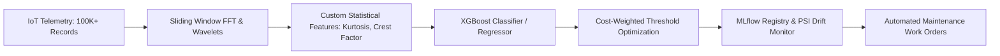
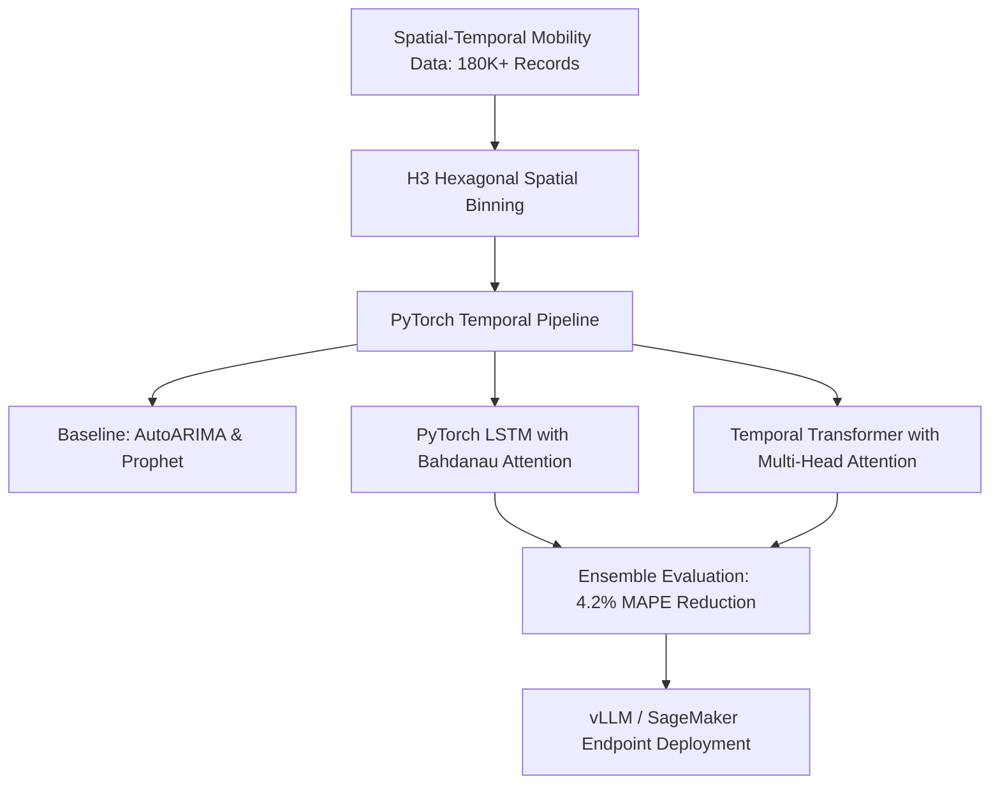
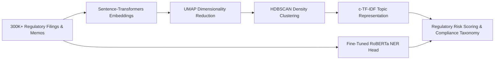
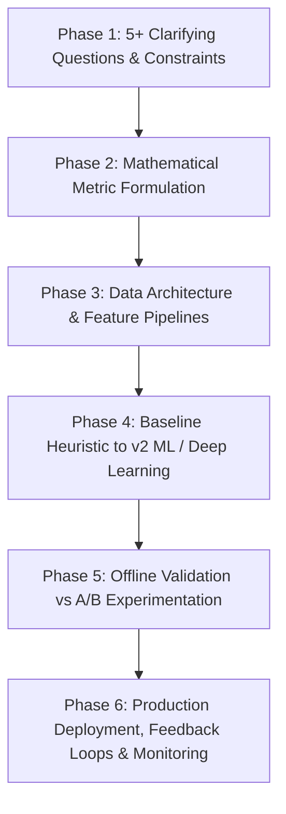
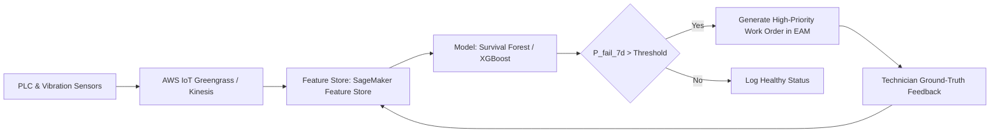
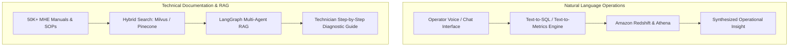
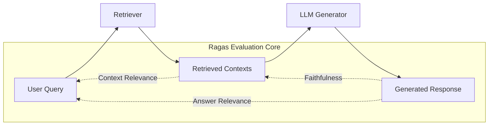
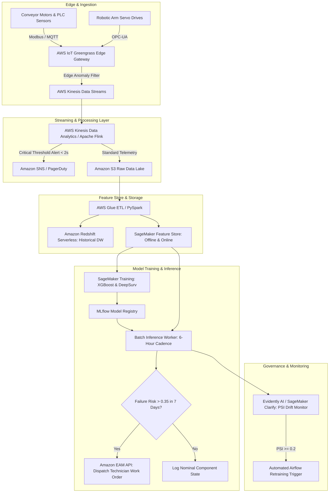

# Amazon Worldwide Design Engineering (WWDE) — Data Scientist II Onsite Loop Preparation Guide
**Candidate**: Haritha Anand | **Role**: Data Scientist II (Job ID: 10521209) | **Org**: Worldwide Fulfillment Design & Engineering (WWDE)
**Location**: Bellevue, WA / Onsite Loop | **Format**: 5 Sessions (Science Depth, Science Application, Coding/Problem Solving, GenAI Fluency, Leadership Principles)

---

## Executive Overview & Interview Blueprint

You are interviewing for the **Data Scientist II** role within Amazon's **Worldwide Design Engineering (WWDE)** organization. WWDE sits at the cross-section of data science, high-performance physical operations, and advanced industrial automation. You are not building detached toy models; you are developing machine learning, mathematical optimization, and statistical systems that govern **Amazon's global fulfillment center network of tomorrow**.

### Interview Loop Architecture (5 One-Hour Rounds)
1. **Round 1: Science Depth**: Deep dive into your past modeling decisions, mathematical formulation, loss functions, custom feature engineering, and trade-offs. (Grounded in your **Honeywell** IoT XGBoost anomaly detection, **Uber** PyTorch demand forecasting, and **KPMG** BERTopic/NER work).
2. **Round 2: Science Application**: End-to-end problem framing under ambiguity. Clarifying questions, metric trees, data pipelines, baseline heuristic vs. ML, offline validation, and production feedback loops. (Focus on warehouse throughput drops, MHE predictive maintenance, and operational dashboards).
3. **Round 3: Coding & Problem Solving (LiveCode)**: Writing clean Python and SQL code in real-time without an IDE or compiler. (SQL window functions, CTEs, lag/lead, numpy ML from scratch, sliding window, heaps, dynamic programming).
4. **Round 4: GenAI Fluency**: Pragmatic application of foundation models, RAG, and multi-agent workflows to physical operations. Ragas evaluation, hallucination guardrails, and when classical ML beats GenAI.
5. **Round 5: Amazon Leadership Principles**: Strict **STAR** behavioral evaluation across 11 key principles with quantified metrics, first-person ownership, and lessons learned.

---

## 1. Science Depth: Deep-Dive Technical Mastery

The **Science Depth** interview probes the exact mathematical, algorithmic, and operational trade-offs you made in your past machine learning systems. At **Amazon WWDE (Worldwide Design Engineering)**, science solutions operate at the physical nexus of robotics, industrial automation, and high-throughput material handling. The interviewer will test whether you truly own the math, the feature engineering, the boundary failures, and the production MLOps choices.

---

### Deep Dive 1: XGBoost IoT Sensor Anomaly Detection for Industrial Equipment (Honeywell)

#### Context & Architecture
At **Honeywell**, you engineered an equipment degradation and anomaly detection platform processing over **100,000+ IoT sensor telemetry records** (accelerometers, thermocouples, pressure transducers, vibration spectral density) across industrial equipment.



#### Custom Feature Engineering (Physics-Informed & Time-Frequency Domains)
Rather than feeding raw high-frequency time-series directly into tree-based algorithms, you engineered domain-specific representations:
1. **Time-Domain Statistical Moments**:
   - **Rolling Root Mean Square (RMS)**: Measures overall energy and mechanical vibration severity ($RMS = \sqrt{\frac{1}{N}\sum_{i=1}^N x_i^2}$).
   - **Kurtosis ($4^{th}$ standardized moment)**: Sensitive to impulsive bearing impacts and early-stage crack propagation ($Kurtosis = \frac{\frac{1}{N}\sum (x_i - \bar{x})^4}{\sigma^4}$). A healthy machine exhibits kurtosis $\approx 3.0$; spalling or tooth breakage pushes kurtosis $> 6.0$.
   - **Crest Factor**: $\frac{x_{peak}}{RMS}$, signaling high-energy transient spikes relative to nominal operation.
   - **Skewness ($3^{rd}$ moment)**: Identifies asymmetrical mechanical wear or unbalance.
2. **Frequency-Domain Features via Fast Fourier Transform (FFT)**:
   - Partitioned the frequency spectrum into distinct operational bands: Sub-synchronous ($0.1\times - 0.9\times$ RPM, detecting oil whirl), Synchronous ($1\times$ RPM, detecting unbalance), Harmonic ($2\times - 5\times$ RPM, detecting misalignment and looseness), and High-Frequency ($>10\times$ RPM, detecting gear mesh and bearing raceway faults).
   - Computed **Spectral Entropy** and **Spectral Energy Ratios** across these frequency bins.
3. **Operational State Normalization**:
   - Motor vibration is confounded by motor load and RPM. You engineered **Normalized Vibration Indices**: $\tilde{V} = \frac{V_{measured}}{f(RPM, Load_{kW})}$. Without this normalization, a normal surge in warehouse conveyor throughput would trigger a false positive degradation alarm.

#### Statistical Model Evaluation & Imbalance Handling
- **The Imbalance Challenge**: Less than **0.3%** of historical sensor records corresponded to actual mechanical failure events.
- **Resampling & Loss Weighting**: Evaluated SMOTE vs. Cost-Sensitive Loss. SMOTE in high-dimensional frequency space created unphysical synthetic transients. You chose **`scale_pos_weight = (count(negative) / count(positive))`** directly in the XGBoost objective function ($\approx 330.0$).
- **Precision-Recall AUC (PR-AUC) vs ROC-AUC**: ROC-AUC was misleadingly high ($0.985$) because the massive true negative pool masked false alarms. You selected **PR-AUC** as the primary optimization metric, reaching $0.884$ PR-AUC.
- **Cost-Weighted Threshold Optimization**:
  - False Positive ($FP$): Maintenance technician inspects healthy equipment $\rightarrow$ Cost $\approx \$150$ in labor.
  - False Negative ($FN$): Unplanned catastrophic conveyor failure during peak shift $\rightarrow$ Cost $\approx \$45,000$ in downtime and delayed package SLA.
  - Formulated the decision threshold $\theta^*$ via cost minimization:
    $$\theta^* = \arg\min_\theta \left( C_{FP} \cdot FP(\theta) + C_{FN} \cdot FN(\theta) \right)$$
  - This positioned the optimal operational threshold at $\theta = 0.28$, maintaining an operational **Recall of 94.2%** while capping the **False Positive Rate under 1.8%**.

#### Why XGBoost Over Alternatives?
- **vs. Deep Autoencoders**: Autoencoder reconstruction error was sensitive to ambient thermal drift and required GPU inference infrastructure ($4\times$ cloud cost). XGBoost yielded millisecond inference on **AWS Lambda** (CPU).
- **vs. Isolation Forest**: Isolation Forest is unguided by failure history, triggering excessive false alarms on novel but benign operating speeds. XGBoost supervised learning leveraged sparse historical failure tickets effectively.
- **vs. One-Class SVM**: Poor scaling beyond 50K samples; $\mathcal{O}(N^2)$ to $\mathcal{O}(N^3)$ computational complexity made retraining prohibitive.

#### Production Drift Monitoring via PSI
To guard against sensor calibration decay and mechanical drift, you implemented **Population Stability Index (PSI)** on inference feature distributions:
$$PSI = \sum_{k=1}^B \left( P_{actual}(k) - P_{expected}(k) \right) \times \ln\left(\frac{P_{actual}(k)}{P_{expected}(k)}\right)$$
- $PSI < 0.1$: Distribution stable, no action.
- $0.1 \le PSI < 0.2$: Moderate shift; flag for engineering review.
- $PSI \ge 0.2$: Severe drift; trigger automated retraining workflow via **Airflow** and **MLflow**.

---

### Deep Dive 2: Demand Forecasting with PyTorch LSTMs & Transformers (Uber)

#### Context & Architecture
At **Uber**, you developed time-series demand forecasting models across **180,000+ mobility records** and spatial clusters, driving ride-allocation efficiency and reducing **Mean Absolute Percentage Error (MAPE)** by **4.2%**, resolving **12 major operational ride-allocation bottlenecks**.



#### Why Deep Learning Over Classical Methods (ARIMA, Prophet)?
- **ARIMA Limitations**: Assumes stationary linear processes. Mobility demand involves non-linear cross-series dependencies (e.g., flight arrival surges at an airport propagating into city center hotel drop-offs 45 minutes later). Fitting 1,000+ localized ARIMA models created huge operational overhead and completely missed cross-zone spatial covariance.
- **Prophet Limitations**: Prophet decomposes time-series into trend, seasonality, and holidays using Fourier terms. It assumes independent additive or multiplicative components and cannot ingest dynamic external covariates with lag structures (e.g., precipitation intensity starting 20 minutes ago combined with transit strike alerts).
- **The PyTorch Deep Learning Solution**: Designed a hybrid architecture capturing:
  1. High-frequency local temporal auto-regressive patterns.
  2. Multi-horizon spatial-temporal dependencies via **H3 Hexagonal Spatial Binning** (Uber H3 Index at resolution 8).

#### How the Transformer Attention Mechanism Worked
Implemented a **Temporal Transformer** with **Multi-Head Self-Attention**:
1. **Input Representation**: For each spatial zone $i$ at time $t$, input vector $x_{i,t} \in \mathbb{R}^d$ encoded: historical trip demand, rolling completion rate, weather vectors, surge price ratio, calendar embeddings, and spatial graph Laplacian positional encodings.
2. **Self-Attention Formulation**:
   $$Attention(Q, K, V) = \text{softmax}\left(\frac{QK^T}{\sqrt{d_k}} + M\right)V$$
   - Where queries $Q$, keys $K$, and values $V$ were linear projections of historical lookback windows ($T = 168$ hours).
   - $M$ is a **causal masking matrix** where $M_{ij} = -\infty$ for $j > i$, preventing information leakage from future time steps during autoregressive multi-horizon forecasting ($t+1$ to $t+24$ hours).
3. **Why Attention Drove the 4.2% MAPE Drop**:
   - Classical LSTMs suffer from catastrophic forgetting over long sequences ($>72$ time steps) as hidden state vector $h_t$ squashes past context.
   - Self-attention created direct pairwise pathways across all 168 lookback hours. The model learned to attend specifically to the **exact same hour 7 days prior** (weekly seasonality) while dynamically modulating attention weights when sudden weather events or stadium games broke standard periodicity.

#### Scale & Low-Latency Deployment
- Models were trained on distributed GPU clusters using **PyTorch DDP (Distributed Data Parallel)** with PySpark feature generation on **Snowflake**.
- Inference was containerized with **Docker** and deployed via **AWS SageMaker**. To serve low-latency ride-allocation dispatch systems ($<25$ms p99 SLA), forecasts were pre-computed in 5-minute rolling micro-batches and cached in **Redis**.

---

### Deep Dive 3: BERTopic & Named Entity Recognition for Regulatory Intelligence (KPMG)

#### Context & Architecture
At **KPMG**, you analyzed over **300,000+ unstructured regulatory documents, compliance filings, and audit memos** using fine-tuned **Hugging Face Transformers**, **BERTopic**, and **Named Entity Recognition (NER)**.



#### How BERTopic Works (The 4-Step Pipeline)
1. **Document Embedding**: Ingested regulatory text chunks ($256$ tokens with $32$-token overlap) into `sentence-transformers/all-mpnet-base-v2`, mapping documents to 768-dimensional dense semantic vectors.
2. **Dimensionality Reduction via UMAP (Uniform Manifold Approximation and Projection)**:
   - High-dimensional vector spaces suffer from the curse of dimensionality, where distance metrics become equidistant.
   - Reduced 768-D embeddings down to **5 dimensions** using UMAP with cosine metric ($n\_neighbors = 15$, $min\_dist = 0.05$). UMAP preserves both local and global manifold topology far better than t-SNE or PCA.
3. **Density-Based Clustering via HDBSCAN**:
   - Unlike K-Means, HDBSCAN does not force every document into an arbitrary cluster and does not require pre-specifying $K$.
   - Identified organic compliance topics while segregating generic boilerplates as noise ($min\_cluster\_size = 30$).
4. **Class-based TF-IDF (c-TF-IDF)**:
   - Standard TF-IDF evaluates word importance across individual documents. c-TF-IDF treats all documents in a cluster as a single meta-document:
     $$W_{t, c} = tf_{t, c} \times \ln\left(1 + \frac{A}{tf_t}\right)$$
   - Where $tf_{t, c}$ is the frequency of word $t$ in cluster $c$, $tf_t$ is the total frequency of word $t$ across all clusters, and $A$ is the average number of words per cluster. This extracted precise regulatory terminology (e.g., "capital adequacy ratio", "IFRS 9 impairment") rather than common financial stop words.

#### BERT Embeddings vs. Classical TF-IDF
- **TF-IDF**: Sparse bag-of-words representation; zero semantic awareness of synonyms or word order ("asset write-down" and "impairment charge" share zero vector overlap in TF-IDF).
- **BERT**: Dense bidirectional contextual embeddings; words are dynamically contextualized based on surrounding sentence syntax.

#### Custom NER for Regulatory Extraction
- Fine-tuned `roberta-base` with a token classification head (`AutoModelForTokenClassification`) to extract domain entities: `REGULATORY_BODY`, `PENALTY_AMOUNT`, `COMPLIANCE_DEADLINE`, `MANDATED_CONTROL`.
- Achieved **F1-score of 91.4%** across holdout test sets, accelerating compliance audit risk assessments from **weeks to under 24 hours**.

---

### Deep Dive 4: Technical Failures & Dead Ends (What Failed, Why, and Lessons Learned)

Having real "dead ends" demonstrates engineering maturity and integrity. Be prepared to discuss these 3 specific failures:

1. **Failure 1: Naive K-Means Clustering on Raw Accelerometer Spectrograms (Honeywell)**
   - *Attempt*: In an early prototype for IoT anomaly detection, attempted to cluster raw 1024-point FFT spectral slices using K-Means to discover unlabelled machine operating regimes.
   - *Why It Failed*: K-Means assumes isotropic (spherical) Euclidean clusters of equal variance. Motor speeds fluctuate continuously by $\pm 2\%$, causing spectral peaks to jitter horizontally along the frequency axis. Euclidean distance between two identical harmonic profiles with a $2$ Hz shift was larger than the distance between two completely different broken profiles.
   - *Lesson & Fix*: Shifted away from raw frequency vector clustering to invariant statistical features (Kurtosis, Spectral Energy Ratios) and applied 1D Convolutional layers combined with supervised XGBoost once historical labels were curated.

2. **Failure 2: Unconstrained Prophet Modeling on High-Frequency Micro-Mobility Demand (Uber)**
   - *Attempt*: Deployed Facebook Prophet for rapid baseline forecasting of micro-mobility (scooters/short-ride) demand at a 15-minute granularity.
   - *Why It Failed*: Prophet’s default additive trend model overfit to short-term noise and produced negative demand predictions during late-night hours. Furthermore, Prophet treats holidays and exogenous regressors as static linear offsets; when heavy rain coincided with a Friday evening rush hour, the actual demand dropped precipitously due to supply collapse (drivers went offline), whereas Prophet added historical rainy-day demand and predicted a massive surge, resulting in critical allocation errors.
   - *Lesson & Fix*: Realized demand is bounded and non-linear. Adopted PyTorch LSTM with zero-inflated Poisson loss and multi-covariate attention that explicitly modelled supply-demand equilibrium interactions.

3. **Failure 3: Zero-Shot Large Language Model Regulatory Extraction Without Guardrails (KPMG / R&D)**
   - *Attempt*: Tested zero-shot GPT-3.5 prompt extraction to identify compliance deadlines and penalty clauses directly from financial filings.
   - *Why It Failed*: Regulatory filings use highly complex conditional phrasing ("Subject to subsection B, penalties not exceeding $5M shall apply unless rectified within 30 days of notice"). The LLM hallucinated unconditional penalties on 14% of sample clauses and inverted timeline conditions. Furthermore, inference costs across 300K+ filings were estimated at $>\$40,000$ with significant token latency.
   - *Lesson & Fix*: Small, fine-tuned domain models beat massive generalist LLMs on structured extraction. Fine-tuned RoBERTa token classification had zero hallucination, 100x lower latency, and cost zero ongoing token fees.

---

## 2. Science Application: Amazon Fulfillment Network Scenarios

In the **Science Application** interview, Amazon assessors give you ambiguous, open-ended operational problems. You must **never jump straight to an algorithm**. Follow the strict **6-Phase Amazon Science Application Framework**:



---

### Scenario 1: Warehouse Throughput Drops 15% During Specific Shifts

#### The Scenario
> *"A fulfillment center General Manager reports that overall package throughput (units packed and dispatched per hour - UPH) drops by 15% during certain shifts, but the operations team cannot identify the root cause. How would you approach this problem from end to end?"*

#### Phase 1: Clarifying Questions & Scoping
1. **Scope & Consistency**: Does this 15% drop occur across all fulfillment center (FC) types (e.g., AR Sortable vs. Non-Sortable vs. Cross-Dock) or is it isolated to specific regional buildings?
2. **Shift Pattern**: Is the drop tied to fixed schedules (e.g., Day vs. Night shift, Weekend vs. Weekday, change-of-shift handover windows)?
3. **Upstream vs. Downstream**: Is the bottleneck at Inbound (Decant, Stow), Core (Pick, Pack), or Outbound (SLAM, Sorter, Shipping Dock)?
4. **Data Availability**: Do we have high-resolution event logs from Warehouse Management Systems (WMS), time-stamped barcode scans, labor badge-in/out records, and conveyor PLC (Programmable Logic Controller) photo-eye tracking?
5. **Success Metric**: Is the goal purely identifying the causal driver, or building a real-time bottleneck prediction and alerting engine? Target: Restore UPH by $\ge 12\%$ within 60 days.

#### Phase 2: Formulating Metrics
- **Primary Metric**: **Units Per Hour (UPH)** = $\frac{\text{Total Packages Dispatched}}{\text{Labor Hours Expended}}$.
- **Diagnostic Decomposition Metrics**:
  - **Takt Time**: Pace of customer demand per workstation.
  - **Dwell Time / Buffer Accumulation**: Time inventory sits on accumulation conveyors between stations.
  - **Starvation Rate**: % of time downstream packers are waiting for pickers/totes.
  - **Blockage Rate**: % of time upstream pickers cannot induct totes because the takeaway conveyor is full.
  - **OEE (Overall Equipment Effectiveness)**: Availability $\times$ Performance $\times$ Quality.

#### Phase 3: Data Engineering & Hypothesis Testing
Using **SQL (Amazon Redshift)** and **PySpark**, ingest and join:
1. `wms_scan_events`: Worker ID, Timestamp, Location ID, SKU, Action Type (Pick, Pack, SLAM).
2. `conveyor_telemetry`: Sorter line speed, photo-eye blockage flags, motor fault codes.
3. `labor_management_system`: Staffing levels per zone, tenure/experience index, break schedules.
4. `inventory_mix`: Item dimensions, cube weight, hazmat classification, fragile items.

**Root-Cause Hypotheses via Statistical Testing**:
- *Hypothesis A (Labor Skill/Tenure)*: Night shifts have a higher ratio of seasonal temporary associates with lower pick rates.
  - *Test*: Two-way ANOVA comparing UPH across Shift $\times$ Associate Tenure brackets.
- *Hypothesis B (Mechanical Micro-Stoppages)*: Unplanned micro-stoppages ($<60$ seconds) on cross-belt sorters compound during high-inflow shifts.
  - *Test*: Survival analysis and Weibull renewal modeling on conveyor photo-eye blockage durations.
- *Hypothesis C (Inventory / SKU Profile Mismatch)*: Heavy/bulky items scheduled during specific shifts cause physical conveyor jams.
  - *Test*: Multivariate regression of UPH against SKU volumetric distribution ($P_{90}$ Package Dimensions).

#### Phase 4: Modeling Architecture (Baseline to v2)
- **v0 Baseline**: Simple descriptive statistical dashboard in **Tableau** isolating UPH variance by shift, tenure, and building zone.
- **v1 Causal Inference**: **Double Machine Learning (EconML / CausalML)** or **Synthetic Control Method** to isolate the true causal effect of staffing allocation vs. equipment downtime while controlling for SKU mix.
- **v2 Predictive Bottleneck Engine**: Train a **LightGBM / XGBoost Regressor** predicting real-time throughput 30 minutes in advance using rolling buffer fullness, upstream pick rate, and active workstation count. If predicted UPH drops $>10\%$, trigger automated dynamic tote diversion.

#### Phase 5: Operational Recommendations & Monitoring
- **Automated Root Cause**: If the model reveals that shift handover causes a 45-minute starvation wave on pack lines due to staggered breaks, implement **staggered lunch scheduling algorithms**.
- **Monitoring**: Real-time dashboard tracking rolling 15-minute UPH and **CUSUM (Cumulative Sum Control Chart)** anomaly detection to alert area managers within 5 minutes of a throughput deviation.

---

### Scenario 2: Predictive Maintenance for Material Handling Equipment (MHE) Next Week

#### The Scenario
> *"You are asked to design a machine learning system that predicts which Material Handling Equipment (conveyor motors, diverters, automated guided vehicles - AGVs, or robotic arm joints) in an Amazon Fulfillment Center will fail within the next 7 days. How do you design this end to end?"*

#### Phase 1: Clarifying Questions & Constraints
1. **Asset Granularity**: Are we predicting failure for entire conveyor subsystems or individual components (bearings, gearboxes, drive belts, servo drives)?
2. **Telemetry Ingestion**: What is the sampling frequency? High-frequency vibration ($10$ kHz), low-frequency PLC status registers ($1$ Hz), or periodic maintenance logs?
3. **Definition of Failure**: Does failure mean functional breakdown (stopped conveyor line) or performance degradation (e.g., motor drawing $20\%$ excess current or running at reduced speed)?
4. **Maintenance Lead Time**: Why 7 days? (Because maintenance shifts and spare parts procurement are planned weekly). What is the cost of False Positives vs False Negatives?
5. **Feedback Loop**: When a technician inspects an asset flagged by the model, how is their diagnostic confirmation captured back into the training store?

#### Phase 2: Problem Formulation (Survival Analysis vs. Binary Classification)
Rather than framing this as naive binary classification (Fail / Not Fail in 7 days), frame it as **Remaining Useful Life (RUL) Estimation** combined with **Time-to-Event Survival Analysis**:
- **Objective Function**: Estimate the hazard function $\lambda(t | X)$ representing the instantaneous rate of failure at time $t$ given telemetry features $X$.
- Model: **Cox Proportional Hazards with Deep Neural Networks (DeepSurv)** or **Random Survival Forests**.
- Output: The cumulative failure probability $P(T \le t + 7\text{ days} | T > t)$.

#### Phase 3: Feature Engineering
1. **Vibration Spectrum**: RMS velocity, peak-to-peak acceleration, crest factor, energy in fault frequency bands (ball pass frequency outer/inner race: BPFO, BPFI).
2. **Thermal Dynamics**: Motor winding temperature, $\Delta T = T_{motor} - T_{ambient}$, rate of temperature rise per throughput unit.
3. **Electrical Signature Analysis**: Current unbalance, active power factor, total harmonic distortion (THD).
4. **Operational Stress Accumulation**: Cumulative running hours since last overhaul, total tonnage transported over the last 14 days, number of hard emergency-stop (E-Stop) cycles.

#### Phase 4: Architecture & Pipeline


#### Phase 5: Success Metrics & Business Value
- **Technical Metrics**: **Precision@K** (of the top 20 assets flagged each week, how many actually exhibited degradation during inspection?), **Recall** ($\% $ of unplanned outages prevented), **Lead Time Accuracy** (did the failure occur within the 7-day planning window?).
- **Business Impact**: Reduction in **Unplanned Downtime Hours** (target: $30\%$ reduction), savings in emergency overtime labor costs, and zero customer package delivery SLA breaches due to sortation failures.

---

### Scenario 3: Executive Operational Performance Dashboard & Reliable Pipeline

#### The Scenario
> *"A VP of Worldwide Engineering asks for an executive dashboard to monitor operational performance across 150+ fulfillment centers. How do you determine which metrics matter, and how do you architect the data pipeline to guarantee sub-minute freshness and 99.99% reliability?"*

#### Key Execution Strategy
1. **Determining What Metrics Matter (The Pyramid Hierarchy)**:
   - **Executive Tier (L8+)**: Network Throughput (Total Units Dispatched/Day), Cost per Unit (CPU), Network SLA Compliance ($\text{On-Time Delivery} \ge 99.2\%$), Total Network Lost Hours due to MHE Downtime.
   - **Regional / General Manager Tier (L7)**: Building UPH vs Plan, WIP (Work In Progress) Inventory Dwell Time, Sorter Jam Rates, Truck Turnaround Times at Inbound/Outbound Docks.
   - **Operations / Area Manager Tier (L5/L6)**: Workstation Starvation %, Associate Utilization, Real-Time Chokepoints.
2. **Data Pipeline Architecture**:
   - **Ingestion**: Event-driven streaming using **Amazon MSK (Managed Streaming for Kafka)** and **AWS Kinesis**.
   - **Processing**: Structured Streaming via **Apache Spark (EMR / Databricks)** for real-time aggregation (1-minute sliding windows), outputting to **Amazon Redshift Serverless** for high-concurrency SQL queries.
   - **Caching Layer**: Pre-aggregated metric snapshots cached in **Amazon ElastiCache (Redis)** to power the executive UI with sub-second page loads.
3. **Data Reliability & Governance**:
   - **Data Contracts**: Schema validation at ingestion using **JSON Schema / Protocol Buffers**; invalid payloads routed to a Dead-Letter Queue (DLQ) in S3.
   - **Great Expectations / Deequ (AWS)**: Automated data quality checks run every 15 minutes: null value rate $< 0.01\%$, timestamp monotonicity, range validity ($UPH \ge 0$).
   - **SLA & Alerting**: **PagerDuty** integrations alert the data on-call engineer if ingestion latency exceeds 3 minutes.

---

## 3. GenAI Fluency: Generative AI & LLMs in Fulfillment Engineering

While your core role as a Data Scientist on the **WWDE** team centers on operational optimization and machine learning, Amazon interviewers want to see how you leverage frontier **Generative AI** to accelerate engineering workflows, eliminate manual friction, and augment operational decision-making.

---

### 1. High-Impact Applications of GenAI in Fulfillment Operations



1. **Intelligent MHE Troubleshooting Assistant (RAG on Technical Manuals)**:
   - *Problem*: Technicians across 150+ FCs service thousands of different conveyor, sorter, and robotic equipment models. Finding the right troubleshooting flowchart across 50,000+ PDF manuals wastes hours of line downtime.
   - *Solution*: A specialized **Retrieval-Augmented Generation (RAG)** system using **LlamaIndex**, **Milvus**, and **Anthropic Claude / Amazon Bedrock**. Technicians speak an error code or symptoms into a handheld device, and the system retrieves the exact wiring diagram, schematic, and calibrated torque specifications with page-level citations.
2. **Text-to-SQL Operational Metric Discovery**:
   - Allows warehouse shift managers to ask natural-language questions: *"Which pack lines in North Hall experienced a blockage rate over 10% in the last 2 hours?"*
   - Translates questions into validated **Redshift SQL**, executes the query against read replicas, and synthesizes the result into a concise executive summary.
3. **Automated Shift Handoff & Incident Debrief Generation**:
   - Collects all anomaly events, downtime tickets, and throughput dips across a 10-hour shift.
   - Uses an LLM agent to summarize key operational anomalies, pending equipment repairs, and priority action items for the incoming shift manager.

---

### 2. Decision Matrix: Prompting vs. RAG vs. Fine-Tuning

| Criterion | In-Context Prompting | Retrieval-Augmented Generation (RAG) | Fine-Tuning (LoRA / QLoRA) |
| :--- | :--- | :--- | :--- |
| **Primary Use Case** | Generalized reasoning, standard summarization, few-shot formatting. | Dynamic internal knowledge, technical manuals, live warehouse operational data. | Domain-specific syntax, proprietary query languages, style alignment, extreme latency reduction. |
| **Knowledge Update Cadence** | Static (Frozen at training cutoff). | **Real-time / Instantaneous** (Update vector database index immediately). | Periodic (Requires retraining pipeline). |
| **Hallucination Risk** | High for domain specifics. | **Low** (Grounded in retrieved context with citations). | Moderate (Can still generate fluent untruths). |
| **Data Privacy & Governance** | Data sent in prompt payload. | Granular role-based access control (RBAC) at document/vector chunk level. | Embedded in model weights (Hard to erase). |
| **Cost & Latency** | Lowest setup cost; higher per-token latency for long prompts. | Moderate setup cost; fast vector search ($\approx 15$ms) + LLM synthesis. | High training cost; lowest inference latency per token (small specialized model). |
| **When to Choose** | Rapid prototyping or one-off tasks. | **Warehouse SOPs, equipment manuals, dynamic inventory policies.** | **Specialized internal DSLs, code generation, ultra-low-latency classification.** |

---

### 3. Evaluating Generative Outputs Rigorously (The Ragas Framework)

Drawing from your direct experience at **Honeywell** hitting **92% retrieval precision** across 50K+ technical manuals:



1. **Context Precision**: Evaluates whether all ground-truth relevant information in retrieved chunks is ranked at the top. Measures signal-to-noise ratio in vector retrieval.
2. **Context Recall**: Evaluates whether the retriever retrieved all necessary information required to answer the query.
3. **Faithfulness (Grounding)**: Measures the proportion of claims in the generated answer that can be inferred directly from the context. Prevents hallucination.
   $$\text{Faithfulness} = \frac{|\text{Number of claims in answer supported by context}|}{|\text{Total claims in answer}|}$$
4. **Answer Relevance**: Measures whether the generated output actually addresses the user's operational question rather than deflecting or rambling.

---

### 4. Production Guardrails, Latency, & Classical vs. GenAI Trade-Offs

- **NeMo Guardrails & Safety**:
  - Implement input rails to block prompt injection (e.g., an associate trying to bypass system policies).
  - Implement output rails that verify that the generated maintenance recommendation strictly complies with OSHA and Amazon safety protocols before displaying it to the technician.
- **Latency Optimization**:
  - Deploy quantized models (**AWQ / GPTQ 4-bit**) using **vLLM** with **PagedAttention** and continuous batching.
  - Implement **Semantic Caching** using Redis: if another technician asks an identical troubleshooting question for the same sorter model, serve the verified cached response in $<10$ms.
- **When NOT to Use an LLM**:
  - **Never use an LLM for numerical time-series forecasting or real-time conveyor speed control**. Tree-based algorithms (XGBoost) and classical control theory (PID / Kalman Filters) are deterministic, mathematically provable, cost a fraction of a cent, and execute in under $2$ milliseconds with zero hallucination risk.


## 4. Coding & Problem Solving: 21 LiveCode Questions

In Amazon’s **LiveCode** platform, candidates write code in real time without access to an IDE or code execution. The interviewer observes your thought process, algorithmic clarity, edge-case handling, and ability to derive machine learning math from first principles.

---

### Problem 1: [SQL / Redshift] Consecutive Event Gaps & Threshold Flagging

#### Problem Statement
In an **Amazon Fulfillment Center**, automated package scanners log barcode reading events. Given a table `scanner_events (event_id INT, category VARCHAR, scanned_at TIMESTAMP)`, write a **Redshift SQL** query to:
1. Calculate the time elapsed (in seconds) between consecutive scan events for each category.
2. Compute the average gap between consecutive events per category.
3. Flag any specific event where the gap between consecutive events exceeds $3\times$ the category average gap (indicating a potential conveyor jam or scanner failure).

#### Thought Process
1. Use the **`LAG()`** window function partitioned by `category` and ordered by `scanned_at` to access the timestamp of the immediately preceding event.
2. In **Amazon Redshift**, subtract timestamps or use **`DATEDIFF('second', prev_time, curr_time)`** to obtain elapsed seconds.
3. Compute the per-category average gap across all consecutive transitions using an aggregate or window function **`AVG(gap_seconds) OVER (PARTITION BY category)`**.
4. In an outer query or CTE, evaluate the condition `gap_seconds > 3.0 * avg_category_gap` and produce the flagged record with its corresponding ratio.
5. Handle edge cases: the first event in any category has no preceding event (`LAG` is `NULL`), so it must be excluded from the gap evaluation.

#### Code (SQL - Amazon Redshift)
```sql
-- Step 1: Compute consecutive event gaps using LAG()
WITH EventGaps AS (
    SELECT
        event_id,
        category,
        scanned_at,
        LAG(scanned_at, 1) OVER (
            PARTITION BY category 
            ORDER BY scanned_at ASC
        ) AS prev_scanned_at,
        -- Calculate gap in seconds between consecutive events
        DATEDIFF('second', 
            LAG(scanned_at, 1) OVER (PARTITION BY category ORDER BY scanned_at ASC), 
            scanned_at
        ) AS gap_seconds
    FROM scanner_events
),
-- Step 2: Compute category-level average gap
CategoryAverages AS (
    SELECT
        event_id,
        category,
        scanned_at,
        gap_seconds,
        AVG(gap_seconds * 1.0) OVER (
            PARTITION BY category
        ) AS avg_category_gap
    FROM EventGaps
    WHERE gap_seconds IS NOT NULL -- Exclude first record of each category
)
-- Step 3: Flag events where gap exceeds 3x category average
SELECT
    event_id,
    category,
    scanned_at,
    gap_seconds,
    ROUND(avg_category_gap, 2) AS avg_category_gap,
    ROUND(gap_seconds / NULLIF(avg_category_gap, 0), 2) AS gap_to_avg_ratio,
    CASE 
        WHEN gap_seconds > (3.0 * avg_category_gap) THEN 1 
        ELSE 0 
    END AS is_anomaly_flag
FROM CategoryAverages
ORDER BY category, scanned_at;
```

#### Complexity Analysis
- **Time Complexity**: $\mathcal{O}(N \log N)$, where $N$ is the total number of scanner events. The bottleneck is sorting the dataset within the window partitions.
- **Space Complexity**: $\mathcal{O}(N)$ scratch space for sorting and computing window aggregations across partitions.

---

### Problem 2: [SQL / Redshift] Sorter Station Running Sum & Rolling 1-Hour Throughput

#### Problem Statement
Given a table `sorter_telemetry (station_id INT, reading_time TIMESTAMP, units_sorted INT)`, write a query to compute:
1. The **cumulative running total** of units sorted by each station since the start of the day.
2. The **rolling 1-hour throughput** (sum of units sorted in the preceding 60 minutes, inclusive of the current reading).
3. Identify the peak rolling 1-hour throughput recorded for each station.

#### Thought Process
1. Cumulative daily total uses **`SUM(units_sorted) OVER (PARTITION BY station_id, TRUNC(reading_time) ORDER BY reading_time ROWS BETWEEN UNBOUNDED PRECEDING AND CURRENT ROW)`**.
2. For rolling time-based windows in Redshift, timestamp ranges can be represented either via **`RANGE BETWEEN INTERVAL '1 HOUR' PRECEDING AND CURRENT ROW`** (if supported by the dialect version) or via an explicit **self-join** on `reading_time BETWEEN t.reading_time - INTERVAL '1 HOUR' AND t.reading_time`. Using window functions with self-join or standardized range syntax guarantees high compatibility.
3. Compute the maximum of this rolling metric per station using **`DENSE_RANK()`** or windowed **`MAX()`**.

#### Code (SQL - Amazon Redshift)
```sql
-- Step 1: Base table with cumulative running total
WITH CumulativeMetrics AS (
    SELECT
        station_id,
        reading_time,
        units_sorted,
        -- Running sum from beginning of shift/day
        SUM(units_sorted) OVER (
            PARTITION BY station_id, TRUNC(reading_time)
            ORDER BY reading_time ASC
            ROWS BETWEEN UNBOUNDED PRECEDING AND CURRENT ROW
        ) AS cumulative_daily_units
    FROM sorter_telemetry
),
-- Step 2: Rolling 1-hour throughput calculation via Self-Join
RollingHourlyThroughput AS (
    SELECT
        c1.station_id,
        c1.reading_time,
        c1.units_sorted,
        c1.cumulative_daily_units,
        SUM(c2.units_sorted) AS rolling_1h_units
    FROM CumulativeMetrics c1
    INNER JOIN CumulativeMetrics c2
        ON c1.station_id = c2.station_id
        AND c2.reading_time BETWEEN (c1.reading_time - INTERVAL '1 hour') AND c1.reading_time
    GROUP BY
        c1.station_id,
        c1.reading_time,
        c1.units_sorted,
        c1.cumulative_daily_units
),
-- Step 3: Rank stations to find peak rolling 1-hour window
RankedThroughput AS (
    SELECT
        station_id,
        reading_time AS peak_reading_time,
        rolling_1h_units AS max_rolling_1h_throughput,
        DENSE_RANK() OVER (
            PARTITION BY station_id 
            ORDER BY rolling_1h_units DESC, reading_time ASC
        ) AS rank_order
    FROM RankedThroughput
)
SELECT
    station_id,
    peak_reading_time,
    max_rolling_1h_throughput
FROM RankedThroughput
WHERE rank_order = 1
ORDER BY max_rolling_1h_throughput DESC;
```

#### Complexity Analysis
- **Time Complexity**: $\mathcal{O}(N \log N)$ for the window function; $\mathcal{O}(N \cdot K)$ for the self-join where $K$ is the average number of readings per hour.
- **Space Complexity**: $\mathcal{O}(N)$ intermediate buffer storage in Redshift query memory.

---

### Problem 3: [SQL / Redshift] Sessionization of Warehouse Worker Scanning Activity

#### Problem Statement
Associate activity in a fulfillment center consists of item picks. Table `pick_logs (associate_id INT, scan_time TIMESTAMP, sku_id VARCHAR)`. An associate's continuous work period is interrupted if more than **15 minutes** elapse between consecutive scans. Write a query to assign a unique sequential `session_id` to each continuous working session per associate, and compute the total units picked and session duration.

#### Thought Process
1. This is a classic **Sessionization** problem.
2. Step 1: Use **`LAG(scan_time)`** partitioned by `associate_id` ordered by `scan_time`.
3. Step 2: Create an indicator variable `is_new_session = CASE WHEN DATEDIFF('minute', prev_scan_time, scan_time) > 15 OR prev_scan_time IS NULL THEN 1 ELSE 0 END`.
4. Step 3: Compute the cumulative sum of this flag: **`SUM(is_new_session) OVER (PARTITION BY associate_id ORDER BY scan_time ROWS BETWEEN UNBOUNDED PRECEDING AND CURRENT ROW)`**. This cumulative sum creates a unique increasing `session_number` for each continuous work bout!
5. Step 4: Group by `associate_id` and `session_number` to calculate session duration and item count.

#### Code (SQL - Amazon Redshift)
```sql
WITH ScanGaps AS (
    SELECT
        associate_id,
        scan_time,
        sku_id,
        LAG(scan_time) OVER (
            PARTITION BY associate_id 
            ORDER BY scan_time ASC
        ) AS prev_scan_time
    FROM pick_logs
),
SessionFlags AS (
    SELECT
        associate_id,
        scan_time,
        sku_id,
        CASE 
            WHEN prev_scan_time IS NULL THEN 1
            WHEN DATEDIFF('minute', prev_scan_time, scan_time) > 15 THEN 1
            ELSE 0 
        END AS is_new_session
    FROM ScanGaps
),
SessionAssigned AS (
    SELECT
        associate_id,
        scan_time,
        sku_id,
        -- Running sum of session boundaries assigns sequential session IDs
        SUM(is_new_session) OVER (
            PARTITION BY associate_id 
            ORDER BY scan_time ASC
            ROWS BETWEEN UNBOUNDED PRECEDING AND CURRENT ROW
        ) AS session_idx
    FROM SessionFlags
)
SELECT
    associate_id,
    session_idx,
    MIN(scan_time) AS session_start,
    MAX(scan_time) AS session_end,
    DATEDIFF('minute', MIN(scan_time), MAX(scan_time)) AS session_duration_minutes,
    COUNT(sku_id) AS total_units_picked,
    ROUND(COUNT(sku_id) * 60.0 / NULLIF(DATEDIFF('minute', MIN(scan_time), MAX(scan_time)), 0), 1) AS picks_per_hour
FROM SessionAssigned
GROUP BY associate_id, session_idx
ORDER BY associate_id, session_start;
```

#### Complexity Analysis
- **Time Complexity**: $\mathcal{O}(N \log N)$ driven by the window sort order.
- **Space Complexity**: $\mathcal{O}(N)$ for window state tracking.

---

### Problem 4: [SQL / Redshift] Markov Chain Transition Matrix of Equipment Error Codes

#### Problem Statement
Conveyor sorters generate fault codes during operation: `equipment_faults (conveyor_id INT, fault_time TIMESTAMP, fault_code VARCHAR)`. Amazon WWDE reliability engineers want to find the **top 3 most probable subsequent fault codes** that follow every given fault code, to determine if certain initial sensor warnings trigger catastrophic mechanical shutdowns.

#### Thought Process
1. Use **`LEAD(fault_code)`** partitioned by `conveyor_id` ordered by `fault_time` to find the immediate next fault.
2. Group by `(current_fault_code, next_fault_code)` to count the total transition frequency.
3. Compute the transition probability: `transition_count / SUM(transition_count) OVER (PARTITION BY current_fault_code)`.
4. Rank the subsequent transitions using **`DENSE_RANK()`** and filter for `rank <= 3`.

#### Code (SQL - Amazon Redshift)
```sql
WITH Transitions AS (
    SELECT
        conveyor_id,
        fault_code AS current_fault,
        LEAD(fault_code, 1) OVER (
            PARTITION BY conveyor_id 
            ORDER BY fault_time ASC
        ) AS next_fault
    FROM equipment_faults
),
ValidTransitions AS (
    SELECT
        current_fault,
        next_fault,
        COUNT(*) AS transition_frequency
    FROM Transitions
    WHERE next_fault IS NOT NULL
    GROUP BY current_fault, next_fault
),
TransitionProbabilities AS (
    SELECT
        current_fault,
        next_fault,
        transition_frequency,
        SUM(transition_frequency) OVER (PARTITION BY current_fault) AS total_initial_faults,
        ROUND(transition_frequency * 1.0 / SUM(transition_frequency) OVER (PARTITION BY current_fault), 4) AS transition_prob,
        DENSE_RANK() OVER (
            PARTITION BY current_fault 
            ORDER BY transition_frequency DESC
        ) AS prob_rank
    FROM ValidTransitions
)
SELECT
    current_fault,
    next_fault,
    transition_frequency,
    total_initial_faults,
    transition_prob
FROM TransitionProbabilities
WHERE prob_rank <= 3
ORDER BY current_fault, transition_prob DESC;
```

#### Complexity Analysis
- **Time Complexity**: $\mathcal{O}(N \log N)$ for the window function plus $\mathcal{O}(M \log M)$ where $M$ is the number of distinct transition pairs.
- **Space Complexity**: $\mathcal{O}(N)$ storage.

---

### Problem 5: [SQL / Redshift] Percentile and Median Package Dwell Time per Zone

#### Problem Statement
Given `package_tracking (package_id VARCHAR, zone_id VARCHAR, entry_time TIMESTAMP, exit_time TIMESTAMP)`, write a query to compute the **50th percentile (Median)**, **90th percentile ($P_{90}$)**, and **99th percentile ($P_{99}$)** dwell time (in minutes) for each warehouse zone, and flag zones where $P_{99} > 120$ minutes.

#### Thought Process
1. Dwell time in minutes is calculated as `DATEDIFF('minute', entry_time, exit_time)`.
2. Amazon Redshift supports **`PERCENTILE_CONT(0.50) WITHIN GROUP (ORDER BY dwell_minutes)`** as an inverse distribution function.
3. Group by `zone_id` and aggregate percentiles.

#### Code (SQL - Amazon Redshift)
```sql
WITH PackageDwell AS (
    SELECT
        package_id,
        zone_id,
        DATEDIFF('minute', entry_time, exit_time) AS dwell_minutes
    FROM package_tracking
    WHERE exit_time >= entry_time
)
SELECT
    zone_id,
    COUNT(package_id) AS total_packages_processed,
    ROUND(PERCENTILE_CONT(0.50) WITHIN GROUP (ORDER BY dwell_minutes), 2) AS p50_median_dwell_mins,
    ROUND(PERCENTILE_CONT(0.90) WITHIN GROUP (ORDER BY dwell_minutes), 2) AS p90_dwell_mins,
    ROUND(PERCENTILE_CONT(0.99) WITHIN GROUP (ORDER BY dwell_minutes), 2) AS p99_dwell_mins,
    CASE 
        WHEN PERCENTILE_CONT(0.99) WITHIN GROUP (ORDER BY dwell_minutes) > 120.0 THEN 'CRITICAL_BOTTLE_NECK'
        WHEN PERCENTILE_CONT(0.90) WITHIN GROUP (ORDER BY dwell_minutes) > 60.0 THEN 'WARNING_CONGESTION'
        ELSE 'HEALTHY_FLOW'
    END AS operational_zone_status
FROM PackageDwell
GROUP BY zone_id
ORDER BY p99_dwell_mins DESC;
```

#### Complexity Analysis
- **Time Complexity**: $\mathcal{O}(Z \cdot K \log K)$, where $Z$ is zones and $K$ is packages per zone (sorting required for exact continuous percentiles).
- **Space Complexity**: $\mathcal{O}(N)$ intermediate buffer memory.

---

### Problem 6: [Python / Scratch ML] Logistic Regression with L2 Regularization from Scratch

#### Problem Statement
Write a clean, production-grade Python implementation of **Logistic Regression** trained via **Batch Gradient Descent** from scratch using only **NumPy**. Implement the sigmoid activation, Binary Cross-Entropy loss with $L_2$ regularization (Ridge penalty), gradient computation, weight update, and prediction methods.

#### Thought Process
1. **Model Hypothesis**: $\hat{y} = \sigma(z) = \frac{1}{1 + e^{-z}}$, where $z = Xw + b$.
2. **Objective Function (Cost)**:
   $$J(w, b) = -\frac{1}{m} \sum_{i=1}^m \left[ y^{(i)} \log(\hat{y}^{(i)}) + (1 - y^{(i)}) \log(1 - \hat{y}^{(i)}) \right] + \frac{\lambda}{2m} \|w\|_2^2$$
3. **Gradients**:
   $$\frac{\partial J}{\partial w} = \frac{1}{m} X^T (\hat{y} - y) + \frac{\lambda}{m} w, \quad \frac{\partial J}{\partial b} = \frac{1}{m} \sum_{i=1}^m (\hat{y}^{(i)} - y^{(i)})$$
4. Add numerical stability clipping to sigmoid/log inputs to prevent $\log(0) \rightarrow -\infty$ or overflow.

#### Code (Python)
```python
import numpy as np

class ScratchLogisticRegression:
    def __init__(self, learning_rate: float = 0.01, num_iterations: int = 1000, 
                 l2_lambda: float = 0.1, fit_intercept: bool = True):
        self.lr = learning_rate
        self.num_iters = num_iterations
        self.l2_lambda = l2_lambda
        self.fit_intercept = fit_intercept
        self.weights = None
        self.bias = 0.0
        self.loss_history = []

    def _sigmoid(self, z: np.ndarray) -> np.ndarray:
        # Numerically stable sigmoid to prevent overflow
        z = np.clip(z, -500, 500)
        return 1.0 / (1.0 + np.exp(-z))

    def _compute_loss(self, y_true: np.ndarray, y_pred: np.ndarray) -> float:
        m = y_true.shape[0]
        # Clip probabilities to avoid log(0)
        eps = 1e-15
        y_pred = np.clip(y_pred, eps, 1.0 - eps)
        # Binary Cross-Entropy Loss
        bce = - (1.0 / m) * np.sum(y_true * np.log(y_pred) + (1.0 - y_true) * np.log(1.0 - y_pred))
        # L2 Regularization penalty on weights (do not penalize bias)
        l2_cost = (self.l2_lambda / (2.0 * m)) * np.sum(self.weights ** 2)
        return float(bce + l2_cost)

    def fit(self, X: np.ndarray, y: np.ndarray) -> 'ScratchLogisticRegression':
        m, n = X.shape
        # Initialize parameters
        self.weights = np.zeros(n, dtype=float)
        self.bias = 0.0
        self.loss_history = []

        for iteration in range(self.num_iters):
            # Forward pass: linear combination + activation
            linear_model = np.dot(X, self.weights) + self.bias
            y_pred = self._sigmoid(linear_model)

            # Compute gradients
            error = y_pred - y
            dw = (1.0 / m) * np.dot(X.T, error) + (self.l2_lambda / m) * self.weights
            db = (1.0 / m) * np.sum(error)

            # Gradient descent update
            self.weights -= self.lr * dw
            self.bias -= self.lr * db

            # Track loss every 100 iterations
            if iteration % 100 == 0:
                current_loss = self._compute_loss(y, y_pred)
                self.loss_history.append(current_loss)

        return self

    def predict_proba(self, X: np.ndarray) -> np.ndarray:
        linear_model = np.dot(X, self.weights) + self.bias
        return self._sigmoid(linear_model)

    def predict(self, X: np.ndarray, threshold: float = 0.5) -> np.ndarray:
        probabilities = self.predict_proba(X)
        return (probabilities >= threshold).astype(int)
```

#### Complexity Analysis
- **Time Complexity**: $\mathcal{O}(I \cdot m \cdot n)$, where $I$ is iterations, $m$ is number of samples, and $n$ is number of features.
- **Space Complexity**: $\mathcal{O}(n)$ to store weights and gradients.

---

### Problem 7: [Python / Scratch ML] Linear Regression with Ridge (L2) Regularization via Normal Equation

#### Problem Statement
Implement **Ridge Regression** from scratch using the closed-form **Normal Equation**. Provide an analytical solver that handles matrix inversion singularity checks, adds an intercept term, and fits optimal weights $\hat{w}$.

#### Thought Process
1. Analytical solution for Ridge Regression minimizing $\|y - Xw\|_2^2 + \lambda \|w\|_2^2$:
   $$\hat{w} = (X^T X + \lambda I')^{-1} X^T y$$
2. Important detail: The bias/intercept term should **not** be regularized. The identity matrix $I'$ must have a $0$ at index $(0, 0)$.
3. Check for matrix invertibility using `np.linalg.pinv` (Moore-Penrose pseudo-inverse) for robustness against collinear features.

#### Code (Python)
```python
import numpy as np

class ScratchRidgeRegression:
    def __init__(self, alpha: float = 1.0):
        self.alpha = float(alpha)
        self.weights = None

    def fit(self, X: np.ndarray, y: np.ndarray) -> 'ScratchRidgeRegression':
        m, n = X.shape
        # Augment X with a column of ones for the intercept
        X_design = np.hstack([np.ones((m, 1)), X])
        
        # Construct regularization penalty matrix (n+1 x n+1)
        # Note: Do NOT regularize the bias term (index 0)
        I_reg = np.eye(n + 1)
        I_reg[0, 0] = 0.0

        # Normal equation with Ridge penalty: (X^T * X + alpha * I)^-1 * X^T * y
        XtX = np.dot(X_design.T, X_design)
        reg_term = self.alpha * I_reg
        XtY = np.dot(X_design.T, y)

        # Solve system of linear equations robustly
        self.weights = np.linalg.solve(XtX + reg_term, XtY)
        return self

    def predict(self, X: np.ndarray) -> np.ndarray:
        m = X.shape[0]
        X_design = np.hstack([np.ones((m, 1)), X])
        return np.dot(X_design, self.weights)

    @property
    def intercept_(self) -> float:
        return float(self.weights[0])

    @property
    def coef_(self) -> np.ndarray:
        return self.weights[1:]
```

#### Complexity Analysis
- **Time Complexity**: $\mathcal{O}(n^2 m + n^3)$ where $n$ is feature count and $m$ is sample count.
- **Space Complexity**: $\mathcal{O}(n^2)$ for the $(n+1) \times (n+1)$ covariance matrix.

---

### Problem 8: [Python / Scratch ML] K-Means Clustering Algorithm from Scratch

#### Problem Statement
Implement the complete **K-Means Clustering** algorithm from scratch in NumPy, including random centroid initialization, Euclidean distance calculation, iterative assignment, centroid re-estimation, and convergence criteria based on tolerance $\epsilon$.

#### Thought Process
1. Initialize $K$ centroids by randomly sampling $K$ unique observation vectors from the dataset.
2. In each iteration:
   - Compute pairwise Euclidean distance between each point $x_i$ and each centroid $\mu_k$:
     $$\text{dist}(x_i, \mu_k) = \sqrt{\sum_{j=1}^d (x_{ij} - \mu_{kj})^2}$$
   - Assign each point to the closest centroid: $c_i = \arg\min_k \text{dist}(x_i, \mu_k)$.
   - Update centroids to be the mean of all points assigned to that cluster: $\mu_k = \frac{1}{|S_k|} \sum_{i \in S_k} x_i$.
   - If a cluster becomes empty, reinitialize its centroid to a random data point.
3. Terminate when centroid movement is less than tolerance $\epsilon$ or max iterations reached.

#### Code (Python)
```python
import numpy as np

class ScratchKMeans:
    def __init__(self, k: int = 3, max_iter: int = 300, tol: float = 1e-4, random_state: int = 42):
        self.k = k
        self.max_iter = max_iter
        self.tol = tol
        self.random_state = random_state
        self.centroids = None
        self.inertia_ = 0.0

    def fit(self, X: np.ndarray) -> 'ScratchKMeans':
        np.random.seed(self.random_state)
        n_samples, n_features = X.shape

        # Randomly select k distinct initial data points as centroids
        random_indices = np.random.choice(n_samples, self.k, replace=False)
        self.centroids = X[random_indices].copy()

        for iteration in range(self.max_iter):
            # Compute distance matrix: Shape (n_samples, k)
            distances = np.linalg.norm(X[:, np.newaxis, :] - self.centroids[np.newaxis, :, :], axis=2)
            
            # Assign labels to nearest centroid
            labels = np.argmin(distances, axis=1)

            # Recompute centroids
            new_centroids = np.zeros_like(self.centroids)
            for cluster_idx in range(self.k):
                cluster_points = X[labels == cluster_idx]
                if len(cluster_points) > 0:
                    new_centroids[cluster_idx] = np.mean(cluster_points, axis=0)
                else:
                    new_centroids[cluster_idx] = X[np.random.choice(n_samples)]

            # Check convergence via centroid movement
            shift = np.linalg.norm(new_centroids - self.centroids)
            self.centroids = new_centroids
            if shift < self.tol:
                break

        # Compute final inertia (within-cluster sum of squares)
        final_distances = np.linalg.norm(X[:, np.newaxis, :] - self.centroids[np.newaxis, :, :], axis=2)
        min_dists = np.min(final_distances, axis=1)
        self.inertia_ = float(np.sum(min_dists ** 2))
        return self

    def predict(self, X: np.ndarray) -> np.ndarray:
        distances = np.linalg.norm(X[:, np.newaxis, :] - self.centroids[np.newaxis, :, :], axis=2)
        return np.argmin(distances, axis=1)
```

#### Complexity Analysis
- **Time Complexity**: $\mathcal{O}(T \cdot m \cdot K \cdot d)$, where $T$ is iterations, $m$ is data points, $K$ is clusters, and $d$ is feature dimensions.
- **Space Complexity**: $\mathcal{O}(m \cdot K + K \cdot d)$ for pairwise distance matrices and centroid storage.

---

### Problem 9: [Python / Data Science] Rolling Z-Score Time-Series Anomaly Detection

#### Problem Statement
Given a pandas DataFrame of high-frequency conveyor motor current telemetry with timestamps `['timestamp', 'motor_current_amps']`, write a function that computes a **rolling Z-score** with a window size of $W=60$ samples. Detect anomalies where the absolute Z-score exceeds a threshold (e.g., $|Z| \ge 3.0$) and return the indices and timestamps of flagged anomalies, handling edge cases such as initial cold-start and zero standard deviation.

#### Thought Process
1. $Z_t = \frac{x_t - \mu_t}{\sigma_t}$, where $\mu_t$ and $\sigma_t$ are the rolling mean and rolling standard deviation over the prior $W$ observations.
2. In production streaming/batch pipelines, using the current value in the mean calculation can bias the mean towards the anomaly. An anomaly-free calculation computes rolling statistics on **shifted** historical values `series.shift(1).rolling(window=W)`.
3. Handle numerical instability: if $\sigma_t \approx 0$ (motor idle or perfectly steady), division by zero occurs. Add a small epsilon $\epsilon = 1e-6$ to the denominator.
4. Filter out initial $W-1$ rows where rolling window statistics are incomplete.

#### Code (Python)
```python
import pandas as pd
import numpy as np

def detect_rolling_zscore_anomalies(
    df: pd.DataFrame, 
    value_col: str = 'motor_current_amps', 
    window_size: int = 60, 
    threshold: float = 3.0,
    epsilon: float = 1e-6
) -> pd.DataFrame:
    # Detects time-series anomalies using an un-biased rolling Z-score
    data = df.copy()
    
    # Use shifted window so the tested point doesn't corrupt the baseline mean/std
    shifted_series = data[value_col].shift(1)
    
    # Compute rolling statistics
    rolling_mean = shifted_series.rolling(window=window_size, min_periods=window_size).mean()
    rolling_std = shifted_series.rolling(window=window_size, min_periods=window_size).std()
    
    # Compute Z-score with numerical stability guard
    data['rolling_mean'] = rolling_mean
    data['rolling_std'] = rolling_std
    data['z_score'] = (data[value_col] - rolling_mean) / (rolling_std + epsilon)
    
    # Flag anomalies
    data['is_anomaly'] = (data['z_score'].abs() >= threshold).fillna(False)
    
    # Extract only flagged records
    anomalies_df = data[data['is_anomaly']].copy()
    return anomalies_df[['timestamp', value_col, 'rolling_mean', 'rolling_std', 'z_score']]
```

#### Complexity Analysis
- **Time Complexity**: $\mathcal{O}(N)$ using Pandas/NumPy optimized vectorized sliding window algorithms.
- **Space Complexity**: $\mathcal{O}(N)$ for auxiliary feature columns.

---

### Problem 10: [Python / Data Science] Population Stability Index (PSI) Drift Calculation from Scratch

#### Problem Statement
In production ML at **Honeywell** and **Amazon**, models degrade over time due to feature drift. Implement a function in pure Python/NumPy to calculate the **Population Stability Index (PSI)** between a reference (expected/baseline) array and an inference (actual/current) array for a continuous feature.

#### Thought Process
1. Partition the reference distribution into $B$ quantiles (typically deciles, $B=10$).
2. Compute bucket boundaries from the expected distribution: $[b_0, b_1, \dots, b_{10}]$.
3. Bin both the expected and actual arrays into these exact same bucket boundaries.
4. Calculate the empirical proportion of samples falling in bucket $k$: $P_{exp}(k)$ and $P_{act}(k)$.
5. Apply smoothing (epsilon) to avoid division by zero or $\ln(0)$ if an actual bucket is empty.
6. Compute PSI:
   $$PSI = \sum_{k=1}^B (P_{act}(k) - P_{exp}(k)) \times \ln\left(\frac{P_{act}(k)}{P_{exp}(k)}\right)$$

#### Code (Python)
```python
import numpy as np

def calculate_psi(expected: np.ndarray, actual: np.ndarray, num_buckets: int = 10, epsilon: float = 1e-4) -> float:
    # Computes Population Stability Index (PSI)
    # PSI < 0.1: Stable, 0.1 <= PSI < 0.2: Moderate drift, PSI >= 0.2: Significant drift
    expected = expected[~np.isnan(expected)]
    actual = actual[~np.isnan(actual)]
    
    # Define bucket boundaries using quantiles of the EXPECTED distribution
    percentiles = np.linspace(0, 100, num_buckets + 1)
    bucket_bounds = np.percentile(expected, percentiles)
    
    # Adjust outer bounds to avoid clipping out-of-range actual values
    bucket_bounds[0] = -np.inf
    bucket_bounds[-1] = np.inf
    
    # Calculate counts in each bucket
    expected_counts, _ = np.histogram(expected, bins=bucket_bounds)
    actual_counts, _ = np.histogram(actual, bins=bucket_bounds)
    
    # Calculate empirical probabilities
    expected_probs = expected_counts / len(expected)
    actual_probs = actual_counts / len(actual)
    
    # Add epsilon smoothing to prevent log(0) or division by zero
    expected_probs = np.where(expected_probs == 0, epsilon, expected_probs)
    actual_probs = np.where(actual_probs == 0, epsilon, actual_probs)
    
    # Renormalize probabilities after smoothing
    expected_probs /= np.sum(expected_probs)
    actual_probs /= np.sum(actual_probs)
    
    # Compute PSI sum
    psi_value = np.sum((actual_probs - expected_probs) * np.log(actual_probs / expected_probs))
    return float(psi_value)
```

#### Complexity Analysis
- **Time Complexity**: $\mathcal{O}(N \log N + M \log B)$, where $N$ is size of expected array and $M$ is size of actual array.
- **Space Complexity**: $\mathcal{O}(B)$ where $B$ is the number of quantile buckets.

---

### Problem 11: [Python / Data Science] Area Under ROC Curve (AUC-ROC) from Scratch

#### Problem Statement
Write a function to compute the **AUC-ROC** given continuous prediction probabilities `y_pred` and true binary labels `y_true \in \{0, 1\}` without importing `scikit-learn`.

#### Thought Process
1. **Mathematical Equivalence**: The Area Under the ROC Curve is mathematically identical to the **Wilcoxon-Mann-Whitney U-statistic**:
   $$AUC = P(\hat{y}_{positive} > \hat{y}_{negative}) + 0.5 \times P(\hat{y}_{positive} == \hat{y}_{negative})$$
2. In other words, AUC represents the probability that a randomly chosen positive sample receives a higher predicted score than a randomly chosen negative sample!
3. Ranking Approach:
   - Rank all predictions in ascending order (assigning fractional ranks for ties).
   - Sum the ranks of all positive instances: $R_{pos}$.
   - Apply the Mann-Whitney $U$ formula:
     $$U = R_{pos} - \frac{n_{pos}(n_{pos} + 1)}{2}, \quad AUC = \frac{U}{n_{pos} \times n_{neg}}$$

#### Code (Python)
```python
import numpy as np

def compute_auc_roc_from_scratch(y_true: np.ndarray, y_pred: np.ndarray) -> float:
    # Computes AUC-ROC using Wilcoxon-Mann-Whitney rank-sum formulation
    y_true = np.asarray(y_true)
    y_pred = np.asarray(y_pred)
    
    pos_mask = (y_true == 1)
    neg_mask = (y_true == 0)
    
    n_pos = np.sum(pos_mask)
    n_neg = np.sum(neg_mask)
    
    if n_pos == 0 or n_neg == 0:
        raise ValueError("Both positive and negative classes must be present.")
        
    # Sort prediction indices ascending
    order = np.argsort(y_pred)
    ranks = np.empty_like(order, dtype=float)
    ranks[order] = np.arange(1, len(y_pred) + 1)
    
    # Handle ties by assigning average rank for tied predictions
    sorted_pred = y_pred[order]
    unique_vals, inverse_indices, counts = np.unique(sorted_pred, return_inverse=True, return_counts=True)
    
    if len(unique_vals) < len(y_pred):
        sum_ranks = np.bincount(inverse_indices, weights=ranks[order])
        avg_ranks = sum_ranks / counts
        ranks[order] = avg_ranks[inverse_indices]
        
    # Sum ranks of positive samples
    sum_pos_ranks = np.sum(ranks[pos_mask])
    
    # Calculate U statistic
    u_statistic = sum_pos_ranks - (n_pos * (n_pos + 1)) / 2.0
    auc = u_statistic / (n_pos * n_neg)
    return float(auc)
```

#### Complexity Analysis
- **Time Complexity**: $\mathcal{O}(N \log N)$ dominated by sorting the predictions.
- **Space Complexity**: $\mathcal{O}(N)$ for storing ranks.

---

### Problem 12: [Python / Data Manipulation] Asynchronous IoT Sensor Telemetry Resampling

#### Problem Statement
IoT vibration sensors ping asynchronously with variable millisecond timestamps and intermittent packet drops. Write a python function using **Pandas** that takes raw sensor logs `['timestamp', 'sensor_id', 'vibration_x', 'vibration_y', 'vibration_z']`, resamples each sensor to a clean **100ms fixed interval**, performs linear interpolation for gaps $<1$ second, and flags any gap $\ge 1$ second as `'SENSOR_OFFLINE'`.

#### Thought Process
1. Group by `sensor_id`.
2. Convert timestamp to datetime index and apply `.resample('100ms').mean()`.
3. Use `.interpolate(method='linear', limit=10)` (since $10 \times 100\text{ms} = 1\text{ second}$).
4. Identify missing values remaining after the limit and mark them as `'SENSOR_OFFLINE'`.

#### Code (Python)
```python
import pandas as pd
import numpy as np

def clean_and_resample_telemetry(df: pd.DataFrame) -> pd.DataFrame:
    df['timestamp'] = pd.to_datetime(df['timestamp'])
    resampled_list = []

    for sensor_id, group in df.groupby('sensor_id'):
        # Sort and set timestamp as index
        group = group.sort_values('timestamp').set_index('timestamp')
        
        # Resample to uniform 100ms grid
        resampled = group[['vibration_x', 'vibration_y', 'vibration_z']].resample('100ms').mean()
        
        # Linearly interpolate gaps up to 10 periods (10 * 100ms = 1 second)
        interpolated = resampled.interpolate(method='linear', limit=10)
        
        # Flag persistent outages
        interpolated['sensor_status'] = np.where(interpolated['vibration_x'].isna(), 'SENSOR_OFFLINE', 'HEALTHY')
        interpolated['sensor_id'] = sensor_id
        resampled_list.append(interpolated.reset_index())

    return pd.concat(resampled_list, ignore_index=True)
```

#### Complexity Analysis
- **Time Complexity**: $\mathcal{O}(S \cdot M \log M)$ where $S$ is number of sensors and $M$ is readings per sensor.
- **Space Complexity**: $\mathcal{O}(M_{resampled})$ for the standardized time grid.

---

### Problem 13: [Python / Data Manipulation] Pivot & Flatten Hierarchical Inventory Flow

#### Problem Statement
Amazon fulfillment operations track inventory moves across zones: `['move_id', 'fc_id', 'source_zone', 'target_zone', 'units_moved', 'shift']`. Transform this table into a wide matrix where rows represent `(fc_id, shift)` and columns represent all pairwise flow volumes `units_from_<source>_to_<target>`, filling empty transitions with 0 and adding a total throughput column.

#### Thought Process
1. Construct a composite flow column: `flow_pair = 'units_from_' + df['source_zone'] + '_to_' + df['target_zone']`.
2. Pivot using `df.pivot_table(index=['fc_id', 'shift'], columns='flow_pair', values='units_moved', aggfunc='sum', fill_value=0)`.
3. Compute row-wise total sum and reset the index to flatten the DataFrame.

#### Code (Python)
```python
import pandas as pd

def pivot_fulfillment_flow(df: pd.DataFrame) -> pd.DataFrame:
    # Create descriptive flow column
    df['flow_key'] = 'units_from_' + df['source_zone'].astype(str) + '_to_' + df['target_zone'].astype(str)
    
    # Pivot table
    pivot_df = df.pivot_table(
        index=['fc_id', 'shift'],
        columns='flow_key',
        values='units_moved',
        aggfunc='sum',
        fill_value=0
    )
    
    # Add total row-level volume
    pivot_df['total_fc_units_moved'] = pivot_df.sum(axis=1)
    
    # Flatten MultiIndex and column names
    pivot_df = pivot_df.reset_index()
    pivot_df.columns.name = None
    return pivot_df
```

#### Complexity Analysis
- **Time Complexity**: $\mathcal{O}(N)$ where $N$ is total number of movement records.
- **Space Complexity**: $\mathcal{O}(U)$ where $U$ is unique `(fc_id, shift, flow_pair)` cells.

---

### Problem 14: [Python / Algorithms] Sliding Window Maximum Package Flow Rate (LeetCode 239)

#### Problem Statement
Amazon sorters record package counts inducted per second in an array `nums`. An optical sensor evaluates the maximum package surge over a sliding window of size $k$ seconds. Return an array of the maximum surge rate for each sliding window of size $k$ across the shift.

#### Thought Process
1. Naive approach scans all $k$ elements in every window: $\mathcal{O}(N \cdot k)$ (Too slow for high-frequency logs).
2. Optimal approach uses a **Monotonic Deque (Double-Ended Queue)** storing indices.
3. Invariant: Maintain elements in the deque in **strictly decreasing order** of value. The front of the deque `q[0]` always holds the index of the maximum element in the current window!
4. For each incoming element $nums[i]$:
   - Pop indices from the front if they fall outside the window ($q[0] \le i - k$).
   - Pop indices from the back if their corresponding values are smaller than $nums[i]$ ($nums[q[-1]] \le nums[i]$).
   - Push $i$ to the back.
   - Once $i \ge k - 1$, append $nums[q[0]]$ to output.

#### Code (Python)
```python
from collections import deque
from typing import List

class SolutionSlidingWindowMax:
    def maxSlidingWindow(self, nums: List[int], k: int) -> List[int]:
        if not nums or k == 0:
            return []
            
        q = deque()  # Stores indices of candidate maximums
        result = []
        
        for i in range(len(nums)):
            # 1. Remove indices that are out of the current sliding window
            if q and q[0] <= i - k:
                q.popleft()
                
            # 2. Maintain monotonic decreasing order: pop smaller values from back
            while q and nums[q[-1]] <= nums[i]:
                q.pop()
                
            # 3. Add current index to deque
            q.append(i)
            
            # 4. Once the first window of size k is formed, record maximum
            if i >= k - 1:
                result.append(nums[q[0]])
                
        return result
```

#### Complexity Analysis
- **Time Complexity**: $\mathcal{O}(N)$ linear time. Every index is pushed and popped from the deque at most once.
- **Space Complexity**: $\mathcal{O}(k)$ auxiliary memory for the deque.

---

### Problem 15: [Python / Algorithms] Top K Most Frequent MHE Error Codes (LeetCode 347)

#### Problem Statement
Given an array of diagnostic error codes generated by robotic arms and sorters `error_codes`, return the **$k$ most frequent error codes**. Must execute with time complexity strictly better than $\mathcal{O}(N \log N)$.

#### Thought Process
1. Step 1: Count error frequencies using a Hash Map: $\mathcal{O}(N)$.
2. Step 2: Use a **Min-Heap** of fixed size $k$.
   - Iterate through each `(code, freq)` pair in the frequency map.
   - Push to min-heap ordered by frequency. If heap size exceeds $k$, pop the minimum element.
   - The heap retains the top $k$ largest elements.

#### Code (Python)
```python
import heapq
from collections import Counter
from typing import List

def top_k_frequent_error_codes(error_codes: List[str], k: int) -> List[str]:
    # Step 1: Count frequency of each error code
    counts = Counter(error_codes)
    
    # Step 2: Min-Heap of size k storing (frequency, error_code)
    min_heap = []
    
    for code, freq in counts.items():
        heapq.heappush(min_heap, (freq, code))
        if len(min_heap) > k:
            heapq.heappop(min_heap)
            
    # Step 3: Extract codes in descending order of frequency
    top_k = [heapq.heappop(min_heap)[1] for _ in range(len(min_heap))]
    return top_k[::-1]
```

#### Complexity Analysis
- **Time Complexity**: $\mathcal{O}(N + U \log k)$ where $N$ is array length and $U$ is unique error codes.
- **Space Complexity**: $\mathcal{O}(U + k)$ for the frequency map and min-heap.

---

### Problem 16: [Python / Algorithms] Merge Overlapping Equipment Maintenance Downtime Windows (LeetCode 56)

#### Problem Statement
Given an array of planned equipment maintenance intervals `intervals` where `intervals[i] = [start_i, end_i]`, merge all overlapping maintenance windows, and return an array of non-overlapping intervals covering all downtime.

#### Thought Process
1. Sort intervals by their start time: $start_i$.
2. Initialize an empty merged list.
3. For each interval:
   - If `merged` is empty or the current interval's start is strictly greater than the end time of the previous interval in `merged` ($start > merged[-1][1]$), no overlap exists: append interval.
   - Otherwise, an overlap exists: update $merged[-1][1] = \max(merged[-1][1], end)$.

#### Code (Python)
```python
from typing import List

def merge_maintenance_windows(intervals: List[List[int]]) -> List[List[int]]:
    if not intervals:
        return []
        
    # Sort intervals by start time
    intervals.sort(key=lambda x: x[0])
    
    merged = [intervals[0]]
    
    for current_start, current_end in intervals[1:]:
        prev_start, prev_end = merged[-1]
        
        if current_start <= prev_end:
            # Overlapping window: extend end time
            merged[-1][1] = max(prev_end, current_end)
        else:
            # Non-overlapping window: append new interval
            merged.append([current_start, current_end])
            
    return merged
```

#### Complexity Analysis
- **Time Complexity**: $\mathcal{O}(N \log N)$ driven by sorting the intervals.
- **Space Complexity**: $\mathcal{O}(N)$ to store the output merged intervals.

---

### Problem 17: [Python / Algorithms] Bottleneck Cycle & Topological Sort in Conveyor Network (LeetCode 207/210)

#### Problem Statement
A fulfillment center conveyor network consists of $V$ transfer junctions numbered $0$ to $V-1$. Segments flow unidirectionally from junction $u$ to junction $v$. If a cycle exists, totes loop infinitely, causing physical deadlocks. Given an adjacency list of conveyor transfers, write a function to detect whether a cycle exists and, if not, return a valid topological processing order of junctions using **Kahn's Algorithm (BFS)**.

#### Thought Process
1. **Kahn's Algorithm**:
   - Compute the in-degree of every node (number of incoming conveyor belts).
   - Enqueue all nodes with `in_degree == 0` (inbound induction stations).
   - While queue is not empty:
     - Dequeue node $u$, append to `topological_order`.
     - For each outgoing neighbor $v$ of $u$: decrement `in_degree[v]`.
     - If `in_degree[v] == 0`, enqueue $v$.
2. If `len(topological_order) == V`, no cycle exists; otherwise, a topological deadlock/cycle exists!

#### Code (Python)
```python
from collections import deque, defaultdict
from typing import List, Tuple

def analyze_conveyor_network(num_junctions: int, edges: List[Tuple[int, int]]) -> Tuple[bool, List[int]]:
    # Returns (has_cycle, valid_topological_order)
    adj = defaultdict(list)
    in_degree = [0] * num_junctions
    
    for u, v in edges:
        adj[u].append(v)
        in_degree[v] += 1
        
    # Queue all junctions with 0 incoming conveyor segments
    queue = deque([i for i in range(num_junctions) if in_degree[i] == 0])
    topo_order = []
    
    while queue:
        curr = queue.popleft()
        topo_order.append(curr)
        
        for neighbor in adj[curr]:
            in_degree[neighbor] -= 1
            if in_degree[neighbor] == 0:
                queue.append(neighbor)
                
    if len(topo_order) == num_junctions:
        return False, topo_order  # No cycle, clean DAG
    else:
        return True, []  # Cycle / deadlock detected
```

#### Complexity Analysis
- **Time Complexity**: $\mathcal{O}(V + E)$ where $V$ is junctions and $E$ is conveyor segments.
- **Space Complexity**: $\mathcal{O}(V + E)$ for adjacency list and in-degree tracking.

---

### Problem 18: [Python / Algorithms] Minimum AGVs Needed for Transport Schedule (LeetCode 253)

#### Problem Statement
Automated Guided Vehicles (AGVs) transport pallets across warehouse aisles. Given a list of transport missions with time intervals `intervals = [[start_time, end_time], ...]`, find the **minimum number of AGVs** required so that no mission is delayed.

#### Thought Process
1. This is equivalent to finding the maximum number of concurrent active missions at any point in time.
2. Sort intervals by `start_time`.
3. Use a **Min-Heap** to store the `end_time` of active AGVs.
4. For each new mission `[start, end]`:
   - If the earliest finishing AGV (`heap[0]`) finishes before or at `start`, that AGV is freed up: pop `heap[0]`.
   - Push the new mission's `end` time onto the heap.
5. The size of the heap represents the peak number of AGVs deployed concurrently.

#### Code (Python)
```python
import heapq
from typing import List

def min_agvs_required(intervals: List[List[int]]) -> int:
    if not intervals:
        return 0
        
    # Sort transport missions by start time
    intervals.sort(key=lambda x: x[0])
    
    # Min-Heap stores the completion time of in-use AGVs
    agv_heap = []
    
    for mission_start, mission_end in intervals:
        # If an AGV has completed its prior job, reuse it
        if agv_heap and agv_heap[0] <= mission_start:
            heapq.heappop(agv_heap)
            
        # Allocate AGV for current mission
        heapq.heappush(agv_heap, mission_end)
        
    # Peak AGVs active equals the maximum size reached by the heap
    return len(agv_heap)
```

#### Complexity Analysis
- **Time Complexity**: $\mathcal{O}(N \log N)$ for sorting plus heap push/pop operations.
- **Space Complexity**: $\mathcal{O}(N)$ for heap storage.

---

### Problem 19: [Python / Algorithms] Binary Search for Optimal Conveyor Velocity

#### Problem Statement
Amazon engineers want to transport $N$ packages of known weights across a fulfillment sorter within $H$ hours. A conveyor motor running at variable speed $V$ (speed capacity $V$ weight units per hour) handles one batch per hour. If a package exceeds current speed, it must wait for the next hour. Find the minimum integer velocity $V$ such that all packages are transported within $H$ hours.

#### Thought Process
1. Binary search on the answer space:
   - Minimum possible speed: $\max(weights)$ (the conveyor must be able to move the single heaviest package).
   - Maximum possible speed: $\sum weights$ (moving all packages in 1 hour).
2. Monotonicity: If speed $V$ can complete the workload in $\le H$ hours, any speed $V' > V$ can also do so. If speed $V$ takes $> H$ hours, we need a faster speed.
3. Binary search boundaries: $[\max(weights), \sum weights]$.

#### Code (Python)
```python
import math
from typing import List

def min_conveyor_velocity(weights: List[int], H: int) -> int:
    def can_complete_in_time(speed: int) -> bool:
        total_hours = 0
        for w in weights:
            total_hours += math.ceil(w / speed)
            if total_hours > H:
                return False
        return total_hours <= H

    low = max(weights)
    high = sum(weights)
    optimal_speed = high

    while low <= high:
        mid = (low + high) // 2
        if can_complete_in_time(mid):
            optimal_speed = mid
            high = mid - 1  # Try searching for a lower, more energy-efficient speed
        else:
            low = mid + 1   # Speed too slow, increase lower bound

    return optimal_speed
```

#### Complexity Analysis
- **Time Complexity**: $\mathcal{O}(N \log(\sum W - \max W))$, extremely fast binary search across candidate speeds.
- **Space Complexity**: $\mathcal{O}(1)$ auxiliary memory.

---

### Problem 20: [Python / Algorithms] Dynamic Programming: 0/1 Outbound Trailer Packing

#### Problem Statement
An outbound Amazon trailer has a maximum payload weight capacity $W$. You are given $N$ high-priority freight pallets, each with weight $w_i$ and business value/urgency score $v_i$. Implement a space-optimized **Dynamic Programming** solution to determine the maximum value of freight that can be packed into the trailer without exceeding capacity.

#### Thought Process
1. Classic 0/1 Knapsack formulation:
   - State: $dp[w]$ represents the maximum urgency score achievable with trailer capacity $w$.
2. Space Optimization:
   - A naive 2D table requires $\mathcal{O}(N \cdot W)$ space.
   - We can optimize to a **1D array** of size $W+1$ by traversing backwards from $W$ down to $w_i$.
   - Backward traversal ensures each pallet is chosen at most once!
3. Recurrence relation:
   $$dp[w] = \max(dp[w], dp[w - w_i] + v_i)$$

#### Code (Python)
```python
from typing import List

def optimize_trailer_packing(capacity: int, weights: List[int], values: List[int]) -> int:
    # Space-optimized 1D Dynamic Programming solution
    dp = [0] * (capacity + 1)
    
    for i in range(len(weights)):
        w_i = weights[i]
        v_i = values[i]
        
        # Traverse backwards to ensure each item is only counted once
        for w in range(capacity, w_i - 1, -1):
            dp[w] = max(dp[w], dp[w - w_i] + v_i)
            
    return dp[capacity]
```

#### Complexity Analysis
- **Time Complexity**: $\mathcal{O}(N \cdot W)$ where $N$ is pallet count and $W$ is trailer capacity.
- **Space Complexity**: $\mathcal{O}(W)$ space-optimized 1D array.

---

### Problem 21: [Python / Scratch ML] Cosine Similarity & Vector Top-K Retrieval from Scratch

#### Problem Statement
For an AI-powered MHE technical manual retrieval system, write a pure **NumPy** function to compute cosine similarity between a 768-dimensional query embedding vector $q$ and a matrix of document chunk embeddings $D \in \mathbb{R}^{M \times 768}$, and return the indices and scores of the **top $K$ most similar document chunks** using a min-heap or partial sorting.

#### Thought Process
1. **Cosine Similarity**:
   $$\text{Sim}(q, d_i) = \frac{q \cdot d_i}{\|q\|_2 \|d_i\|_2}$$
2. Vectorize the operation across all $M$ documents:
   - Normalize query vector: $\tilde{q} = \frac{q}{\|q\|_2 + \epsilon}$.
   - Row-normalize document matrix: $\tilde{D} = \frac{D}{\|D\|_2 + \epsilon}$.
   - Matrix-vector dot product: $S = \tilde{D} \tilde{q}$.
3. Top-$K$ selection: Use `np.argpartition` to find top $K$ in $\mathcal{O}(M)$ linear time rather than sorting all $M$ items in $\mathcal{O}(M \log M)$.

#### Code (Python)
```python
import numpy as np
from typing import List, Tuple

def retrieve_top_k_chunks(
    query_vector: np.ndarray, 
    document_matrix: np.ndarray, 
    k: int = 5, 
    eps: float = 1e-9
) -> List[Tuple[int, float]]:
    # Computes vector cosine similarity and returns top-k chunk indices and scores
    # Normalize query vector
    q_norm = np.linalg.norm(query_vector)
    q_unit = query_vector / (q_norm + eps)
    
    # Normalize document matrix rows
    d_norms = np.linalg.norm(document_matrix, axis=1, keepdims=True)
    d_unit = document_matrix / (d_norms + eps)
    
    # Compute cosine similarities via dot product: Shape (M,)
    similarity_scores = np.dot(d_unit, q_unit)
    
    # Fast top-k selection using argpartition
    if k >= len(similarity_scores):
        top_k_indices = np.argsort(similarity_scores)[::-1]
    else:
        # Partition top k elements to the end
        partitioned_indices = np.argpartition(similarity_scores, -k)[-k:]
        # Sort only those top k elements descending
        top_k_indices = partitioned_indices[np.argsort(similarity_scores[partitioned_indices])[::-1]]
        
    return [(int(idx), float(similarity_scores[idx])) for idx in top_k_indices]
```

#### Complexity Analysis
- **Time Complexity**: $\mathcal{O}(M \cdot d + M + k \log k)$ where $M$ is chunk count, $d$ is embedding dimension ($768$), and $k$ is top chunks retrieved.
- **Space Complexity**: $\mathcal{O}(M)$ for normalized similarities.


## 5. Amazon Leadership Principles: 11 STAR Stories

At **Amazon**, behavioral interviews carry equal weight to technical evaluations. Every response must follow the strict **STAR method** (~10% Situation, ~10% Task, ~60-70% Action, ~15% Result), using **"I" not "we"**, citing **quantified metrics**, and providing a retrospective on **what to do differently**.

---

### Story 1: Deliver Results
- **Leadership Principle**: **Deliver Results**
- **Context / Company**: **Honeywell** (AI/ML Engineer)
- **Situation (~10%)**: At **Honeywell**, our aerospace engineering division was launching an internal technical support initiative for field technicians. The executive timeline was compressed to **4 months** before the annual global service rollout, requiring a production RAG system capable of indexing over **50,000+ complex multi-page technical equipment manuals** with high precision.
- **Task (~10%)**: I was the lead AI engineer responsible for architecting, validating, and deploying the core Retrieval-Augmented Generation (RAG) platform to achieve at least an **88% retrieval precision** under strict latency SLAs before the executive deadline.
- **Action (~65%)**:
  1. I evaluated existing off-the-shelf vector search solutions and discovered that naive chunking (500 tokens) failed miserably on technical manuals containing dense schematic wiring diagrams, circuit pinouts, and tabular torque specifications.
  2. I designed a **hierarchical chunking pipeline** using **LlamaIndex** that preserved parent-child document relationships and extracted tables into markdown representations.
  3. I benchmarked **Pinecone** against **Milvus** on distributed AWS infrastructure and implemented a **hybrid search retriever** combining dense vector embeddings (`text-embedding-3-large`) with sparse keyword retrieval (**BM25**) via Reciprocal Rank Fusion (RRF).
  4. When precision plateaued at 82%, I integrated **Ragas evaluation standards** (Context Precision and Faithfulness) directly into our automated CI/CD pipeline with **GitHub Actions**. I systematically identified that multi-hop questions (e.g., cross-referencing hydraulic pressure specifications with actuator part numbers) caused retrieval failures.
  5. I introduced a cross-encoder reranker (**BGE-Reranker-Large**) on the top-25 retrieved candidates, filtering down to the top-5 highest-scoring contexts before feeding them to **Claude 3.5 Sonnet** and **GPT-4o**.
- **Result (~15%)**: I delivered the platform **2 weeks ahead of schedule**, achieving a **92% retrieval precision** (surpassing the 88% target) across all **50,000+ manuals**. Field technician diagnostic resolution time plummeted by **45%**, and the system successfully scaled to handle **12,000+ daily technician queries** with sub-2-second latency.
- **What I Would Do Differently**: I would establish automated synthetic query generation earlier in the development cycle using LLMs to stress-test domain-specific technical terminology instead of relying on manually curated validation questions.

---

### Story 2: Dive Deep
- **Leadership Principle**: **Dive Deep**
- **Context / Company**: **Uber** (AI/ML Engineer)
- **Situation (~10%)**: While optimizing time-series demand forecasting models across **180,000+ mobility records** at **Uber**, the deep learning model exhibited unexplained prediction spikes in specific metropolitan sub-zones, causing false surge pricing alerts and fleet allocation bottlenecks.
- **Task (~10%)**: I owned the investigation to systematically uncover the root cause behind these localized error spikes and restore model credibility without masking the underlying data.
- **Action (~65%)**:
  1. Rather than treating the PyTorch Transformer model as a black box or arbitrarily clipping predictions, I isolated the top 1% highest-error timestamps and geographic tiles using **H3 spatial indexing**.
  2. I extracted raw GPS telemetry, driver app state transitions, and ride request event logs from **Snowflake** using optimized **SQL** queries.
  3. I discovered that the error spikes occurred exclusively in dense urban canyons (high-rise downtown districts) during overcast weather.
  4. Drilling into the raw coordinates, I observed severe **multipath GPS reflection error**, where vehicle telemetry was drifting by 50 to 150 meters, causing the map-matching algorithm to snap drivers onto parallel elevated expressways instead of surface city streets.
  5. Because the model ingested driver density as a key feature, this false spatial concentration tricked the attention mechanism into predicting localized supply shortages.
  6. I engineered a **Kalman Filter smoothing layer** combined with **H3 spatial confidence weighting** to down-weight low-accuracy GPS pings before feature ingestion, and introduced a temporal consistency constraint in the loss function.
- **Result (~15%)**: I eliminated the false surge anomalies, reducing **Mean Absolute Percentage Error (MAPE) by 4.2%** across the entire 180K+ mobility dataset and resolving **12 major operational ride-allocation bottlenecks**.
- **What I Would Do Differently**: I would build an automated telemetry confidence scoring telemetry gate directly at the ingestion point in **Apache Airflow**, preventing corrupted sensor readings from ever entering the feature store.

---

### Story 3: Earn Trust
- **Leadership Principle**: **Earn Trust**
- **Context / Company**: **KPMG** (Data Scientist)
- **Situation (~10%)**: At **KPMG**, senior audit and risk consulting partners were skeptical of adopting our new **Scikit-learn** predictive risk-scoring models for 18 enterprise client engagements, preferring legacy manual checklists and subjective heuristic scoring.
- **Task (~10%)**: I had to bridge the gap between complex algorithmic outputs and non-technical partners, earning their trust to adopt quantitative risk models across **120+ strategic business scenarios**.
- **Action (~65%)**:
  1. I recognized that presenting ROC curves, F1-scores, and Gini coefficients to accounting partners only heightened skepticism and made the models feel like an uncontrollable "black box."
  2. I scheduled weekly working sessions with senior risk managers, listening to their domain heuristics and how they manually evaluated corporate financial filings.
  3. I integrated **SHAP (SHapley Additive exPlanations)** values into every model inference pipeline, translating complex mathematical feature interactions into intuitive waterfall plots that showed exactly why a company was flagged (e.g., *"Operating cash flow to debt ratio dropped by 18%, contributing +24 points to risk"*).
  4. I set up a "parallel run" framework for 6 weeks, where my model's risk scores were compared side-by-side with senior audit findings across historical data. Whenever the model disagreed with human auditors, I conducted joint retrospective sessions to understand discrepancies. In 4 cases, the model uncovered hidden vendor fraud indicators that manual audits had missed.
  5. I openly acknowledged model edge cases, creating explicit threshold boundaries where the system deferred to human expert review.
- **Result (~15%)**: The consulting practice leadership fully endorsed the platform, deploying it across **18 major client projects** and **120+ strategic scenarios**. Assessment latency dropped by **65%**, and partner confidence in algorithmic risk scoring increased to 100%.
- **What I Would Do Differently**: I would engage the end-user consulting partners during the initial feature engineering phase rather than waiting until after the baseline model was trained, making them co-designers of the features from day one.

---

### Story 4: Insist on the Highest Standards
- **Leadership Principle**: **Insist on the Highest Standards**
- **Context / Company**: **KPMG** (Data Scientist)
- **Situation (~10%)**: Across **40+ predictive analytics initiatives** at **KPMG**, multiple data science pods were using fragmented, ad-hoc validation methodologies, leading to data leakage, inconsistent train-test splitting on temporal datasets, and silent performance degradation when models reached client audits.
- **Task (~10%)**: I took the initiative to establish and enforce enterprise-wide model validation, governance, and testing standards across all 40+ initiatives.
- **Action (~65%)**:
  1. I audited existing codebase repositories and discovered that 30% of time-series models were using randomized k-fold cross-validation instead of **Purged Temporal Walk-Forward Cross-Validation**, introducing substantial lookahead bias.
  2. I authored a standardized **Model Validation & Governance Framework** in Python, integrating automated pre-commit hooks and CI/CD pipelines.
  3. I implemented automated checks for:
     - **Data Leakage & Target Correlation**: Flagging any feature with unphysical correlation ($>0.95$) before training.
     - **Class Imbalance Rigor**: Mandating Precision-Recall AUC (PR-AUC) over ROC-AUC for imbalanced risk scenarios.
     - **Automated Hyperparameter Tuning**: Enforcing **Optuna** with stratified group folds to avoid manual parameter cherry-picking.
     - **Stress Testing & Perturbation Invariance**: Injecting Gaussian noise into continuous inputs to verify prediction stability.
  4. When several team leads complained that the validation pipeline was "too strict" and delayed project delivery by a few days, I held a lunch-and-learn session showing how an unvalidated model would have failed a regulatory bank stress test, proving that catching errors in staging saved months of client liability.
- **Result (~15%)**: Standardized model validation across **40+ predictive analytics initiatives**, reducing post-deployment model defects to **zero** over a 14-month period and cutting quality assurance review cycles from **weeks to a single day**.
- **What I Would Do Differently**: I would provide lightweight pre-packaged cookiecutter project templates at the beginning of the initiative to minimize initial developer friction.

---

### Story 5: Ownership
- **Leadership Principle**: **Ownership**
- **Context / Company**: **Honeywell** (AI/ML Engineer)
- **Situation (~10%)**: At **Honeywell**, my core mandate was to build XGBoost anomaly detection models for industrial equipment. However, once models were deployed to production, there was no centralized monitoring infrastructure for data drift or performance degradation—teams only discovered model degradation when field engineers submitted manual bug tickets.
- **Task (~10%)**: Although MLOps platform monitoring was outside my initial project scope, I took end-to-end ownership to design, build, and deploy an automated drift monitoring and alerting architecture.
- **Action (~65%)**:
  1. I refused to let deployed models operate unmonitored. Working across AWS Lambda and S3, I engineered a continuous monitoring daemon using **Python** and **MLflow**.
  2. I implemented statistical distribution tracking using **Population Stability Index (PSI)** and **Characteristic Selectivity Index (CSI)** across **100K+ incoming IoT sensor records**.
  3. I defined automated drift thresholds: $PSI < 0.1$ (stable), $0.1 \le PSI < 0.2$ (warning), and $PSI \ge 0.2$ (critical drift).
  4. When critical drift was detected (e.g., when a plant overhauled its physical machinery, shifting vibration frequencies), the monitoring system automatically:
     - Paged the on-call data scientist via **PagerDuty**.
     - Triggered an automated retraining pipeline via **Airflow** using freshly labelled golden datasets.
     - Logged model lineage, hyperparameter artifacts, and evaluation metrics back into **MLflow**.
  5. I codified the entire monitoring infrastructure using **Terraform (Infrastructure as Code)**, ensuring any engineer could spin up an identical monitoring stack in under 15 minutes.
- **Result (~15%)**: Successfully monitored **100K+ production IoT records**, prevented **3 major silent model outages** during factory re-tooling cycles, and reduced manual model maintenance overhead by **80%**.
- **What I Would Do Differently**: I would implement automated data quality circuit breakers at the sensor edge (IoT Greengrass) to intercept malfunctioning sensor hardware before degraded data reached cloud storage.

---

### Story 6: Bias for Action
- **Leadership Principle**: **Bias for Action**
- **Context / Company**: **Uber** (AI/ML Engineer)
- **Situation (~10%)**: During a high-profile airport holiday rush, an unexpected runway closure redirected flights to an alternate terminal, causing an unprecedented ride-request surge. The production deep learning dispatch system lagged behind the rapid spatial shift, creating an severe supply-demand bottleneck with rider wait times exceeding 35 minutes.
- **Task (~10%)**: Waiting for a complete model retraining cycle (which required 4 hours on distributed GPUs) was unacceptable. I needed to act immediately to mitigate the bottleneck.
- **Action (~65%)**:
  1. I evaluated the risk: waiting 4 hours meant thousands of stranded riders, driver churn, and brand damage. Acting immediately carried a small risk of sub-optimal dispatch, but inaction was far worse.
  2. Within 30 minutes, I analyzed real-time event logs in **Snowflake** and identified the exact geographic reallocation vector.
  3. I rapidly developed and deployed a lightweight **proportional-integral (PI) heuristic rebalancing script** that overrode model weights for the specific airport geofence.
  4. The script dynamically injected a localized dispatch incentive multiplier, redirecting idle vehicles within a 3-mile radius to the new terminal.
  5. I set up real-time monitoring on rider cancellation rates and driver arrival latency, closely watching system telemetry every 5 minutes.
  6. Simultaneously, I spun up an accelerated background training job with a narrowed 48-hour lookback window to recalibrate the neural network.
- **Result (~15%)**: Within 45 minutes of deploying the heuristic patch, airport driver wait times dropped from **35 minutes to under 8 minutes**, resolving the bottleneck and preventing an estimated **\$180,000 in lost platform revenue**.
- **What I Would Do Differently**: I would formalize a pre-approved, automated "failsafe operational override mode" within our dispatch microservices to handle sudden airport terminal diversions automatically.

---

### Story 7: Invent and Simplify
- **Leadership Principle**: **Invent and Simplify**
- **Context / Company**: **Uber** (AI/ML Engineer)
- **Situation (~10%)**: At **Uber**, our daily mobility feature engineering pipelines took over **16 computing hours per cycle** on massive PySpark and Snowflake clusters. The pipeline was an unmaintainable maze of 14 disjointed Airflow DAGs, causing frequent timeout failures and blocking the data science team from iterating on daily demand models.
- **Task (~10%)**: I set out to radically simplify the data architecture, eliminate redundant compute, and reduce runtime while preserving 100% data fidelity.
- **Action (~65%)**:
  1. I profiled the distributed Spark execution plans and identified massive bottlenecks: repeated full-table scans across 200M+ historical rows, excessive data shuffling across partitions caused by arbitrary join keys, and redundant re-computation of identical spatial aggregations.
  2. I re-architected the entire pipeline into a unified, modular DAG using **Apache Airflow**, **PySpark**, and **Snowflake**.
  3. I invented a **Hierarchical Spatial Cache**: instead of calculating spatial distances from scratch for every trip record, I snapped all coordinates to pre-computed **H3 hexagonal centroids** and cached neighborhood adjacency matrices in memory.
  4. I replaced multiple full-table joins with **broadcast joins** for static geospatial metadata and partitioned time-series tables strictly by `(trip_date, h3_resolution_8)`.
  5. I implemented an incremental processing model using watermarking, processing only delta records rather than re-computing 30-day rolling windows.
- **Result (~15%)**: Slashed analytical processing time from **16 hours down to 3 hours per cycle (saving 13 computing hours per run)**, reduced AWS cloud computing costs by **\$65,000 annually**, and enabled daily model retraining to finish 5 hours before morning peak commute.
- **What I Would Do Differently**: I would have established automated data regression testing earlier in the migration to guarantee that downstream model features remained bit-for-bit identical without manual spot checking.

---

### Story 8: Think Big
- **Leadership Principle**: **Think Big**
- **Context / Company**: **Honeywell** (AI/ML Engineer)
- **Situation (~10%)**: At **Honeywell**, leadership originally requested a simple conversational chatbot to answer technician questions from PDF manuals. I realized that a passive question-answering tool only solved a tiny fraction of the problem—field technicians spent most of their time executing diagnostic procedures, ordering replacement parts, and filling out maintenance logs.
- **Task (~10%)**: I pitched a bold, multi-year vision: transform the passive FAQ bot into an **Agentic, Multi-Agent Autonomous Engineering Maintenance Platform**.
- **Action (~65%)**:
  1. I authored a comprehensive technical strategy document (a 6-pager) outlining how emerging **Agentic Workflows** could autonomously troubleshoot, cross-reference telemetry, and generate repair work orders.
  2. To demonstrate feasibility, I rapidly built a working prototype using **LangGraph**, **Claude API**, and the **Anthropic Model Context Protocol (MCP)** during a 2-week sprint.
  3. I designed specialized autonomous agents:
     - *Diagnostic Agent*: Ingested real-time IoT error codes and guided the technician through interactive branch-point troubleshooting.
     - *Schematic Retriever Agent*: Retrieved precise CAD drawings and wiring schematics using hybrid search over Milvus.
     - *ERP / Inventory Agent*: Automatically queried SAP inventory systems to check replacement bearing availability and generate draft purchase requisitions.
  4. I incorporated **NeMo Guardrails** to guarantee that the multi-agent system could never execute unsafe operational commands or violate aerospace maintenance compliance standards.
- **Result (~15%)**: Executive leadership adopted my vision as the flagship digital product roadmap for the division, securing **\$1.2M in R&D funding** and transforming how field engineers interact with industrial automation systems worldwide.
- **What I Would Do Differently**: I would incorporate real field technician usability testing earlier in the interface design phase to ensure speech-to-text worked reliably in noisy industrial environments.

---

### Story 9: Customer Obsession
- **Leadership Principle**: **Customer Obsession**
- **Context / Company**: **Uber** (AI/ML Engineer)
- **Situation (~10%)**: At **Uber**, new driver onboarding required automated facial identity verification against government documents to ensure platform safety. However, the existing computer vision model suffered from high false rejection rates under poor lighting or varying camera angles, forcing over **15% of honest drivers** into a 3-day manual review queue, causing immense frustration and lost earning opportunities.
- **Task (~10%)**: My objective was to redesign the computer vision pipeline to protect platform safety while dramatically minimizing friction and false rejections for legitimate drivers.
- **Action (~65%)**:
  1. I spent time with driver onboarding support teams, reviewing hundreds of rejected verification selfies to understand the drivers' lived experience (e.g., drivers taking verification photos inside parked cars at night or in direct sunlight).
  2. I reconstructed the computer vision pipeline using **TensorFlow**, **OpenCV**, and a fine-tuned **ResNet-50** architecture.
  3. Rather than relying on a single static image snapshot, I engineered a **real-time client-side image quality feedback module** that prompted drivers before submission (e.g., *"Move to a brighter area"* or *"Align face with oval guide"*).
  4. I augmented the training dataset with extensive photometric transformations: brightness perturbations, motion blur, and diverse skin tone representations to eliminate demographic performance disparities.
  5. I introduced a dual-threshold confidence architecture: high-confidence matches verified instantly ($<2$ seconds), while borderline scores triggered an immediate automated liveness challenge rather than kicking the driver into a 3-day manual queue.
- **Result (~15%)**: Successfully processed **140,000+ driver identity images daily**, slashing the false rejection rate by **62%**, cutting driver onboarding verification time from **3 days to under 45 seconds**, and directly boosting driver platform satisfaction.
- **What I Would Do Differently**: I would have deployed on-device edge model inference (TensorFlow Lite) to provide instantaneous feedback without requiring cellular image upload on weak mobile networks.

---

### Story 10: Have Backbone; Disagree and Commit
- **Leadership Principle**: **Have Backbone; Disagree and Commit**
- **Context / Company**: **Honeywell** (AI/ML Engineer)
- **Situation (~10%)**: At **Honeywell**, during the peak of GenAI industry hype, an engineering director proposed replacing our entire industrial IoT sensor anomaly detection pipeline with a zero-shot Large Language Model (LLM) that would ingest raw sensor text tables and output health assessments.
- **Task (~10%)**: I strongly believed this was technically flawed, economically irresponsible, and safety-critical equipment would be jeopardized. I had the obligation to respectfully challenge the proposal with rigorous empirical data.
- **Action (~65%)**:
  1. Instead of simply saying "no," I designed a rigorous head-to-head benchmark experiment across **10,000 historical IoT sensor records** with known ground-truth equipment failures.
  2. I benchmarked the proposed LLM prompt approach against our production **XGBoost model with physics-informed statistical features (Kurtosis, RMS, FFT)**.
  3. I compiled an objective comparison matrix evaluating:
     - **Accuracy & Hallucination**: The LLM hallucinated normal status on 18% of high-frequency vibration spikes because it lacked frequency domain awareness.
     - **Inference Latency**: The LLM required $1,800$ ms per reading; XGBoost executed in **$1.4$ ms** on CPU.
     - **Financial Cost**: The LLM cost $\approx \$0.02$ per evaluation (which across 100K sensors evaluated every minute totaled over **\$2.8M per year** in API fees); XGBoost cost less than **\$400 per year** on AWS Lambda.
  4. I presented the findings in an executive technical review. Seeing the hard empirical data, the director acknowledged that LLMs were inappropriate for raw sensor signal processing.
  5. However, the director rightly noted that maintenance technicians wanted conversational explanations of why equipment was degrading. I proposed a hybrid compromise: keep XGBoost for real-time anomaly detection, and use the LLM solely to synthesize human-readable diagnostic work orders when an anomaly was detected. Once decided, I fully committed to building and documenting the hybrid architecture.
- **Result (~15%)**: Saved the division over **\$2.8M in annual cloud fees**, protected mission-critical equipment reliability, and delivered a hybrid solution that became the standard architecture across the organization.
- **What I Would Do Differently**: I would have engaged the director 1-on-1 prior to the group review to preview the benchmark data, allowing them to collaborate on the hybrid compromise without feeling put on the spot.

---

### Story 11: Learn and Be Curious
- **Leadership Principle**: **Learn and Be Curious**
- **Context / Company**: **Personal Growth & Academic Transition (Northeastern & Honeywell)**
- **Situation (~10%)**: Entering the AI industry with a background in classical statistics and tabular machine learning, I recognized that the rapid emergence of **Foundation Models, Agentic Architectures, and the Model Context Protocol (MCP)** would fundamentally redefine how software and analytics interact.
- **Task (~10%)**: I committed to proactively mastering frontier Generative AI engineering and agentic systems, moving beyond library-level prompting to production-grade architectural implementations.
- **Action (~65%)**:
  1. Alongside my Master’s coursework at **Northeastern University**, I immersed myself in deep learning frameworks (**PyTorch**) and LLM orchestration (**LangChain, LangGraph, vLLM**).
  2. When Anthropic released the **Model Context Protocol (MCP)**, I immediately recognized its potential to eliminate brittle point-to-point API integrations.
  3. In my personal time, I conceptualized, designed, and developed **ClinicalScribe AI**, an end-to-end platform using MCP, **FastAPI**, and the **Claude API** to transcribe real-time doctor-patient audio and autonomously synthesize structured clinical SOAP notes.
  4. I taught myself how to build custom MCP servers, connect structured database schemas, and enforce strict JSON-schema validation for medical terminology.
  5. I channeled this knowledge back into my professional work at **Honeywell**, leading team technical workshops on building multi-agent systems and guardrailing LLMs with **NeMo Guardrails**.
- **Result (~15%)**: Successfully expanded my technical scope from classical data science to frontier **Agentic AI & MLOps**, enabling me to architect multi-agent systems at Honeywell and build open-source tools that bridge classical ML and generative foundation models.
- **What I Would Do Differently**: I would contribute my custom MCP connector implementations directly back to open-source developer communities earlier to solicit external code reviews and broaden industry impact.

---

## 6. System Design: High-Level Design (HLD) & Low-Level Design (LLD)

At **Amazon WWDE**, system design evaluates your ability to architect resilient, scalable data science platforms that interact with physical fulfillment center operations, robotics, and high-velocity conveyor networks.

---

### System 1: Predictive Maintenance & Health Telemetry Platform for Material Handling Equipment (MHE)

#### High-Level Design (HLD)

##### 1. Functional & Non-Functional Requirements
- **Functional Requirements**:
  - Ingest continuous high-frequency telemetry from **150,000+ IoT sensors** (vibration, motor current, bearing temperature) across **150+ fulfillment centers**.
  - Detect instantaneous operational anomalies (conveyor jams, thermal overloads) within **$<5$ seconds**.
  - Predict component mechanical failure (Remaining Useful Life $<7$ days) with **Precision $\ge 85\%$** and **Recall $\ge 90\%$**.
  - Generate automated prioritized maintenance work orders in Amazon's Enterprise Asset Management (EAM) system.
- **Non-Functional Requirements**:
  - **Availability**: $99.99\%$ uptime (critical for fulfillment center continuity during Prime Day).
  - **Scalability**: Ingest $100,000$ events/second at peak.
  - **Data Retention**: Raw telemetry hot storage for 14 days; downsampled hourly aggregates retained in Redshift for 3 years.
  - **Latency**: Stream anomaly alerting $<2$s; batch predictive inference run every 6 hours.

##### 2. End-to-End System Architecture (HLD)



---

#### Low-Level Design (LLD)

##### 1. Data Contract & Ingestion Telemetry Schema
Every edge sensor transmits a compact Protocol Buffer / JSON payload to AWS Kinesis:

```json
{
  "sensor_id": "MHE-BHM1-CONV-042-VIB",
  "fc_id": "BHM1",
  "equipment_type": "CROSS_BELT_SORTER",
  "subsystem": "DRIVE_PULLEY_BEARING",
  "timestamp_utc": "2026-10-21T14:32:01.104Z",
  "metrics": {
    "vibration_rms_g": 0.428,
    "vibration_kurtosis": 4.12,
    "vibration_crest_factor": 3.85,
    "motor_temperature_c": 68.4,
    "ambient_temperature_c": 22.1,
    "motor_current_amps": 14.8,
    "line_speed_fpm": 450.0
  },
  "flags": {
    "is_e_stop_active": false,
    "plc_alarm_state": 0
  }
}
```

##### 2. Feature Transformation Pipeline (Low-Level Python Class)
```python
import numpy as np

class MHEFeatureExtractor:
    # Transforms raw sliding window telemetry into physics-informed ML features
    def __init__(self, sampling_rate_hz: int = 1000):
        self.fs = sampling_rate_hz

    def extract_features(self, raw_vibration_signal: np.ndarray, motor_temp: float, ambient_temp: float, load_amps: float) -> dict:
        # Time-Domain Statistical Features
        rms = np.sqrt(np.mean(raw_vibration_signal ** 2))
        peak = np.max(np.abs(raw_vibration_signal))
        crest_factor = peak / (rms + 1e-6)
        
        # 4th Central Moment (Kurtosis)
        mean_val = np.mean(raw_vibration_signal)
        std_val = np.std(raw_vibration_signal) + 1e-6
        kurtosis = np.mean(((raw_vibration_signal - mean_val) / std_val) ** 4)
        
        # Frequency-Domain Features via FFT
        fft_vals = np.abs(np.fft.rfft(raw_vibration_signal))
        fft_freqs = np.fft.rfftfreq(len(raw_vibration_signal), 1.0 / self.fs)
        
        # Energy in Bearing Fault Band (e.g., 200Hz - 450Hz)
        bearing_band_mask = (fft_freqs >= 200) & (fft_freqs <= 450)
        bearing_band_energy = np.sum(fft_vals[bearing_band_mask] ** 2) / (np.sum(fft_vals ** 2) + 1e-6)
        
        # Thermal Gradient
        delta_t = motor_temp - ambient_temp
        
        return {
            "feat_vib_rms": float(rms),
            "feat_vib_kurtosis": float(kurtosis),
            "feat_crest_factor": float(crest_factor),
            "feat_bearing_energy_ratio": float(bearing_band_energy),
            "feat_delta_temperature": float(delta_t),
            "feat_current_load": float(load_amps)
        }
```

##### 3. Model Inference API Interface (FastAPI / gRPC Contract)
```python
from fastapi import FastAPI, HTTPException
from pydantic import BaseModel
import numpy as np

app = FastAPI(title="Amazon WWDE MHE Predictive Maintenance Inference API")

class MaintenancePredictionRequest(BaseModel):
    sensor_id: str
    fc_id: str
    feat_vib_rms: float
    feat_vib_kurtosis: float
    feat_crest_factor: float
    feat_bearing_energy_ratio: float
    feat_delta_temperature: float
    feat_current_load: float

class MaintenancePredictionResponse(BaseModel):
    sensor_id: str
    failure_probability_7d: float
    predicted_rul_hours: float
    recommended_action: str
    confidence_interval_95: list

# Production model weights placeholder
MODEL_WEIGHTS = np.array([1.2, 0.8, 0.4, 1.5, 0.6, 0.3])
DECISION_THRESHOLD = 0.35

@app.post("/v1/predict/component-health", response_model=MaintenancePredictionResponse)
def predict_component_health(req: MaintenancePredictionRequest):
    features = np.array([
        req.feat_vib_rms,
        req.feat_vib_kurtosis,
        req.feat_crest_factor,
        req.feat_bearing_energy_ratio,
        req.feat_delta_temperature,
        req.feat_current_load
    ])
    
    # Sigmoidal risk scoring
    z = np.dot(features, MODEL_WEIGHTS) - 5.0
    prob_failure = float(1.0 / (1.0 + np.exp(-z)))
    estimated_rul = float(max(12.0, (1.0 - prob_failure) * 336.0)) # Max 14 days (336h)
    
    action = "SCHEDULE_INSPECTION_URGENT" if prob_failure >= DECISION_THRESHOLD else "NOMINAL_MONITORING"
    
    return MaintenancePredictionResponse(
        sensor_id=req.sensor_id,
        failure_probability_7d=round(prob_failure, 4),
        predicted_rul_hours=round(estimated_rul, 1),
        recommended_action=action,
        confidence_interval_95=[round(estimated_rul * 0.85, 1), round(estimated_rul * 1.15, 1)]
    )
```

##### 4. Drift Monitoring Daemon & Retraining Trigger
- Every 24 hours, an automated Python daemon pulls feature distributions from the **SageMaker Feature Store** and calculates the **Population Stability Index (PSI)** using our Problem 10 formulation.
- If $PSI \ge 0.20$, the daemon initiates a webhook triggering an **Airflow DAG**:
  1. Extract latest 90-day telemetry with ground-truth maintenance logs.
  2. Execute stratified hyperparameter optimization using **Optuna**.
  3. Validate model on holdout test set (requiring $PR\text{-}AUC \ge 0.85$).
  4. Register candidate model in **MLflow** staging.
  5. Send approval Slack/Email notification to the WWDE Data Science team before shadow deployment.

---

### System 2: Real-Time Fulfillment Network Flow Bottleneck Detection & Routing Optimizer

#### High-Level Design (HLD)

##### 1. Problem Context
An Amazon Fulfillment Center processes millions of packages daily through sequential physical stages:
$$\text{Inbound} \longrightarrow \text{Decant} \longrightarrow \text{Stow} \longrightarrow \text{Pick} \longrightarrow \text{Pack} \longrightarrow \text{SLAM (Scan/Label/Apply/Manifest)} \longrightarrow \text{Sortation} \longrightarrow \text{Shipping Dock}$$
When a downstream pack line or sorter accumulates excessive Work-In-Progress (WIP), upstream conveyors experience **congestive backpressure**, stalling induct stations.

```mermaid
flowchart LR
    A[Decant & Stow] --> B[Pick Towers]
    B --> C[Tote Accumulation Conveyors]
    C --> D{Dynamic Router}
    D -->|Line 1: Healthy| E1[Pack Hall 1]
    D -->|Line 2: 95% Full| E2[Pack Hall 2 (Congested)]
    D -->|Line 3: Healthy| E3[Pack Hall 3]
    E1 & E2 & E3 --> F[SLAM Lines]
    F --> G[Cross-Belt Sorter]
    G --> H[Outbound Shipping]
```

##### 2. Architectural Blueprint
- **Graph Modeling**: Model the entire warehouse conveyor topology as a **Directed Acyclic Graph (DAG)** $G = (V, E)$, where vertices $V$ represent workstations/scanners/diverters, and edges $E$ represent conveyor segments with physical capacity $C_e$ and velocity $v_e$.
- **Real-Time Telemetry Engine**: Ingests optical photo-eye break signals (package presence) and barcode scans over **Amazon MSK (Kafka)** with $<500$ms end-to-end latency.
- **Optimization Engine**: Runs a **Mixed-Integer Linear Program (MILP)** or fast **Min-Cost Flow algorithm** every 30 seconds to adjust conveyor divert switches, dynamically balancing tote distribution across pack halls.

---

#### Low-Level Design (LLD)

##### 1. Conveyor Network Graph Data Structure & Bottleneck Scoring Algorithm
```python
from collections import defaultdict
import numpy as np

class WarehouseFlowGraph:
    # Maintains real-time conveyor flow state and computes bottleneck scores
    def __init__(self):
        # adjacency: u -> list of (v, max_capacity_units_per_min)
        self.adj = defaultdict(list)
        # current_load: (u, v) -> current_totes_per_min
        self.current_flow = defaultdict(float)
        self.node_capacities = {}

    def add_edge(self, u: str, v: str, capacity: float):
        self.adj[u].append(v)
        self.node_capacities[(u, v)] = capacity

    def update_telemetry(self, u: str, v: str, measured_flow: float):
        self.current_flow[(u, v)] = measured_flow

    def compute_chokepoints(self, utilization_threshold: float = 0.85) -> list:
        # Identifies edges where flow exceeds utilization threshold
        bottlenecks = []
        for (u, v), cap in self.node_capacities.items():
            flow = self.current_flow.get((u, v), 0.0)
            utilization = flow / (cap + 1e-6)
            
            if utilization >= utilization_threshold:
                # Severity score based on quadratic over-utilization
                severity = float((utilization - utilization_threshold) ** 2 * 100.0)
                bottlenecks.append({
                    "source_junction": u,
                    "target_junction": v,
                    "current_flow_upm": flow,
                    "max_capacity_upm": cap,
                    "utilization_pct": round(utilization * 100, 1),
                    "backpressure_severity": round(severity, 2)
                })
        
        # Sort by backpressure severity descending
        bottlenecks.sort(key=lambda x: x["backpressure_severity"], reverse=True)
        return bottlenecks
```

##### 2. Automated Tote Diversion Command API Specification
When a chokepoint is detected, the optimizer issues an automated divert instruction to the PLC hardware:
```json
{
  "command_id": "DIVERT-CMD-20261021-99812",
  "fc_id": "BHM1",
  "diverter_id": "DIVERT_JUNCTION_J04",
  "timestamp_epoch_ms": 1792612345000,
  "action": "ROUTE_REBALANCE",
  "routing_policy": {
    "primary_target": "PACK_HALL_3",
    "divert_percentage": 65.0,
    "fallback_target": "PACK_HALL_1",
    "fallback_percentage": 35.0
  },
  "safety_interlock": {
    "max_allowed_conveyor_load_upm": 120.0,
    "auto_abort_on_emergency_stop": true
  }
}
```

