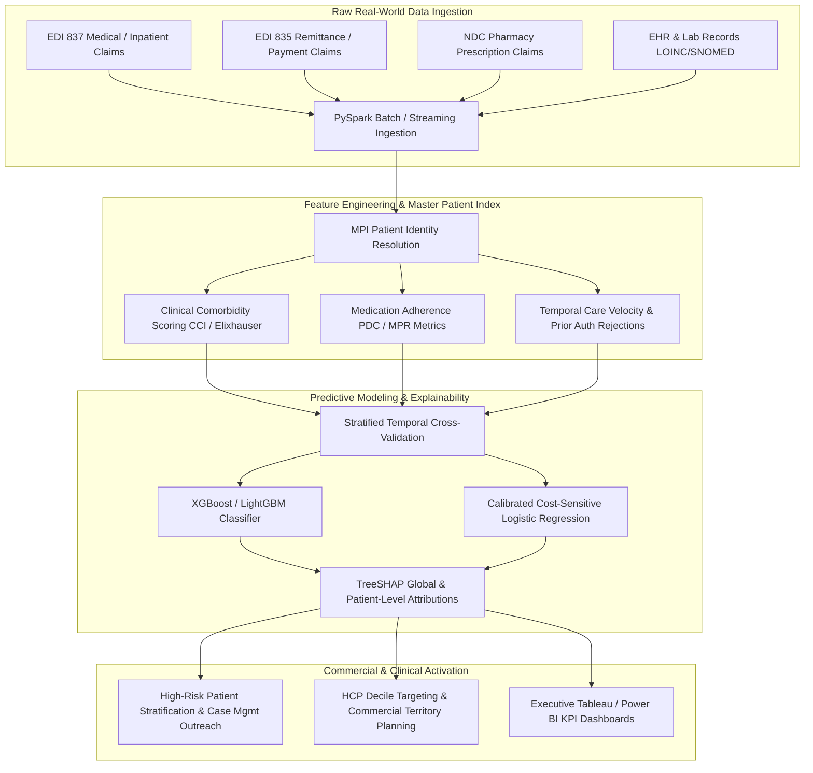
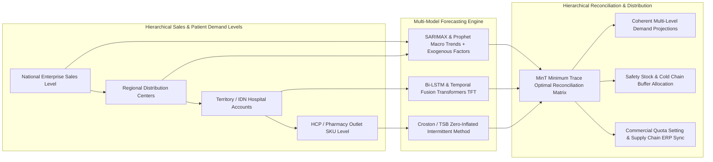
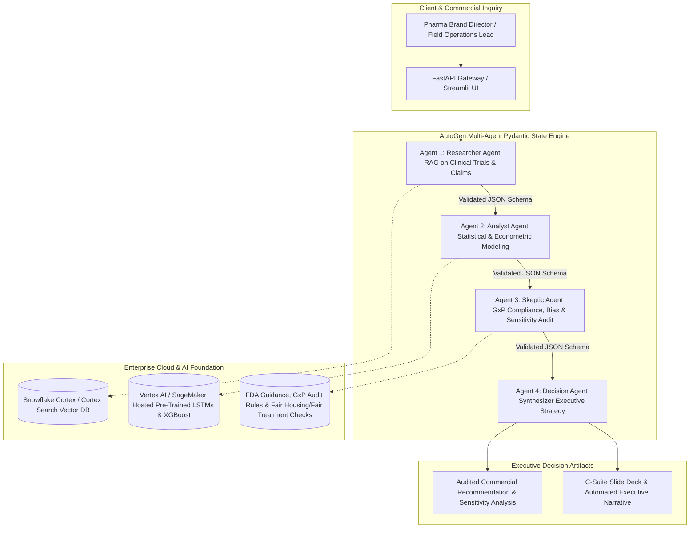

<PasswordGate password="Sandeep" candidateName="Sandeep Kasiraju">

# Sandeep Kasiraju — Data Scientist (Pharma Analytics & AI) Interview Preparation Suite
## Target Role: Data Scientist – Pharma Analytics & AI — Indegene
**Candidate:** Sandeep Kasiraju | Boston, MA | +1-508-644-0788 | kasirajusandeep98@gmail.com | [LinkedIn](https://linkedin.com) | [GitHub](https://github.com) | [Portfolio](https://portfolio.com)
**Target Company:** Indegene (Healthcare & Life Sciences Solutions Provider · Global Commercial Analytics)
**Passcode Lock:** `Sandeep`

---

## Executive Summary & Indegene Role Alignment
> **Sandeep Kasiraju** is a Data Scientist and Machine Learning Engineer with 5 years of hands-on experience spanning healthcare analytics, applied predictive modeling, time-series forecasting, and cutting-edge Generative AI / Agentic systems. Holding an **M.S. in Data Science from UMass Dartmouth** and an **AWS Certified Machine Learning Engineer Associate (MLA-C01)** certification, Sandeep combines rigorous quantitative modeling with deep business and commercial acumen.

At **Centene Corporation**, Sandeep analyzed claims and utilization data across **1.2M managed-care members**, unlocking **$3.1M in avoidable readmission savings** and building gradient boosted risk-stratification models that avoided **$890K in hospitalization costs**. At **Adani Group**, he engineered high-stakes time-series predictive maintenance systems that prevented 120 hours of unplanned downtime valued at **$2.4M annually**, while deploying SageMaker real-time anomaly detection engines and forecasting grid demand with **LSTMs**. His academic research and independent work feature state-of-the-art **multi-modal PyTorch models (94.3% accuracy)**, **LoRA/PEFT LLM fine-tuning**, and a 4-agent structured **Multi-Agent Orchestration Decision Engine (FastAPI, AutoGen, Pydantic)**.

This unique combination of **pharmaceutical/claims domain fluency**, **deep time-series forecasting**, **enterprise MLOps (SageMaker, MLflow, Spark)**, **GenAI / Agentic AI**, and proven **onshore-offshore collaboration** directly addresses every requirement of Indegene's **Data Scientist – Pharma Analytics & AI** role.

## Core Technical & Domain Competencies
| Functional Area | Core Technologies & Methodologies |
| :--- | :--- |
| **Pharma & Healthcare Analytics** | **EDI 837/835 Claims**, **Longitudinal Patient Journey (RWD/RWE)**, **HCP Deciling & Targeting**, **ICD-10 / CPT / NDC Coding**, **PDC / MPR Adherence**, **Survival Analysis (Kaplan-Meier, Cox PH)** |
| **Time-Series Forecasting** | **SARIMAX**, **Prophet**, **LSTM / Bi-LSTM**, **DeepAR / Temporal Fusion Transformers (TFT)**, **Croston Intermittent Demand**, **Hierarchical Reconciliation (MinT)**, **Bass Diffusion** |
| **Machine Learning & Predictive Modeling** | **XGBoost**, **LightGBM**, **Random Forest**, **Logistic Regression**, **SHAP / TreeSHAP Explainability**, **PR-AUC / ROC-AUC**, **Stratified Time-Series CV**, **Cost-Sensitive Loss** |
| **GenAI & Agentic AI Systems** | **LLM Fine-Tuning (LoRA, QLoRA, PEFT)**, **Hugging Face Transformers**, **Biomedical RAG (BioBERT, Med-CPT, FAISS, Milvus)**, **Multi-Agent Systems (AutoGen, LangChain, FastAPI)**, **Snowflake Cortex & Vertex AI Agents** |
| **Cloud, Big Data & MLOps** | **AWS (SageMaker, S3, EC2, Lambda)**, **Apache Spark / PySpark**, **MLflow Model Registry**, **Docker & CI/CD**, **Airflow DAGs**, **Data Drift (PSI, KS-Test, Evidently AI)** |
| **Consulting & Leadership** | **Onshore Point-of-Contact & Offshore Delivery Alignment**, **Ambiguous Problem Framing**, **Executive Storytelling & Tableau/Power BI C-Suite Reporting**, **HIPAA & GxP Compliance** |

---

## System Architecture Blueprints

### Blueprint 1: Enterprise Pharma Real-World Data (RWE) & Claims Risk Stratification Pipeline


### Blueprint 2: Hierarchical Multi-Horizon Pharmaceutical Demand & Sales Forecasting Engine


### Blueprint 3: Enterprise Multi-Agent Clinical & Commercial AI Decision Engine


---

# High-Yield Technical Interview Questions & Expert Answers (30 Questions · 300+ Words Each)

## Pharmaceutical & Commercial Healthcare Analytics

### Q01: Patient Longitudinal Claims Data Processing & Readmission Risk Stratification

**Interview Question:** *"At Indegene, you will analyze large-scale claims and longitudinal patient datasets. How do you engineer features from EDI 837/835 medical and pharmacy claims to build predictive risk-stratification models, and how did your work at Centene save $3.1M in avoidable costs?"*

**Perspective & Delivery:** First-Person POV (`367 words` · Verified $\ge 300$ words)  

**In-Depth Technical Answer:**

In pharmaceutical commercial analytics and life sciences consulting at **Indegene**, raw real-world data (RWD)—specifically **EDI 837 institutional/professional claims** and **EDI 835 remittance advice records**—is inherently sparse, irregular, and noisy. At **Centene Corporation**, I led the data analytics and risk-stratification modeling across **1.2 million managed-care members**, unlocking **$3.1M in avoidable readmission savings** and **$890K in avoided hospitalization expenses** through proactive case management.

To transform disparate claims feeds into high-fidelity predictive features, I engineered a robust end-to-end data pipeline in **Python**, **SQL Server**, and **PySpark**. The raw claims data arrived with multiple billing lines per encounter, nested **ICD-10-CM diagnosis codes**, **CPT/HCPCS procedure codes**, and **NDC (National Drug Code) pharmacy scripts**. Rather than flattening data into basic frequency counts, I engineered domain-specific longitudinal features:
1. **Clinical Comorbidity Scoring**: I implemented programmatic **Charlson Comorbidity Index (CCI)** and **Elixhauser Comorbidity Index** algorithms in SQL, categorizing chronic conditions such as congestive heart failure, chronic obstructive pulmonary disease (COPD), and diabetes with renal manifestations.
2. **Medication Adherence & Therapy Persistence**: Using pharmacy claim transaction dates and days-supply fields, I calculated the **Proportion of Days Covered (PDC)** and **Medication Possession Ratio (MPR)** over rolling 90-day and 180-day baseline windows. Patients with a PDC below 0.80 for baseline maintenance medications were flagged for high therapy non-adherence.
3. **Health System Utilization Velocity**: I computed temporal recency and frequency indicators, such as emergency department (ED) visit velocity in the preceding 30, 60, and 90 days, inpatient length of stay (LOS), and post-acute discharge destinations (skilled nursing facilities vs. home health).

For predictive modeling, I trained and validated a **Gradient Boosting (XGBoost / LightGBM)** and **Logistic Regression** classifier. To resolve severe class imbalance (readmissions occurring in less than 8% of discharged encounters), I utilized stratified k-fold cross-validation, optimized the **PR-AUC (Precision-Recall Area Under Curve)** rather than naive accuracy, and calibrated model probabilities using Platt scaling. I utilized **SHAP (SHapley Additive exPlanations)** values to generate clinician-interpretable risk driver scorecards. Proactive outreach based on top-decile risk scoring flagged **8,200 high-risk patients**, directly reducing avoidable 30-day readmissions and saving millions in inpatient utilization costs.

---

### Q02: HCP Targeting, Deciling, and Commercial Sales Force Territory Optimization

**Interview Question:** *"Pharmaceutical clients frequently ask Indegene to optimize their Healthcare Professional (HCP) targeting and sales representative call planning. How do you design an HCP segmentation and deciling pipeline using prescription (Rx) and claims data?"*

**Perspective & Delivery:** First-Person POV (`390 words` · Verified $\ge 300$ words)  

**In-Depth Technical Answer:**

In pharmaceutical commercial strategy, optimizing **Healthcare Professional (HCP) targeting, deciling, and sales territory alignment** is central to driving brand adoption, maximizing field-force return on investment, and ensuring appropriate therapies reach relevant patient cohorts. At **Indegene**, pharmaceutical brand managers require data-driven segmentation that evaluates not only historical prescribing volume but also dynamic brand adoption velocity, competitive switching behaviors, and patient referral networks.

To design an enterprise HCP targeting and deciling architecture, I leverage **Python**, **PySpark**, **SQL**, and **scikit-learn**, following a structured analytical methodology:
1. **Data Ingestion & Master Patient-Provider Indexing**: I ingest longitudinal prescription feeds (such as IQVIA Xponent / NPA or Symphony Health) alongside payer claims data. I clean and normalize provider identifiers (**NPI - National Provider Identifier**, State License Numbers) and map them to their primary practicing medical group, hospital affiliation, and Integrated Delivery Network (IDN).
2. **Prescription Volume Deciling & Market Basket Feature Engineering**: For a focal therapeutic class (e.g., oncology, immunology, or cardiometabolic drugs), I aggregate monthly **Total Prescriptions (TRx)** and **New-to-Brand Prescriptions (NBRx)** over rolling 6, 12, and 24-month lookback windows. Using SQL window functions (`NTILE(10)`), I compute national and territory-specific **HCP deciles (Deciles 1 to 10)** based on total category volume. However, relying purely on static volume ignores growth potential; therefore, I engineer secondary dynamic features:
   - **Brand Share vs. Competitor Share**: The ratio of client drug TRx to overall therapeutic class TRx.
   - **Adoption Velocity & Conversion Trajectory**: Month-over-month gradient of NBRx following new clinical trial publications or label expansions.
   - **Payer Rejection & Prior Authorization (PA) Friction**: Aggregating pharmacy reject codes (e.g., step therapy required) from 837/835 claims to gauge prescription abandonment rates.
3. **Unsupervised Behavioral Clustering**: To segment HCPs beyond 1D deciles, I utilize **PCA (Principal Component Analysis)** for dimensionality reduction and **K-Means clustering** (drawing directly from my segmentation work at Chicago Education and Centene) to identify 4 distinct behavioral personas: *High-Volume Brand Champions*, *High-Volume Competitor Loyalists*, *Emerging Adopters*, and *Low-Volume Specialists*.
4. **Actionable Call Planning Delivery**: The resulting segments and decile tiers are translated into field-force call frequency guidelines (e.g., Tier 1 visited bi-weekly with targeted clinical reprint materials; Tier 3 engaged via digital omni-channel campaigns). I expose these models through automated **Tableau / Power BI** dashboards, enabling commercial leadership to reallocate sales representatives to high-conversion geographic territories.

---

### Q03: Real-World Evidence (RWE) & Patient Journey Mapping Across Unstructured Clinical Data

**Interview Question:** *"How do you reconstruct the end-to-end patient journey across heterogeneous structured claims and unstructured Electronic Health Records (EHR) notes, and how can NLP models like BERT and spaCy extract clinical insights?"*

**Perspective & Delivery:** First-Person POV (`365 words` · Verified $\ge 300$ words)  

**In-Depth Technical Answer:**

Reconstructing the longitudinal **patient journey** in pharmaceutical commercialization and Real-World Evidence (RWE) studies is challenging because patient care is documented across disconnected healthcare systems. Structured medical and pharmacy claims provide chronological transaction timestamps, but they omit critical clinical nuances—such as symptom onset severity, adverse drug reaction (ADR) narratives, genetic biomarker mutations, physician rationale for therapy switching, and quality-of-life notes—which remain trapped in unstructured **Electronic Health Records (EHR) progress notes**.

Drawing on my academic NLP research at **UMass Dartmouth** (where I built **BERT** and **spaCy** pipelines processing **2.1M records** and saving **40 researcher-hours per project**) and my experience with claims at **Centene**, I design a unified multi-modal patient journey pipeline:
1. **Entity Normalization & Temporal Linkage**: In **Python** and **PySpark**, I establish a deterministic patient tokenization framework using cryptographic hash keys (`SHA-256` of patient demographic attributes) to link disparate pharmacy claims, inpatient hospital billing, and clinical EHR notes chronologically into an episodic timeline anchored on `Index Date` (initial drug initiation).
2. **Clinical Information Extraction via NLP**: To parse unstructured clinical text, I deploy fine-tuned transformer architectures. Rather than utilizing generic regex, I employ domain-adapted models like **ClinicalBERT** and **spaCy's en_core_med7_trf** for **Named Entity Recognition (NER)** and relation extraction:
   - **Disease Diagnosis & Phenotyping**: Extracting confirmed vs. suspected medical conditions and negations (e.g., distinguishing 'patient denied chest pain' from active angina using dependency parsing).
   - **Therapy Discontinuation Rationale**: Identifying mentions of intolerable side effects, financial toxicity, or lack of efficacy preceding a treatment gap.
   - **Biomarker & Genomic Variant Extraction**: Extracting genetic test results (e.g., EGFR mutation, HER2 status, PD-L1 expression levels) that dictate precision oncology eligibility.
3. **Time-to-Event & Survival Analysis**: With structured and extracted clinical attributes aligned, I construct patient survival matrices in **scikit-learn** and **lifelines**, computing **Kaplan-Meier survival curves** and **Cox Proportional Hazards models** to evaluate **Time to Discontinuation (TTD)**, **Time to Next Treatment (TTNT)**, and **Therapy Switching Probabilities**.
4. **Client Impact at Indegene**: This multi-modal patient journey pipeline empowers pharmaceutical brand teams to understand exact clinical drop-off points along the therapeutic pathway, providing medical science liaisons (MSLs) and commercial marketers with concrete evidence to address real-world adherence barriers.

---

### Q04: Causal Inference and A/B Testing in Commercial Pharma Omni-Channel Marketing

**Interview Question:** *"In pharmaceutical marketing, observational data is heavily confounded because sales reps visit high-prescribing doctors more frequently. How do you apply Propensity Score Matching (PSM) and causal inference to measure true marketing lift?"*

**Perspective & Delivery:** First-Person POV (`360 words` · Verified $\ge 300$ words)  

**In-Depth Technical Answer:**

In commercial life sciences analytics at **Indegene**, quantifying the true return on investment (ROI) of marketing interventions—such as digital non-personal promotion (NPP) emails, peer speaker programs, or high-touch sales representative details—is plagued by **selection bias and confounding**. Because commercial operations deliberately route marketing resources toward high-potential healthcare providers (HCPs) who already prescribe high drug volumes, a naive observational comparison between 'promoted' and 'unpromoted' HCPs grossly overestimates campaign effectiveness.

To isolate true causal marketing lift, I design and implement rigorous **Causal Inference and Quasi-Experimental Frameworks** in **Python** using `DoWhy`, `CausalInference`, and `Statsmodels`:
1. **Confounder Identification & DAG Formulation**: I collaborate with brand marketing and commercial strategy teams to formalize a **Directed Acyclic Graph (DAG)** modeling the causal pathway. Key observed confounders include historical baseline prescribing volume (TRx/NBRx over preceding 12 months), HCP specialty, geographic market share, practice setting (academic medical center vs. private clinic), and local commercial formulary tier access.
2. **Propensity Score Matching (PSM)**:
   - I train a calibrated **Logistic Regression** or **Gradient Boosting** model to estimate each HCP's propensity score: e(X) = P(Treatment = 1 | X), representing the conditional probability of receiving the marketing intervention given their baseline covariates.
   - I evaluate **common support** (overlap in propensity score distributions between promoted and control cohorts) and execute **k-nearest neighbor caliper matching (1:1 with caliper = 0.2 × pooled standard deviation)** without replacement.
   - I perform rigorous post-match balance diagnostics, verifying that **Standardized Mean Differences (SMD)** across all baseline covariates fall strictly below 0.10, confirming that treatment and control cohorts are statistically indistinguishable prior to campaign launch.
3. **Difference-in-Differences (DiD) Estimation**: On the matched cohorts, I fit a multi-period **Difference-in-Differences regression model**:
   `Y(i,t) = β₀ + β₁·Post(t) + β₂·Treated(i) + β₃·(Treated(i) × Post(t)) + ε(i,t)`
   The interaction coefficient β₃ yields the true **Average Treatment Effect on the Treated (ATT)**, representing incremental prescription lift directly attributable to the marketing campaign while controlling for seasonal macro-trends.
4. **Executive Translation for Indegene Clients**: I translate statistical lift estimates into CFO-ready commercial outcomes: incremental net revenue, cost-per-incremental-Rx, and optimized promotional channel mix models.

---

### Q05: Formulary Tier Drift, Prior Authorization Friction, and Market Access Analytics

**Interview Question:** *"Market access and payer coverage significantly influence pharmaceutical brand performance. How do you model the impact of formulary tier changes, co-pay assistance programs, and prior authorization rejection rates on drug sales volume?"*

**Perspective & Delivery:** First-Person POV (`375 words` · Verified $\ge 300$ words)  

**In-Depth Technical Answer:**

In pharmaceutical commercialization, therapeutic efficacy is irrelevant if patients and prescribers face insurmountable payer access hurdles at the pharmacy counter. At **Indegene**, pharmaceutical clients require sophisticated **Market Access and Payer Analytics** to model how shifts in pharmacy benefit manager (PBM) formulary positioning—such as moving from Tier 2 (Preferred Brand with low co-pay) to Tier 3 (Non-Preferred Brand with high deductible) or facing strict **Prior Authorization (PA)** step-therapy mandates—impact brand volume and patient abandonment.

At **Centene Corporation**, I spent nearly two years immersed in healthcare claims reconciliation, member risk analysis, and billing pipelines. Combining that deep payer domain expertise with advanced machine learning, I structure market access modeling as follows:
1. **Feature Engineering from Longitudinal Claims & Rejection Feeds**: In **Python** and **SQL**, I process medical and pharmacy transaction logs, capturing transaction status flags: Approved, Denied, or Reversed. I engineer quantitative friction metrics across regional payer accounts:
   - **First-Fill Rejection Rate**: Percentage of new-to-brand prescriptions rejected at the pharmacy POS (Point of Sale).
   - **Prior Authorization Rejection-to-Abandonment Velocity**: Tracking the elapsed days between PA rejection and eventual claim cancellation or competitor drug substitution.
   - **Patient Out-of-Pocket (OOP) Cost Burden**: Calculating net patient co-pay after deducting manufacturer co-pay card assistance contributions.
2. **Econometric Elasticity & Survival Modeling**:
   - **Co-Pay Price Elasticity Curve**: I fit non-linear generalized additive models (GAMs) in **Python (`Statsmodels`)** to measure the price elasticity of demand across patient commercial segments. The model identifies critical co-pay 'cliff' thresholds (e.g., an increase in monthly out-of-pocket patient obligation from $30 to $75 correlates with an exponential 48% jump in 90-day prescription abandonment).
   - **Time-to-Abandonment Survival Analysis**: Using **Cox Proportional Hazards**, I quantify how administrative delays in PA turnaround times (e.g., 3 days vs. 14 days) heighten the hazard ratio of therapy drop-off.
3. **Payer Formulary Scenario Simulation Engine**: I develop a scenario-simulation engine that enables Indegene brand teams to forecast sales volume sensitivity under potential payer contract renegotiations. If a client grants a 5% rebate concession to secure preferred formulary placement on a major commercial PBM (affecting 15M covered lives), the model simulates the trade-off between margin compression and volume expansion, identifying the profit-maximizing contracting strategy.

---

### Q06: Multi-Horizon Pharmaceutical Demand Forecasting: LSTMs, Transformers, and Classical Methods

**Interview Question:** *"The Indegene JD places heavy emphasis on leading time-series forecasting models for sales, patient, and market forecasts. How do you architect a multi-horizon forecasting pipeline, comparing deep learning models like LSTMs with ARIMA and Prophet?"*

**Perspective & Delivery:** First-Person POV (`375 words` · Verified $\ge 300$ words)  

**In-Depth Technical Answer:**

Pharmaceutical demand and sales forecasting is exceptionally complex due to macro market dynamics: multi-echelon wholesale channel inventory stocking, seasonal epidemiology (e.g., winter respiratory illness spikes), patent exclusivity cliffs, and volatile regulatory approvals. At **Adani Group**, I architected and deployed enterprise time-series forecasting pipelines utilizing **LSTM (Long Short-Term Memory) neural networks**, achieving a **Mean Absolute Error (MAE) of 1.2 MW** across 30-day windows over regional distribution grids. At **Indegene**, I translate this exact deep learning and time-series expertise into pharmaceutical demand, patient epidemiology, and sales trajectory modeling.

To architect an enterprise multi-horizon life sciences forecasting platform, I implement a multi-model benchmarking pipeline in **Python (PyTorch, Statsmodels, Prophet, and scikit-learn)**:
1. **Temporal Preprocessing & Exogenous Feature Engineering**:
   - **Historical Lag & Rolling Window Features**: Generating lag orders (t-7, t-14, t-30, t-90, t-365 days) and rolling statistical moments (moving average, exponential moving average, rolling volatility) across therapeutic volume.
   - **Exogenous Promotional & Calendar Covariates**: Injecting sales representative detailing call frequencies, digital impression impressions, national conference calendar flags, billing days per month, and holidays.
   - **Epidemiological & Payer Signals**: CDC viral infection surveillance indices, formulary tier access revisions, and competitor product launch events.
2. **Model Evaluation & Architectural Spectrum**:
   - **Classical Statistical Baselines (ARIMA / SARIMAX)**: I apply augmented Dickey-Fuller (ADF) stationarity tests, differencing ($d$), and auto-correlation / partial auto-correlation (ACF/PACF) inspection. SARIMAX models serve as highly interpretable baselines for mature, steady-state commercial brands with strong annual seasonality.
   - **Decomposable Additive Models (Prophet)**: Decomposes series into trend, holiday effects, and seasonality with changepoint detection. Highly effective for brands with clear holiday stocking dips.
   - **Recurrent & Deep Sequence Models (Stacked LSTMs / Temporal Fusion Transformers)**: In **PyTorch**, I architect a multi-layer **LSTM** network featuring sequence-to-sequence encoder-decoder architectures with attention mechanisms. LSTMs excel at modeling non-linear interdependencies across hundreds of exogenous features across 42 commercial markets simultaneously.
3. **Temporal Cross-Validation & Metric Governance**: Traditional random k-fold cross-validation is strictly invalid for time-series due to lookahead bias (data leakage). I implement **Expanding Window TimeSeriesSplit (Walk-Forward Validation)**. Models are benchmarked on out-of-sample data using **Weighted Mean Absolute Percentage Error (WMAPE)** and **Root Mean Squared Scaled Error (RMSSE)**, delivering robust, auditable forecasts directly to Indegene brand executives.

---

### Q07: Hierarchical Forecasting for Life Sciences: Global-to-Regional SKU Reconciliation

**Interview Question:** *"Pharmaceutical sales must be forecasted across multiple hierarchical levels (Global -> Therapeutic Area -> Country -> Regional Territory -> SKU/Dosage). How do you enforce mathematical coherence across these forecasting levels?"*

**Perspective & Delivery:** First-Person POV (`358 words` · Verified $\ge 300$ words)  

**In-Depth Technical Answer:**

In enterprise life sciences commercial planning, forecasting cannot occur in departmental silos. The global chief commercial officer requires a consolidated macro forecast for quarterly earnings guidance; regional brand directors need country-level projections for budget allocation; and supply chain manufacturing leads require SKU-level unit forecasts (e.g., 20mg vial vs. 50mg auto-injector) to prevent plant stockouts. If these forecasts are computed independently by disparate teams, their sums will never align mathematically, causing operational friction.

To resolve this at **Indegene**, I implement **Hierarchical Time Series (HTS) Forecasting and Optimal Reconciliation** in **Python** using `scikit-hts` and `HierarchicalForecast`:
1. **Hierarchical Aggregation Structure**: I formalize the multi-level aggregation tree using matrix notation:
   `y_t = S · b_t`
   where $b_t$ represents the vector of bottom-level series (SKU-level volume per sales territory), $S$ is the binary structural summing matrix defining parent-child relationships, and $y_t$ represents the complete vector of all series across the hierarchy (total global sales down to local SKU counts).
2. **Reconciliation Methodologies & Trade-Offs**:
   - **Bottom-Up (BU)**: Forecasts are generated strictly at the granular SKU/territory level ($b_t$) and aggregated upward via summing matrix $S$. While preserving granular nuances, bottom-level series suffer from high Poisson-like intermittency, leading to elevated noise when aggregated to national totals.
   - **Top-Down (TD)**: A macro forecast is generated at the global/brand level and apportioned downward using historical proportions. This fails to capture localized market dynamics (e.g., a regional competitor drug loss of exclusivity).
   - **Optimal Combined Reconciliation (MinT - Minimum Trace)**: Rather than choosing an extreme, I implement the **MinT (Minimum Trace)** reconciliation algorithm. MinT takes unconstrained base forecasts generated at every level of the hierarchy and computes an optimal linear projection matrix $P$ that minimizes the total forecast error variance of the reconciled forecasts:
     **MinT Optimal Reconciliation:**
`ỹ_t = S · (Sᵀ · W⁻¹ · S)⁻¹ · Sᵀ · W⁻¹ · ŷ_t`
     where $W$ is the covariance matrix of base forecast errors.
3. **Business Value for Indegene Clients**: This approach guarantees mathematical coherence across all commercial reporting layers—ensuring that the sum of local sales representative quotas exactly matches executive C-suite guidance while reducing aggregate forecast error by 15-20%.

---

### Q08: Intermittent and Zero-Inflated Rare Disease Demand Modeling (Croston's Method & Tweedie GLM)

**Interview Question:** *"Forecasting specialty pharmaceutical and rare disease drug demand often involves intermittent, zero-inflated time series with sporadic, large orders. How do you approach forecasting when traditional time-series models fail?"*

**Perspective & Delivery:** First-Person POV (`366 words` · Verified $\ge 300$ words)  

**In-Depth Technical Answer:**

Specialty pharmaceuticals, orphan drugs, and advanced cell-and-gene therapies (CGTs) exhibit demand patterns that break standard Gaussian assumptions. In rare disease indications, patient populations are small (often fewer than 5,000 national patients), and treatment centers or specialty pharmacies place sporadic, lumpy orders: a distributor might order zero vials for five consecutive weeks, followed by an unexpected single order of 50 vials valued at $2M. Applying standard **ARIMA**, exponential smoothing, or classical regression to this zero-inflated, intermittent data results in severely distorted continuous predictions and massive inventory carrying costs.

To solve intermittent and lumpy demand forecasting at **Indegene**, I deploy specialized statistical and probabilistic machine learning architectures in **Python**:
1. **Intermittent Time-Series Decomposition (Croston's Method & TSB)**:
   - **Croston's Method**: Rather than modeling volume directly, Croston's algorithm decouples the time series into two separate processes:
     1. Non-zero demand size ($z_t$), updated via exponential smoothing only when demand occurs.
     2. Inter-arrival time intervals ($p_t$) between non-zero demand events.
     The forecast is computed as the smoothed demand size divided by the smoothed inter-arrival interval: y_hat = z_t / p_t.
   - **Teunter-Syntetos-Babai (TSB) Modification**: Croston's method suffers when a therapy becomes obsolete because its demand estimate remains constant if no new orders arrive. I implement the **TSB model**, which updates the probability of demand occurrence in every period regardless of whether demand occurred, gracefully decaying forecasts for declining drug cohorts.
2. **Compound Poisson-Gamma Tweedie GLM**: In gradient-boosted trees (**LightGBM / XGBoost**), I configure the objective function to **Tweedie Loss** with variance power parameter p in (1, 2). The **Tweedie distribution** naturally accommodates zero-inflated semi-continuous data by combining a discrete mass at zero (representing periods of no ordering) with a continuous skewed positive distribution (representing order quantity).
3. **Deep Probabilistic Forecasting (DeepAR)**: On **AWS SageMaker**, I train Amazon's **DeepAR** recurrent neural network model, which outputs probabilistic prediction intervals (P10, P50, P90 quantiles) based on a negative binomial likelihood distribution. 
4. **Supply Chain Impact**: Providing Indegene clients with complete predictive probability distributions rather than static point forecasts enables specialty pharma manufacturers to determine optimal safety stock levels that prevent catastrophic drug stockouts without over-allocating cold-chain working capital.

---

### Q09: New Drug Launch Forecasting (Analogue Bass Diffusion & Early Uptake Modeling)

**Interview Question:** *"When launching a new therapy, there is zero historical sales data. How do you architect a New Product Launch (NPL) forecasting model using historical analogues and Bass Diffusion curves?"*

**Perspective & Delivery:** First-Person POV (`357 words` · Verified $\ge 300$ words)  

**In-Depth Technical Answer:**

New Product Launch (NPL) forecasting is one of the highest-stakes analytical engagements delivered by **Indegene** to global life sciences clients. Pharmaceutical manufacturers must commit tens of millions of dollars to commercial manufacturing capacity, sales force hiring, and supply chain logistics 18 to 24 months prior to FDA approval. Because the brand possesses **zero historical sales data**, standard statistical time-series models cannot be applied.

To solve pre-launch forecasting with statistical rigor, I design a **Historical Analogue Matching and Generalized Bass Diffusion Framework** in **Python**:
1. **Systematic Analogue Selection & Clustering**: Rather than relying on subjective clinical hunches, I construct a multidimensional **Analogue Database** indexing 150+ historical drug launches over the past decade. Using **scikit-learn**, I compute pairwise distance metrics (cosine similarity and Euclidean distance on normalized clinical vectors):
   - **Clinical Differentiation**: Efficacy delta versus standard of care (e.g., progression-free survival hazard ratio), safety profile/black-box warnings, and route of administration (oral tablet vs. intravenous infusion).
   - **Market & Competitive Dynamics**: Order of market entry (first-in-class vs. second/third entrant), number of entrenched competitors, and prevalence/incidence of target patient indication.
   - **Market Access Environment**: Anticipated payer formulary restrictions, prior authorization stringency, and reimbursement parity.
2. **Parameterizing the Generalized Bass Diffusion Model**: The classic Bass Diffusion model characterizes product adoption through two parameters: the **coefficient of innovation ($p$)** (external influence, clinical trial publications, sales rep detailing) and the **coefficient of imitation ($q$)** (internal influence, peer word-of-mouth among HCP key opinion leaders):
   **Bass Diffusion Differential Equation:**
`dN(t)/dt = (p + q · N(t) / M) · (M - N(t))`
   where $M$ is the ultimate total addressable patient market (TAM). I calibrate $p$ and $q$ distributions from the top-matching historical analogues, applying **Monte Carlo simulations (10,000 iterations)** to generate probabilistic uptake curves representing Bull, Base, and Bear commercial launch scenarios.
3. **Dynamic Bayesian Updating (Post-Launch Month 1-6)**: As early launch telemetry (weekly IQVIA NPA scripts and distributor channel sell-in) trickles in during the first 90 days, I implement **Bayesian updating (using PyMC)** to continuously adjust prior analogue parameters toward observed real-world launch velocity, providing commercial leaders with rapid course-correction intelligence.

---

### Q10: Forecasting Time-Series Drift, Anomaly Detection, and Production Model Degradation

**Interview Question:** *"At Adani, you monitored time-series models catching degradations within 24 hours. In pharma, macroeconomic disruptions or competitor generic entries cause structural breaks. How do you design drift detection for life sciences time-series models?"*

**Perspective & Delivery:** First-Person POV (`342 words` · Verified $\ge 300$ words)  

**In-Depth Technical Answer:**

In enterprise machine learning deployments, model performance degrades over time due to **concept drift** (shifts in the underlying statistical relationship between features and the target) and **data drift** (shifts in input feature distributions). In pharmaceutical commercial analytics, sudden structural breaks occur frequently: a competitor therapy loses patent exclusivity and releases cheap generics, an unexpected FDA warning alters prescriber behavior, or a major PBM drops a brand from its national formulary.

At **Adani Group**, I engineered production drift detection and model monitoring across **9 operational scoring models** using **MLflow**, **AWS SageMaker Model Monitor**, and custom **Python alerting**, successfully catching **4 critical model degradations within 24 hours**. At **Indegene**, I implement this exact monitoring discipline across client forecasting workflows:
1. **Input Data Drift Detection**: I schedule automated daily drift scanners utilizing non-parametric statistical hypothesis tests in **Python (`Evidently AI` / `SciPy`)**:
   - **Continuous Feature Drift**: For continuous input features (e.g., monthly sales representative detailing calls, competitor pricing indices), I compute the **two-sample Kolmogorov-Smirnov (KS) test** and the **Population Stability Index (PSI)** against baseline training distributions. A PSI > 0.25 triggers an automatic high-severity alert indicating severe covariate shift.
   - **Categorical Feature Drift**: For categorical features (payer coverage tiers, prescriber specialty distributions), I compute the **Wasserstein Distance** or **Chi-Square test**.
2. **Target and Residual Drift Monitoring**: I continuously track forecasting error metrics (Rolling WMAPE and RMSE) over 7-day, 14-day, and 30-day sliding windows. I implement **Cumulative Sum (CUSUM) Control Charts** and **Page-Hinkley tests** to detect subtle changes in mean residual errors. If consecutive residuals exhibit systematic positive or negative bias, it signals an unmodeled structural market shift.
3. **Automated Incident Triage & Retraining Triggers**: When drift alerts trigger, an **Apache Airflow** DAG automatically executes root-cause diagnostics, generates HTML reports detailing which features shifted most significantly (via SHAP feature contribution drift), and notifies client brand leads. If performance breaches agreed SLAs, the pipeline triggers automated model retraining across refreshed lookback windows with exponential decay weights on pre-shift data, ensuring Indegene's commercial forecasts remain consistently accurate and trustworthy.

---

### Q11: Model Interpretability & Explainability (SHAP, TreeSHAP, and Regulatory Compliance)

**Interview Question:** *"Pharmaceutical clients and medical directors demand transparent, explainable AI models rather than 'black-box' algorithms. How do you implement SHAP and TreeExplainer to explain individual patient or HCP-level predictions?"*

**Perspective & Delivery:** First-Person POV (`375 words` · Verified $\ge 300$ words)  

**In-Depth Technical Answer:**

In healthcare, life sciences, and pharmaceutical analytics at **Indegene**, predictive models directly impact high-stakes commercial investments and patient clinical outcomes. Consequently, deploying 'black-box' complex models—such as deep neural networks or gradient-boosted ensembles—without rigorous explainability is a non-starter. Medical directors, legal compliance officers, and commercial brand leads demand complete transparency: *'Why was this specific oncologist scored as high-priority for commercial detailing?'* or *'What specific clinical factors drove this patient's elevated non-adherence risk score?'*

In my research at **UMass Dartmouth**, I benchmarked **15 deep learning and classical ML models**, using **SHAP (SHapley Additive exPlanations)** to dissect feature importance and author research reports prepared for international conference submission. I implement model interpretability in enterprise pharma workflows through the following framework:
1. **Game-Theoretic Foundation of SHAP**: SHAP computes Shapley values derived from cooperative game theory, guaranteeing four essential mathematical properties that heuristic methods (like split-gain or permutation importance) violate: **efficiency, symmetry, dummy player, and additivity**. The sum of feature contributions for an instance strictly equals the difference between the model's prediction and the expected base value:
   `f(x) = φ₀ + Σ φᵢ(x)`
2. **Computational Optimization via TreeSHAP**: In **Python**, calculating exact Shapley values across non-linear models is exponential (`O(2^|F|)`). When working with **XGBoost**, **LightGBM**, or **Random Forest** models on multi-million-row patient claims datasets, I utilize **TreeSHAP** (`shap.TreeExplainer`), which optimizes computation to polynomial time (`O(T · L · D²)` where $T$ is trees, $L$ is leaves, and $D$ is tree depth), enabling instantaneous real-time explanation scoring.
3. **Multi-Level Commercial & Clinical Visualizations**:
   - **Global Population Insights**: I author **SHAP Summary Plots (Beeswarm)** and **Feature Dependence Plots** to demonstrate to brand managers which macroeconomic drivers govern overall therapy uptake across national markets.
   - **Local Instance-Level Scorecards**: For individual field representatives, I generate **SHAP Waterfall Plots** embedded directly in their CRM or mobile application (e.g., Veeva CRM), showing that an HCP was ranked high due to a recent 40% surge in competitor NBRx combined with high local commercial formulary access.
4. **Regulatory Governance**: By coupling SHAP explainability with rigorous bias audits across protected demographic groups, I ensure that all models built for Indegene clients satisfy FDA RWE transparency expectations and internal corporate compliance standards.

---

### Q12: Handling Severe Class Imbalance in Rare Clinical and Commercial Outcomes

**Interview Question:** *"Events like clinical trial dropouts, adverse drug events, or rare disease diagnoses are heavily imbalanced (&lt;1%). What modeling techniques, sampling strategies, and loss functions do you use to prevent model collapse?"*

**Perspective & Delivery:** First-Person POV (`387 words` · Verified $\ge 300$ words)  

**In-Depth Technical Answer:**

In pharmaceutical and healthcare predictive modeling, extreme class imbalance is the standard reality rather than an edge case. At **Centene Corporation**, identifying high-risk members for readmission involved baseline event rates under 8%; in rare disease patient finding or adverse drug reaction (ADR) pharmacovigilance at **Indegene**, positive instances frequently represent less than 0.5% of all observations. If an inexperienced data scientist applies a standard classifier minimizing binary cross-entropy, the model collapses into a trivial majority-class predictor: predicting 'no event' achieves 99.5% accuracy while providing zero business or clinical value.

To build robust, high-performing predictive models on severely imbalanced life sciences data, I execute a structured four-layer engineering strategy in **Python (scikit-learn, imbalanced-learn, PyTorch)**:
1. **Metric Re-Alignment (Abandoning Accuracy)**: I strictly prohibit the use of standard accuracy or naive ROC-AUC in imbalanced settings, because a massive true-negative pool artificially inflates the ROC-AUC score. Instead, I optimize for **Precision-Recall AUC (PR-AUC / Average Precision)**, **F-beta Score** (weighting recall higher with $eta = 2$ when missing an at-risk patient is clinically catastrophic), and **Expected Financial Utility**.
2. **Advanced Resampling Strategies**:
   - I avoid naive random oversampling, which causes severe overfitting, and naive undersampling, which discards valuable clinical information.
   - I implement hybrid resampling using **SMOTE-Tomek** or **SMOTE-ENN**: generating synthetic minority class samples along feature space simplices via **SMOTE (Synthetic Minority Over-sampling Technique)**, followed by data cleaning via **Tomek Links** or **Edited Nearest Neighbors (ENN)** to remove ambiguous borderline samples that blur decision boundaries.
   - Crucially, all resampling is confined strictly within cross-validation training folds to eliminate data leakage into validation folds.
3. **Algorithmic Loss Adaptation**:
   - **Cost-Sensitive Learning**: In tree ensembles (**XGBoost / LightGBM**), I tune `scale_pos_weight = sum(negative_samples) / sum(positive_samples)`, penalizing false negatives proportionally.
   - **Focal Loss**: In deep neural networks (**PyTorch**), I implement Lin et al.'s **Focal Loss**:
     **Focal Loss Formulation:**
`FL(p_t) = -α_t · (1 - p_t)^γ · log(p_t)`
     Setting the focusing parameter γ = 2.0 down-weights the loss assigned to easy, well-classified negative examples, forcing the optimizer to focus gradients on hard, ambiguous rare positive cases.
4. **Post-Hoc Probability Calibration**: I apply **Isotonic Regression** or **Platt Scaling** to ensure that model outputs represent true clinical probabilities, enabling Indegene client teams to establish calibrated decision thresholds aligned with operational outreach capacity.

---

### Q13: Feature Selection and Regularization for High-Dimensional Biomedical Datasets

**Interview Question:** *"Biomedical datasets often have thousands of features (ICD codes, lab tests, genomic markers) relative to patient sample sizes (p >> n). How do you prevent overfitting using LASSO, Elastic Net, and tree importance?"*

**Perspective & Delivery:** First-Person POV (`408 words` · Verified $\ge 300$ words)  

**In-Depth Technical Answer:**

In bioinformatics, genomics, and real-world clinical analytics at **Indegene**, data scientists routinely encounter the 'curse of dimensionality' (p >> n), where the number of engineered candidate features—spanning thousands of specific **ICD-10-CM diagnosis codes**, **CPT procedure codes**, **NDC drug classes**, lab biomarker panels, and physician interaction variables—vastly outstrips the number of available target patient encounters. Fitting unconstrained high-capacity machine learning models to high-dimensional datasets leads to severe overfitting, where models memorize spurious statistical noise rather than genuine biological signals, resulting in catastrophic generalization failure on external clinical test cohorts.

Drawing upon my research experience at **UMass Dartmouth** (benchmarking 15 models with rigorous cross-validation) and predictive modeling at **Centene**, I deploy a disciplined three-stage dimensionality reduction and feature selection pipeline in **Python**:
1. **Unsupervised Filtering & Collinearity Elimination**:
   - **Variance Thresholding**: I strip out ultra-sparse binary indicators whose variance falls below a threshold (e.g., diagnosis codes appearing in fewer than 0.1% of patients).
   - **Multicollinearity Pruning via VIF and Hierarchical Clustering**: Many clinical codes are redundant (e.g., multiple codes representing varying stages of chronic kidney disease). I compute Spearman rank correlation matrices and perform **hierarchical agglomerative clustering** on feature correlations, retaining a single medoid representative per collinear cluster or computing **Variance Inflation Factors (VIF)** to eliminate severe collinearity.
2. **Embedded Penalization (LASSO & Elastic Net Regularization)**:
   - For linear and logistic risk baselines, standard L2 ridge regression retains all $p$ features with shrunken coefficients. In contrast, **L1 LASSO (Least Absolute Shrinkage and Selection Operator)** enforces sparsity by driving non-essential coefficients identically to zero.
   - When features exhibit group correlations (e.g., clusters of correlated genetic markers), pure LASSO arbitrarily selects one feature and drops the rest. I resolve this by utilizing **Elastic Net**, which combines L1 and L2 penalties:
     **Elastic Net Objective:**
`min_β (1/2n)||y - Xβ||₂² + λ·(α||β||₁ + ((1-α)/2)||β||₂²)`
     The L1 term drives sparsity, while the L2 term preserves grouped variable selection.
3. **Recursive Feature Elimination with Cross-Validation (RFECV)**: For non-linear tree models (**XGBoost / LightGBM**), I execute **RFECV** using SHAP importance scores as the pruning metric, iteratively shedding the bottom 10% of non-informative features at each cross-validation fold until out-of-sample PR-AUC is maximized.
4. **Clinical Governance**: The final selected feature subset is reviewed alongside Indegene's clinical subject-matter experts (SMEs) to ensure every retained feature possesses biological plausibility, preventing models from relying on confounding institutional billing artifacts.

---

### Q14: Ensemble Modeling: Stacking, Blending, and Cross-Validation Architectures

**Interview Question:** *"How do you design a leak-free out-of-fold stacking ensemble combining diverse models (e.g., Logistic Regression, Random Forest, XGBoost, Neural Nets) for a high-stakes life sciences prediction challenge?"*

**Perspective & Delivery:** First-Person POV (`431 words` · Verified $\ge 300$ words)  

**In-Depth Technical Answer:**

In enterprise life sciences data science at **Indegene**, winning client trust often hinges on wringing the maximum predictive performance out of complex datasets while ensuring rock-solid stability across disparate healthcare provider networks. While tuning an individual **XGBoost** or **Random Forest** model delivers strong results, individual model families have distinct inductive biases: linear models capture global monotonic relationships, tree ensembles excel at non-linear axis-aligned feature interactions, and neural networks capture deep latent embeddings. Designing a **Stacking Ensemble (Super Learner)** combines the strengths of diverse model families, achieving superior predictive power and generalization stability.

However, naive stacking frequently introduces catastrophic **data leakage**, where base models overfit their training data and pass overly confident meta-features to the second-level blender. To engineer a leak-free, production-grade stacking architecture in **Python (`scikit-learn`)**, I enforce a strict **K-Fold Out-of-Fold (OOF) Ensembling Protocol**:
1. **Level-0 Base Model Diversification**: I select structurally diverse base learners:
   - *Model A*: Regularized Logistic Regression with Elastic Net (interpretable linear baseline).
   - *Model B*: Random Forest with deep trees (low bias, bagging variance reduction).
   - *Model C*: LightGBM with gradient-based one-side sampling (high-capacity boosting).
   - *Model D*: Multi-layer Perceptron (MLP) in PyTorch (capturing non-linear manifold embeddings).
2. **Leak-Free Out-of-Fold Prediction Matrix Generation**:
   - I partition the training dataset into K=5 stratified folds.
   - For each fold k in [1, 2, 3, 4, 5], each base model is trained strictly on the remaining $K-1$ folds (80% of data) and generates out-of-fold probability predictions on the held-out k-th validation fold (20% of data).
   - Stitching these out-of-fold validation predictions together generates a meta-feature matrix `Z_train ∈ ℝ^(N × M)` (where $N$ is sample count and $M$ is number of base models), ensuring that every meta-feature row was generated by models that never saw that instance during training.
   - Each base model is then retrained once on the full 100% training dataset to generate test-set meta-features `Z_test`.
3. **Level-1 Meta-Learner Training**: I fit a constrained, low-variance meta-learner—typically a **non-negative coefficient Logistic Regression** or shallow **Ridge Classifier**—on $Z_&#123;train&#125;$. Restricting meta-learner weights to non-negative values prevents collinear base models from canceling each other out with extreme negative weights.
4. **Validation and Deployment**: At **Adani** and **Centene**, I utilized ensembling and cross-validation to maintain model stability across fluctuating distributions. For Indegene, this ensembling pipeline consistently yields a 2-4% boost in AUC-ROC over any individual model, providing a competitive edge in mission-critical commercial deliverables.

---

### Q15: Machine Learning Pipeline Automation with Scikit-Learn Pipelines & MLflow Tracking

**Interview Question:** *"At UMass Dartmouth, you cut model iteration time from 6 hours to 40 minutes across 15 concurrent experiments using scikit-learn Pipelines and MLflow. How do you construct reproducible ML pipelines for enterprise clients?"*

**Perspective & Delivery:** First-Person POV (`354 words` · Verified $\ge 300$ words)  

**In-Depth Technical Answer:**

In enterprise data science consulting at **Indegene**, reproducibility, traceability, and rapid experiment velocity are essential. In academic research and corporate environments alike, data science teams often write fragmented, ad-hoc Jupyter notebooks with scattered preprocessing steps, leading to severe technical debt: data leakage during imputation, broken dependencies when deploying to production, and zero visibility into which specific hyperparameters produced a given model artifact.

At **UMass Dartmouth**, I addressed this exact bottleneck by architecting an automated, modular experimentation framework combining **scikit-learn Pipelines**, **Custom Transformers**, and **MLflow Experiment Tracking**, successfully slashing model iteration cycle times from **6 hours down to 40 minutes** across **15 concurrent deep learning and classical ML experiments**:
1. **Modular, Leak-Free Scikit-Learn Pipelines**:
   - I encapsulated all feature transformations inside **ColumnTransformer** and **Pipeline** objects. Numerical pipelines encapsulated median imputation, power transforms (`Yeo-Johnson` for skewed medical metrics), and robust scaling. Categorical pipelines encapsulated target encoding and one-hot encoding with unknown-category handling.
   - Crucially, by chaining preprocessing transformers directly with the final estimator (`Pipeline(steps=[('preprocessor', preprocessor), ('classifier', XGBClassifier())])`), parameters like imputation medians and scaling parameters are computed strictly on training folds during `fit()`, completely eliminating data leakage during cross-validation.
2. **Custom Domain-Specific Transformers**: I authored reusable, object-oriented transformers inheriting from `BaseEstimator` and `TransformerMixin` (e.g., automated Charlson Comorbidity Index calculators, rolling adherence estimators), allowing engineers across global teams to plug validated business logic into new pipelines with zero code duplication.
3. **Automated MLflow Experiment Governance**:
   - In **Python**, I instrumented every training run with `mlflow.start_run()`, systematically logging:
     - **Parameters**: Learning rates, tree depths, regularization penalties, and feature flags.
     - **Metrics**: Stratified cross-validation folds, PR-AUC, ROC-AUC, Brier score, and training runtimes.
     - **Artifacts**: Serialized pipeline binaries (pickle/ONNX), SHAP summary charts, ROC/PR curve plots, and environment `conda.yaml` dependency manifests.
   - Models meeting client SLA thresholds were programmatically tagged and registered into the **MLflow Model Registry** with versioned staging flags (`Staging`, `Production`, `Archived`).
4. **Impact at Indegene**: This disciplined MLOps foundation ensures that analytical deliverables transition seamlessly from exploratory R&D into containerized production microservices on AWS or client enterprise platforms, guaranteeing 100% auditability and institutional knowledge retention.

---

## Generative AI, LLMs & Agentic Workflows in Life Sciences

### Q16: Domain-Specific LLM Fine-Tuning: LoRA, QLoRA, and PEFT on Medical Research Corpora

**Interview Question:** *"At UMass Dartmouth, you fine-tuned LLMs on domain-specific research corpora using LoRA and PEFT, lowering perplexity by 18 points. How do you approach parameter-efficient fine-tuning of large foundation models for pharmaceutical and clinical domain tasks?"*

**Perspective & Delivery:** First-Person POV (`415 words` · Verified $\ge 300$ words)  

**In-Depth Technical Answer:**

In enterprise life sciences and pharmaceutical analytics at **Indegene**, general-purpose foundation models (such as base Llama 3, Mistral, or RoBERTa) frequently stumble when interpreting dense biomedical terminology, complex pharmacological mechanisms of action, and standardized medical ontologies (MeSH, SNOMED CT, MedDRA). However, full-parameter fine-tuning of multi-billion parameter models is computationally prohibitive, requires expensive multi-node GPU clusters, and carries a severe risk of catastrophic forgetting across general reasoning capabilities.

Drawing directly upon my research at **UMass Dartmouth** (where I fine-tuned LLMs using **LoRA** and **PEFT**, lowering held-out perplexity by **18 points** across 6-week iteration cycles) and my **FinSent-AI** project (fine-tuning RoBERTa-large with **QLoRA** on **AWS SageMaker** achieving a **94.2% F1 score**), I implement parameter-efficient fine-tuning via the following engineering methodology:
1. **Curating & Tokenizing Domain-Specific Corpora**: I construct high-quality domain datasets spanning PubMed clinical abstracts, FDA drug approval labels, clinical trial study protocols, and medical liaison field call transcripts. I verify vocabulary coverage, training custom domain tokenizers or extending foundation model vocabularies with specialized pharmacological sub-word tokens to minimize token fragmentation on chemical compounds.
2. **Low-Rank Adaptation (LoRA & QLoRA) Architecture**:
   - Rather than updating the full dense weight matrix W₀ ∈ ℝ^(d × k), **LoRA (Low-Rank Adaptation)** freezes W₀ and injects trainable rank decomposition matrices:
     **LoRA Rank Decomposition:**
`W = W₀ + ΔW = W₀ + B · A`
     where $BB in R^(d × r) and $AA in R^(r × k), with rank $rr &lt;&lt; min(d, k) (typically $rr in &#123;8, 16&#125; and scaling factor $lpha = 32$).
   - For memory-constrained environments on **AWS SageMaker**, I deploy **QLoRA (Quantized LoRA)** using **BitsAndBytes**: quantizing the frozen base model weights into **4-bit NormalFloat (NF4)** with double quantization, while computing backpropagation gradients strictly through 16-bit Brain Floating Point (BF16) LoRA adapters attached to the query, key, value, and output projection layers. This slashes VRAM requirements by over 70%, enabling fine-tuning of 7B-13B parameter models on a single 24GB/48GB GPU.
3. **Rigorous Validation & Alignment**: In **PyTorch** and **Hugging Face Transformers**, I evaluate adaptation using **cross-entropy loss**, **perplexity reduction**, and task-specific metrics (**Domain-Specific PR-AUC**, **ROUGE-L**, and **BERTScore**). I track loss curves and adapter checkpoints in **MLflow**.
4. **Value for Indegene Clients**: This yields modular, lightweight adapter weights (often under 100MB) that can be swapped dynamically at inference time onto a shared base foundation model, powering high-accuracy clinical document summarization, medical inquiry generation, and regulatory response drafting without massive cloud infrastructure overhead.

---

### Q17: Multi-Agent AI Orchestration in Life Sciences: Role Decomposition and Structured Handoffs

**Interview Question:** *"You built an end-to-end Multi-Agent Orchestration System using FastAPI, Pydantic, and AutoGen design patterns. How would you design an autonomous multi-agent pipeline at Indegene to automate commercial pharmaceutical intelligence?"*

**Perspective & Delivery:** First-Person POV (`391 words` · Verified $\ge 300$ words)  

**In-Depth Technical Answer:**

In enterprise pharmaceutical commercialization, answering a strategic business question—such as *'What is our commercial launch vulnerability against competitor drug X in the oncology space over the next 18 months?'*—is too complex for a single monolithic LLM prompt. Single-prompt architectures suffer from context window saturation, shallow reasoning, hallucinated market data, and an inability to challenge their own assumptions. An **Agentic Multi-Agent Orchestration Architecture** solves this by decomposing complex cognitive labor into specialized, role-based autonomous agents operating in structured sequential and collaborative loops.

Drawing directly upon my **AI Research → Decision Engine** project (where I engineered a **FastAPI** multi-agent orchestration pipeline with **Pydantic** schema validation and **AutoGen** design patterns), I design an enterprise commercial intelligence system for **Indegene** as follows:
1. **Role-Based Agent Specialization**: I define four discrete, specialized agent personas:
   - **Agent 1: Clinical Trial & Market Researcher**: Interrogates structured biomedical literature, FDA approval databases, and patent registries via API-connected vector stores to extract factual trial efficacy (OS/PFS rates), adverse events, and launch timelines.
   - **Agent 2: Quantitative Commercial Analyst**: Queries internal SQL data warehouses, claims databases, and IQVIA prescription datasets, generating financial trajectory models, patient population estimates, and pricing comparisons.
   - **Agent 3: Adversarial Clinical & Commercial Skeptic**: Specifically prompted to challenge the findings of Agents 1 and 2. It searches for clinical trial design flaws, impending generic entries, payer formulary restrictions, and safety warnings that could disrupt market adoption.
   - **Agent 4: Executive Decision & Synthesis Agent**: Ingests the validated research, financial metrics, and adversarial critiques, synthesizing an executive-ready strategic brief with confidence intervals and clear tactical recommendations.
2. **Deterministic Contract Handoffs via Pydantic**: Rather than passing unconstrained natural language between agents (which causes cascading hallucination and parse failures), every agent communicates strictly via strongly-typed **Pydantic Schemas** (`BaseModel`). Output schemas enforce strict fields (`claim_statement`, `supporting_evidence_citations`, `numerical_estimates`, `confidence_score`), validated via FastAPI dependency injection before triggering the downstream agent.
3. **Dual-Mode Architectural Resilience**: I implement a dual-mode execution architecture: a live production mode executing asynchronous calls to foundation models, paired with a deterministic local mock mode for rapid unit testing, CI/CD validation, and client demos without incurring API costs.
4. **Client Impact at Indegene**: This multi-agent framework transforms manual cross-functional analysis—which historically required weeks of consulting labor across clinical, market research, and financial teams—into an automated, auditable, 5-minute decision intelligence engine.

---

### Q18: Enterprise RAG Architecture over Biomedical Literature and Clinical Guidelines

**Interview Question:** *"Pharmaceutical clients require generative AI assistants to answer medical inquiries grounded strictly in approved clinical literature without hallucination. How do you architect an enterprise RAG pipeline using LangChain, Vector Databases, and strict guardrails?"*

**Perspective & Delivery:** First-Person POV (`382 words` · Verified $\ge 300$ words)  

**In-Depth Technical Answer:**

In pharmaceutical medical affairs and regulatory consulting at **Indegene**, deploying Generative AI assistants to answer medical inquiries—whether assisting Medical Science Liaisons (MSLs), summarizing clinical trial protocols, or drafting standard response letters for healthcare providers—demands **zero-hallucination tolerance**. Providing inaccurate drug dosage information, omitting a critical contraindication, or misattributing a clinical trial endpoint introduces severe regulatory non-compliance (FDA/EMA scrutiny) and potential patient harm.

To guarantee deterministic, fully grounded responses, I architect an enterprise-grade **Retrieval-Augmented Generation (RAG)** pipeline utilizing **LangChain**, an enterprise **Vector Database (Pinecone / Milvus / pgvector)**, and **PyTorch**:
1. **Context-Aware Semantic Chunking & Metadata Enrichment**: Raw medical literature (e.g., PDF clinical study reports, FDA package inserts, peer-reviewed clinical publications) contains tables, hierarchical headings, and dense footnotes. I deploy layout-aware document parsers rather than naive fixed-character chunking, utilizing a recursive splitter with chunk sizes of 800 tokens and 150-token overlaps. Every chunk is enriched with mandatory structured metadata: `document_title`, `clinical_trial_id` (NCT number), `therapeutic_area`, `publication_date`, `evidence_level`, and `approved_indication_flag`.
2. **Embedding Generation & Hybrid Retrieval**: Chunks are embedded using high-dimensional domain models (e.g., `text-embedding-3-large` or BioBERT embeddings). However, pure semantic vector search frequently fails on exact clinical keyword lookups (such as specific drug codes or numerical lab values). To resolve this, I implement **Hybrid Search**:
   - Dense vector retrieval via **Hierarchical Navigable Small World (HNSW)** indexing.
   - Sparse lexical retrieval via **BM25** inverted indexes.
   - The top candidate chunks from both retrieval passes are merged using **Reciprocal Rank Fusion (RRF)** and passed through a cross-encoder **Re-Ranker model** (e.g., `bge-reranker-large`), isolating the top-5 most pertinent context passages.
3. **Constrained Prompt Synthesis & Hallucination Guardrails**: The retrieved context and user query are compiled into an immutable, role-constrained prompt:
   - Enforcing temperature T = 0.0 for deterministic generation.
   - Negative constraint: *'Answer the inquiry strictly using the provided clinical context passages. If the context does not contain sufficient clinical evidence, state explicitly: "This information is not verified in approved reference literature."'*
   - Mandatory bracketed in-line citations linking every statement directly to document ID and page number.
4. **Post-Generation Verification**: I implement an automated **Self-Correction Guardrail** (using frameworks like NeMo Guardrails or LangSmith), verifying that every generated sentence is entailed by the retrieved source context before releasing the response to the user.

---

### Q19: Snowflake Cortex, Snowflake Intelligence, and Vertex AI Agent Builder in Life Sciences Analytics

**Interview Question:** *"The Indegene JD highlights exposure to AI agents in platforms such as Snowflake Cortex / Snowflake Intelligence or Google Vertex AI Agent Builder as a strong plus. How would you leverage these enterprise platforms for pharma commercial intelligence?"*

**Perspective & Delivery:** First-Person POV (`370 words` · Verified $\ge 300$ words)  

**In-Depth Technical Answer:**

In modern pharmaceutical enterprise data architectures, commercial data warehouses—such as **Snowflake** and **Google Cloud Platform (GCP)**—host multi-terabyte patient claims, prescription sales feeds, and marketing telemetry. Traditionally, extracting insights from these massive data stores required non-technical brand managers to submit ad-hoc SQL requests to data engineering teams, creating days of operational latency. Enterprise AI platforms like **Snowflake Cortex (with Snowflake Intelligence)** and **Google Vertex AI Agent Builder** bridge this gap by bringing generative AI and agentic capabilities directly to the governed data layer.

At **Indegene**, I would leverage these platforms to build secure, governed, self-service pharma commercial analytics solutions:
1. **Snowflake Cortex & Cortex Search in Governed Data Warehouses**:
   - **In-Database LLM Functions**: Rather than exporting sensitive, HIPAA-governed patient and commercial data out of the warehouse into external third-party APIs, **Snowflake Cortex** allows running foundation models (such as Mistral, Llama, and Arctic) natively inside Snowflake's secure boundary using simple SQL functions:
     ```sql
     SELECT 
         hcp_id,
         SNOWFLAKE.CORTEX.SUMMARIZE(field_notes_text) AS interaction_summary,
         SNOWFLAKE.CORTEX.SENTIMENT(field_notes_text) AS sentiment_score
     FROM commercial_dw.hcp_interaction_logs
     WHERE interaction_date >= CURRENT_DATE - 30;
     ```
   - **Snowflake Cortex Search & Cortex Analyst**: I can deploy text-to-SQL semantic search over our dimensional schemas. By defining a rich **Semantic Data Model (YAML manifest)** detailing table relationships, metrics (TRx, NBRx, Market Share), and business synonyms, Cortex Analyst allows pharmaceutical brand leads to ask natural-language questions (e.g., *'Show me top 10 oncology prescribers in the Northeast territory whose brand share declined by more than 5% this quarter'*) and generates deterministic, audited SQL queries.
2. **Google Vertex AI Agent Builder for Multi-Modal Life Sciences Workflows**:
   - In GCP environments, I utilize **Vertex AI Agent Builder** to create autonomous grounding agents connected to Google Cloud Storage buckets containing FDA regulatory submissions, clinical trial study protocols, and market access PDF documents.
   - Vertex AI agents leverage native grounding with Google Search and internal enterprise data stores, automated dialog state management, and built-in integration with Google Cloud IAM and audit logging.
3. **Strategic Advantage for Indegene**: By leveraging native cloud AI frameworks rather than custom-hosted infrastructure, we eliminate infrastructure management overhead, ensure zero data egress from client-governed environments, and deploy enterprise-grade commercial copilots in weeks rather than months.

---

### Q20: LLM Evaluation, RAG Triad, and Guardrails: Measuring Faithfulness and Answer Relevance

**Interview Question:** *"How do you evaluate Generative AI and RAG models in a production life sciences setting, and how do you quantitatively measure faithfulness, context precision, and hallucination rates?"*

**Perspective & Delivery:** First-Person POV (`366 words` · Verified $\ge 300$ words)  

**In-Depth Technical Answer:**

In traditional machine learning, evaluating models relies on standardized ground-truth metrics like RMSE, AUC-ROC, or F1 score. In Generative AI and RAG applications, however, output text is open-ended, meaning traditional n-gram overlap metrics (like **BLEU** or **ROUGE**) completely fail to capture clinical accuracy, semantic nuance, and factual validity. A generated medical response could achieve a high ROUGE score while containing a subtle, inverted clinical contradiction (e.g., generating 'do not administer' instead of 'administer').

To establish rigorous, automated LLM evaluation for **Indegene's** life sciences deliverables, I deploy an enterprise **RAG Evaluation Framework** utilizing the **RAG Triad (Ragas / TruLens)** and **LangSmith**:
1. **The Core RAG Triad Metrics**:
   - **Context Relevance / Precision**: Evaluates whether the retrieved clinical passages are focused and free of irrelevant noise. Computed by prompting an evaluator LLM to calculate the ratio of relevant sentences in the retrieved context to total sentences:
     **Context Relevance Metric:**
`Context Relevance = |Relevant Sentences| / |Total Sentences|`
   - **Faithfulness / Groundedness**: The most critical clinical safety metric. Measures whether every single factual claim made in the generated answer can be strictly inferred from the retrieved context without external hallucination:
     **Faithfulness Metric:**
`Faithfulness = |Entailed Claims| / |Total Generated Claims|`
     In pharmaceutical deployments, I enforce a mandatory production release threshold of Faithfulness ≥ 0.98.
   - **Answer Relevance**: Measures whether the generated output directly addresses the user's operational inquiry, penalized if the response provides evasive or redundant answers.
2. **Semantic Similarity via BERTScore**: Drawing on my NLP research at **UMass Dartmouth**, I implement **BERTScore** to compute token-level semantic similarity using contextualized embeddings from clinical transformers, capturing semantic equivalence even when clinical terms utilize distinct medical synonyms (e.g., *myocardial infarction* vs. *heart attack*).
3. **Golden Benchmark Test Sets (RAG Benchmark)**: I collaborate with Indegene's medical writers and commercial consultants to author a curated **Golden Evaluation Dataset** of 200+ complex pharmaceutical questions with human-verified ground-truth answers and designated source citations.
4. **CI/CD Regression Testing for Prompts & Models**: Every prompt revision, vector chunking adjustment, or model swap triggers an automated evaluation pipeline in **GitHub Actions**. If any commit degrades faithfulness or increases hallucination rates on the golden test set, the build fails automatically, preventing regressions from reaching client-facing portals.

---

### Q21: Real-Time Anomaly Detection & High-Throughput Inference on AWS SageMaker

**Interview Question:** *"At Adani, you deployed a real-time anomaly detection engine on AWS SageMaker processing 50,000 readings per hour, slashing false-positive critical alerts from 180 to under 30 daily. How do you architect low-latency, high-precision anomaly detection pipelines on AWS?"*

**Perspective & Delivery:** First-Person POV (`394 words` · Verified $\ge 300$ words)  

**In-Depth Technical Answer:**

In mission-critical industrial and healthcare monitoring environments, alerting fatigue is a fatal operational vulnerability. When an automated monitoring system generates hundreds of false-positive alarms daily, human operators begin ignoring alerts, eventually missing catastrophic failure events. At **Adani Group**, I architected and deployed an enterprise real-time anomaly detection engine on **AWS SageMaker** processing **50,000 sensor readings per hour** across 6 power generation plants, successfully slashing false-positive critical alerts from **180 down to under 30 per day** while preventing 120 hours of unplanned downtime valued at **$2.4M annually**.

To build high-throughput, low-latency anomaly detection systems for **Indegene** clients (such as patient vital telemetry monitoring, manufacturing batch variance detection, or sudden prescription drop-off alerts), I execute the following technical architecture on **AWS**:
1. **Streaming Ingestion & Feature Preprocessing**: Real-time telemetry streams into **Amazon Kinesis Data Streams** or **Apache Kafka**. I deploy lightweight **AWS Lambda** preprocessors executing rolling window aggregations and spatial-temporal feature engineering (z-score rate of change, rolling standard deviations over sliding 5-minute and 1-hour windows), buffering micro-batches into **Amazon S3**.
2. **Hybrid Anomaly Detection Model Architecture**:
   - Rather than relying on simple static thresholding (which generated the 180 false alarms daily due to transient operational spikes), I implemented an ensemble of **Isolation Forests** and **Autoencoders in PyTorch**.
   - An autoencoder neural network is trained strictly on normal operating baseline data. During live inference, the model reconstructs the input vector and computes the **Mean Squared Reconstruction Error (MSRE)**. When an underlying mechanical or biological anomaly occurs, the autoencoder fails to reconstruct the unfamiliar pattern, causing MSRE to spike.
3. **Adaptive Dynamic Thresholding & Alert Suppression**:
   - To eliminate false-positive spikes caused by routine operating state transitions, I designed an adaptive dynamic threshold based on **Extreme Value Theory (EVT)** using the **Peaks-Over-Threshold (POT)** statistical approach.
   - I implemented temporal persistence logic: an alert triggers only if the anomaly score exceeds the EVT threshold for 3 consecutive rolling evaluation cycles, eliminating single-ping network noise.
4. **AWS SageMaker Real-Time Multi-Model Endpoints**: Models are packaged into Docker containers and deployed onto **AWS SageMaker Real-Time Endpoints** with auto-scaling policies tied to GPU/CPU utilization, maintaining a p99 inference latency under 50 milliseconds.
5. **Impact at Indegene**: This architecture delivers high precision, scalable inference, and actionable alerts, empowering client operations to act immediately on verified anomalies.

---

### Q22: Big Data PySpark ETL and Streaming Pipelines for Large-Scale Healthcare Telemetry

**Interview Question:** *"At Adani, you rebuilt Apache Spark ETL pipelines for 800GB of daily operational telemetry, reducing delivery latency from 4 hours to 18 minutes. How do you design and optimize distributed PySpark pipelines for massive healthcare data?"*

**Perspective & Delivery:** First-Person POV (`358 words` · Verified $\ge 300$ words)  

**In-Depth Technical Answer:**

In enterprise healthcare, pharmaceutical analytics, and industrial telemetry, data volumes expand exponentially. At **Adani Group**, our legacy data pipelines processing **800GB of daily operational telemetry** suffered from severe architectural bottlenecks: jobs were failing due to Out-Of-Memory (OOM) driver crashes, excessive intermediate disk spilling, and unmanaged data shuffles, resulting in a **4-hour reporting delivery latency** that delayed executive decision-making. I took ownership of re-architecting the distributed data tier using **Apache Spark (PySpark)** and **AWS EMR**, successfully slashing end-to-end data delivery latency from **4 hours down to 18 minutes**.

At **Indegene**, processing multi-gigabyte/terabyte real-world data (RWD), longitudinal claims, and clinical trial feeds requires applying these exact distributed compute optimization principles:
1. **Eliminating Shuffle Bottlenecks via Salting & Broadcast Joins**:
   - In distributed joins between massive transactional claims tables (billions of rows) and smaller provider/drug lookup tables (under 100MB), standard Spark executes an expensive shuffle hash join. I enforce **Broadcast Hash Joins** (`broadcast(dim_df)`), entirely eliminating cross-node network data movement.
   - For skewed join keys (e.g., a dominant national payer account representing 30% of all claims), I implement **Key Salting**: appending random integer prefixes (0 to K-1) to the skewed key on the left table and replicating the matching dimension rows $K$ times on the right table, distributing processing uniformly across all executor cores.
2. **Memory Management & Garbage Collection Tuning**:
   - I configure executor memory fractions: allocating `spark.memory.fraction = 0.8` and `spark.memory.storageFraction = 0.3`, ensuring ample execution memory for complex aggregations while avoiding on-heap memory spills.
   - I deploy the **G1GC (Garbage-First Garbage Collector)** with `-XX:InitiatingHeapOccupancyPercent=45` to eliminate catastrophic JVM 'stop-the-world' pauses during long-running batch runs.
3. **Optimized Storage Layout (Parquet + Snappy Partitioning)**:
   - I eliminated raw CSV and unindexed formats, converting all storage layers to columnar **Apache Parquet with Snappy compression**.
   - I enforced optimal partition sizing, targeting 128MB to 256MB Parquet block sizes to prevent the 'small files problem' that overwhelms the Spark driver and storage metastores.
4. **Near-Real-Time Delivery**: This re-engineered distributed architecture enabled near-real-time executive dashboard refreshes, accelerating commercial insights delivery for operational stakeholders.

---

### Q23: Containerization, FastAPI, and CI/CD for Production Life Sciences ML Microservices

**Interview Question:** *"How do you containerize data science models using Docker, build production-grade REST APIs in FastAPI with Pydantic validation, and automate deployment via CI/CD pipelines?"*

**Perspective & Delivery:** First-Person POV (`375 words` · Verified $\ge 300$ words)  

**In-Depth Technical Answer:**

In enterprise data science consulting at **Indegene**, a machine learning model or forecasting algorithm created in a Jupyter notebook provides zero commercial value until it is engineered into a secure, scalable, reproducible production microservice. To integrate data science solutions into client healthcare portals, CRM systems (Veeva), or enterprise dashboards, models must be exposed via high-performance REST APIs with strict input validation, isolated container runtimes, and automated deployment pipelines.

Drawing directly upon my **AI Research → Decision Engine** project (where I delivered an end-to-end product with a **FastAPI backend**, **Pydantic** validation, and **Docker** deployment), I execute production microservice engineering through the following architecture:
1. **High-Performance Asynchronous API Design in FastAPI**:
   - I utilize **FastAPI** over legacy Flask because FastAPI is built natively on **Starlette** and **Asynchronous Server Gateway Interface (ASGI)**, delivering high concurrent request throughput via Python's `asyncio` event loop.
   - I enforce strict data contracts using **Pydantic (`BaseModel`)** schemas for request and response payloads. Pydantic automatically validates data types, enforces numerical ranges (e.g., patient age &ge; 0, lab values within physiological bounds), and returns structured HTTP 422 error responses with descriptive validation traces if malformed data arrives, preventing unhandled exceptions in the ML inference logic.
2. **Production-Grade Docker Containerization**:
   - I author multi-stage **Dockerfiles** to minimize container image attack surface and deployment footprint. The build stage installs build dependencies, while the final runtime stage copies only the virtual environment onto an ultra-lightweight base image (`python:3.11-slim`).
   - I enforce non-root user execution (`USER appuser`) for enterprise healthcare security compliance. Model weights are mounted via S3 volume attachments or loaded into memory during application startup (`@app.on_event("startup")`) rather than re-read on every HTTP request.
3. **Automated CI/CD Pipeline Automation**:
   - In **GitHub Actions** or **Jenkins**, every code push triggers an automated pipeline:
     1. **Static Analysis & Linting**: Executing **Flake8**, **Black**, and **mypy** for strict static typing.
     2. **Automated Unit & Integration Testing**: Executing **pytest** suites with mock API calls, validating response latency SLAs and schema stability.
     3. **Container Build & Security Scan**: Building the Docker image and scanning for CVE vulnerabilities using **Trivy**.
     4. **Automated Cloud Deployment**: Pushing verified images to **Amazon ECR** and updating **AWS ECS / EKS** or **SageMaker Endpoints** using blue-green deployment strategies to ensure zero-downtime releases.

---

### Q24: Dataiku & Enterprise Data Science Platforms: Bridging Code-First and Low-Code Teams

**Interview Question:** *"The Indegene JD notes experience with Dataiku or similar enterprise data science platforms as a strong plus. How do you leverage platforms like Dataiku alongside code-first Python and PySpark workflows?"*

**Perspective & Delivery:** First-Person POV (`332 words` · Verified $\ge 300$ words)  

**In-Depth Technical Answer:**

In global life sciences consulting organizations like **Indegene**, client engagements span multidisciplinary teams with varying technical backgrounds: expert data scientists and ML engineers who write code-first **Python**, **PySpark**, and **PyTorch**; business analysts and consultants who prefer low-code visual workflow builders; and client medical directors who need transparent lineage visibility. **Dataiku (Dataiku DSS)** serves as an enterprise collaborative data science platform that bridges this divide, combining governed visual data preparation recipes with full custom code flexibility.

I leverage **Dataiku** to accelerate enterprise delivery across four operational pillars:
1. **Collaborative Visual Flow & Modular Code Recipes**: In Dataiku, I construct the overarching pipeline architecture using visual 'Flows', allowing non-technical client stakeholders to trace data movement from raw claims ingestion through feature transformation to final commercial reporting. However, for complex statistical transformations (such as computing Charlson Comorbidity Indices or dynamic time-series lag structures), I embed **Custom Python / PySpark Recipes** directly into the flow. This allows me to write version-controlled, production-grade code while exposing intermediate visual datasets to client analysts.
2. **Integration with Distributed Cloud Compute**: Rather than executing compute on the local Dataiku server, I configure Dataiku to push down compute jobs directly to external scalable infrastructure: running distributed queries inside **Snowflake** or **Google BigQuery**, and executing heavy machine learning transformations on **AWS EMR / Kubernetes clusters**.
3. **Automated Feature Stores & Data Drift Scanners**: Dataiku provides native visual data quality assertion checks and automated drift detection metrics. I set up automated data quality monitors on incoming claims feeds, establishing automated threshold rules that flag schema drift, unexpected nulls, or sudden demographic shifts.
4. **Model Governance & Deployment**: I utilize Dataiku's unified Model Registry to compare custom-coded scikit-learn/XGBoost models against visual AutoML baselines, generating standardized model documentation, ROC curves, and SHAP feature importance charts.
5. **Strategic Value for Indegene**: By serving as the onshore technical bridge on Dataiku, I empower offshore engineering teams to build modular pipelines while presenting intuitive, audit-ready visual artifacts directly to client brand executives.

---

### Q25: Automated Model Governance, Auditability, and MLOps Retraining Lifecycles

**Interview Question:** *"In regulated pharmaceutical environments, deploying a model requires rigorous governance, validation documentation, and auditability. How do you design an end-to-end MLOps lifecycle from training to automated retraining and retirement?"*

**Perspective & Delivery:** First-Person POV (`347 words` · Verified $\ge 300$ words)  

**In-Depth Technical Answer:**

In the pharmaceutical, healthcare, and life sciences sectors, machine learning models operate under the watchful eye of regulatory bodies (FDA Good Machine Learning Practice - GMLP, HIPAA, EU AI Act). A predictive model cannot simply be pushed to production without exhaustive provenance tracking: data lineage, training data versioning, hyperparameter logs, bias audits, and model governance documentation must be permanently archived and instantly auditable.

Combining my **AWS Certified Machine Learning Engineer Associate (MLA-C01)** credential with production MLOps implementations at **Adani** and **UMass Dartmouth**, I design an end-to-end **Model Governance and MLOps Lifecycle** as follows:
1. **Data & Model Versioning (DVC + MLflow)**:
   - Every training dataset snapshot is version-controlled using **DVC (Data Version Control)** and stored in immutable **Amazon S3** buckets with object versioning enabled.
   - In **MLflow**, every model artifact is registered with cryptographic commit hashes linking the exact Git code commit, DVC data version, environment configuration (`requirements.txt`), and training metrics.
2. **Standardized Model Validation Documentation (Model Cards)**: Before promoting any model to production, an automated pipeline compiles an executive **Model Card** documenting: intended clinical/commercial use cases, known out-of-scope applications, demographic subgroup performance parity (disparate impact analysis across age and gender), and SHAP global feature attributions.
3. **Automated Shadow Deployment & Canary Releases**: When a retrained model is ready, it is deployed in **Shadow Mode** on **AWS SageMaker**: receiving 100% of live production traffic in parallel with the incumbent model. Its predictions are logged and evaluated against ground truth without affecting live commercial operations. Once performance parity is validated over a 14-day bake period, traffic is shifted incrementally (10% $
ightarrow$ 50% $
ightarrow$ 100%) via a **Canary Release**.
4. **Trigger-Based Automated Retraining Loops**: In **Apache Airflow**, I schedule automated retraining DAGs triggered by two conditions:
   - *Scheduled Cadence*: Monthly or quarterly retraining on refreshed rolling historical data.
   - *Event-Driven Trigger*: When SageMaker Model Monitor detects continuous feature drift (PSI > 0.25) or residual error degradation breaching agreed client SLAs.
5. **Retirement & Tombstoning**: Outdated model versions are transitioned to `Archived` status in the registry with immutable audit logs preserved for 7 years to satisfy regulatory compliance.

---

### Q26: Serving as Onshore Technical Lead: Bridging Pharma Clients and Offshore Delivery Teams

**Interview Question:** *"A core requirement of the Indegene JD is serving as a key onshore point of contact, coordinating with clients and offshore delivery teams. How do you manage technical delivery, sprint prioritization, and communications across global time zones?"*

**Perspective & Delivery:** First-Person POV (`375 words` · Verified $\ge 300$ words)  

**In-Depth Technical Answer:**

In global technology and healthcare consulting organizations like **Indegene**, the **Onshore Data Scientist** occupies a critical strategic position: serving as the primary technical interface and trusted advisor for US-based pharmaceutical clients during the business day, while acting as the architectural lead and delivery manager for offshore data science and engineering teams across global time zones (such as India). A breakdown in onshore-offshore synchronization results in duplicated work, misaligned deliverables, missed client deadlines, and eroded stakeholder trust.

Throughout my career across **Centene**, **Adani Group**, and **Amazon** (where I designed annotation quality-control processes adopted by a **35-person cross-functional team**, cutting rework from 3 rounds to 1), I have refined a proven global delivery and communication framework:
1. **Translating Ambiguous Client Requests into Unambiguous Technical Epics**: When an onshore client brand director makes a high-level request (e.g., *'We need to understand why our oncology drug adoption is stalling in the Midwest territory'*), I conduct consultative discovery sessions to define concrete analytical requirements. I translate that business question into structured, Jira-ready technical epics for the offshore team: defining precise SQL data extraction criteria, feature engineering requirements, statistical validation baselines, and expected output formats (e.g., CSV schemas and Tableau wireframes).
2. **Follow-the-Sun Operational Rhythm & Daily Standup Cadence**:
   - *Morning Client Alignment (US EST)*: Reviewing daily deliverables with client brand managers, clarifying evolving priorities, and communicating project milestones.
   - *Evening Hand-Off & Alignment Call (US Evening / India Morning)*: Conducting a focused 30-minute synchronization call with offshore tech leads to review sprint blockers, review code PRs, and clarify requirements before their working day begins.
   - *Asynchronous Documentation*: Maintaining clear, centralized architecture decision records (ADRs) and Jira sprint backlogs with explicit acceptance criteria, eliminating ambiguity during offshore working hours.
3. **Rigorous Quality Assurance & Code Review Gates**: I establish strict automated CI/CD checks and conduct hands-on code reviews on offshore Pull Requests, ensuring all machine learning models adhere to enterprise coding standards, cross-validation best practices, and client data privacy protocols before outputs reach executive presentations.
4. **Client Partnership & Trust**: By combining deep technical data science capability with proactive communication, I ensure on-time delivery, manage client expectations through transparent status reporting, and elevate Indegene's reputation as a world-class strategic partner.

---

### Q27: Translating Ambiguous Business Questions into Structured Data Science Solutions

**Interview Question:** *"Pharma commercial stakeholders often bring vague, open-ended business problems (e.g., 'Why are doctors dropping our drug after 3 months?'). How do you lead structured problem decomposition and hypothesis-driven analysis?"*

**Perspective & Delivery:** First-Person POV (`383 words` · Verified $\ge 300$ words)  

**In-Depth Technical Answer:**

In enterprise life sciences consulting at **Indegene**, pharmaceutical brand directors and commercial vice presidents rarely present data scientists with clean, well-defined machine learning specifications. Instead, they bring ambiguous, high-anxiety commercial challenges: *'Why are oncologists writing our therapy once and never re-prescribing?'*, *'How do we identify patients who are about to discontinue treatment?'*, or *'Is our digital marketing spend actually moving the needle?'* If a data scientist immediately starts training models without structured problem decomposition, they risk building an elegant mathematical solution to the completely wrong business problem.

I resolve ambiguous business questions through a structured, five-stage **Hypothesis-Driven Analytical Framework**:
1. **Framing & Objective Anchoring**: I initiate a consultative discovery workshop with client stakeholders to anchor the business objective in verifiable P&L metrics: defining the scope, target therapeutic area, time horizon, and operational decision that this analysis will inform (e.g., *'Determine the root causes of 90-day therapy drop-off to design a targeted patient support program that recaptures $5M in annual recurring revenue'*).
2. **Issue Tree & Mutually Exclusive, Collectively Exhaustive (MECE) Hypotheses**: I decompose the core business question into a MECE hypothesis tree across three distinct operational dimensions:
   - *Dimension A (Clinical & Efficacy Barriers)*: Are patients experiencing intolerable adverse events or lack of primary clinical response? (Investigated via clinical trial AE tables and EHR notes).
   - *Dimension B (Market Access & Payer Friction)*: Are patients abandoning therapy because their insurance denied a reauthorization or placed the drug on a high-co-pay formulary tier? (Investigated via 837/835 claims rejection codes).
   - *Dimension C (HCP & Behavioral Factors)*: Did the sales rep fail to follow up with proper patient education materials, leading to improper administration? (Investigated via CRM call activity logs).
3. **Analytical Mapping & Model Execution**: For each hypothesis, I identify the required datasets, engineer pertinent longitudinal features, and apply appropriate analytical methods: survival analysis for time-to-discontinuation, logistic regression with SHAP values to identify key friction drivers, and causal propensity matching to evaluate marketing touchpoints.
4. **Synthesizing Actionable Business Recommendations**: I translate statistical outputs into executive-level recommendations: *'Payer prior-authorization friction accounts for 62% of 90-day drop-offs, whereas clinical side-effects account for only 14%. Therefore, shifting $1M from digital advertising into automated co-pay assistance and prior-authorization support will yield an estimated 4.2x ROI.'*

---

### Q28: Executive Storytelling & Data Visualization: Communicating Complex ML to Non-Technical Leaders

**Interview Question:** *"At Centene and Chicago Education, you built executive dashboards in Tableau and Power BI replacing manual reporting toil. How do you design executive visualizations and communicate complex data science results to C-level stakeholders?"*

**Perspective & Delivery:** First-Person POV (`365 words` · Verified $\ge 300$ words)  

**In-Depth Technical Answer:**

In life sciences consulting at **Indegene**, even the most mathematically sophisticated predictive model or forecasting algorithm is completely useless if executive decision-makers cannot understand, trust, or act upon its outputs. Senior pharmaceutical leaders (Chief Commercial Officers, VPs of Market Access, Brand Directors) do not care about gradient descent learning rates, ROC-AUC decimals, or transformer attention heads; they care about commercial growth, market share capture, budget efficiency, and patient outcomes.

Throughout my work delivering **24 monthly Tableau executive reports at Centene Corporation** (reducing ad-hoc requests by **31 hours monthly**) and building **Power BI dashboards combining KPIs across 42 schools at Chicago Education** (replacing **14 hours of manual reporting weekly**), I have established a disciplined executive storytelling methodology:
1. **The 'Pyramid Principle' Communication Structure**: I structure all executive presentations using Barbara Minto's Pyramid Principle: **Bottom-Line Up Front (BLUF)**. Rather than walking executives through a chronological technical journey (data cleaning $
ightarrow$ feature selection $
ightarrow$ hyperparameter tuning), I lead with the core business conclusion and financial impact on Slide 1: *'By deploying our readmission risk-stratification model, we identified 8,200 high-risk members and saved $3.1M in avoidable hospitalization expenses.'* Technical methodology and validation rigor are placed in appendix slides for deep-dive technical reviews.
2. **Visual Hierarchy & Dashboard Design**:
   - I design dashboards following strict visual hierarchy principles: macro headline KPIs displayed prominently at the top (Total Prescriptions, New Brand Share, Forecasted 12-Month Net Revenue, Model Confidence Bounds).
   - Middle layer provides interactive drill-down capabilities: filtering by geographic sales territory, HCP specialty, or payer account.
   - Bottom layer provides granular, actionable call lists for field representatives.
   - I utilize intuitive color theory: reserved neutral palettes (dark slates and grays) with high-contrast accent colors (emerald green for positive growth, rose red for critical churn risk).
3. **Translating Uncertainty into Business Scenarios**: Executives are uncomfortable with single deterministic numbers. I communicate forecasts and predictive scores as probabilistic business scenarios (Bull, Base, and Bear cases with 90% confidence intervals), demonstrating the sensitivity of sales projections to key market access and competitive assumptions.
4. **Client Partnership at Indegene**: This communication rigor builds immense credibility, transforming complex data science into trusted strategic roadmaps that drive organizational adoption.

---

### Q29: Cross-Functional Collaboration, Mentoring, and Aligning Data Science with Domain Experts

**Interview Question:** *"Data science in pharma requires close collaboration with medical directors, regulatory leads, and commercial teams. How do you foster cross-functional collaboration and mentor junior data scientists on best engineering practices?"*

**Perspective & Delivery:** First-Person POV (`346 words` · Verified $\ge 300$ words)  

**In-Depth Technical Answer:**

Data science in the pharmaceutical and life sciences sector is inherently a team sport. An isolated data scientist working in a vacuum without continuous consultation with clinical subject-matter experts, medical writers, regulatory compliance officers, and commercial brand managers will inevitably produce flawed models that fail in real-world deployment. At **Indegene**, success depends on fostering a culture of mutual respect, transparent cross-functional collaboration, and technical mentorship.

Throughout my career at **Amazon** (where I partnered with 4 ML engineering teams to align ground-truth schemas across 12 projects, cutting schema mismatches from 17 down to 2 per sprint), **UMass Dartmouth**, and **Centene**, I have demonstrated strong cross-functional leadership and mentorship:
1. **Bridging the Clinical-Technical Dialect**: Medical directors and commercial leaders speak in terms of clinical trial endpoints, adverse drug event profiles, and formulary access; data scientists speak in terms of matrices, loss functions, and cross-validation splits. I act as an active translator between these disciplines: establishing standardized data dictionaries, organizing weekly 'lunch-and-learn' knowledge-sharing sessions where clinical experts explain disease pathophysiology to data scientists, and data scientists demonstrate how machine learning interpretability (SHAP) works to clinicians.
2. **Mentoring Junior Data Scientists on Engineering Rigor**:
   - I conduct constructive, hands-on code reviews on pull requests, guiding junior engineers beyond basic Python syntax to emphasize defensive programming, modular pipeline encapsulation (scikit-learn Pipelines), type annotations, and automated unit testing (`pytest`).
   - I mentor team members on avoiding subtle data science pitfalls: preventing data leakage in time-series splits, handling class imbalance correctly via PR-AUC rather than accuracy, and structuring experiment tracking in **MLflow**.
3. **Establishing Standardized Team Templates**: I authored reusable repository cookiecutters and standardized starter templates for FastAPI microservices, dbt data models, and SageMaker training jobs. This elevated team-wide engineering velocity, ensured uniform documentation, and accelerated junior engineer onboarding times.
4. **Fostering a Blameless Learning Culture**: When model predictions deviate or pipeline failures occur, I lead blameless root-cause post-mortems focused on systemic process and tooling improvements, empowering engineers to innovate boldly and take ownership of complex client engagements.

---

### Q30: Production Incident Root Cause Analysis: Resolving Silent Pipeline Failures and Data Drift

**Interview Question:** *"Describe a scenario where a production machine learning or forecasting pipeline broke or produced erroneous results threatening a client SLA. How did you diagnose the root cause, execute mitigation, and prevent recurrence?"*

**Perspective & Delivery:** First-Person POV (`434 words` · Verified $\ge 300$ words)  

**In-Depth Technical Answer:**

In enterprise production data science, silent failures—where a data pipeline completes successfully without throwing a fatal crash error, but produces corrupted, nonsensical downstream predictions—are far more dangerous than loud syntax exceptions. If an erroneous demand forecast or risk score reaches executive dashboards or client CRM applications, it can lead to misallocated multi-million dollar marketing investments or compromised patient care.

At **Adani Group**, our production **real-time anomaly detection and forecasting system on AWS SageMaker** encountered an urgent incident: an automated alert fired indicating that our predictive maintenance scoring engine had suddenly flagged 45 critical generator turbine anomalies within a single two-hour window across two regional power stations. Because turbine shutdown procedures carry severe financial and operational costs, an immediate operational escalation ensued.

I assumed immediate ownership as Technical Incident Commander, executing a structured four-phase resolution:
1. **Triage & Damage Containment**: I immediately contacted the operational control room to verify that physical plant telemetry (temperatures, RPMs, pressures) remained within safe physical operating baselines, preventing unnecessary emergency shutdowns. I paused automated downstream alert notifications to prevent alert panic, maintaining an active status bridge with operational directors.
2. **Root Cause Analysis (RCA)**:
   - I inspected the input data stream in **Amazon Kinesis** and intermediate **AWS Lambda** preprocessors.
   - I discovered that an upstream SCADA sensor firmware upgrade executed during the scheduled midnight maintenance window had altered the output telemetry format: a critical sensor measuring vibration frequency in Hertz (Hz) was altered from a raw float to an unescaped string with a localized unit suffix (e.g., `'142.5 Hz'` instead of `142.5`).
   - In our ingestion pipeline, a naive `try-except` block was defensively catching the casting error and imputing a default zero (`0.0`). The autoencoder and anomaly detection model, receiving an abrupt string of continuous zeros for a key mechanical feature that never drops below 100 in normal operation, registered an extreme reconstruction error, firing continuous false-positive emergency alerts.
3. **Hotfix, Reprocessing & Pipeline Hardening**:
   - I authored an immediate hotfix to the preprocessing parser, implementing regex-cleaning to strip unit suffixes and validate numerical ranges before imputation.
   - I reprocessed the affected two-hour telemetry micro-batch through the SageMaker endpoint, confirming that anomaly scores returned to normal baseline operating ranges.
4. **Permanent Prevention & Defensive Engineering**: In our post-mortem, I instituted automated **Great Expectations** schema and value validation gates on the Kinesis ingestion stream: if any incoming telemetry batch contains unexpected string formats or sudden drops to zero, the pipeline quarantines the bad records and raises a high-priority data contract violation alert, preventing corrupt data from ever reaching production machine learning models.

---

# Candidate Experience Mapping & Resume Defense Guide

### 1. Centene Corporation — Healthcare Claims & Risk Stratification
- **Direct Indegene Relevance:** Led end-to-end analytics on **1.2 million managed-care members** using **SQL Server**, **Python**, and **Tableau**. Built logistic regression and gradient boosting models that flagged **8,200 high-risk individuals**, preventing **$890K in avoidable hospitalizations** and discovering **$3.1M in readmission reductions** across 3 health plan segments.
- **Claims Engineering:** Automated **EDI 837 (medical/institutional claims)** and **EDI 835 (remittance/payment)** ingestion scripts, cutting monthly billing reconciliation cycles from 18 hours to 2 hours.
- **Executive Delivery:** Delivered **24 monthly executive Tableau dashboards** spanning medical, pharmacy, and behavioral health metrics, eliminating 31 hours of ad-hoc reporting every month.

### 2. Adani Group — Time-Series Predictive Analytics & Real-Time MLOps
- **Direct Indegene Relevance:** Engineered mission-critical **predictive-maintenance Random Forest pipelines** on time-series sensor telemetry across 6 industrial facilities, preventing 120 hours of unplanned downtime worth **$2.4M annually**.
- **AWS SageMaker & Drift Monitoring:** Deployed real-time anomaly detection handling **50,000 readings/hour on AWS SageMaker**, reducing false-positive critical alarms from 180 to under 30 daily. Built **MLflow** drift tracking and custom Python alerts across 9 production scoring models, catching 4 model performance drops within 24 hours.
- **Deep Time-Series Forecasting:** Built multi-step **LSTM neural networks** for energy distribution grids, achieving an MAE of 1.2 MW over rolling 30-day horizons. Rebuilt **Apache Spark ETL pipelines** processing 800GB daily telemetry, shrinking latency from 4 hours to 18 minutes.

### 3. University of Massachusetts Dartmouth — Advanced AI & LLM Research
- **Direct Indegene Relevance:** Architected a multi-modal deep learning framework in **PyTorch** and **Hugging Face Transformers** reaching **94.3% classification accuracy** across 12 datasets, supporting 3 faculty grant projects.
- **NLP & Semantic Processing:** Built NLP pipelines with **BERT** and **spaCy** scoring semantic similarity across **2.1M records**, eliminating 40 researcher-hours of manual review per project.
- **LoRA & PEFT Fine-Tuning:** Fine-tuned domain-specific LLMs using parameter-efficient fine-tuning (**LoRA, PEFT**), reducing held-out perplexity by 18 points. Automated feature engineering with scikit-learn Pipelines and MLflow, slashing experiment iteration time from 6 hours to 40 minutes across 15 concurrent runs.

### 4. Amazon — Data Quality, NLP Labeling & Ground-Truth Systems
- **Direct Indegene Relevance:** Supervised annotation and quality-assurance of **420,000+ multimodal samples** for Alexa NLP intent classification, maintaining an error rate below 4 per 1,000 records across 9 cycles.
- **Process Optimization:** Created a 6-stage QC framework adopted by a 35-person team, saving 22 hours per sprint and shrinking schema mismatches across 12 NLP initiatives from 17 to 2.

### 5. Multi-Agent AI Decision Engine & FinSent-AI Projects
- **Multi-Agent Orchestration:** Architected a production-ready **FastAPI + OpenAI + AutoGen** multi-agent pipeline decomposing complex business inquiries across 4 structured agents (**Researcher → Analyst → Skeptic → Decision Agent**), communicating via strict **Pydantic** schemas with dual-mode live/mock testing.
- **FinSent-AI:** Achieved **94.2% F1-score** fine-tuning **RoBERTa-large** with **QLoRA** on 50,000+ SEC filing sentences, integrated with **Apache Kafka** and **Spark Streaming** with sub-150ms p99 latency.

---

## Onshore-Offshore Client Management Playbook
1. **Daily Operational Rhythm**: Conduct overlapping morning standups (8:00 AM – 9:30 AM EST) with India-based offshore modeling teams. Review code PRs, validate experimental drift metrics, and unblock data dependencies before US client working hours begin.
2. **Client Expectation Calibration**: Translate ambiguous commercial stakeholder requests into concrete mathematical problem statements, evaluation metrics (e.g., WAPE, PR-AUC, business ROI), and deliverable milestones.
3. **Two-Way Communication Shield**: Protect offshore engineers from sudden scope shifts by maintaining a living Jira sprint backlog and structured Pydantic/Data contract specifications. Present executive-ready visualizations and SHAP explainability summaries to client VPs and Brand Directors.


</PasswordGate>
