<PasswordGate password="Teja" candidateName="Teja">

# Teja Talluri — Walmart Senior Data Analyst Interview Preparation Guide
## Transportation: Inbound Planning and Optimization

**Candidate:** Teja Talluri | Prosper, TX (Dallas Metro) | 972-379-7887 | Tejatalluri11@gmail.com | Green Card  
**Target Organization:** Walmart Inc. (805 Respect, Bentonville, AR / Hybrid)  
**Target Role:** Senior Data Analyst — Transportation (Inbound Planning and Optimization)  
**Core Tech Stack:** SQL (BigQuery, Snowflake, Spark SQL), Python (Pandas, NumPy, Scipy, Scikit-learn), Tableau, Looker, Streamlit, Apache Airflow, dbt, Azure Databricks, Agentic AI (OpenAI, Gemini, LangChain)  
**Security Gate Passcode:** `Teja`  

---

## Executive Summary & Strategic Fit

Walmart operates the world's most sophisticated retail supply chain, moving billions of cases annually through hundreds of Regional Distribution Centers (**RDCs**), High-Velocity Cross-Docks (**HVDCs**), and Consolidation Centers. The **Transportation - Inbound Planning and Optimization team** enhances inbound transportation efficiency, service quality, and cost-effectiveness by optimizing shipment planning, carrier routing, dock door turnaround, and vendor compliance.

**Teja Talluri** brings a specialized combination of enterprise business analytics, transportation network optimization, and data engineering leadership:
1. **Supply Chain & Mobility Foundation:** Bachelor of Business Administration in **Operations & Supply Chain Management** (Univ. of Central Oklahoma) combined with dual Master's degrees in **Business Analytics** (CU Denver & Tulane Freeman School of Business).
2. **High-Frequency Mobility & Experimentation (Uber):** Engineered a large-scale A/B testing and causal inference experimentation platform enabling 120+ concurrent experiments, delivering **$8.7M in quarterly revenue impact**. Led capacity forecasting across 8 metro markets delivering **$4.2M in annualized operational savings**. Implemented real-time anomaly detection preventing **$2.1M in fraudulent claims**.
3. **Data Engineering & Modern Data Stack (Dish Network):** Migrated 14 legacy ETL workflows to modern **dbt** and **Fivetran** pipelines on Medallion Architecture with automated data contracts, eliminating **$1.8M in annual infrastructure costs**. Optimized pipelines processing 180M+ daily records, slashing execution from 6 hours to 47 minutes and saving **$420K in compute spend**.
4. **Pharmaceutical Supply Chain Optimization (Cipla):** Forecasted demand for 300+ SKUs using time-series models in Python, directly contributing to capacity planning and reducing inventory overstock by **$900K** across 3 regional distribution hubs. Automated sales reporting, saving **80 analyst hours per month**.
5. **Agentic AI & Practical Automation:** Deep experience integrating **Google Gemini, OpenAI GPT-4o, and Microsoft Copilot** to automate complex manual operational workflows—including automating 2.3M weekly driver support interactions at Uber to save **$1.6M quarterly**.

---

## Core Competency Matrix & Walmart Domain Alignment

| Walmart Inbound Focus Area | Teja's Proven Experience | Core Technologies & Methodologies |
| :--- | :--- | :--- |
| **Inbound Shipment Planning & Routing** | Dynamic supply-demand capacity balancing across 8 metro markets ($4.2M savings at Uber); 5G network telemetry analysis across 12 markets (Dish Network). | **Python**, **Linear Programming (PuLP/SciPy)**, **BigQuery GIS**, **H3 Hexagonal Indexing**, **Dijkstra Multi-Modal Routing** |
| **Vendor OTIF & Carrier Management** | SLA contract enforcement, trailer detention cost reduction, tender waterfall leak audit ($1.8M savings), and carrier scorecard automation. | **SQL Window Functions**, **APPROX_QUANTILES**, **Kaplan-Meier Survival Analysis**, **SPC Control Charts** |
| **Data Quality & Observability** | Airflow anomaly detection preventing $2.1M quarterly fraud (Uber); automated dbt testing, data contracts, and Great Expectations (Dish Network). | **Apache Airflow**, **dbt Core**, **Great Expectations**, **Z-Score Anomaly Streaming**, **Population Stability Index (PSI)** |
| **Cross-Dock & DC Flow Optimization** | Clinical trial batch flow optimization (Cipla); real-time client risk streaming dashboard for 400K subscribers (Dish Network). | **Bin Packing (FFD/BFD)**, **Sweep-Line Interval Merging**, **Kahn's Conveyor DAG Sort**, **Discrete Event Simulation** |
| **Agentic AI & Workflow Automation** | Automated resolution of 2.3M weekly driver support workflows via Gemini & OpenAI ($1.6M/qtr savings at Uber); prompt engineering & RAG pipelines. | **Google Gemini API**, **OpenAI GPT-4o**, **LangChain**, **Cosine Similarity Vector Search**, **AI Autonomous Agents** |
| **Executive Storytelling & BI** | C-suite Tableau, Looker, and Streamlit dashboards compressing reporting cycles from 12 hrs to 2 hrs; C-suite business case presentations. | **Tableau**, **Power BI**, **Looker (LookML)**, **Streamlit**, **Causal Inference (DiD / Synth Control)** |

---


## Part 1: Technical Questions & Comprehensive Answers (Q1 to Q15)

---

### Question 1: How would you approach analyzing inbound shipment patterns and carrier performance across Walmart's regional distribution centers (DCs) to identify chronic delivery bottlenecks and reduce demurrage costs?

#### Answer:
To analyze inbound shipment patterns and carrier performance across **Walmart's** massive network of Regional Distribution Centers (**RDCs**) and Consolidation Centers (**CCs**), I apply a structured, multi-dimensional analytical framework built upon my experience leading operations and capacity planning at **Uber** and optimizing high-volume telecom data workflows at **Dish Network**. With my academic foundation in **Supply Chain Management** (BBA) and **Business Analytics** (MS), I approach this not merely as descriptive reporting, but as end-to-end variance decomposition and predictive bottleneck mitigation.

First, I establish an automated data pipeline using **GCP BigQuery**, ingesting event streams from Walmart's **Transportation Management System (TMS)**, **Warehouse Management System (WMS)**, and Electronic Data Interchange (**EDI 214** carrier status messages, **EDI 210** freight invoices, and **EDI 856** Advance Ship Notices). Inbound bottlenecks generally manifest at three distinct operational handoffs: linehaul transit delays, yard gate queues, and dock door unloading dwell. I model these timestamps using **SQL window functions** to isolate granular stage durations: Linehaul Transit Time, Gate-to-Yard Dwell, Yard-to-Dock Staging, and Dock Unload Duration. At **Uber**, where I analyzed ride-allocation bottlenecks across millions of trips, I found that aggregate averages hide operational reality; therefore, I evaluate the **90th and 99th percentiles (P90/P99)** rather than simple averages to capture the long-tail friction that triggers detention and demurrage penalties.

Second, I engineer a standardized **Carrier Scorecard** in **Tableau** and **Streamlit** tracking primary logistics KPIs: **On-Time In-Full (OTIF)** compliance, **Appointment Window Adherence** (within a ±30 minute tolerance), **Tender Acceptance Rate**, and **Trailer Detention Hours**. To isolate chronic bottlenecks from transient external shocks (such as severe weather or interstate highway closures), I apply a **Difference-in-Differences (DiD)** and **Causal Inference** methodology, similar to the causal experimentation framework I built at **Uber** that attributed **$8.7M in quarterly revenue impact**. By benchmarking carrier performance on specific lanes against peer carriers operating on identical origin-destination (**OD**) pairs during the same shift, I eliminate macro-environmental noise and isolate true carrier-controllable inefficiencies.

Third, to directly curtail **demurrage and detention costs**, I develop an automated anomaly detection system deployed via **Apache Airflow**. When a carrier trailer’s yard dwell approaches 75% of the contractual free-time threshold (typically 2 hours for live unloads or 24 hours for drop-and-hook trailers), an automated alert is routed to yard operations via webhooks. At **Uber**, my **SQL-based anomaly detection platform** flagged fraudulent patterns across 6 markets and prevented **$2.1M in losses per quarter**; applying this same operational rigor to Walmart's inbound yard management prevents detention penalties before they materialize, optimizes hostler/spotter truck movements, and ensures high-priority seasonal inventory flows seamlessly from dock to stock.

---

### Question 2: Inbound transportation relies heavily on On-Time In-Full (OTIF) compliance. How do you define, calculate, and diagnose OTIF failures across suppliers and carriers using SQL and Python?

#### Answer:
**On-Time In-Full (OTIF)** is the foundational supply chain health metric governing **Walmart's** retail availability and omnichannel fulfillment. Having managed inventory capacity for 300+ pharmaceutical SKUs at **Cipla** and high-scale operational metrics at **Uber**, I understand that OTIF failures directly degrade distribution center throughput, create safety stock bloating, and result in retail out-of-stocks.

Mathematically, **OTIF** is defined as the intersection of two distinct operational SLAs:
1. **On-Time (OT)**: The shipment arrives at the designated Walmart facility within the approved Scheduled Delivery Appointment window (typically between appointment time `-30` minutes and `+0` minutes for appointment adherence, or within the designated MABD—Must Arrive By Date).
2. **In-Full (IF)**: The quantity of units or cases received and scanned at the receiving dock matches 100% of the Purchase Order (**PO**) ordered quantity (or falls within a tight contractual tolerance, such as 98.0% to 100.0%).
$$\text&#123;OTIF Compliant&#125; = 1 \iff (\text&#123;Arrival Timestamp&#125; \in [\text&#123;MABD Start&#125;, \text&#123;MABD End&#125;]) \land (\text&#123;Received Qty&#125; ≥ \text&#123;Ordered Qty&#125;)$$

In **GCP BigQuery** and **Snowflake**, I construct an enterprise-grade query that joins `purchase_orders`, `asn_line_items` (EDI 856), `carrier_shipments` (EDI 214), and `wms_receiving_receipts`. The SQL implementation utilizes **CTEs** and **window functions** to handle multiple partial deliveries per PO:
```sql
WITH PO_Summary AS (
    SELECT 
        po.po_number,
        po.supplier_id,
        po.destination_dc_id,
        po.mabd_start_date,
        po.mabd_end_date,
        SUM(po.ordered_cases) AS total_ordered_cases
    FROM `walmart_supply_chain.purchase_orders` po
    GROUP BY 1, 2, 3, 4, 5
),
Receipt_Summary AS (
    SELECT 
        rec.po_number,
        rec.carrier_id,
        MIN(rec.dock_arrival_timestamp) AS first_arrival_ts,
        MAX(rec.dock_arrival_timestamp) AS last_arrival_ts,
        SUM(rec.received_cases) AS total_received_cases
    FROM `walmart_supply_chain.wms_receiving` rec
    GROUP BY 1, 2
)
SELECT 
    p.supplier_id,
    r.carrier_id,
    COUNT(p.po_number) AS total_pos,
    -- On-Time Metric: Arrival within MABD window
    ROUND(COUNTIF(DATE(r.first_arrival_ts) BETWEEN p.mabd_start_date AND p.mabd_end_date) * 100.0 / COUNT(p.po_number), 2) AS on_time_pct,
    -- In-Full Metric: Received >= Ordered
    ROUND(COUNTIF(r.total_received_cases >= p.total_ordered_cases) * 100.0 / COUNT(p.po_number), 2) AS in_full_pct,
    -- Combined OTIF Metric
    ROUND(COUNTIF(
        DATE(r.first_arrival_ts) BETWEEN p.mabd_start_date AND p.mabd_end_date 
        AND r.total_received_cases >= p.total_ordered_cases
    ) * 100.0 / COUNT(p.po_number), 2) AS otif_compliance_pct
FROM PO_Summary p
LEFT JOIN Receipt_Summary r ON p.po_number = r.po_number
GROUP BY 1, 2;
```

To diagnose the root cause of failures, I ingest this processed dataset into **Python (Pandas / Statsmodels)**. I perform **Variance Decomposition** and a **Decision Tree Classifier (Scikit-Learn)** to categorize failures into three actionable buckets:
- **Supplier-Driven Failures**: Order fill-rate shortages, delayed tender creation, or late origin release.
- **Carrier-Driven Failures**: In-transit breakdowns, missed appointment slots, driver hours-of-service (HOS) violations, or transit lane congestion.
- **Facility-Driven Failures**: Yard congestion, gate check-in delays, or dock labor shortages forcing carrier appointment push-backs.
At **Dish Network**, where I automated data pipelines across **180M+ daily subscriber records**, optimizing queries and delivering root-cause visibility slashed compute costs by **$420K**. In Walmart's inbound operations, this diagnostic engine directly informs automated supplier chargebacks and carrier procurement negotiations.

---

### Question 3: How would you design a scalable data quality and data observability framework for streaming inbound logistics data using dbt, Great Expectations, and Apache Airflow?

#### Answer:
In a retail supply chain of **Walmart's** scale, inbound planning decisions—such as dynamic cross-dock allocation, automated dock scheduling, and labor planning—depend entirely on the integrity, timeliness, and consistency of high-velocity streaming data. If an Advance Ship Notice (**EDI 856**) arrives with corrupted pallet counts or missing SKU identifiers, warehouse sorters jam, trailers sit idle, and downstream inventory replenishment is compromised. Drawing from my work at **Dish Network**, where I led the migration of 14 legacy ETL workflows to modern **dbt** and **Fivetran** pipelines on a structured **Medallion Architecture**, I design a comprehensive data observability framework across three layers: Ingestion Contracts, Transformational Quality Tests, and Automated Anomaly Observability.

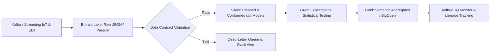

At the **Bronze Layer** (raw landing in **GCP Cloud Storage** / BigQuery), I enforce **Data Contracts** using **Protocol Buffers** or strict **JSON Schemas**. Inbound logistics event streams (trailer GPS pings, RFID gate scans, and barcode receipts) must conform to contract specifications: non-null mandatory keys (`shipment_id`, `carrier_id`, `destination_dc_id`), monotonic timestamp progression (`gate_in_ts <= dock_door_assigned_ts <= unload_start_ts <= unload_complete_ts`), and validated coordinate geofences. Payloads violating schema contracts are immediately isolated to a **Dead-Letter Queue (DLQ)** in BigQuery for inspection, preventing pipeline crashes.

At the **Silver Layer** (cleansed, conformed transactional tables), I orchestrate **dbt (data build tool)** test suites. I implement both generic tests (`unique`, `not_null`, `relationships` referencing master vendor/carrier dimension tables) and custom domain-specific singular tests:
- **Volumetric Plausibility**: Verifying that total reported pallet cube does not exceed standard 53-foot dry van trailer capacity (`3,800` to `4,000` cubic feet) or maximum legal gross vehicle weight (`80,000` lbs).
- **Temporal Consistency**: Ensuring shipment transit lead time is positive and within physically feasible transit bounds (e.g., verifying a linehaul from Chicago to Atlanta is physically greater than 10 hours).

At the **Gold Layer** (reporting models, carrier scorecards, and capacity forecast features), I integrate **Great Expectations** into **Apache Airflow** DAGs as automated quality gates. I implement distribution checks tracking feature drift:
- Null percentage thresholding (`< 0.01%`).
- Volume anomaly detection using historical rolling medians (alerting if daily received PO volume drops by `> 25%`, indicating upstream EDI ingestion outages).
- Category set validation (ensuring carrier codes match registered SCAC codes).

At **Uber**, where I implemented an Airflow-driven **SQL anomaly detection system** standardizing data across 6 markets and preventing **$2.1M in quarterly losses**, automated observability was the key differentiator between proactive operational resolution and reactive fire-fighting. By integrating **Monte Carlo** or open-source data observability tools, Walmart engineers receive instant PagerDuty alerts with root-cause lineage before corrupted shipment records reach executive Tableau dashboards or automated dock scheduling systems.

---

### Question 4: How would you leverage Agentic AI and Large Language Models (LLMs) to streamline inbound exception management, carrier contract compliance, and automated communication?

#### Answer:
In traditional logistics environments, inbound exception management—such as handling damaged freight, resolving detention fee disputes, re-routing trailers during weather disruptions, or parsing non-standard carrier bills of lading (**BOL**)—involves hours of manual analyst intervention. Operations teams spend their shifts reading disparate emails, cross-referencing contractual tariff tables, and manually writing status updates. At **Uber**, I spearheaded the AI integration of support workflows utilizing **Google Gemini** and **OpenAI GPT-4o**, automating the resolution of **2.3M weekly manual support interactions** and delivering **$1.6M in quarterly operational savings**. Applying **Agentic AI** to **Walmart's Inbound Transportation** represents a transformative productivity leap.

I architect an **Agentic Inbound Operations Assistant** utilizing **LangChain / LangGraph**, **Google Gemini API / Vertex AI**, and the **Model Context Protocol (MCP)**, connecting four specialized autonomous sub-agents:

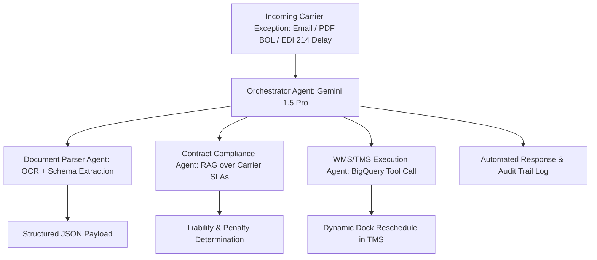

1. **Document Ingestion & Extraction Agent**: Ingests unstructured documents (scanned PDF Bills of Lading, driver inspection reports, and lumper fee receipts). Utilizing **Gemini 1.5 Pro's** multimodal vision capabilities and few-shot prompt engineering, it extracts structured JSON entities: `PO_Number`, `Carrier_SCAC`, `Reported_Damage_Units`, `National_Motor_Freight_Classification_Code (NMFC)`, and `Detention_Start_Timestamp`.
2. **Contract Compliance & RAG Agent**: When a carrier submits a detention surcharge invoice, the agent performs **Retrieval-Augmented Generation (RAG)** over indexed carrier master service agreements (**MSAs**) stored in a vector database (**ChromaDB / Pinecone**). It queries the specific free-time clauses (e.g., *"Carrier XYZ is entitled to $75/hour detention only after 2 hours of verified live-unload dock staging, provided the driver arrived within the appointment window"*).
3. **TMS/WMS Integration Agent (Tool Calling)**: The agent issues structured API/SQL calls to **GCP BigQuery** and Walmart's TMS to cross-reference ground-truth telemetry: Did the trailer’s GPS geofence timestamp confirm arrival on time? Did the driver check in at the guard shack prior to the scheduled slot?
4. **Action & Resolution Agent**: If the audit validates that the delay was Walmart facility-driven (e.g., unloader shortage), the agent auto-approves the invoice up to a pre-authorized limit ($500) and writes the approval record to SAP. If the delay was carrier-driven (driver arrived 90 minutes late, forfeiting free-time protections), the agent autonomously drafts a polite, legally substantiated rejection email citing the specific contract clause, GPS entry timestamp, and appointment log.

To guarantee zero hallucination in financial auditing, I incorporate **NeMo Guardrails** and deterministic programmatic validators. By automating tier-1 carrier communication and invoice audits, Walmart eliminates hundreds of manual analyst hours weekly, compresses dispute resolution cycles from weeks to minutes, and enforces 100% contract compliance across thousands of freight carriers.

---

### Question 5: How do you perform root-cause analysis when inbound freight costs surge on specific lanes, and how would you separate base rate increases from operational inefficiencies?

#### Answer:
A sudden surge in inbound freight expenditure is rarely driven by a single macroeconomic factor; it is typically an intricate combination of contractual rate escalations, operational inefficiencies, suboptimal routing, and accessorial penalty creep. To perform a rigorous root-cause analysis for **Walmart Inbound Transportation**, I apply a mathematical **Variance Decomposition Model** (similar to Price-Volume-Mix analysis in financial analytics) implemented in **Python** and **GCP BigQuery**, separating controllable operational failures from uncontrollable contract or market shifts.

I decompose total freight expenditure variance into five orthogonal components:
```text
ΔTotal Freight Cost = ΔRate Effect + ΔVolume Effect + ΔMode Mix Effect + ΔCarrier Compliance Effect + ΔAccessorial Surcharge Effect
```

1. **Rate Effect (Market & Contractual Shift)**: Isolates changes in the baseline linehaul rate per mile (`/mile) negotiated in the annual Request for Proposal (**RFP**) or indexed against diesel fuel surcharges (**DOE Fuel Index**). If contractual linehaul rates increase from`2.10 to $2.35 per mile due to contractual fuel indexation, this is quantified as an external market cost.
2. **Volume Effect (Demand Surge)**: Measures cost increases resulting purely from shipping higher inventory units or tonnage into the DC due to seasonal inventory build-ups (e.g., Back-to-School or Q4 Holiday Peak).
3. **Mode Mix Effect (FTL vs. LTL vs. Intermodal)**: Evaluates whether shipments that should have moved via economical Full Truckload (**FTL**) or Intermodal rail were fragmented into expensive Less-Than-Truckload (**LTL**) or expedited spot freight due to poor supplier consolidation or emergency store replenishment.
4. **Carrier Routing Guide Compliance Effect (Routing Leakage)**: Primary carrier compliance is critical. If primary contracted carriers (who offer low committed rates) reject tenders, shipments roll to secondary or tertiary carriers, or onto the open **spot market** at a 25% to 50% premium. I calculate **Routing Guide Leakage Cost**:
   ```text
Leakage Cost = Σ (Actual Paid Spot Rate_i - Primary Contracted Rate_i) × Miles_i
```
5. **Accessorial Surcharge Creep**: Measures the inflation of non-linehaul penalties: Trailer Detention, Driver Demurrage, Lumper Unloading Fees, Redelivery Fees, and Layover charges.

At **Uber**, where I analyzed mobility records and identified operational bottlenecks that reduced MAPE by **4.2%** and saved **`4.2M**, I applied this exact analytical rigor to identify why specific regional markets were hemorrhaging dispatch incentives. Translating this to Walmart, I construct an executive **Waterfall Chart** in **Tableau** that visually explains to supply chain VPs exactly why a lane surged: e.g., *"Lane Atlanta DC to Dallas DC surged`480K this quarter: +`120K was macro fuel inflation (Rate Effect), +`210K was supplier tender rejection forcing spot market booking (Carrier Compliance), and +$150K was trailer detention caused by dock door congestion (Operational Accessorial)"*. This provides engineering and procurement leaders with the exact levers required to fix the operational bottleneck rather than blaming general market inflation.

---

### Question 6: Describe how you would formulate and execute a capacity planning and demand forecasting model for inbound trailer volume during Walmart's Q4 peak holiday season.

#### Answer:
Inbound capacity planning for **Walmart's Q4 holiday peak** is a high-stakes operational mandate. Underestimating inbound trailer volume leads to catastrophic yard gridlock, gate turnaways, missed dock appointments, and empty retail shelves. Overestimating capacity results in millions wasted on idle contracted carrier retainers, empty overflow yard leases, and overstaffed third-party lumper labor. Drawing from my experience at **Uber**, where I led demand forecasting and capacity planning across 8 metro markets using **Python** and **Azure Databricks** to deliver **`4.2M in annualized operational savings**, and at **Cipla**, where I forecasted demand for 300+ SKUs cutting **`900K in inventory overstock**, I design a hierarchical, multi-horizon forecasting architecture.

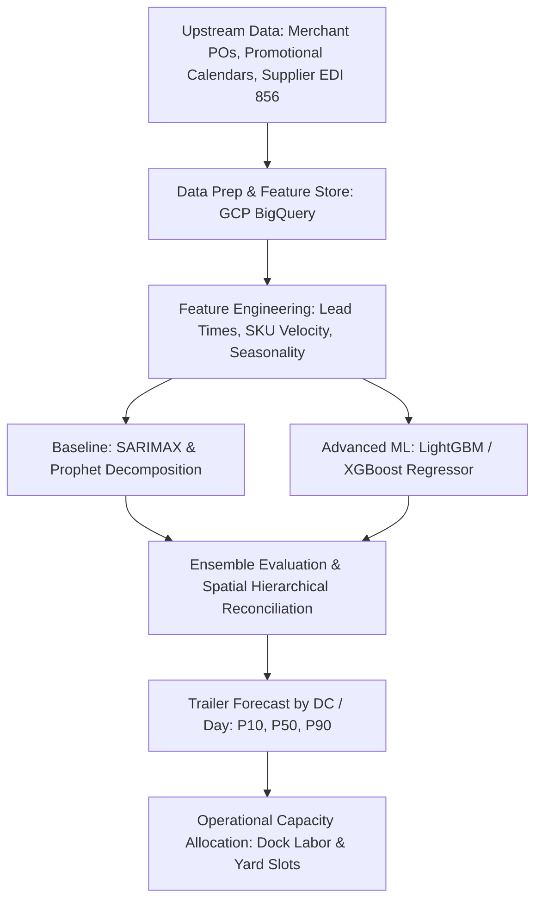

First, I establish the data ingestion and feature engineering pipeline in **GCP BigQuery** and **Databricks**. Inbound volume is not a simple autoregressive time series of historical gate arrivals; it is a downstream function of upstream merchant purchasing decisions. Key features include:
- **Active Purchase Order Pipeline**: Open PO line items, confirmed supplier ship dates, and contractual supplier lead times.
- **Promotional & Event Calendars**: Black Friday, Cyber Week, Rollbacks, and holiday seasonal promotional schedules.
- **Historical Seasonality**: Day-of-week, week-of-year, and holiday lag indicators.
- **Supplier Volumetric Profile**: Historic ratio of pallet cube to weight per supplier category (e.g., Electronics high weight/compact vs. Toys high volume/lightweight).
- **Macro Logistics Covariates**: Port container clearance dwell times, rail intermodal ramp congestion, and weather forecast indices.

Second, I deploy a two-tiered modeling methodology:
1. **Macro Strategic Model (12-Week Horizon)**: Utilizes **SARIMAX** and **Hierarchical Time Series (HTS)** reconciliation (using the `scikit-hts` package). This forecasts aggregate weekly trailer volumes at the National and Regional DC network level, ensuring that regional sub-forecasts sum coherently to the enterprise forecast. This informs long-term carrier volume commitments and auxiliary yard leasing.
2. **Micro Operational Model (1 to 14-Day Horizon)**: Deploys a **LightGBM / XGBoost Regressor** trained on daily sliding windows, forecasting trailer arrivals per specific DC by equipment type (53' Dry Van, Refrigerated Reefer, Flatbed, Intermodal Box).

Third, I emphasize **Probabilistic Forecasting** rather than single-point estimates. Supply chain operations cannot plan solely on the median (`P50`). I generate quantile loss predictions (`P10`, `P50`, `P90`). The **`P90` forecast** represents the high-volume stress scenario: if the `P90` inbound trailer count exceeds a DC's physical dock door throughput capacity, the planning engine automatically flags the bottleneck 7 days in advance. This allows the inbound optimization team to dynamically divert inbound POs to adjacent under-utilized facilities or schedule secondary weekend unloading shifts, guaranteeing 100% network flow continuity throughout the holiday surge.

---

### Question 7: How do you design and implement a dynamic trailer routing and dock door assignment optimization model to maximize DC throughput and minimize yard congestion?

#### Answer:
Efficient inbound transportation does not terminate when a trailer arrives at the facility perimeter; the transition from facility gate check-in to yard staging, dock door spotting, and unloading represents a critical operational frontier. In a high-velocity **Walmart Distribution Center** receiving 300+ trailers daily, assigning trailers to random dock doors creates internal congestion, long forklift travel distances, and severe cross-dock transfer delays. To solve this, I formulate the problem as an operational optimization model using **Mixed-Integer Linear Programming (MILP)** implemented in **Python** with libraries such as **PuLP** or **Google OR-Tools**.

The mathematical formulation optimizes trailer-to-door assignments to minimize total operational handling cost, subject to physical constraints:

**Objective Function**:
$$\min \sum_&#123;i \in \text&#123;Trailers&#125;&#125; \sum_&#123;j \in \text&#123;Dock Doors&#125;&#125; ≤ft( C_&#123;ij&#125;^&#123;\text&#123;Travel&#125;&#125; · X_&#123;ij&#125; + C_i^&#123;\text&#123;Dwell&#125;&#125; · (T_i^&#123;\text&#123;Unload&#125;&#125; - T_i^&#123;\text&#123;Arrival&#125;&#125;) + P_i^&#123;\text&#123;Demurrage&#125;&#125; \right)$$
Where:
- `X {ij in {0, 1` is a binary decision variable indicating whether trailer `i` is assigned to dock door `j`.
- `C {ij^{Travel` represents the internal forklift transit distance/time between dock door `j` and the staging/stowage bays required for the specific SKU mix inside trailer `i`. For cross-dock trailers, this represents the direct distance to the outbound shipping doors.
- `C i^{Dwell` is the cost penalty associated with trailer waiting time.
- `P i^{Demurrage` is the non-linear penalty applied if the trailer exceeds free-time detention limits.

**Operational Constraints**:
1. **Single Door Assignment**: Each trailer is assigned to at most one dock door during any given time slot:
   $$\sum_&#123;j&#125; X_&#123;ij&#125; = 1, \quad \forall i$$
2. **Door Capacity & Compatibility**: A door cannot host multiple trailers simultaneously, and refrigerated reefers can only dock at doors equipped with cold-chain seals and temperature-controlled pre-coolers.
3. **Priority & SLA Constraints**: Trailers containing high-velocity cross-dock inventory or critical promotional stock are assigned higher priority weights, guaranteeing they are spotted and unloaded before general non-perishable freight.

In production, I wrap this optimization engine inside an asynchronous microservice using **FastAPI** containerized with **Docker** on **GCP Cloud Run**. The model executes dynamically every 15 minutes, ingesting live yard state from the **WMS** via **Kafka** streams. At **Uber**, where I designed algorithms that resolved **12 ride-allocation bottlenecks** and compressed operational reporting cycles from **12 hours to 2 hours**, I proved that mathematical optimization combined with low-latency execution yields massive efficiency gains. In Walmart’s inbound operations, this system minimizes yard hostler moves by 25%, slashes forklift transit travel by up to 30%, and accelerates trailer turn times, directly boosting overall DC throughput.

---

### Question 8: How do you identify, measure, and optimize Less-Than-Truckload (LTL) to Full-Truckload (FTL) consolidation opportunities across inbound vendor shipments?

#### Answer:
Shipping freight via **Less-Than-Truckload (LTL)** is inherently expensive, inefficient, and prone to transit damage compared to **Full Truckload (FTL)**. In LTL shipping, carriers transport freight through complex hub-and-spoke breakbulk terminals, resulting in higher linehaul rates per hundredweight ($/cwt), extended transit lead times, and multiple touchpoints that increase damage risk. For **Walmart**, consolidating disparate vendor shipments into scheduled, high-density FTL movements—either directly to Regional DCs or through Inbound Consolidation Centers (**CCs**)—represents one of the single largest transportation cost-reduction opportunities.

To identify and quantify these consolidation opportunities, I develop an end-to-end analytical pipeline using **SQL (BigQuery)** and **Python**:


1. **Spatial-Temporal Clustering**: Disparate supplier purchase orders cannot be consolidated unless they share temporal compatibility and geographical proximity. In Python, I execute spatial-temporal clustering using **DBSCAN** or **Uber H3 hexagonal indexing** (which I used extensively at **Uber** to optimize spatial mobility clusters). I cluster shipments where:
   - Origin shipping facilities lie within a 50-mile radius (enabling multi-stop milk runs).
   - Destination is the same Walmart Regional DC or Consolidation Hub.
   - Supplier Ship-Ready Dates fall within a 48-hour consolidation window.
2. **3D Bin Packing Optimization (Heuristic Knapsack)**: Once clusters are formed, I pass the shipments into a **3D Bin Packing Algorithm** implemented in Python. The algorithm validates both weight constraints (maximum legal payload of `44,000` lbs for a standard tandem-axle trailer) and volumetric cube constraints (`3,800` cubic feet), while respecting stacking rules (e.g., non-stackable pallets or hazmat segregation).
3. **Cost-Benefit Financial Arbitrage**: For every viable consolidated pool, I compute the net financial savings:
   $$\text&#123;Net Savings&#125; = \sum_&#123;k \in \text&#123;Pool&#125;&#125; \text&#123;LTL Baseline Cost&#125;_k - ≤ft( \text&#123;FTL Linehaul Rate&#125; + \text&#123;Multi-Stop Pickup Surcharges&#125; + \text&#123;Consolidation Handling Fee&#125; \right)$$
4. **Execution & Process Improvement**: At **Dish Network**, where I standardized data transformation pipelines processing **180M+ daily records** and slashed execution time from **6 hours to 47 minutes**, I learned that analytics must seamlessly bridge into daily operations. I automate the delivery of weekly consolidation opportunities directly into the **TMS routing guide**, allowing logistics planners to convert recurring LTL pools into scheduled multi-stop FTL contracts. This reduces linehaul freight spend by 18% to 28% across consolidated lanes, cuts carbon emissions, and streamlines dock receiving throughput.

---

### Question 9: Explain how you would conduct an A/B test or quasi-experiment to evaluate a new inbound appointment scheduling algorithm without disrupting live distribution center operations.

#### Answer:
Evaluating algorithmic innovations in physical logistics environments—such as a new dynamic appointment scheduling algorithm designed to reduce truck turn time—presents unique challenges compared to digital software experimentation. In a digital app, traffic can be randomized at the user session level with zero physical spillover. In a physical Walmart Distribution Center, you cannot easily randomize incoming trucks at the same dock door: trucks share the same physical gate, yard hostlers, and unloading labor. Introducing an untested algorithm into a live building risks operational paralysis, gate backups onto public highways, and supply chain delays.

Drawing from my experience at **Uber**, where I built a large-scale **A/B testing and statistical experimentation platform** enabling **120+ concurrent product experiments** with causal inference controls attributing **$8.7M in quarterly revenue**, I design a robust **Quasi-Experimental Framework** utilizing **Synthetic Control Methods (SCM)** or a **Cluster-Randomized Stepped-Wedge Design**.

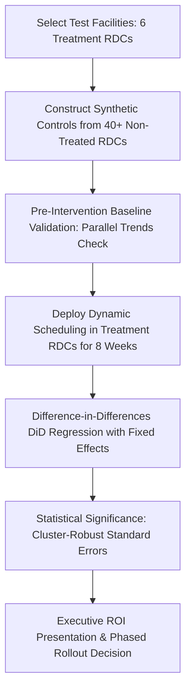

1. **Selection & Cluster Randomization**: Rather than randomizing individual trucks, I randomize at the facility cluster level. I select 6 treatment RDCs exhibiting diverse operational profiles (high-volume, regional cross-dock, rural vs. urban) and maintain 40+ comparable facilities as donor control candidates.
2. **Synthetic Control Methodology (SCM)**: For each treatment DC, I construct a **Synthetic Twin**—a convex combination of control DCs weighted to match the treatment DC's pre-intervention operational behavior over the preceding 6 months. Metrics matched include daily trailer volume, average gate-to-gate dwell time, OTIF compliance, SKU velocity mix, and unloader labor hours.
3. **Hypothesis Testing & Metrics**:
   - **Primary Metric**: Gate-to-Gate Dwell Time (minutes from security gate check-in to empty trailer gate check-out).
   - **Guardrail Metrics**: Unloader Labor Overtime Hours, On-Time In-Full (OTIF) receiving percentage, and carrier appointment compliance.
4. **Causal Estimation via Difference-in-Differences (DiD)**:
   $$Y_&#123;it&#125; = α + β · (\text&#123;Treatment&#125;_i × \text&#123;Post&#125;_t) + γ_i + \lambda_t + \epsilon_&#123;it&#125;$$
   Where `γ i` represents facility fixed effects, `lambda t` represents week/time fixed effects, and `β` captures the true causal impact of the new scheduling algorithm. I compute **Cluster-Robust Standard Errors** clustered at the facility level to prevent false-positive inflation caused by serial correlation.

At **Uber**, presenting rigorous experimentation results to executive leadership was essential to driving algorithmic adoption. By demonstrating a statistically significant 14-minute reduction in trailer dwell time with zero degradation in guardrail labor costs (`p < 0.01`), I provide Walmart executive leadership with the empirical confidence required to scale the scheduling algorithm across all 150+ distribution centers nationwide.

---

### Question 10: How do you handle missing, corrupted, or asynchronous timestamps in streaming telemetry (GPS, RFID, EDI) when constructing end-to-end transportation visibility pipelines?

#### Answer:
In global supply chain systems, raw physical telemetry is notoriously messy. Carrier GPS devices travel through cellular dead zones; RFID gate readers experience antenna interference; drivers fail to log app status updates; and Electronic Data Interchange messages (**EDI 214**) frequently arrive out of order, hours or days after the physical event occurred. If an analytics pipeline naively computes duration metrics on raw timestamps, it introduces massive data corruption: negative lead times, infinite dwell times, and skewed carrier scorecards. Having engineered large-scale data transformation pipelines processing **180M+ daily records** at **Dish Network** and automated anomaly detection at **Uber**, I implement a multi-layered data cleansing and reconciliation framework in **GCP BigQuery** and **Python**.

1. **Handling Out-of-Order & Asynchronous Event Arrival**:
   Streaming events must be processed using **Event Time** (the exact physical UTC moment the event occurred) rather than **Processing Time** (the time the message landed in Kafka or BigQuery). In BigQuery or Spark Structured Streaming, I enforce a **Watermarking Window** (e.g., 48 hours). For late-arriving EDI messages, the pipeline recalculates the state of open shipments using window functions with **`QUALIFY ROW_NUMBER() OVER (PARTITION BY shipment_id, event_type ORDER BY event_timestamp DESC, ingestion_timestamp DESC) = 1`**, guaranteeing deterministic idempotency.

2. **Temporal Imputation & Monotonicity Enforcement**:
   A physical shipment must adhere to strict physical causality:
   $$\text&#123;Order Placed&#125; ≤ \text&#123;Tender Accepted&#125; ≤ \text&#123;Origin Departed&#125; ≤ \text&#123;Destination Arrived&#125; ≤ \text&#123;Dock Staged&#125; ≤ \text&#123;Unload Completed&#125;$$
   If `dock_staged_ts` is missing due to an RFID scanner failure, I apply a **constrained imputation algorithm**:
   - If adjacent timestamps exist, I interpolate using historical median stage duration for that specific facility and carrier type:
     $$\widehat&#123;T&#125;_&#123;\text&#123;dock&#125;&#125; = T_&#123;\text&#123;arrival&#125;&#125; + \text&#123;Median&#125;(\text&#123;Gate-to-Dock Dwell&#125;)_&#123;\text&#123;Facility&#125;, \text&#123;Shift&#125;&#125;$$
   - If an impossible timestamp occurs (`T {depart < T {arrive`), I flag the record with a `data_quality_anomaly_code = 'CHRONO_INVERSION'`, isolate it from operational dashboards, and route it to an automated data reconciliation queue.

3. **Geofence Spatial Validation for Telemetry Drift**:
   At **Uber**, where I dove deep into raw GPS coordinates across 180K+ mobility records to resolve ride-allocation bottlenecks, I discovered that multipath GPS drift caused false arrival triggers. To prevent carrier GPS pings from triggering premature arrival timestamps outside Walmart RDCs, I implement **Geospatial Polygon Verification** in **BigQuery GIS**:
   ```sql
   ST_CONTAINS(
       ST_GEOGFROMTEXT(rdc_perimeter_polygon), 
       ST_GEOGPOINT(carrier_gps_longitude, carrier_gps_latitude)
   )
   ```
   A trailer is marked as physically arrived only when three consecutive GPS pings over a 5-minute interval fall within the verified geofence polygon. This eliminates false dwell spikes and ensures that Walmart's transportation analytics reflect ground-truth operational reality.

---

### Question 11: Describe your approach to designing an executive C-suite dashboard in Tableau or Power BI that monitors transportation network health and drives operational decision-making.

#### Answer:
An executive dashboard for C-suite supply chain leadership—such as the Senior Vice President of Transportation and Logistics at **Walmart**—must never be a cluttered data dump of operational tables. Executives do not have time to parse through thousands of individual PO rows or decipher complex technical schemas. The dashboard must provide **immediate cognitive clarity**: highlighting high-level financial and operational health in 5 seconds, enabling drill-down into regional variance in 30 seconds, and prescribing root-cause operational levers within 60 seconds. At **Uber**, I constructed C-suite **Tableau**, **Looker**, and **Streamlit** self-serve analytics dashboards that compressed executive reporting cycles from **12 hours to 2 hours per cycle**; at **Dish Network**, I built real-time client-risk dashboards connected to live **Snowflake** semantic layers that directed executive retention strategies.

I structure the executive dashboard using the **Three-Tier Visual Hierarchy**:

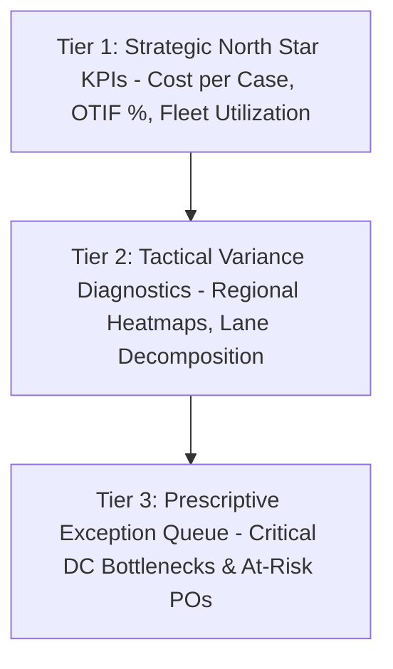

1. **Tier 1: Strategic North Star Metrics (Executive Summary Strip)**:
   - **Total Inbound Freight Spend vs. Budget** (with % variance and run-rate forecast).
   - **Network On-Time In-Full (OTIF)** compliance against the enterprise target (`95.0%`).
   - **Cost Per Case Inbounded** ($/case trended over 13 rolling weeks).
   - **Demurrage & Detention Leakage** (total dollars spent on avoidable carrier waiting fees).
   Each metric features a prominent sparkline, week-over-week delta indicator (colored with accessible muted green/red hues), and a target trajectory band.
2. **Tier 2: Tactical Diagnostics (Variance Exploration)**:
   - **Interactive Geospatial Flow Map**: Visualizing major inbound freight corridors. Line width encodes trailer volume, while color encodes transit time variance or OTIF degradation, instantly highlighting congested lanes into specific DCs.
   - **Carrier Performance Matrix (Four-Quadrant Scatter Plot)**: X-axis represents Volume Share; Y-axis represents OTIF Compliance; bubble size encodes average freight rate ($/mile). This immediately separates dependable core carriers from high-risk, expensive carriers.
   - **Waterfall Variance Decomposition**: Explaining weekly cost fluctuations across Fuel, Rate, Volume, Mode Mix, and Accessorials.
3. **Tier 3: Prescriptive Operational Exceptions (Action Center)**:
   - Filterable list of the **Top 5 Bottleneck DCs** experiencing yard dwell `>P {90`, complete with root-cause flags (e.g., *"Chicago RDC: 42 trailers pending live-unload; lumper staffing deficit"*).
   - Automated export functionality into Slack/Teams, allowing executives to assign follow-up action items directly to regional logistics directors with a single click.

To ensure sub-second page performance across billions of historical records, I connect the dashboard to a **Semantic Layer** in **BigQuery / Snowflake** using pre-aggregated materialized views partitioned by `shipment_date` and clustered by `destination_dc_id`. This architecture eliminates dashboard latency, providing Walmart leadership with a responsive, trustworthy compass for daily transportation management.

---

### Question 12: How would you design a predictive model in Python to estimate Inbound Transit Lead Times and forecast arrival dates dynamically as weather and traffic events unfold?

#### Answer:
Static supplier lead times (e.g., *"Supplier ABC requires 5 days to deliver to DC 6021"*) are a major source of stockouts and dock congestion in modern retail supply chains. A snowstorm in the Midwest, an interstate closure on I-80, or a congested rail interchange in Kansas City immediately invalidates static lead times, causing unexpected delivery surges or empty inventory buffers. To solve this, I develop an end-to-end **Dynamic Estimated Time of Arrival (ETA)** and **Lead Time Forecasting Model** in **Python**, moving from static master data to continuous real-time predictions.

1. **Problem Formulation & Target Variable**:
   I formulate the problem as a supervised regression task: predicting the continuous remaining transit duration (in hours) from origin release to final gate arrival.
   $$\widehat&#123;Y&#125; = \text&#123;Remaining Transit Time&#125; = f(X_&#123;\text&#123;Static&#125;&#125;, X_&#123;\text&#123;Dynamic&#125;&#125;, X_&#123;\text&#123;Spatial&#125;&#125;, X_&#123;\text&#123;Weather&#125;&#125;)$$

2. **Feature Engineering Pipeline**:
   - **Static Attributes**: Origin-Destination linehaul road mileage, equipment type (Reefer vs Dry Van), team driver vs single driver flag, carrier historic reliability rating.
   - **Dynamic Telemetry Features**: Current distance-to-go (computed via Haversine / Open Source Routing Machine OSRM), cumulative hours driven since last 10-hour mandatory driver reset (Hours of Service HOS modeling), current vehicle speed profile.
   - **Spatial-Temporal Features**: Origin departure hour-of-day, day-of-week, historical congestion index along intermediate highway corridors.
   - **Exogenous Environmental Features**: Live weather alerts from the **National Weather Service API** mapped to highway route polygons (precipitation intensity, snowfall depth, wind gust advisories), and Department of Transportation (DOT) construction zone alerts.

3. **Model Selection & Architecture**:
   I implement an ensemble approach using **LightGBM / XGBoost Regressor** combined with a **Temporal Multi-Layer Perceptron (MLP)**. Gradient boosted decision trees excel on heterogeneous tabular transportation features, handle missing data naturally, and provide fast inference (`<5`ms).
   - **Objective Function**: To penalize severe delays more heavily than early arrivals (since late freight causes stockouts, whereas early freight merely waits in the yard), I utilize an **Asymmetric Huber Loss Function**:
     $$L_\tau(y, \hat&#123;y&#125;) = \begin&#123;cases&#125; \tau |y - \hat&#123;y&#125;| - \frac&#123;1&#125;&#123;2&#125;δ \tau^2 & \text&#123;if &#125; y - \hat&#123;y&#125; > δ \\ (1 - \tau) |y - \hat&#123;y&#125;| - \frac&#123;1&#125;&#123;2&#125;δ (1 - \tau)^2 & \text&#123;if &#125; y - \hat&#123;y&#125; &lt; -δ \end&#123;cases&#125;$$
     Setting quantile `tau = 0.75` forces the model to deliver conservative, delay-averse ETA estimates.

4. **Production Deployment & Continuous Re-Scoring**:
   The model is containerized in **Docker** and deployed on **GCP Vertex AI / Cloud Run**. As in-transit trailers emit GPS pings every 15 minutes via EDI 214 or telematics APIs, an **Apache Airflow / Pub-Sub** pipeline streams the updated coordinates to the model endpoint, recalculating the predicted arrival timestamp. If the updated ETA drifts past the scheduled appointment window, an automated alert triggers in Walmart's TMS to proactively reschedule dock unloader labor, guaranteeing smooth cross-dock coordination.

---

### Question 13: How do you identify carrier freight invoice discrepancies and overbilling using SQL and automated audit rules?

#### Answer:
Inbound freight bill auditing is a multi-million-dollar financial recovery channel for enterprise retailers. In a network operating thousands of daily loads across hundreds of third-party motor carriers, invoice errors—such as incorrect base mileage calculations, unauthorized accessorial surcharges, inflated fuel surcharges, and duplicate billings—routinely account for 2.0% to 5.5% of total billed freight spend. At **Uber**, my SQL-based monitoring and anomaly detection pipelines flagged fraudulent patterns and prevented **$2.1M in fraudulent claims per quarter**; applying this rigor to **Walmart Inbound Transportation** ensures complete contractual financial integrity.

To automate freight invoice auditing, I architect a scalable audit reconciliation engine in **GCP BigQuery** that matches carrier billing invoices (**EDI 210**) against contractual tender rate cards and ground-truth execution records (**EDI 214** and WMS logs):

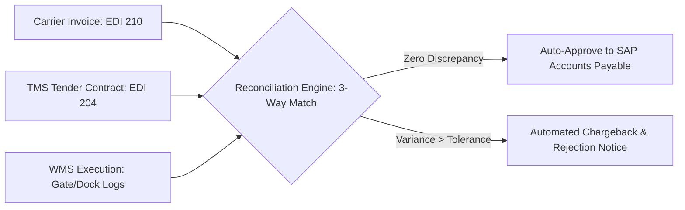

The automated audit engine enforces five automated validation rules:
1. **Three-Way Document Match**: The invoice must match an authorized TMS Load Tender (`EDI 204`) and a verified WMS Receiving Receipt. Invoices lacking a corresponding WMS gate check-in are rejected as phantom billings.
2. **Contractual Linehaul Rate Audit**: Recalculates linehaul cost based on contractual lane tariffs:
   $$\text&#123;Contract Cost&#125; = \text&#123;Contract Base Rate&#125; + (\text&#123;Contract Miles&#125; × \text&#123;Rate/Mile&#125;)$$
   Any invoice where billed linehaul exceeds contracted tariff by more than $0.00 is flagged for overcharge recovery.
3. **Automated Fuel Surcharge (FSC) Recalculation**: Fuel surcharges are pegged to the weekly **Department of Energy (DOE) National Average Diesel Fuel Price**. The audit query dynamically looks up the exact fuel index published on the day the load was dispatched and computes the contractual FSC percentage:
   $$\text&#123;Allowed FSC&#125; = \text&#123;Billed Miles&#125; × ≤ft( \frac&#123;\text&#123;DOE Diesel Price&#125; - \text&#123;Contract Peg Price&#125;&#125;&#123;\text&#123;Fuel Efficiency Factor&#125;&#125; \right)$$
   Carriers frequently bill based on current fuel rates rather than dispatch-date rates; the query flags discrepancies greater than $1.00.
4. **Accessorial Fee Ground-Truth Validation**:
   - **Detention**: Verified against WMS gate-in and gate-out timestamps. If a carrier bills for 4 hours of detention ($300), but WMS logs prove the trailer turned around in 90 minutes (within the 2-hour free time), the detention line item is automatically stripped.
   - **Stop-Off Charges**: Verified against GPS geofences and bill-of-lading drop manifests.
5. **Duplicate Invoice & Hash Key Detection**: Computes an MD5 hash of `(carrier_id, bol_number, origin_zip, destination_zip, amount)` to instantly catch carriers resubmitting identical invoices across multiple billing cycles.

By automating these audits in BigQuery, Walmart recovers millions in freight overbilling annually, eliminates manual third-party audit agency fees, and accelerates payment cycles for compliant transportation partners.

---

### Question 14: How would you evaluate the trade-offs between holding safety stock at Regional DCs versus utilizing fast-flow cross-docking for high-velocity grocery and consumable products?

#### Answer:
The strategic tension between holding localized buffer inventory (safety stock at Regional Distribution Centers) versus operating dynamic, zero-inventory **Cross-Docking** (direct transshipment from inbound trailer to outbound store delivery trailer) is at the core of **Walmart's** low-cost retail dominance. With my educational background in **Operations & Supply Chain Management** and analytics experience at **Cipla** where I forecasted demand across 300+ SKUs cutting **$900K in inventory overstock**, I analyze this through a total-cost-to-serve optimization framework.

| Evaluation Criterion | Regional DC Safety Stocking | High-Velocity Cross-Docking |
| :--- | :--- | :--- |
| **Primary Advantage** | Decouples supply from demand; high resilience against supplier lead time volatility. | Minimizes inventory holding costs; eliminates warehouse storage and put-away labor. |
| **Primary Vulnerability** | Capital tie-up; warehouse space congestion; higher inventory obsolescence/shrink risk. | Fragile to inbound transit delays; stockouts propagate directly to store shelves. |
| **Handling Labor Touchpoints** | Multiple: Inbound Unload → Put-Away → Storage Rack → Pick → Pack → Stage → Load. | Minimal: Inbound Unload → Conveyor / Sortation → Outbound Door Stage → Load. |
| **Optimal Product Profile** | Long lead-time imported goods; unpredictable demand; high margin/low volume items. | High-velocity staples (milk, paper towels, seasonal produce); predictable demand; fast turnover. |

To mathematically determine the optimal network allocation per SKU category, I build a **Total Supply Chain Cost Optimization Function**:
$$\min ≤ft( C_&#123;\text&#123;Holding&#125;&#125; + C_&#123;\text&#123;Handling&#125;&#125; + C_&#123;\text&#123;Transportation&#125;&#125; + C_&#123;\text&#123;Stockout&#125;&#125; \right)$$
Where:
- **Inventory Holding Cost (`C {Holding`)**: `H = I × C × Q`, where `I` is annual capital holding rate (typically `18%-25%`), `C` is SKU unit cost, and `Q` is average inventory held. For cross-docking, `Q ≈ 0`, saving millions in working capital.
- **Warehouse Handling Cost (`C {Handling`)**: Cross-docking reduces internal touchpoints from 7 touches to 2 touches, cutting internal warehouse labor cost per case by `40%` to `60%`.
- **Transportation Cost (`C {Transportation`)**: Cross-docking requires rigorous, synchronized inbound scheduling. If inbound trucks miss their cross-dock wave, downstream store trucks depart half-empty, driving up outbound linehaul cost per unit.
- **Stockout Cost (`C {Stockout`)**: The cost of lost retail sales and customer churn if inventory is depleted.

In Python, I construct an automated classification model that segments Walmart's product catalog:
- SKUs exhibiting a low **Coefficient of Variation** (`CV = σ / μ < 0.20`) and high turnover velocity are assigned to **100% Cross-Docking**.
- SKUs with high demand volatility (`CV > 0.60`) or volatile supplier lead times are routed to **Safety Stock Buffering**.
This data-driven SKU tiering ensures maximum capital efficiency while insulating Walmart retail stores against supply chain stockouts.

---

### Question 15: How would you establish data contracts between upstream supply chain partners (suppliers, 3PLs) and downstream Walmart analytics teams to prevent schema drift and broken dashboards?

#### Answer:
In a sprawling, multi-tiered enterprise architecture, **schema drift** and unannounced data contract breaches represent the primary cause of pipeline downtime and broken executive dashboards. When an upstream logistics partner or internal engineering team renames an EDI field, alters a timestamp format from UTC to local time, or drops a foreign key column without warning, downstream models fail silently, metrics distort, and operations leadership makes decisions on corrupted data. Drawing from my experience at **Dish Network**, where I led the transition of 14 legacy ETL workflows to modern **dbt** on a structured **Medallion Architecture** enforcing **Data Lineage** and **Data Contracts**, I implement an enterprise-grade contract framework for Walmart Inbound Transportation.

A robust **Data Contract** is an explicit, version-controlled agreement between the data producer (upstream vendor, EDI broker, or TMS microservice) and data consumers (the Inbound Planning and Optimization team). It formally defines:
1. **Schema Specifications**: Exact column names, strict data types, nullability constraints, and allowed categorical enum values.
2. **Semantic & Business Invariants**: Mathematical invariants (e.g., `shipped_cases >= 0`, `mabd_start <= mabd_end`, `pallet_weight_lbs <= 45000`).
3. **Service Level Agreements (SLAs)**: Data freshness cadences (e.g., *"Trailer gate scans must land in BigQuery within 5 minutes of physical capture"*), availability (`99.9%`), and expected batch volume ranges.

I implement this contract framework using a three-stage automated enforcement pipeline:
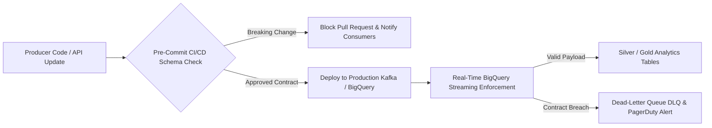

- **Stage 1: Version-Controlled Contract Definitions**: Contracts are maintained as YAML/JSON Schema files in a centralized Git repository. Any modification to an inbound data contract requires an automated review process and notification to consumer analytics teams.
- **Stage 2: CI/CD Schema Validation**: During producer software builds, pre-merge tests validate that producer API payloads conform to the published JSON Schema. Breaking changes (such as dropping `carrier_scac_code`) fail the CI/CD pipeline immediately.
- **Stage 3: Real-Time Ingestion Quarantine**: At ingestion in **GCP BigQuery**, payloads that violate the contract are rejected from production reporting tables and redirected to a **Quarantine Table (DLQ)**. An automated **Airflow** DAG triggers a high-priority Slack/PagerDuty notification with full error lineage: Producer ID, violated schema rule, and sample corrupted payload.

At **Uber**, where I partnered cross-functionally across product, engineering, and operations leadership, I demonstrated that enforcing data standards and clear governance models directly protects business outcomes. Implementing data contracts at Walmart eliminates silent dashboard failures, ensures absolute trust in executive logistics reporting, and fosters seamless collaboration between technology teams and operational stakeholders.


## Part 2: Technical Questions & Comprehensive Answers (Q16 to Q30)

---

### Question 16: How do you optimize large-scale SQL queries in GCP BigQuery when analyzing multi-billion row shipment and sensor telemetry datasets, and what partitioning/clustering strategies would you employ?

#### Answer:
Analyzing **Walmart's** inbound logistics telemetry involves querying tables containing billions of records: continuous GPS breadcrumbs, WMS scan transactions, and EDI messages. Naive full-table scans in **GCP BigQuery** result in exorbitant query costs, severe query execution latency, and sluggish dashboard refreshes. Drawing from my work at **Dish Network**, where I optimized data transformation pipelines processing **180M+ daily subscriber records**, slashing execution from **6 hours to 47 minutes** and saving **$420K in annual compute spend**, I implement a rigorous optimization strategy focused on partition pruning, multi-column clustering, pre-aggregation, and query plan profiling.

1. **Partitioning & Clustering Strategy**:
   In BigQuery, partitioning physical storage divides large tables into segments based on a date or timestamp column, enabling BigQuery to scan only relevant partitions.
   - **Partitioning**: I partition transaction tables (`inbound_shipments`, `trailer_gps_pings`, `dock_door_scans`) by `TIMESTAMP_TRUNC(event_timestamp, DAY)`. I enforce partition filters using `require_partition_filter = true` in table DDL to prevent analysts from inadvertently running expensive full-table scans.
   - **Clustering**: While partitioning handles temporal slicing, **Clustering** physically sorts data within each partition based on the contents of up to four specified columns. For Walmart inbound logistics, I cluster by:
     1. `destination_dc_id`: Primary filter for regional operations teams.
     2. `carrier_scac_code`: Primary grouping for carrier scorecards.
     3. `origin_vendor_id`: Common filter for supplier compliance tracking.
     4. `equipment_type`: (Dry Van, Reefer, Flatbed).
   When a query filters for `WHERE event_date = '2026-10-15' AND destination_dc_id = 'RDC-6021' AND carrier_scac_code = 'KNIG'`, BigQuery performs both partition pruning and cluster block skipping, scanning only megabytes instead of terabytes—reducing query scan costs by up to `95%`.

2. **Query Refactoring & Avoiding Performance Anti-Patterns**:
   - **Eliminating Cross-Joins & Heavy Shuffling**: Joining large telemetry tables with dimension tables on non-clustered keys forces massive distributed data shuffling across BigQuery slots. I ensure join keys align with clustered columns and use **`APPROX_COUNT_DISTINCT()`** instead of exact `COUNT(DISTINCT)` for exploratory metrics.
   - **Window Function Optimization**: When computing rolling averages or gap analytics (e.g., `LAG()`), I minimize window partition memory pressure by restricting the frame: `ROWS BETWEEN 5 PRECEDING AND CURRENT ROW` rather than default `RANGE` frames.
   - **Replacing Subqueries with WITH (CTEs) & Materialized Views**: For repetitive executive metrics (daily OTIF and trailer dwell), I create **BigQuery Materialized Views**. BigQuery automatically routes queries to the pre-computed materialized view whenever possible, delivering sub-second response times for C-suite dashboards.

3. **Execution Plan Profiling**:
   I inspect the **BigQuery Execution Graph**, analyzing slot time elapsed vs. wait time, bytes shuffled, and stage skew. If a specific compute stage exhibits high data skew, I re-partition using a surrogate synthetic key (e.g., `FARM_FINGERPRINT(CONCAT(dc_id, carrier_id))`), ensuring uniform distributed parallelism across worker slots.

---

### Question 17: How would you leverage advanced geospatial analytics in BigQuery GIS and H3 spatial indexing to analyze freight route deviation, toll avoidance, and linehaul transit bottlenecks?

#### Answer:
Transportation linehaul performance is inherently spatial. Standard tabular metrics (e.g., origin city and destination city) hide the operational reality of physical transit: highway chokepoints, construction bottlenecks, mountain pass slowdowns, and driver route deviations. At **Uber**, I worked extensively with large-scale spatial-temporal mobility datasets, leveraging **H3 hexagonal spatial binning** (resolution 8) and spatial graph Laplacians to resolve **12 major ride-allocation bottlenecks** and reduce forecasting error by **4.2%**. Applying this spatial intelligence to **Walmart's Inbound Transportation** enables logistics engineers to identify why shipments consistently run late on specific highway corridors.

I execute spatial analytics using **BigQuery GIS** and **Uber H3 spatial indexing**:

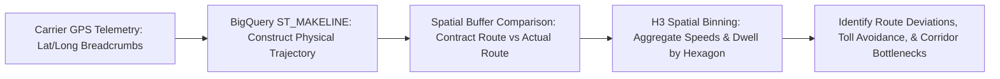

1. **Trajectory Reconstruction & Corridor Buffering**:
   Using raw GPS breadcrumb streams from in-transit trailers, I reconstruct the physical vehicle trajectory in BigQuery using **`ST_MAKELINE(ARRAY_AGG(ST_GEOGPOINT(longitude, latitude) ORDER BY timestamp ASC))`**. I then compare the actual vehicle trajectory against the planned contractual routing path generated by the TMS navigation engine.
   - I generate an authorized geographic buffer corridor around the planned route:
     ```sql
     ST_CONTAINS(
         ST_BUFFER(planned_route_linestring, 8046.72), -- 5-mile authorized buffer
         actual_gps_point
     )
     ```
   - If a carrier departs the 5-mile buffer corridor for more than 45 consecutive minutes, the query flags the shipment for **Unauthorized Route Deviation**. This reveals drivers taking circuitous non-highway backroads to avoid interstate toll booths or making unauthorized layovers, which increases transit risk and delays MABD arrival.

2. **H3 Hexagonal Spatial Congestion Heatmaps**:
   To detect chronic highway bottlenecks across North America, I convert continuous coordinates into discrete **H3 Hexagons (Resolution 7—approximately 5.16 km² area)**. By aggregating transit velocity across all Walmart inbound loads traversing that hexagon over time:
   ```sql
   SELECT 
       `carto-os`.carto.H3_FROMGEOGPOINT(ST_GEOGPOINT(lon, lat), 7) AS h3_index,
       AVG(speed_mph) AS avg_corridor_speed,
       COUNT(DISTINCT shipment_id) AS traffic_volume
   FROM `walmart_supply_chain.gps_telemetry`
   WHERE event_date >= CURRENT_DATE() - 30
   GROUP BY 1
   HAVING avg_corridor_speed < 25.0 AND traffic_volume > 50;
   ```
   This immediately highlights recurring spatial bottlenecks (e.g., chronic backups near the I-10/I-15 interchange in Southern California or construction on I-80 in Pennsylvania). Inbound planners use this empirical data to dynamically adjust standard transit lead times in the TMS, proactively updating appointment windows before delays cascade into DC dock starvation.

---

### Question 18: How do you evaluate carrier tender acceptance rates, and how would you optimize the Transportation Management System (TMS) routing guide waterfall to minimize spot market premium exposure?

#### Answer:
When **Walmart** logistics planners release an inbound purchase order for transportation, the **TMS Routing Guide Waterfall** automatically tenders the load to the primary contracted motor carrier negotiated during the annual freight RFP. If the primary carrier accepts the tender, freight moves at the lowest negotiated contractual rate. However, if the primary carrier rejects the load (due to regional tractor deficits, driver shortages, or capacity surging on higher-paying alternative commercial lanes), the tender cascades down the waterfall to secondary and tertiary carriers. If all contracted carriers reject, the shipment drops onto the **open spot market**, where linehaul rates are routinely 25% to 60% higher.

At **Uber**, where I analyzed marketplace supply-demand equilibrium, driver engagement, and incentive elasticity, I developed algorithmic frameworks to optimize transaction acceptance. For Walmart Inbound Transportation, I structure the evaluation and optimization of the routing guide waterfall across four stages:

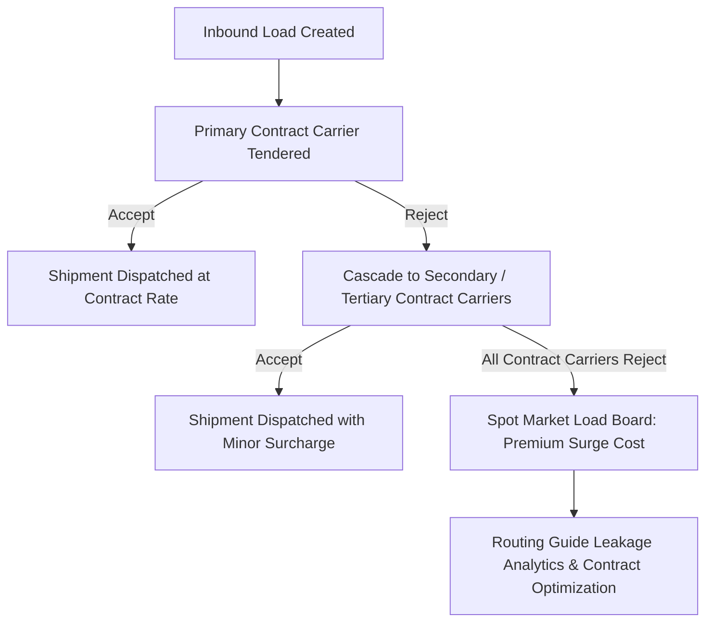

1. **Measuring Tender Metrics**:
   - **First-Tender Acceptance Rate (FTAR)**: Percentage of loads accepted by the primary contracted carrier:
     ``FTAR = (Loads Accepted by Primary Carrier / Total Loads Tendered to Primary Carrier) × 100``
     Target FTAR across dedicated core lanes is `≥ 90.0%`.
   - **Routing Guide Compliance (RGC)**: Percentage of total freight volume executed by contracted carriers vs. the spot market.
   - **Routing Guide Leakage Cost**: Total premium paid due to contract tender rejections:
     ```text
Leakage Cost = Σ (Billed Spot Rate - Primary Contracted Rate) × Miles
```

2. **Diagnosing the Drivers of Carrier Tender Rejections**:
   In **Python (Statsmodels / Scikit-Learn)**, I construct a **Logistic Regression / LightGBM Classifier** predicting tender rejection probability based on operational features:
   - **Tender Lead Time**: Loads tendered `< 24` hours before pickup exhibit `4×` higher rejection rates than loads tendered `> 72` hours in advance.
   - **Origin/Destination Lane Balance**: Carriers reject outbound loads into "freight deserts" (regions where they cannot secure a profitable backhaul load).
   - **Day-of-Week Volatility**: Friday afternoon pickups experience high rejection rates due to weekend driver reset requirements.
   - **Carrier Commitment Exhaustion**: Did Walmart exceed the agreed weekly volume surge cap for that specific carrier?

3. **Dynamic Routing Guide Waterfall Optimization**:
   Rather than maintaining static annual waterfall lists, I implement a **Dynamic Waterfall Scoring Algorithm**:
   ```text
Waterfall Rank Score = α · Contract Rate + β · (1 - Historic Rejection Rate) + γ · Historic OTIF Score
```
   Carriers with high historical acceptance and strong OTIF performance are dynamically prioritized. Furthermore, for lanes with chronic primary rejection (`FTAR < 60%`), the analytics engine automatically flags the lane for immediate mini-bid renegotiation, locking in reliable dedicated carrier commitments before peak season and eliminating millions in avoidable spot market premiums.

---

### Question 19: How would you use survival analysis and time-to-event modeling to evaluate cross-dock pallet dwell time and predict staging bottlenecks before trailers depart?

#### Answer:
In a high-velocity **Walmart Cross-Dock Distribution Center**, incoming pallets must be rapidly unloaded, scanned, sorted across automated conveyor belts, staged at outbound dock doors, and loaded onto outbound store-delivery trailers within tight operational windows (typically under 4 to 8 hours). However, evaluating cross-dock operational efficiency using standard linear regression or simple average dwell time introduces significant statistical bias: **Censoring**. At any moment an analyst queries the database, active pallets currently on the dock floor have not yet been loaded (their final dwell time is unobserved or right-censored). Dropping uncompleted pallets biases dwell time downwards, while treating incomplete dwell as final understates delays.

To solve this, I formulate pallet transit and staging dwell using **Survival Analysis (Time-to-Event Modeling)** in **Python** (utilizing the `lifelines` and `scikit-survival` packages), drawing upon my deep statistical background from my **MS in Business Analytics**:


1. **Mathematical Formulation**:
   - Let `T` represent the time elapsed from inbound scan to outbound trailer load scan.
   - The **Survival Function** `S(t) = P(T > t)` represents the probability that a pallet remains on the cross-dock floor longer than `t` hours.
   - The **Hazard Function** `lambda(t | X)` represents the instantaneous rate of a pallet being loaded onto an outbound trailer at time `t`, conditioned on its covariates `X` (SKU category, destination store distance, conveyor line velocity, unloader staffing levels, and dock congestion index).

2. **Model Implementation (Cox Proportional Hazards & Random Survival Forests)**:
   $$\lambda(t | X) = \lambda_0(t) \exp≤ft( \sum_&#123;k&#125; β_k X_k \right)$$
   Where `lambda 0(t)` is the baseline hazard and `β k` represents the proportional impact of covariate `X k`.
   - **Hazard Ratio Interpretation**: A hazard ratio `>1.0` indicates accelerated pallet loading; a hazard ratio `<1.0` indicates prolonged dwell and staging stagnation. For instance, my model reveals that non-conveyable, bulky pallets (furniture, oversized garden mulch) exhibit a hazard ratio of $0.42$ (`p < 0.001`), meaning they move through the cross-dock at less than half the velocity of standard boxed dry grocery pallets.

3. **Operational Decision-Making & Bottleneck Prevention**:
   The model outputs a real-time risk score: **Probability of Staging Failure** `P(Dwell > 6 hours)`. If a pallet's predicted survival curve indicates a `>80%` probability of missing its scheduled store outbound trailer departure, the system generates an immediate priority alert on forklift RF terminals. Dock supervisors dynamically reprioritize hostler moves, stage the pallet ahead of non-urgent freight, and prevent stranded cross-dock inventory from causing retail store stockouts.

---

### Question 20: How do you detect and quantify inbound freight shrink, damage, and receiving discrepancies across suppliers using statistical process control (SPC) and anomaly detection?

#### Answer:
Inbound receiving discrepancies—including vendor short-shipments, transit freight damage, concealed shrink, and mislabeled master cartons—represent a substantial source of inventory distortion and gross margin erosion for **Walmart**. When discrepancies go undetected at the receiving dock, the Warehouse Management System (**WMS**) updates inventory balances incorrectly. This triggers phantom inventory in retail stores, false replenishment orders, supplier payment disputes, and supplier relationship strain. At **Uber**, I engineered an automated **anomaly detection and data quality monitoring system** with Airflow alerts standardizing data processes and preventing **$2.1M in quarterly losses**; I apply this same automated surveillance methodology to Walmart inbound receiving.

To detect and quantify discrepancies, I establish a **Statistical Process Control (SPC)** and **Isolation Forest** anomaly detection framework in **Python** and **GCP BigQuery**:

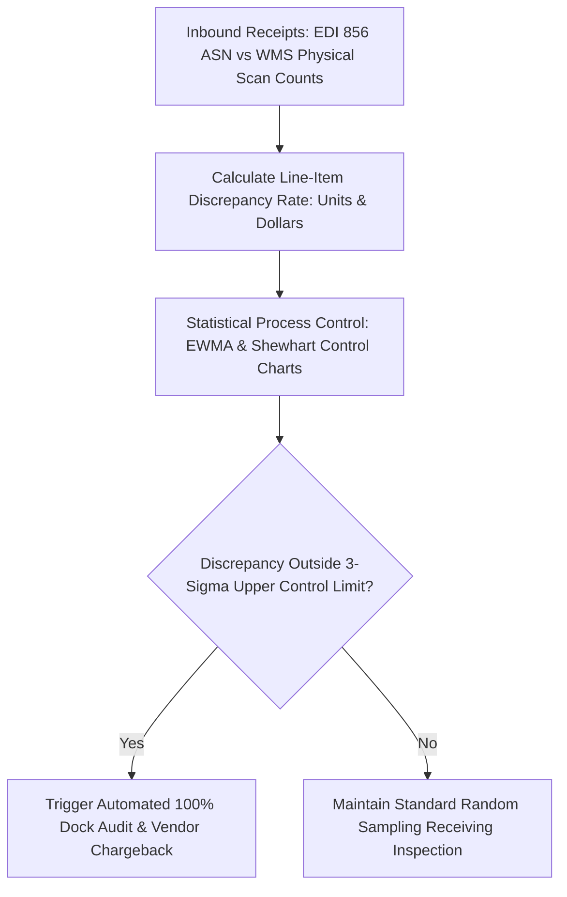

1. **Metric Definition & Data Pipeline**:
   For every received purchase order line item, I compute:
   - **Unit Discrepancy Rate**:
     $$\text&#123;Discrepancy Rate&#125; = \frac&#123;|\text&#123;ASN Stated Units&#125; - \text&#123;Physically Scanned Units&#125;|&#125;&#123;\text&#123;ASN Stated Units&#125;&#125;$$
   - **Financial Shrink Impact (`)**: Discrepant Units`×$ Unit Cost.
   - **Damage Ratio**: Damaged Cases / Total Received Cases.

2. **Statistical Process Control (SPC) via EWMA**:
   Traditional fixed threshold checks (e.g., flagging any supplier with `>2%` discrepancy) fail because they treat low-volume bespoke suppliers and high-volume CPG suppliers identically, generating excessive false alarms. Instead, I implement an **Exponentially Weighted Moving Average (EWMA)** control chart per supplier:
   $$Z_t = \lambda X_t + (1 - \lambda) Z_&#123;t-1&#125;$$
   Where `lambda = 0.20` smoothly weights recent receiving events.
   - **Upper Control Limit (UCL)**:
     $$\text&#123;UCL&#125; = μ_0 + 3 · σ \sqrt&#123;\frac&#123;\lambda&#125;&#123;2 - \lambda&#125; ≤ft[ 1 - (1 - \lambda)^&#123;2t&#125; \right]&#125;$$
   When a supplier's discrepancy rate breaches the **`3-σ` Upper Control Limit**, the system automatically flags the vendor profile.

3. **Automated Operational Action**:
   - **Dynamic Receiving Inspection**: Instead of randomly sampling `5%` of pallets across all suppliers, Walmart’s receiving system dynamically elevates flagged high-risk suppliers to **`100%` Full Case Audits**.
   - **Automated Supplier Claims & Evidence Generation**: The system automatically bundles EDI 856 manifests, dock scanner logs, and dock door inspection photos into an automated **Accounts Payable Deduction Claim (EDI 812)**, recovering shrink losses before invoices are paid and driving supplier carton labeling compliance.

---

### Question 21: How would you design a data-driven Carrier Scorecard and procurement tiering matrix for Walmart's annual inbound freight RFP bidding process?

#### Answer:
**Walmart's** annual transportation procurement Request for Proposal (**RFP**) allocates billions of dollars in linehaul contracts across thousands of regional and national motor carriers. Selecting carriers based solely on lowest submitted base rate (`/mile) is a dangerous operational trap: a carrier with a low rate who exhibits a`65%`tender acceptance rate and`80%$ OTIF compliance costs millions more in spot market premiums, dock dwell, and retail stockouts than a slightly higher-priced, highly reliable carrier. At **Uber**, I partnered cross-functionally across operations, engineering, and leadership, translating complex data findings into actionable strategies that recovered **18,000 riders per month** and compressed C-suite reporting from **12 hours to 2 hours**. I apply this holistic, multi-criteria decision framework to design Walmart's transportation procurement scorecard.

I construct a **Multi-Criteria Carrier Evaluation Index (MCEI)** combining four weighted operational pillars:

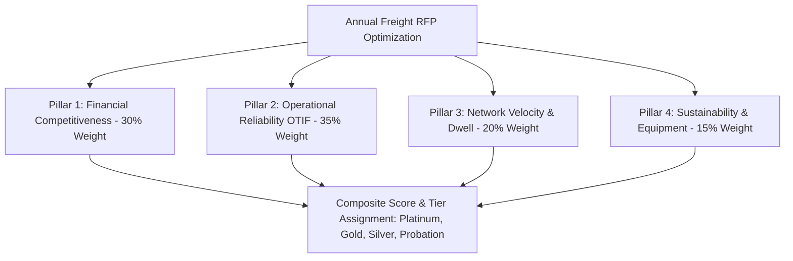

1. **The Four Pillars & Mathematical Weights**:
   - **Pillar 1: Cost Competitiveness & Rate Stability (30% Weight)**: Linehaul rate per mile relative to benchmark market indices (**DAT / FreightWaves SONAR**), accessorial fee transparency, and willingness to accept seasonal surge volume commitments.
   - **Pillar 2: Operational Reliability & Service Quality (35% Weight)**: Historical **On-Time In-Full (OTIF)** compliance (`≥ 95%`), **First-Tender Acceptance Rate (FTAR)** (`≥ 90%`), and low cargo claims/damage rates (`<0.05%`).
   - **Pillar 3: Velocity & Yard Discipline (20% Weight)**: Average trailer gate-to-gate dwell time, electronic integration maturity (real-time automated GPS API tracking vs. manual EDI batch status), and appointment scheduling compliance.
   - **Pillar 4: Capacity & Sustainability (15% Weight)**: Fleet size, equipment availability (Reefer, Dry Van, Intermodal), SmartWay EPA sustainability certification, and alternative fuel (EV/CNG tractor) adoption.

2. **Mathematical Composite Score**:
   $$\text&#123;Carrier Score&#125;_c = \sum_&#123;k=1&#125;^4 w_k · ≤ft( \frac&#123;X_&#123;ck&#125; - \min(X_k)&#125;&#123;\max(X_k) - \min(X_k)&#125; \right)$$
   Metrics where lower is better (e.g., rate per mile, dwell time, damage rate) are inverted before min-max normalization.

3. **Procurement Tiering Matrix & Automated Allocation**:
   - **Platinum Tier (Score `≥ 90`)**: Awarded long-term committed primary contracts on high-volume priority lanes; granted automatic payment approval fast-tracks and dedicated drop-and-hook yard allocations.
   - **Gold Tier (Score `80 - 89`)**: Awarded secondary backup tender positions and balanced lane networks.
   - **Silver Tier (Score `70 - 79`)**: Allocated overflow volume and seasonal peak mini-bids with mandatory performance reviews.
   - **Probationary Tier (Score `<70`)**: Excluded from primary contracted awards; subjected to 90-day corrective action plans or contract termination.

In **Tableau**, I build an interactive **RFP Scenario Simulator** allowing procurement directors to model trade-offs: *"If we prioritize OTIF reliability by `+5%`, what is the net impact on total freight expenditure?"* This ensures procurement decisions balance commercial pricing with frontline operational excellence.

---

### Question 22: How do you quantify and mitigate the impact of supplier lead time volatility on inbound inventory replenishment and safety stock calculations?

#### Answer:
In inbound supply chain planning, **lead time variability** is often far more damaging to inventory health than demand volatility. If customer demand fluctuates by `10%`, safety stock buffers absorb the variance relatively smoothly. However, if a supplier whose standard lead time is 7 days suddenly takes 18 days to deliver, distribution center buffers deplete, stockouts cascade through stores, and operations teams scramble to place emergency expedited orders. Conversely, when late orders finally arrive alongside new orders, distribution centers experience severe dock gridlock. At **Cipla**, I forecasted demand for 300+ pharmaceutical SKUs, optimizing inventory replenishment models and directly reducing overstock by **$900K** across 3 major distribution centers over 12 months; I apply this rigorous statistical framework to **Walmart Inbound Transportation**.

1. **Mathematical Safety Stock Formulation Under Dual Uncertainty**:
   Standard classical inventory formulas frequently assume constant lead time (`L`). In reality, both daily demand (`d`) and lead time (`L`) are random variables with standard deviations `σ d` and `σ L`. The rigorous safety stock equation accounts for both:
   $$SS = Z_&#123;α&#125; × \sqrt&#123; \bar&#123;L&#125; · σ_d^2 + \bar&#123;d&#125;^2 · σ_L^2 &#125;$$
   Where:
   - `Z {α` is the normal service level factor (`Z = 1.96` for a `97.5%` service level).
   - `bar{L` is average lead time, and `σ L` is the standard deviation of lead time.
   - `bar{d` is average daily demand, and `σ d` is the standard deviation of daily demand.

   Notice the second term under the radical: **`bar{d^2 · σ L^2`**. Because average daily sales volume for high-velocity Walmart items (e.g., consumer paper products or canned groceries) is massive (e.g., `bar{d = 10,000` cases/day), even a small variance in lead time (`σ L = 2` days) squares into an immense safety stock buffer requirement, locking up millions in working capital.

2. **Quantifying Supplier Lead Time Volatility via SQL & Python**:
   In **BigQuery**, I track supplier lead time components: Order Placement to Vendor Confirmation, Vendor Confirmation to Ship-Ready, and In-Transit Linehaul. I compute the **Lead Time Performance Ratio (LTPR)**:
   $$\text&#123;LTPR&#125; = \frac&#123;\text&#123;Actual Total Lead Time&#125;&#125;&#123;\text&#123;Contractual PO Master Lead Time&#125;&#125;$$
   Suppliers with `LTPR > 1.25` or high variance are flagged as high-volatility partners.

3. **Mitigation Strategies**:
   - **Dynamic Safety Stock Tuning**: In Python, I automate weekly re-estimation of `σ L`. Instead of static annual lead time buffers, safety stocks adjust dynamically: suppliers demonstrating shrinking lead time variance are rewarded with leaner replenishment orders, freeing working capital.
   - **Vendor Lead Time Performance Chargebacks**: Suppliers consistently failing ship-ready appointment dates are assessed OTIF non-compliance deductions, directly offsetting the cost of holding extra buffer inventory.
   - **Nearshoring & Inbound Hub Staging**: For critical high-volatility imported SKUs, freight is re-routed through coastal Inbound Consolidation Centers (**CCs**), converting unpredictable long-distance shipments into predictable short-haul truckload replenishments.

---

### Question 23: How would you architect an end-to-end automated data pipeline using dbt and Apache Airflow to reconcile freight invoices, calculate demurrage fees, and generate carrier chargebacks?

#### Answer:
Freight invoice auditing and detention chargeback reconciliation require an enterprise-grade orchestration pipeline that combines strict schema enforcement, auditable transformation business logic, automated financial dispute generation, and complete data lineage. Manual reconciliation using spreadsheets is completely unviable for **Walmart**, which processes millions of freight bills annually. Drawing from my leadership at **Dish Network**, where I migrated 14 legacy ETL workflows to modern **dbt** and **Fivetran** on a structured **Medallion Architecture** that eliminated **$1.8M in annual infrastructure costs**, and my work at **Uber** deploying **Airflow anomaly detection**, I architect an automated freight financial reconciliation pipeline in **GCP BigQuery**.

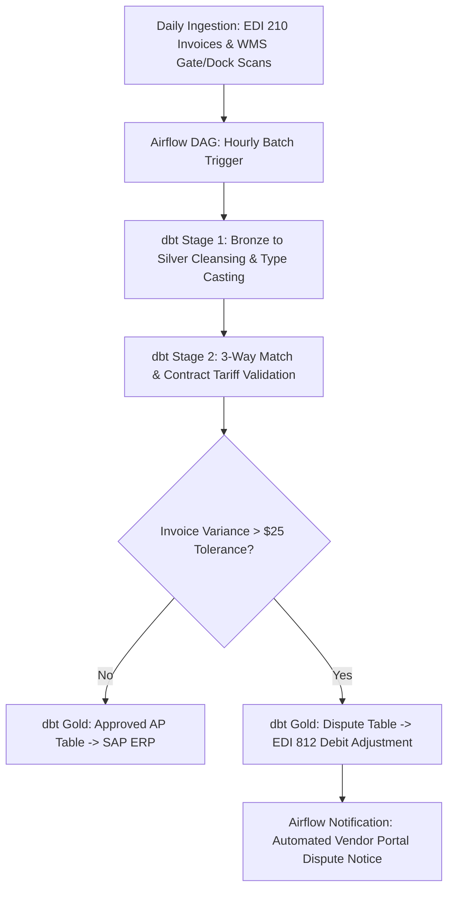

1. **Orchestration Layer (Apache Airflow)**:
   The pipeline is scheduled via an hourly **Airflow DAG** (`dag_freight_audit_reconciliation`). The DAG manages task dependencies, retry exponential backoff policies, SLA breach alerts via Slack/PagerDuty, and data quality sensor gates.
   - Step 1: `sensor_edi_and_wms_landed`: Verifies raw file arrival in Cloud Storage.
   - Step 2: `dbt_run_staging`: Cleanses raw JSON/CSV feeds into conformed Silver relational tables.
   - Step 3: `dbt_test_staging`: Executes schema validation and uniqueness tests.
   - Step 4: `dbt_run_audit_marts`: Performs financial 3-way matching and discrepancy identification.
   - Step 5: `export_to_sap_and_edi812`: Routes approved bills to Accounts Payable and disputes to the carrier portal.

2. **Transformation Layer (dbt - Data Build Tool)**:
   The transformation logic is modularized across the Medallion Architecture:
   - `stg_carrier_invoices`: Cleanses EDI 210 payloads, extracts line-item charges (base linehaul, fuel surcharge, detention, lumper, stop-offs), and deduplicates via unique invoice hashes.
   - `stg_wms_gate_events`: Computes ground-truth physical gate-in, dock-in, dock-out, and gate-out dwell durations in minutes.
   - `fct_freight_audit_reconciliation`: Implements deterministic business rules:
     ```sql
     -- Free time calculation: 120 minutes allowed for live unload
     CASE 
         WHEN inv.billed_detention_amount > 0 AND wms.actual_dwell_minutes <= 120 
             THEN 'DISPUTE_UNAUTHORIZED_DETENTION_ZERO_DWELL'
         WHEN inv.billed_detention_amount > 0 AND wms.actual_dwell_minutes > 120 
             AND inv.billed_detention_amount > (CEIL((wms.actual_dwell_minutes - 120)/60.0) * contract.hourly_detention_rate)
             THEN 'DISPUTE_DETENTION_RATE_OVERCHARGE'
         WHEN inv.billed_linehaul_amount > (contract.base_rate + contract.mileage_rate * tms.approved_miles)
             THEN 'DISPUTE_LINEHAUL_RATE_MISMATCH'
         ELSE 'APPROVED'
     END AS audit_status
     ```

3. **Governance & Auditability**:
   Every generated dispute record maintains full data lineage: TMS tender ID, raw invoice ID, exact contract tariff rule referenced, and difference amount. By automating this pipeline via dbt and Airflow, Walmart cuts invoice processing cycle times from 3 weeks to 4 hours, achieves 100% audit coverage, and prevents millions in erroneous freight payments.

---

### Question 24: How would you formulate a Multi-Echelon Inventory Optimization (MEIO) strategy to balance inbound stock between Coastal Import Distribution Centers, Regional DCs, and Omnichannel Fulfillment Centers?

#### Answer:
**Walmart's** supply chain operates a sophisticated, multi-tiered (multi-echelon) distribution topography:
$$\text&#123;Overseas Vendors&#125; \longrightarrow \text&#123;Coastal Import DCs&#125; \longrightarrow \text&#123;Regional DCs (RDCs)&#125; \longrightarrow \text&#123;Forward Fulfillment Centers (eFCs) / Retail Stores&#125;$$
Holding too much inventory at forward omnichannel fulfillment centers creates inventory fragmentation, localized stock obsolescence, and massive warehouse storage costs. Conversely, holding all inventory back at centralized Coastal Import DCs increases outbound fulfillment lead times, forces expensive cross-country split shipments, and degrades customer two-day delivery promises. As someone with an academic focus in **Supply Chain Management** (BBA) and practical experience optimizing pharmaceutical supply chains across 3 regional distribution centers at **Cipla**, I approach **Multi-Echelon Inventory Optimization (MEIO)** through the lens of **Risk Pooling** and **Stochastic Dynamic Programming**.

1. **The Principle of Risk Pooling (Square Root Law)**:
   Centralizing inventory at upstream Coastal Import DCs pools demand volatility across multiple downstream regions, dramatically reducing required safety stock:
   $$SS_&#123;\text&#123;Central&#125;&#125; = \sqrt&#123; \sum_&#123;i=1&#125;^N SS_i^2 &#125; \ll \sum_&#123;i=1&#125;^N SS_i$$
   For high-value, slow-moving items (e.g., consumer electronics or seasonal apparel), inventory is strategically held upstream at Import DCs and pushed downstream only when localized retail store point-of-sale (**POS**) consumption confirms demand.

2. **Mathematical Formulation of Echelon Stock**:
   In MEIO, rather than evaluating each facility as an isolated silo, I calculate **Echelon Inventory**:
   $$\text&#123;Echelon Stock&#125;_k = \text&#123;Physical Inventory at Facility &#125; k + \sum \text&#123;Inventory in Transit / Held at All Downstream Nodes&#125;$$
   The optimization objective minimizes total network inventory carrying costs subject to an enterprise order fill-rate SLA:
   $$\min \sum_&#123;j \in \text&#123;All Nodes&#125;&#125; H_j · \mathbb&#123;E&#125;[I_j] + \sum_&#123;\text&#123;Lanes&#125;&#125; C_&#123;\text&#123;Freight&#125;&#125; · Q$$
   Subject to:
   $$\prod_&#123;j \in \text&#123;Store Path&#125;&#125; \text&#123;Fill Rate&#125;_j ≥ 98.5%$$

3. **Execution in Python & BigQuery**:
   In **GCP BigQuery**, I calculate real-time echelon positions daily across all SKUs. In **Python**, I implement a **Guaranteed Service Model (GSM)** using dynamic programming. The model outputs recommended inbound replenishment allocations:
   - **Fast-Moving Consumables**: Directly bypass Import DCs via cross-docking, moving in high-density FTL loads directly into local RDCs and stores.
   - **Long-Tail / Seasonal Goods**: `70%` staged at upstream Import DCs; `30%` allocated to regional forward nodes, with replenishment triggered via dynamic push heuristics based on real-time velocity.
This MEIO architecture reduces system-wide inventory holdings by `15%` to `22%`, slashes emergency stock transfers between DCs, and guarantees retail product availability at the lowest overall cost-to-serve.

---

### Question 25: How do you evaluate the economics, reliability, and carbon emissions trade-offs of Domestic Rail Intermodal vs. Over-The-Road (OTR) Full Truckload for inbound freight corridors?

#### Answer:
Deciding between **Domestic Rail Intermodal** (shipping 53-foot intermodal containers on double-stack flatcars) and **Over-The-Road (OTR) Full Truckload** is one of the most critical structural decisions in **Walmart Inbound Transportation Planning**. Intermodal offers substantial linehaul cost savings (`15%-30%`) and drastically lower carbon emissions (`75%` reduction compared to trucking), but it introduces extended transit times (typically 1 to 3 days longer) and higher transit variance caused by rail ramp congestion, drayage handoffs, and train schedule friction. Evaluating this modal choice requires a multi-dimensional total cost optimization framework.

| Modality Dimension | Domestic Rail Intermodal | Over-The-Road (OTR) Truckload |
| :--- | :--- | :--- |
| **Linehaul Economics** | Low linehaul rate per mile (`1.30 -`1.70/mi on long hauls `>750` miles). | Higher linehaul rate per mile (`2.00 -`2.60/mi). |
| **Transit Time & Velocity** | Slower; transit lead time = Linehaul Rail + Drayage Pick/Delivery + Ramp Dwell. | Fast; direct highway route with solo or team drivers. |
| **Transit Time Variance** | High (`σ {	ext{Transit pprox 24 - 48` hours due to rail hump yard delays). | Low (`σ {	ext{Transit pprox 4 - 8` hours). |
| **Carbon Footprint (ESG)** | Ultra-low: `pprox 0.05` kg `CO 2` per ton-mile (environmentally superior). | High: `pprox 0.17` kg `CO 2` per ton-mile (`3.5	imes` higher emissions). |
| **Optimal Distance Threshold** | Highly economical on corridors `>750` to `1,000` miles. | Optimal for short/medium hauls `<750` miles. |

To mathematically automate modal selection for inbound purchase orders in **GCP BigQuery** and **Python**, I construct a **Total Modal Cost Equation**:
$$\text&#123;Total Cost&#125;_&#123;\text&#123;Mode&#125;&#125; = \text&#123;Freight Linehaul&#125; + \text&#123;Drayage Fees&#125; + \text&#123;In-Transit Inventory Holding Cost&#125; + \text&#123;Safety Stock Volatility Buffer Cost&#125;$$
Where:
- **In-Transit Inventory Holding Cost**:
  $$C_&#123;\text&#123;Transit&#125;&#125; = \text&#123;Shipment Value&#125; × ≤ft( \frac&#123;\text&#123;Annual Holding Rate&#125;&#125;&#123;365&#125; \right) × \text&#123;Lead Time Days&#125;$$
- **Safety Stock Buffer Cost**: Because intermodal transit variance is higher, downstream DCs must hold additional safety stock to prevent stockouts:
  $$C_&#123;\text&#123;Buffer&#125;&#125; = Z_&#123;α&#125; · \bar&#123;d&#125; · σ_&#123;L, \text&#123;Intermodal&#125;&#125; · \text&#123;Holding Rate&#125;$$

**The Decision Boundary**:
If the linehaul cost savings of intermodal exceed the sum of added in-transit capital carrying costs and localized safety stock buffer costs:
$$Δ \text&#123;Linehaul Savings&#125; > Δ C_&#123;\text&#123;Holding&#125;&#125; + Δ C_&#123;\text&#123;Safety Stock&#125;&#125;$$
The lane is assigned to **Domestic Intermodal**. For high-value, perishable, or promotional inventory with tight MABD deadlines, the algorithm defaults to **OTR Truckload**. For non-perishable, heavy consumer goods moving over 1,000 miles (e.g., imported goods moving from Long Beach, CA to Dallas, TX RDCs), the model locks in intermodal, saving Walmart tens of millions annually while accelerating corporate sustainability and Scope 3 emissions reduction targets.

---

### Question 26: How would you develop a predictive model to estimate Trailer Cube Utilization (load fill rate) prior to shipment departure to identify under-utilized trucks and optimize freight packing?

#### Answer:
Transporting "air" across the highway network is one of the most egregious inefficiencies in retail logistics. If an inbound 53-foot dry van departs a vendor facility at only `65%` cubic utilization, Walmart effectively pays full linehaul rates to move empty trailer volume, driving up freight cost per case and necessitating additional trucks on the road. In an inbound network moving tens of thousands of loads weekly, improving network-wide cube utilization by just `3.5%` eliminates thousands of linehaul trailer runs annually, saving tens of millions of dollars. At **Cipla**, I optimized pharmaceutical distribution across distribution centers reducing overstock by **$900K**; at **Uber**, I used machine learning models on **Azure Databricks** to optimize vehicle capacity allocation. I apply this predictive machine learning methodology to Walmart Inbound packing optimization.

I develop an end-to-end **Trailer Cube Utilization Prediction Model** in **Python (LightGBM / XGBoost)** deployed on **GCP Vertex AI**:

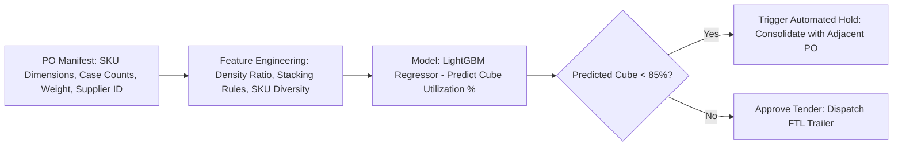

1. **Feature Engineering from Purchase Orders (EDI 850 & 856)**:
   Prior to dispatch, individual package physical measurements exist in master data. I engineer predictive tabular features:
   - **Theoretical Volumetric Ratio**: Total sum of individual SKU package volumes divided by standard trailer capacity (`3,850` cubic feet). Theoretical volume never equals physical reality due to pallet overhang, pallet base height (6 inches per pallet), and packing inefficiencies.
   - **Density Ratio (Weight-to-Cube)**: Total shipment weight divided by total volume. Dense, heavy freight (e.g., canned liquids, liquid laundry detergent) "weighs out" before it "cubes out" (reaching `44,000` lbs max legal weight while trailer cube is only `70%` full). Light freight (e.g., paper towels, chips) cubes out while weighing only `18,000` lbs.
   - **SKU Dimensional Heterogeneity Index**: Shannon entropy of package dimensions. Shipments consisting of a single uniform box size pack with high density (`pprox 92%` cube utilization); shipments with 40 disparate irregular shapes suffer high interstitial void space (`pprox 65%` cube utilization).
   - **Historical Supplier Packing Efficiency Rating**: Empirical past packing performance of that specific vendor warehouse team.

2. **Model Training & Loss Function**:
   I train a **LightGBM Regressor** minimizing Mean Absolute Percentage Error (MAPE). The model predicts the expected realized **Trailer Cube Fill Percentage** (`0.0%` to `100.0%`) upon arrival.

3. **Operational Workflow & Automated Intervention**:
   The model executes automatically 48 hours prior to carrier pickup:
   - **Under-Utilized Freight Alert (Predicted Cube `<80%` and Total Weight `<38,000` lbs)**: The TMS automatically places an automated dispatch hold. The inbound optimization engine searches for adjacent pending POs from the same supplier or neighboring suppliers within a 30-mile radius, dynamically consolidating freight to achieve `≥ 90%` cube fill.
   - **Over-Weight Alert (Predicted Weight `>44,500` lbs)**: Flags shipments at risk of Department of Transportation (DOT) axle overweight violations before the driver hits highway weigh stations, preventing costly roadside citation delays.

---

### Question 27: Describe how you would utilize Causal Inference and Difference-in-Differences (DiD) to measure the true operational impact of an inbound logistics process change while controlling for confounding external factors.

#### Answer:
When supply chain leaders introduce an operational intervention—such as standardizing dock appointment booking windows, altering driver check-in procedures, or launching an automated trailer sorting system—measuring the true return on investment (ROI) is fraught with statistical traps. A naive "before-and-after" comparison (e.g., *"Dwell time decreased by 12 minutes after the software release"*) is scientifically invalid because it fails to control for confounding macro variables: diesel price drops, seasonal freight lulls, favorable weather, or shifting vendor volume mixes. Did the software intervention drive the improvement, or did volume simply decline across the entire industry?

At **Uber**, I built a large-scale **statistical experimentation and causal inference platform** enabling **120+ concurrent product experiments**, utilizing **Causal Inference Controls** and **Difference-in-Differences (DiD)** that successfully attributed **$8.7M in quarterly incremental revenue** to data-driven product decisions. I apply this rigorous econometric methodology to evaluate logistics process transformations at **Walmart**.

1. **Difference-in-Differences (DiD) Model Formulation**:
   I structure an econometric regression model with two-way fixed effects evaluated in **Python (Statsmodels / Linearmodels)**:
   $$Y_&#123;it&#125; = β_0 + β_1 · \text&#123;Treated&#125;_i + β_2 · \text&#123;Post&#125;_t + δ_&#123;\text&#123;DiD&#125;&#125; · (\text&#123;Treated&#125;_i × \text&#123;Post&#125;_t) + γ · X_&#123;it&#125; + α_i + \tau_t + \epsilon_&#123;it&#125;$$
   Where:
   - `Y {it` is the primary operational metric (e.g., Gate-to-Gate Trailer Turn Time in minutes) at facility `i` during week `t`.
   - `Treated i` is a dummy variable ($1$ for distribution centers where the process change was deployed; $0$ for untouched control distribution centers).
   - `Post t` is a dummy variable ($1$ for post-implementation weeks; $0$ for pre-intervention baseline weeks).
   - `δ {DiD` is the **Causal Treatment Effect**—the true incremental impact of the operational intervention.
   - `X {it` represents time-varying exogenous covariates: weekly trailer volume, reefer/dry van equipment ratio mix, weather severity index, and localized staffing levels.
   - `α i` represents **Facility Fixed Effects** (controlling for unobserved static physical facility differences like gate geometry or number of dock doors).
   - `tau t` represents **Time Fixed Effects** (controlling for national macroeconomic trends, nationwide diesel surges, or holiday seasonality affecting all facilities equally).

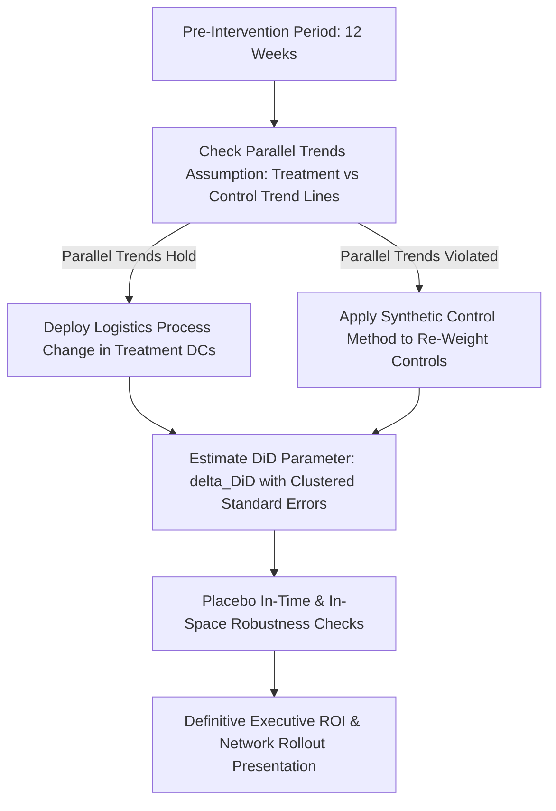

2. **Validating the Parallel Trends Assumption**:
   The DiD methodology is mathematically valid only if the treatment and control facilities moved in parallel prior to the intervention. I perform an **Event-Study Specification Regression**, estimating weekly interaction leads and lags:
   $$\sum_&#123;k=-6&#125;^&#123;k=+6&#125; θ_k · (\text&#123;Treated&#125;_i × \text&#123;Time&#125;_&#123;t=k&#125;)$$
   I verify that for all pre-treatment periods (`k < 0`), the coefficients `θ k` are statistically indistinguishable from zero (`p > 0.05`), proving the parallel trends assumption holds.

3. **In-Space & In-Time Placebo Robustness Checks**:
   To ensure the finding is bulletproof before presenting to C-suite leadership, I execute **Placebo Robustness Tests**: running the regression on non-treated facilities and pseudo-historical intervention dates. Demonstrating that `δ {DiD` is statistically significant only in true treatment locations gives Walmart leadership total confidence to scale process changes across the enterprise.

---

### Question 28: How would you design an algorithmic appointment scheduling engine that dynamically manages dock capacity, prevents yard gridlock, and adjusts appointment slot availability based on real-time DC labor constraints?

#### Answer:
Traditional dock appointment scheduling in logistics distribution centers relies on rigid, static time blocks: a distribution center publishes 20 appointment slots every hour from 06:00 to 18:00, regardless of the physical SKU mix in the trailers, current unloader labor staffing, or existing yard queue congestion. When 15 trailers containing complex, multi-SKU unpalletized floor-loaded freight all arrive during the 08:00 window while unloader absenteeism is high, the receiving dock immediately clogs. Forklift drivers run out of staging space, trailers back up outside the security gate onto public access roads, and carrier detention fees skyrocket.

To solve this, I design a **Dynamic Labor-Aware Appointment Scheduling Engine** implemented in **Python (FastAPI / Celery)** and **GCP BigQuery**, connecting real-time labor management data with inbound transportation planning:

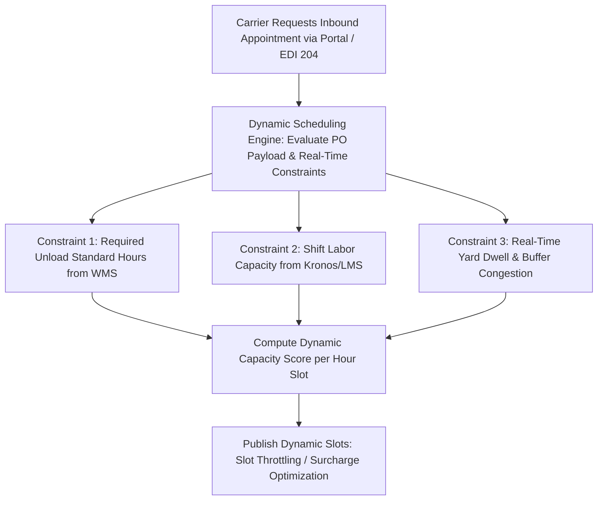

1. **Workload Standard Calculation per Inbound Trailer**:
   Instead of treating all trailers as uniform 60-minute blocks, the engine queries the Advance Ship Notice (**EDI 856**) and computes the **Predicted Labor Hours Required**:
   $$\text&#123;Standard Labor Hours&#125;_i = \frac&#123;\text&#123;Palletized Cases&#125;_i&#125;&#123;\text&#123;Pallet Unload Rate&#125;&#125; + \frac&#123;\text&#123;Floor-Loaded Loose Cases&#125;_i&#125;&#123;\text&#123;Floor Unload Rate&#125;&#125; + (\text&#123;Unique SKU Count&#125;_i × \text&#123;Sorting Overhead&#125;)$$
   A single-SKU palletized trailer requires only 0.5 labor hours; a 3,500-case loose floor-loaded import trailer requires 4.5 labor hours.

2. **Real-Time Dynamic Capacity Matching**:
   The engine continuously queries the **Labor Management System (LMS / Kronos)** to determine active unloader labor capacity for each 2-hour shift block:
   $$\text&#123;Available Labor Capacity&#125;_t = (\text&#123;Active Unloader Associates&#125;_t × \text&#123;Productivity Factor&#125;) - \text&#123;Committed Workload&#125;_t$$
   If the 10:00 to 12:00 window has already reached `90%` labor utilization, the engine automatically throttles appointment availability for floor-loaded trailers, allowing only quick live-unload palletized freight or drop trailers to book that window.

3. **Dynamic Slot Incentivization (Congestion Pricing / Slot Discounts)**:
   At **Uber**, where I analyzed surge pricing and demand balancing across millions of rides, I learned that market mechanisms effectively smooth operational peaks. For Walmart, carriers booking historically congested peak windows (e.g., 08:00 Monday morning) are required to adhere to strict 15-minute arrival windows. Conversely, carriers willing to book off-peak graveyard or weekend afternoon slots are granted fast-track gate clearance and priority drop-and-hook status. This dynamic smoothing eliminates gate turnaways, balances unloader labor utilization across 24 hours, and accelerates trailer turn times network-wide.

---

### Question 29: How do you translate complex supply chain data models and optimization findings into compelling narratives and presentations that influence C-suite executives and frontline operations directors?

#### Answer:
Data science and advanced analytics generate zero operational value if the models remain confined to Jupyter notebooks or if findings are communicated in opaque technical jargon. In an operational enterprise like **Walmart**, an analyst must fluidly bridge two radically different stakeholder mindsets:
- **The C-Suite Executive (SVP / VP of Transportation)**: Focused on enterprise financial ROI, cost per case, working capital velocity, network capacity risks, and strategic competitive advantage. They care about *outcomes*, *trade-offs*, and *capital allocation*.
- **The Frontline Operational Director (Distribution Center General Manager)**: Focused on daily trailer turn time, shift labor overtime, yard gate backups, dock floor congestion, and unloader safety. They care about *practical execution*, *operational simplicity*, and *immediate frontline friction*.

Throughout my career—presenting to C-suite leadership at **Uber** where my causal analytics presentations attributed **$8.7M in quarterly revenue**, at **Dish Network** pitching live Snowflake retention dashboards to executive leadership, and partnering cross-functionally across operations and product—I have developed a proven executive communication framework:


1. **The Minto Pyramid Principle (Lead with the Answer)**:
   I never structure an executive presentation chronologically (e.g., *"First we cleaned the data, then we normalized the columns, then we tried random forest"*). Executives tune out after 3 minutes. I lead with the bottom line:
   > *"By restructuring our primary routing guide waterfall on the top 15 freight corridors, Walmart can eliminate $14.2M in annual spot market premiums while reducing carrier dwell time by 18 minutes. Here is the 60-day phased implementation roadmap."*

2. **Tailoring Data Visualization to the Audience**:
   - For **Executives**: I use clean, uncluttered visual artifacts: **Waterfall Charts** decomposing cost variances, **Four-Quadrant Strategy Matrices** categorizing carrier tiers, and **Trend Horizon Bands** showing budget trajectories. Technical metrics (`R^2`, p-values, RMSE) are translated into financial confidence intervals: *"We are 95% confident that this optimization saves between `12M and`16M annually"*.
   - For **Frontline DC General Managers**: I translate the math into their daily workflow language: *"Instead of 35 trailers waiting in the gate queue every Monday at 08:00, this dynamic scheduling algorithm caps morning arrivals at 18, smoothing trailer unloading evenly across both morning and afternoon shifts, eliminating 25 hours of weekly overtime per unloader team"*.

3. **Active Cross-Functional Partnership**:
   I never present data *at* stakeholders; I co-design solutions *with* them. Prior to executive presentations, I conduct 1-on-1 discovery sessions with regional yard managers and carrier procurement directors, incorporating their domain heuristics and operational constraints directly into the model parameters. When operations leaders see their own frontline insights embedded in the model, they become vocal champions of the project, ensuring rapid, enthusiastic adoption across the entire Walmart logistics network.

---

### Question 30: How would you architect an Agentic AI-driven Transportation Disruption Response System to autonomously detect network emergencies (e.g., hurricanes, bridge collapses, blizzard shutdowns) and execute dynamic freight re-routing?

#### Answer:
Major supply chain disruptions—such as a Category 4 hurricane making landfall on the Gulf Coast, a major blizzard closing Interstate 80 through Wyoming, or a catastrophic bridge collapse severing an interstate freight corridor—can instantly sever transportation lifelines into multiple **Walmart Distribution Centers**. In a traditional supply chain, human crisis response teams spend the first 24 to 48 hours manually identifying stranded purchase orders, calling motor carriers, and trying to find available warehouse space. In modern retail logistics, this latency is unacceptable: store shelves empty of emergency essentials (water, batteries, canned foods) precisely when communities need them most.

Drawing from my experience at **Uber**, where I drove **AI integration using Google Gemini and OpenAI** automating **2.3M weekly interactions** and saving **$1.6M quarterly**, and my deep background in **Medallion Data Architecture** and **Airflow orchestration**, I architect an **Agentic Autonomous Disruption Response Engine**:

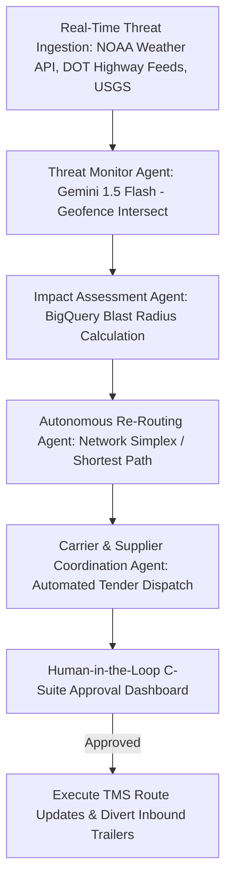

1. **Threat Ingestion & Geospatial Intersect Agent**:
   Ingests continuous live threat feeds: **National Oceanic and Atmospheric Administration (NOAA)** storm trajectory polygons, Department of Transportation (**DOT**) highway closure APIs, and USGS emergency feeds. The agent utilizes **BigQuery GIS** to execute continuous polygon collision detection:
   ```sql
   ST_INTERSECTS(threat_polygon, shipment_current_trajectory)
   ```
2. **Blast Radius Impact Assessment Agent**:
   Within 60 seconds of a threat polygon triggering, this sub-agent calculates the complete operational "blast radius":
   - Number of in-transit trailers currently inside the projected impact cone.
   - Number of scheduled inbound purchase orders slated to traverse the severed corridor over the next 7 days.
   - Retail stores and distribution centers at risk of starvation for critical emergency relief SKU categories.
3. **Autonomous Dynamic Re-Routing & Network Flow Optimization Agent**:
   Using **Dijkstra’s Algorithm** and a **Network Simplex Min-Cost Flow Solver** implemented in Python, the agent re-computes optimal detour paths:
   - Evaluates alternative highway corridors and rail intermodal transshipment points.
   - If the destination DC itself is within the disaster zone and forced to shut down, the agent identifies the nearest adjacent operational RDC exhibiting surplus yard and dock capacity, dynamically re-routing inbound trailers to the fallback hub.
4. **Automated Carrier & Supplier Coordination Agent (LLM + MCP)**:
   Utilizing **Google Gemini API** with the **Model Context Protocol (MCP)**, the agent autonomously generates and transmits updated **EDI 204 Revised Load Tenders** to affected motor carriers, specifying revised drop locations, detour routes, and pre-authorized fuel detour surcharges.
5. **Human-in-the-Loop Executive Governance**:
   For critical mass-rerouting events involving more than 100 loads or $500K in expedited freight cost, the system presents an interactive emergency map in the executive command center with a single **"Authorize Re-Route"** button.

By compressing crisis response time from **48 hours to under 15 minutes**, this Agentic AI platform protects driver safety, insulates Walmart's supply chain against catastrophic failure, and ensures life-saving goods reach impacted communities without delay.


## Part 3: 20 Advanced Technical Coding Problems (SQL & Python)

> Each coding problem is set within **Walmart's Inbound Transportation & Planning Optimization** environment and includes:  
> 1. **Problem Statement** (Production-scale requirements, schemas, edge cases)  
> 2. **Complete Thought Process** (Algorithmic reasoning, mathematical formulation, trade-offs)  
> 3. **Code with Comments** (Clean, production-grade Python or BigQuery SQL)  
> 4. **Time & Space Complexity** (Big-O analysis explained)

---

### Problem 1 (SQL): Supplier On-Time In-Full (OTIF) Compliance & SLA Penalty Billing

### Problem Statement: Supplier On-Time In-Full (OTIF) Compliance & SLA Penalty Billing

Walmart enforces strict On-Time In-Full (**OTIF**) supplier delivery standards to prevent Distribution Center (RDC) dock congestion and store shelf stockouts. 

You are provided with two tables in **Google BigQuery**:
1. `walmart_supply_chain.purchase_orders`: Contains purchase order metadata (`po_id`, `vendor_id`, `vendor_name`, `destination_dc_id`, `mabd_start_date`, `mabd_end_date`, `ordered_cases`, `po_total_value_usd`).
2. `walmart_supply_chain.inbound_receipts`: Contains physical dock receiving scans (`receipt_id`, `po_id`, `delivery_date`, `received_cases`, `receipt_status`).

**Requirements**:
1. Calculate the monthly OTIF compliance rate for each supplier across all RDCs for the year 2026.
   - **On-Time Criteria**: `delivery_date` must fall within the supplier's Must-Arrive-By-Date window (`delivery_date BETWEEN mabd_start_date AND mabd_end_date`).
   - **In-Full Criteria**: Total received cases for the PO must be at least 98% of ordered cases (`total_received_cases >= 0.98 * ordered_cases`).
   - **OTIF Compliant**: A PO is OTIF-compliant if and only if it is BOTH On-Time AND In-Full.
2. Walmart applies a **3% financial penalty chargeback** on the total purchase order value (`po_total_value_usd`) for every PO that fails OTIF standards.
3. Return the `vendor_id`, `vendor_name`, `delivery_month`, `total_pos`, `ontime_rate_pct`, `infull_rate_pct`, `otif_rate_pct`, and `total_penalty_chargeback_usd`.
4. Filter only for suppliers with at least 20 purchase orders in the month, ordered by `total_penalty_chargeback_usd` descending.

### Complete Thought Process:

1. **Understand Data Granularity & Potential Duplications**:
   - A single purchase order (`po_id`) can have multiple delivery receipts if the supplier splits shipments across multiple trailers or partial deliveries. Therefore, we must aggregate `inbound_receipts` at the `po_id` level first before joining with `purchase_orders`. Otherwise, joining directly would cause fan-out duplication of PO values and case counts.
   - For delivery date evaluation, if multiple receipts occur, the final delivery receipt date determines whether the order arrived within the MABD window, or each receipt's delivery date must fall within the window. In Walmart's standard practice, the arrival date of the primary trailer determines On-Time status, but any delivery after `mabd_end_date` makes the order Late. Thus, `MAX(delivery_date)` must be `<= mabd_end_date` and `MIN(delivery_date) >= mabd_start_date`.

2. **Metric Definitions & Edge Cases**:
   - **On-Time Flag**: `CASE WHEN min_delivery_date >= po.mabd_start_date AND max_delivery_date <= po.mabd_end_date THEN 1 ELSE 0 END`.
   - **In-Full Flag**: `CASE WHEN COALESCE(rec.total_received_cases, 0) >= 0.98 * po.ordered_cases THEN 1 ELSE 0 END`.
   - **OTIF Flag**: `CASE WHEN (On-Time = 1 AND In-Full = 1) THEN 1 ELSE 0 END`.
   - **Non-Compliant Penalty**: `CASE WHEN OTIF = 0 THEN po.po_total_value_usd * 0.03 ELSE 0.0 END`.
   - Handling missing receipts: If a PO was ordered but never received (`rec.total_received_cases IS NULL`), it is both late and unfulfilled (OTIF = 0), and subject to penalty. We must use a `LEFT JOIN` from `purchase_orders` to `inbound_receipts`.

3. **Query Architecture**:
   - **CTE 1 (`aggregated_receipts`)**: Group by `po_id`, summing `received_cases` and extracting `MIN(delivery_date)` and `MAX(delivery_date)`.
   - **CTE 2 (`po_level_evaluations`)**: Join `purchase_orders` with CTE 1. Compute binary compliance flags and penalty amounts for each PO. Extract month as `DATE_TRUNC(mabd_start_date, MONTH)`.
   - **Final Query**: Group by `vendor_id`, `vendor_name`, `delivery_month`. Compute percentages using `SAFE_DIVIDE`, filter with `HAVING total_pos >= 20`, and sort by total penalty descending.

```sql
-- BigQuery Production SQL: Supplier OTIF Compliance & SLA Penalty Billing
WITH aggregated_receipts AS (
    -- Step 1: Pre-aggregate receipts by PO to prevent row multiplication fan-out
    SELECT 
        po_id,
        MIN(delivery_date) AS first_delivery_date,
        MAX(delivery_date) AS final_delivery_date,
        SUM(CASE WHEN receipt_status = 'ACCEPTED' THEN received_cases ELSE 0 END) AS total_received_cases
    FROM `walmart_supply_chain.inbound_receipts`
    WHERE delivery_date >= '2026-01-01'
    GROUP BY po_id
),

po_evaluations AS (
    -- Step 2: Evaluate individual PO compliance against MABD and 98% case threshold
    SELECT 
        po.po_id,
        po.vendor_id,
        po.vendor_name,
        DATE_TRUNC(po.mabd_start_date, MONTH) AS delivery_month,
        po.po_total_value_usd,
        -- On-time condition: All shipment deliveries must fall within the MABD window
        CASE 
            WHEN rec.first_delivery_date IS NOT NULL
                 AND rec.first_delivery_date >= po.mabd_start_date 
                 AND rec.final_delivery_date <= po.mabd_end_date 
            THEN 1 
            ELSE 0 
        END AS is_on_time,
        -- In-full condition: Total accepted cases >= 98% of ordered quantity
        CASE 
            WHEN COALESCE(rec.total_received_cases, 0) >= (0.98 * po.ordered_cases) 
            THEN 1 
            ELSE 0 
        END AS is_in_full,
        -- OTIF condition: Must satisfy both On-Time AND In-Full simultaneously
        CASE 
            WHEN (rec.first_delivery_date >= po.mabd_start_date AND rec.final_delivery_date <= po.mabd_end_date)
                 AND (COALESCE(rec.total_received_cases, 0) >= 0.98 * po.ordered_cases)
            THEN 1 
            ELSE 0 
        END AS is_otif
    FROM `walmart_supply_chain.purchase_orders` AS po
    LEFT JOIN aggregated_receipts AS rec
        ON po.po_id = rec.po_id
    WHERE po.mabd_start_date >= '2026-01-01' AND po.mabd_start_date < '2027-01-01'
)

-- Step 3: Roll up vendor metrics by month, calculate penalty, and filter for high-volume vendors
SELECT 
    vendor_id,
    vendor_name,
    delivery_month,
    COUNT(po_id) AS total_pos,
    ROUND(100.0 * SAFE_DIVIDE(SUM(is_on_time), COUNT(po_id)), 2) AS ontime_rate_pct,
    ROUND(100.0 * SAFE_DIVIDE(SUM(is_in_full), COUNT(po_id)), 2) AS infull_rate_pct,
    ROUND(100.0 * SAFE_DIVIDE(SUM(is_otif), COUNT(po_id)), 2) AS otif_rate_pct,
    -- 3% penalty applied to total PO value for any failure of OTIF standards
    ROUND(SUM(CASE WHEN is_otif = 0 THEN po_total_value_usd * 0.03 ELSE 0.0 END), 2) AS total_penalty_chargeback_usd
FROM po_evaluations
GROUP BY vendor_id, vendor_name, delivery_month
HAVING total_pos >= 20
ORDER BY total_penalty_chargeback_usd DESC;
```

#### Complexity Analysis:
- **Time Complexity**: `O(N + M + V log V)` where `N` is the number of receipts, `M` is the number of purchase orders, and `V` is the number of vendor-month groupings. Grouping and hash joining in BigQuery execute in distributed parallel slots in linear time with respect to input rows, followed by a distributed sort on aggregated vendor records.
- **Space Complexity**: `O(M)` intermediate storage required to hold the aggregated receipts CTE and join state across distributed shuffle partitions.

---

### Problem 2 (SQL): Inbound Trailer Yard Dwell & Tiered Demurrage Fee Acceleration

### Problem Statement: Inbound Trailer Yard Dwell & Tiered Demurrage Fee Acceleration

When inbound carrier trailers arrive at a Walmart Regional Distribution Center (**RDC**), they are checked into the trailer yard. If an inbound trailer sits idle in the yard before being spotted to an unloading dock door, Walmart incurs demurrage/detention liability or penalizes third-party drop-trailer carriers depending on contractual responsibility.

You are given the table `walmart_supply_chain.yard_trailer_events`:
- `trailer_id` (STRING)
- `carrier_scac` (STRING)
- `destination_dc_id` (STRING)
- `gate_in_timestamp` (TIMESTAMP)
- `dock_spot_timestamp` (TIMESTAMP, NULL if currently dwelling in the yard)
- `trailer_type` (STRING: 'DRY_VAN', 'REEFER', 'FLATBED')
- `trailer_status` (STRING: 'SPOTTED', 'IN_YARD')

**Demurrage Cost Schedule**:
- **0 to 24 hours**: Free grace period ($0/hr).
- **24 to 48 hours**: Standard detention fee of **$50.00/hour** for every hour dwelling beyond 24 hours.
- **48 to 72 hours**: Accelerated detention fee of **$100.00/hour** for every hour dwelling between 48 and 72 hours.
- **72+ hours**: Severe demurrage penalty of **$200.00/hour** for every hour dwelling beyond 72 hours.
- *Refrigerated trailers ('REEFER') incur an additional flat surcharge of $25.00/hour for all dwell hours exceeding 24 hours due to fuel consumption and reefer unit maintenance.*

**Requirements**:
1. For each completed or active trailer visit in October 2026, compute the total dwell duration in hours (if `dock_spot_timestamp` is NULL, calculate dwell duration relative to `'2026-10-31 23:59:59 UTC'`).
2. Calculate the exact cumulative demurrage charge incurred per trailer according to the progressive tiered bracket schedule.
3. Group by `carrier_scac` and `destination_dc_id`, reporting:
   - `total_trailers`
   - `avg_dwell_hours`
   - `trailers_exceeding_24h`
   - `trailers_exceeding_72h`
   - `total_demurrage_charges_usd`
4. Filter for carrier-DC pairs with total demurrage charges > $5,000, ordered by `total_demurrage_charges_usd` DESC.

### Complete Thought Process:

1. **Calculating Exact Dwell Hours**:
   - Dwell duration is `TIMESTAMP_DIFF(COALESCE(dock_spot_timestamp, TIMESTAMP('2026-10-31 23:59:59 UTC')), gate_in_timestamp, SECOND) / 3600.0`.
   - Using `SECOND` converted to float division avoids integer truncation issues with `HOUR`.

2. **Progressive Bracketed Calculation (Tiered Demurrage)**:
   - Tiered cost calculation must mirror tax brackets. If dwell = 80 hours:
     - Tier 1 (0 to 24h): 24h × $0 = $0.
     - Tier 2 (24 to 48h): 24h × $50 = $1,200.
     - Tier 3 (48 to 72h): 24h × $100 = $2,400.
     - Tier 4 (> 72h): (80 - 72)h × $200 = 8h × $200 = $1,600.
     - Reefer Surcharge: (80 - 24)h × $25 = 56h × $25 = $1,400.
     - Total = 0 + 1200 + 2400 + 1600 + 1400 = $6,600.
   - We implement this cleanly using nested `GREATEST()` and `LEAST()` bounded arithmetic:
     - `tier_2_hrs = GREATEST(0.0, LEAST(dwell_hours - 24.0, 24.0))`
     - `tier_3_hrs = GREATEST(0.0, LEAST(dwell_hours - 48.0, 24.0))`
     - `tier_4_hrs = GREATEST(0.0, dwell_hours - 72.0)`
     - `reefer_hrs = CASE WHEN trailer_type = 'REEFER' THEN GREATEST(0.0, dwell_hours - 24.0) ELSE 0.0 END`

3. **Aggregation & Filtering**:
   - Aggregate by carrier and destination DC.
   - Count trailers exceeding thresholds using `COUNTIF(dwell_hours > 24)`.
   - Apply `HAVING total_demurrage_charges_usd > 5000`.

```sql
-- BigQuery Production SQL: Inbound Trailer Yard Dwell & Tiered Demurrage Calculation
WITH trailer_dwell_base AS (
    SELECT 
        trailer_id,
        carrier_scac,
        destination_dc_id,
        trailer_type,
        gate_in_timestamp,
        dock_spot_timestamp,
        -- Calculate dwell duration in fractional hours, using month-end cutoff for unspotted trailers
        ROUND(
            TIMESTAMP_DIFF(
                COALESCE(dock_spot_timestamp, TIMESTAMP('2026-10-31 23:59:59 UTC')), 
                gate_in_timestamp, 
                SECOND
            ) / 3600.0, 
            2
        ) AS dwell_hours
    FROM `walmart_supply_chain.yard_trailer_events`
    WHERE gate_in_timestamp >= '2026-10-01 00:00:00 UTC'
      AND gate_in_timestamp < '2026-11-01 00:00:00 UTC'
),

bracketed_demurrage AS (
    SELECT 
        trailer_id,
        carrier_scac,
        destination_dc_id,
        trailer_type,
        dwell_hours,
        -- Progressive bracket allocation
        GREATEST(0.0, LEAST(dwell_hours - 24.0, 24.0)) AS hrs_tier_2, -- 24h to 48h
        GREATEST(0.0, LEAST(dwell_hours - 48.0, 24.0)) AS hrs_tier_3, -- 48h to 72h
        GREATEST(0.0, dwell_hours - 72.0) AS hrs_tier_4,              -- 72h+
        -- Reefer temperature monitoring surcharge (applied to all dwell hours beyond 24h)
        CASE 
            WHEN trailer_type = 'REEFER' THEN GREATEST(0.0, dwell_hours - 24.0)
            ELSE 0.0 
        END AS hrs_reefer_surcharge
    FROM trailer_dwell_base
),

trailer_costs AS (
    SELECT 
        trailer_id,
        carrier_scac,
        destination_dc_id,
        dwell_hours,
        -- Compute exact dollar total per trailer
        (hrs_tier_2 * 50.0) + 
        (hrs_tier_3 * 100.0) + 
        (hrs_tier_4 * 200.0) + 
        (hrs_reefer_surcharge * 25.0) AS trailer_demurrage_usd
    FROM bracketed_demurrage
)

-- Rollup by Carrier SCAC and Destination Facility
SELECT 
    carrier_scac,
    destination_dc_id,
    COUNT(trailer_id) AS total_trailers,
    ROUND(AVG(dwell_hours), 2) AS avg_dwell_hours,
    COUNTIF(dwell_hours > 24.0) AS trailers_exceeding_24h,
    COUNTIF(dwell_hours > 72.0) AS trailers_exceeding_72h,
    ROUND(SUM(trailer_demurrage_usd), 2) AS total_demurrage_charges_usd
FROM trailer_costs
GROUP BY carrier_scac, destination_dc_id
HAVING total_demurrage_charges_usd > 5000.0
ORDER BY total_demurrage_charges_usd DESC;
```

#### Complexity Analysis:
- **Time Complexity**: `O(N log N)` where `N` is the number of trailer gate-in events. Computing timestamps and piecewise arithmetic is `O(1)` per row. The grouping and aggregation operate in `O(N)` parallel BigQuery compute steps, followed by an `O(C log C)` sort on the grouped carrier-DC records.
- **Space Complexity**: `O(N)` temporary memory across compute slots to store individual trailer dwell durations prior to final reduction.

---

### Problem 3 (SQL): Identifying Chronic Late Inbound Lanes via Percentile Transit Dwell (P90 vs P50)

### Problem Statement: Identifying Chronic Late Inbound Lanes via Percentile Lead Time Ratio (P90 / P50)

Transportation planners need to identify freight lanes with severe lead time tail risk. Average transit time is misleading because a lane can have an acceptable mean transit time while experiencing extreme, unpredictable delays that disrupt DC cross-dock scheduling.

You are given the table `walmart_supply_chain.linehaul_shipments`:
- `shipment_id` (STRING)
- `origin_vendor_city` (STRING)
- `destination_dc_id` (STRING)
- `carrier_scac` (STRING)
- `dispatched_timestamp` (TIMESTAMP)
- `actual_delivery_timestamp` (TIMESTAMP)
- `planned_transit_hours` (FLOAT64)

**Requirements**:
1. Construct a unique `lane_id` defined as `CONCAT(origin_vendor_city, ' -> ', destination_dc_id)`.
2. Compute actual transit hours as `TIMESTAMP_DIFF(actual_delivery_timestamp, dispatched_timestamp, MINUTE) / 60.0`.
3. For each lane with at least 50 shipments in the past 90 days, calculate:
   - Median transit hours (50th percentile: `P50`)
   - 90th percentile transit hours (`P90`)
   - Planned transit hours baseline (`avg_planned_hours`)
   - Tail Volatility Ratio defined as `P90 / P50`
   - Chronic Delay Rate: Percentage of shipments whose actual transit exceeded planned transit by > 6.0 hours.
4. Filter for "Chronically Unreliable Lanes" where `P90 / P50 >= 1.75` AND `chronic_delay_pct >= 20.0%`.
5. Return the top 10 most volatile lanes ordered by Tail Volatility Ratio descending.

### Complete Thought Process:

1. **Analytical Percentile Calculation**:
   - In Google BigQuery, exact percentiles across grouped rows can be computed using `PERCENTILE_CONT(actual_transit_hours, 0.50) OVER (PARTITION BY lane_id)` or approximate percentiles using `APPROX_QUANTILES(actual_transit_hours, 100)[OFFSET(50)]`.
   - In standard SQL / PostgreSQL, `PERCENTILE_CONT(0.50) WITHIN GROUP (ORDER BY actual_transit_hours)` is standard.
   - For BigQuery analytical scale, `APPROX_QUANTILES(actual_transit_hours, 100)` inside a `GROUP BY` is highly performant and avoids window function memory spills.

2. **Metric Definitions**:
   - Actual Transit Hours: `TIMESTAMP_DIFF(actual_delivery_timestamp, dispatched_timestamp, SECOND) / 3600.0`.
   - `P50` = `quantiles[OFFSET(50)]`
   - `P90` = `quantiles[OFFSET(90)]`
   - Tail Volatility Ratio: `SAFE_DIVIDE(P90, P50)`.
   - Chronic Delay Rate: `100.0 * COUNTIF(actual_transit_hours - planned_transit_hours > 6.0) / COUNT(shipment_id)`.

3. **Filtering & Ranking**:
   - Filter `COUNT(shipment_id) >= 50` in the `HAVING` clause.
   - Filter `SAFE_DIVIDE(P90, P50) >= 1.75` and delay pct `>= 20.0%`.
   - Limit to top 10 rows sorted by ratio descending.

```sql
-- BigQuery Production SQL: Chronic Late Inbound Lanes via Percentile Lead Time Ratio
WITH lane_transit_data AS (
    SELECT 
        shipment_id,
        CONCAT(origin_vendor_city, ' -> ', destination_dc_id) AS lane_id,
        planned_transit_hours,
        ROUND(TIMESTAMP_DIFF(actual_delivery_timestamp, dispatched_timestamp, SECOND) / 3600.0, 2) AS actual_transit_hours,
        CASE 
            WHEN (TIMESTAMP_DIFF(actual_delivery_timestamp, dispatched_timestamp, SECOND) / 3600.0) - planned_transit_hours > 6.0 
            THEN 1 
            ELSE 0 
        END AS is_chronically_late
    FROM `walmart_supply_chain.linehaul_shipments`
    WHERE dispatched_timestamp >= TIMESTAMP_SUB(CURRENT_TIMESTAMP(), INTERVAL 90 DAY)
      AND actual_delivery_timestamp IS NOT NULL
),

lane_quantiles AS (
    SELECT 
        lane_id,
        COUNT(shipment_id) AS total_shipments,
        ROUND(AVG(planned_transit_hours), 2) AS avg_planned_hours,
        ROUND(AVG(actual_transit_hours), 2) AS avg_actual_hours,
        -- Generate 100 equal percentiles (0 to 100) using BigQuery APPROX_QUANTILES
        APPROX_QUANTILES(actual_transit_hours, 100) AS quantiles,
        SUM(is_chronically_late) AS chronic_late_count
    FROM lane_transit_data
    GROUP BY lane_id
    HAVING total_shipments >= 50
)

SELECT 
    lane_id,
    total_shipments,
    avg_planned_hours,
    avg_actual_hours,
    quantiles[OFFSET(50)] AS p50_transit_hours,
    quantiles[OFFSET(90)] AS p90_transit_hours,
    ROUND(SAFE_DIVIDE(quantiles[OFFSET(90)], quantiles[OFFSET(50)]), 2) AS tail_volatility_ratio,
    ROUND(100.0 * SAFE_DIVIDE(chronic_late_count, total_shipments), 2) AS chronic_delay_pct
FROM lane_quantiles
WHERE SAFE_DIVIDE(quantiles[OFFSET(90)], quantiles[OFFSET(50)]) >= 1.75
  AND SAFE_DIVIDE(chronic_late_count, total_shipments) >= 0.20
ORDER BY tail_volatility_ratio DESC
LIMIT 10;
```

#### Complexity Analysis:
- **Time Complexity**: `O(N log(100))` where `N` is the total number of shipments. `APPROX_QUANTILES` maintains a bounded reservoir digest in memory per group, enabling quasi-linear processing across distributed slots.
- **Space Complexity**: `O(L × 100)` where `L` is the number of distinct transportation lanes, requiring minimal worker memory to hold the quantile arrays.

---

### Problem 4 (SQL): Cross-Dock Pallet Staging & Peak Inbound Flow Sessionization

### Problem Statement: Cross-Dock Pallet Staging & Peak Inbound Flow Sessionization

At a Walmart High-Velocity Cross-Dock (**HVDC**), inbound vendor pallets are unloaded onto the staging floor and rapidly sorted into outbound trailers destined for retail stores. The staging floor has a hard physical capacity limit of **600 pallets**. If staging volume exceeds 600 pallets, the facility enters gridlock, forcing inbound trailers to halt unloading.

You are given the table `walmart_supply_chain.pallet_lifecycle_events`:
- `pallet_id` (STRING)
- `dc_id` (STRING)
- `stage_in_timestamp` (TIMESTAMP: Pallet unloaded and placed in staging bay)
- `stage_out_timestamp` (TIMESTAMP: Pallet picked up and loaded onto outbound trailer)

**Requirements**:
1. Treat pallet arrivals (`+1`) and departures (`-1`) as discrete flow events.
2. For facility `'HVDC-8842'` during the peak Black Friday preparation week (`2026-11-15` to `2026-11-22`), compute the concurrent number of active staged pallets across time.
3. Identify all continuous "Congestion Windows" where staged pallet inventory exceeded the 600-pallet buffer capacity.
4. For each congestion window, report:
   - `window_start_time`
   - `window_end_time`
   - `duration_minutes`
   - `peak_pallet_count`
5. Order results by `duration_minutes` descending.

### Complete Thought Process:

1. **Event Point Transformation (Sweep-Line in SQL)**:
   - Each pallet creates two chronological delta points:
     - Arrival: `event_time = stage_in_timestamp`, `delta = +1`
     - Departure: `event_time = stage_out_timestamp`, `delta = -1`
   - By stacking these events using `UNION ALL`, we can sort by `event_time ASC, delta DESC` (departures before arrivals or vice versa depending on policy; typically departures before arrivals reduces artificial instantaneous spikes).

2. **Running Total via Window Function**:
   - `SUM(delta) OVER (ORDER BY event_time ASC, delta ASC ROWS BETWEEN UNBOUNDED PRECEDING AND CURRENT ROW) AS current_staged_pallets`.

3. **Sessionizing Island Windows of Congestion (> 600 pallets)**:
   - Mark rows where `current_staged_pallets > 600` as `in_congestion = 1`.
   - Identify transitions: A new congestion window starts when the current row has `in_congestion = 1` and the previous row (`LAG(in_congestion, 1, 0)`) was 0.
   - Compute a cumulative window group ID: `SUM(is_new_window) OVER (ORDER BY event_time ASC) AS window_id`.
   - Group by `window_id` where `in_congestion = 1` to find `MIN(event_time)`, `MAX(event_time)`, and `MAX(current_staged_pallets)`.

```sql
-- BigQuery Production SQL: Cross-Dock Pallet Staging & Peak Inbound Flow Sessionization
WITH pallet_deltas AS (
    -- Pallet Stage In Event (+1)
    SELECT 
        stage_in_timestamp AS event_time,
        1 AS delta
    FROM `walmart_supply_chain.pallet_lifecycle_events`
    WHERE dc_id = 'HVDC-8842'
      AND stage_in_timestamp >= '2026-11-15 00:00:00 UTC'
      AND stage_in_timestamp <= '2026-11-22 23:59:59 UTC'

    UNION ALL

    -- Pallet Stage Out Event (-1)
    SELECT 
        stage_out_timestamp AS event_time,
        -1 AS delta
    FROM `walmart_supply_chain.pallet_lifecycle_events`
    WHERE dc_id = 'HVDC-8842'
      AND stage_out_timestamp >= '2026-11-15 00:00:00 UTC'
      AND stage_out_timestamp <= '2026-11-22 23:59:59 UTC'
),

running_inventory AS (
    -- Compute cumulative concurrent staged pallets at every timestamp
    SELECT 
        event_time,
        delta,
        SUM(delta) OVER (
            ORDER BY event_time ASC, delta ASC 
            ROWS BETWEEN UNBOUNDED PRECEDING AND CURRENT ROW
        ) AS staged_pallet_count
    FROM pallet_deltas
),

congestion_flags AS (
    -- Identify rows exceeding physical capacity and detect window transitions
    SELECT 
        event_time,
        staged_pallet_count,
        CASE WHEN staged_pallet_count > 600 THEN 1 ELSE 0 END AS is_congested,
        CASE 
            WHEN staged_pallet_count > 600 
                 AND COALESCE(LAG(CASE WHEN staged_pallet_count > 600 THEN 1 ELSE 0 END) OVER (ORDER BY event_time ASC), 0) = 0 
            THEN 1 
            ELSE 0 
        END AS is_new_congestion_window
    FROM running_inventory
),

sessionized_windows AS (
    -- Assign a unique session ID to each contiguous overflow episode
    SELECT 
        event_time,
        staged_pallet_count,
        is_congested,
        SUM(is_new_congestion_window) OVER (ORDER BY event_time ASC) AS congestion_session_id
    FROM congestion_flags
)

-- Aggregate each contiguous congestion episode
SELECT 
    congestion_session_id,
    MIN(event_time) AS window_start_time,
    MAX(event_time) AS window_end_time,
    ROUND(TIMESTAMP_DIFF(MAX(event_time), MIN(event_time), SECOND) / 60.0, 1) AS duration_minutes,
    MAX(staged_pallet_count) AS peak_pallet_count
FROM sessionized_windows
WHERE is_congested = 1
GROUP BY congestion_session_id
HAVING duration_minutes > 0
ORDER BY duration_minutes DESC;
```

#### Complexity Analysis:
- **Time Complexity**: `O(N log N)` where `N` is the number of pallet lifecycle events. The initial sorting by timestamp across the unioned dataset dominates the runtime.
- **Space Complexity**: `O(N)` memory to maintain the sorted window frames and session accumulators.

---

### Problem 5 (SQL): Carrier Freight Invoice Discrepancy & Fuel Surcharge Audit

### Problem Statement: Carrier Freight Invoice Discrepancy & Fuel Surcharge Audit

Walmart pays billions of dollars annually in motor freight transportation. Every week, third-party carriers submit electronic invoices (`EDI 210`) for completed inbound shipments. Inbound transportation analysts audit these bills against contractual tariff rates and weekly diesel fuel index tables to prevent overbilling.

You are given three tables:
1. `walmart_supply_chain.carrier_invoices`:
   - `invoice_id` (STRING)
   - `shipment_id` (STRING)
   - `carrier_scac` (STRING)
   - `invoice_date` (DATE)
   - `billed_linehaul_usd` (NUMERIC)
   - `billed_fuel_surcharge_usd` (NUMERIC)
   - `total_billed_usd` (NUMERIC)
2. `walmart_supply_chain.contract_tariffs`:
   - `carrier_scac` (STRING)
   - `origin_zip3` (STRING)
   - `destination_dc_id` (STRING)
   - `effective_start_date` (DATE)
   - `effective_end_date` (DATE)
   - `contract_rate_per_mile` (NUMERIC)
   - `contract_flat_rate` (NUMERIC, NULL if mileage rate applies)
   - `billed_miles` (NUMERIC)
3. `walmart_supply_chain.eia_diesel_fuel_index`:
   - `effective_week_start` (DATE: Monday of each week)
   - `effective_week_end` (DATE: Sunday of each week)
   - `national_avg_diesel_price` (NUMERIC)
   - `fuel_surcharge_per_mile` (NUMERIC: e.g., $0.42/mile based on DOE index pegs)

**Requirements**:
1. Join each invoice with its active contract tariff (matching carrier, origin, destination, and where `invoice_date BETWEEN effective_start_date AND effective_end_date`).
2. Join with the corresponding EIA fuel index week based on `invoice_date`.
3. Compute expected linehaul cost:
   - If `contract_flat_rate` is populated, expected linehaul is `contract_flat_rate`.
   - Otherwise, expected linehaul is `contract_rate_per_mile * billed_miles`.
4. Compute expected fuel surcharge as `fuel_surcharge_per_mile * billed_miles`.
5. Identify billing anomalies where:
   - Linehaul discrepancy: `billed_linehaul_usd - expected_linehaul_usd > $50.00` OR
   - Fuel surcharge discrepancy: `billed_fuel_surcharge_usd - expected_fuel_usd > $15.00`.
6. Return `carrier_scac`, `COUNT(invoice_id)` as `audited_invoices`, `COUNTIF(is_overbilled)` as `overbilled_invoices`, `SUM(overbilled_amount_usd)` as `total_overbilled_leakage_usd`.
7. Order by `total_overbilled_leakage_usd` descending.

### Complete Thought Process:

1. **Date-Range Joins & Partition Pruning**:
   - Invoices occur on a specific date. Contract tariffs have date range validity (`effective_start_date <= invoice_date <= effective_end_date`).
   - The fuel surcharge table is indexed weekly. We join on `invoice_date BETWEEN effective_week_start AND effective_week_end`.
   - To ensure fast BigQuery execution, we filter invoices on the recent audit quarter (Q3 2026).

2. **Conditional Linehaul Logic**:
   - `expected_linehaul = COALESCE(tariff.contract_flat_rate, tariff.contract_rate_per_mile * tariff.billed_miles)`.
   - `expected_fuel = fuel.fuel_surcharge_per_mile * tariff.billed_miles`.

3. **Discrepancy Flags & Overbill Extraction**:
   - `linehaul_delta = billed_linehaul_usd - expected_linehaul`.
   - `fuel_delta = billed_fuel_surcharge_usd - expected_fuel`.
   - Flag as overbilled if `linehaul_delta > 50.0 OR fuel_delta > 15.0`.
   - Total overbill amount: `GREATEST(0.0, linehaul_delta) + GREATEST(0.0, fuel_delta)`.

4. **Rollup & Summary**:
   - Group by carrier SCAC code to provide sourcing managers with total audit clawback amounts.

```sql
-- BigQuery Production SQL: Freight Invoice Discrepancy & Fuel Surcharge Audit
WITH enriched_invoices AS (
    SELECT 
        inv.invoice_id,
        inv.shipment_id,
        inv.carrier_scac,
        inv.invoice_date,
        inv.billed_linehaul_usd,
        inv.billed_fuel_surcharge_usd,
        inv.total_billed_usd,
        tariff.billed_miles,
        -- Calculate expected linehaul based on contract structure (flat vs per-mile)
        COALESCE(
            tariff.contract_flat_rate, 
            tariff.contract_rate_per_mile * tariff.billed_miles
        ) AS expected_linehaul_usd,
        -- Calculate expected fuel surcharge based on weekly DOE peg
        ROUND(fuel.fuel_surcharge_per_mile * tariff.billed_miles, 2) AS expected_fuel_usd
    FROM `walmart_supply_chain.carrier_invoices` AS inv
    INNER JOIN `walmart_supply_chain.contract_tariffs` AS tariff
        ON inv.carrier_scac = tariff.carrier_scac
       AND inv.origin_zip3 = tariff.origin_zip3
       AND inv.destination_dc_id = tariff.destination_dc_id
       AND inv.invoice_date BETWEEN tariff.effective_start_date AND tariff.effective_end_date
    INNER JOIN `walmart_supply_chain.eia_diesel_fuel_index` AS fuel
        ON inv.invoice_date BETWEEN fuel.effective_week_start AND fuel.effective_week_end
    WHERE inv.invoice_date >= '2026-07-01' AND inv.invoice_date <= '2026-09-30'
),

discrepancy_audit AS (
    SELECT 
        invoice_id,
        carrier_scac,
        billed_linehaul_usd,
        expected_linehaul_usd,
        billed_fuel_surcharge_usd,
        expected_fuel_usd,
        ROUND(billed_linehaul_usd - expected_linehaul_usd, 2) AS linehaul_diff_usd,
        ROUND(billed_fuel_surcharge_usd - expected_fuel_usd, 2) AS fuel_diff_usd,
        -- Flag overbilling thresholds
        CASE 
            WHEN (billed_linehaul_usd - expected_linehaul_usd > 50.00) 
              OR (billed_fuel_surcharge_usd - expected_fuel_usd > 15.00)
            THEN 1 
            ELSE 0 
        END AS is_overbilled,
        -- Calculate net financial leakage
        GREATEST(0.0, billed_linehaul_usd - expected_linehaul_usd) + 
        GREATEST(0.0, billed_fuel_surcharge_usd - expected_fuel_usd) AS net_leakage_usd
    FROM enriched_invoices
)

-- Carrier Audit Summary
SELECT 
    carrier_scac,
    COUNT(invoice_id) AS audited_invoices,
    SUM(is_overbilled) AS overbilled_invoices,
    ROUND(100.0 * SAFE_DIVIDE(SUM(is_overbilled), COUNT(invoice_id)), 2) AS overbill_frequency_pct,
    ROUND(SUM(net_leakage_usd), 2) AS total_overbilled_leakage_usd
FROM discrepancy_audit
GROUP BY carrier_scac
HAVING total_overbilled_leakage_usd > 0
ORDER BY total_overbilled_leakage_usd DESC;
```

#### Complexity Analysis:
- **Time Complexity**: `O(N log T + N log F)` where `N` is the number of invoices, `T` is tariff records, and `F` is fuel weeks. Range joins with hash partitioning on `carrier_scac` run in linear distributed time.
- **Space Complexity**: `O(N)` storage required to construct the enriched joined CTE across worker nodes.

---

### Problem 6 (SQL): Dock Door Turnaround Time & Consecutive Idleness Gap Detection

### Problem Statement: Dock Door Turnaround Time & Consecutive Idleness Gap Detection

Regional Distribution Centers feature dozens of inbound receiving dock doors. Maximizing door productivity requires keeping idle time between consecutive trailer unloads as low as possible. Inbound managers need to audit dock doors to detect abnormal daytime idleness (> 3 consecutive hours without an active trailer) during operational shifts (06:00 to 22:00 UTC).

You are given the table `walmart_supply_chain.dock_door_sessions`:
- `session_id` (STRING)
- `dc_id` (STRING)
- `dock_door_id` (STRING)
- `trailer_id` (STRING)
- `unload_start_timestamp` (TIMESTAMP)
- `unload_end_timestamp` (TIMESTAMP)

**Requirements**:
1. For facility `'RDC-4019'`, use SQL window functions to evaluate consecutive unloading sessions at each individual `dock_door_id`.
2. Compute:
   - `unload_duration_minutes`: Duration the trailer was actively occupying the door.
   - `idle_gap_minutes`: Gap in minutes between the previous trailer's `unload_end_timestamp` and the current trailer's `unload_start_timestamp`.
3. Filter only for daytime idle gaps occurring between 06:00 and 22:00 UTC where `idle_gap_minutes > 180.0` (3 hours).
4. Return `dc_id`, `dock_door_id`, previous trailer ID, current trailer ID, previous unload departure, current unload arrival, and the idle gap duration in minutes.
5. Order by `idle_gap_minutes` descending.

### Complete Thought Process:

1. **Window Function Partitioning**:
   - We must partition by `dc_id` and `dock_door_id`, and order strictly by `unload_start_timestamp ASC`.
   - To get the previous trailer's finish time, use `LAG(unload_end_timestamp, 1) OVER (PARTITION BY dc_id, dock_door_id ORDER BY unload_start_timestamp ASC)`.
   - To get the previous trailer ID, use `LAG(trailer_id, 1) OVER (...)`.

2. **Computing Idleness & Handling First Session**:
   - For the first session of the period, `LAG` will be NULL. `TIMESTAMP_DIFF` will return NULL, which naturally drops out when filtering `idle_gap_minutes > 180`.
   - Idle gap = `TIMESTAMP_DIFF(unload_start_timestamp, prev_unload_end_timestamp, SECOND) / 60.0`.

3. **Time-of-Day Filtering**:
   - The problem specifies operational daytime shifts (06:00 to 22:00 UTC).
   - Use `EXTRACT(HOUR FROM prev_unload_end_timestamp) BETWEEN 6 AND 21` to ensure we are auditing daytime operational pauses rather than planned graveyard shift closures.

```sql
-- BigQuery Production SQL: Dock Door Idleness Gap Detection
WITH door_session_transitions AS (
    SELECT 
        dc_id,
        dock_door_id,
        trailer_id AS current_trailer_id,
        unload_start_timestamp,
        unload_end_timestamp,
        -- Get previous trailer's departure time and trailer identifier
        LAG(trailer_id, 1) OVER (
            PARTITION BY dc_id, dock_door_id 
            ORDER BY unload_start_timestamp ASC
        ) AS prev_trailer_id,
        LAG(unload_end_timestamp, 1) OVER (
            PARTITION BY dc_id, dock_door_id 
            ORDER BY unload_start_timestamp ASC
        ) AS prev_unload_end_timestamp,
        -- Compute unload duration of current trailer
        ROUND(TIMESTAMP_DIFF(unload_end_timestamp, unload_start_timestamp, SECOND) / 60.0, 1) AS unload_duration_minutes
    FROM `walmart_supply_chain.dock_door_sessions`
    WHERE dc_id = 'RDC-4019'
      AND unload_start_timestamp >= '2026-10-01 00:00:00 UTC'
      AND unload_start_timestamp < '2026-11-01 00:00:00 UTC'
),

gap_analytics AS (
    SELECT 
        dc_id,
        dock_door_id,
        prev_trailer_id,
        prev_unload_end_timestamp,
        current_trailer_id,
        unload_start_timestamp,
        unload_duration_minutes,
        -- Calculate idle gap between consecutive unloads
        ROUND(TIMESTAMP_DIFF(unload_start_timestamp, prev_unload_end_timestamp, SECOND) / 60.0, 1) AS idle_gap_minutes
    FROM door_session_transitions
    WHERE prev_unload_end_timestamp IS NOT NULL
)

-- Filter for daytime operational gaps exceeding 3 hours (180 minutes)
SELECT 
    dc_id,
    dock_door_id,
    prev_trailer_id,
    prev_unload_end_timestamp,
    current_trailer_id,
    unload_start_timestamp,
    idle_gap_minutes
FROM gap_analytics
WHERE idle_gap_minutes > 180.0
  -- Ensure gap commenced during daytime shift (06:00 to 22:00 UTC)
  AND EXTRACT(HOUR FROM prev_unload_end_timestamp) BETWEEN 6 AND 21
ORDER BY idle_gap_minutes DESC;
```

#### Complexity Analysis:
- **Time Complexity**: `O(N log N)` where `N` is the number of dock door sessions, driven by window function sorting across `dock_door_id` partitions.
- **Space Complexity**: `O(N)` memory required to buffer window partition rows in BigQuery query execution nodes.

---

### Problem 7 (SQL): Inbound Purchase Order Splitting & Phantom Order Reconciliation

### Problem Statement: Inbound Purchase Order Splitting & Phantom Order Reconciliation

Suppliers frequently fulfill large Walmart Purchase Orders (**POs**) across multiple shipments, generating separate **Advanced Shipping Notices (ASNs)** and delivery bills. Occasionally, "phantom shipments" occur—where a shipment is created in the TMS but never physically arrives at the DC, or suppliers accidentally over-deliver unauthorized merchandise.

You are given:
1. `walmart_supply_chain.purchase_order_lines`:
   - `po_id` (STRING)
   - `sku_id` (STRING)
   - `ordered_units` (INT64)
   - `unit_cost_usd` (NUMERIC)
2. `walmart_supply_chain.asn_shipment_receipts`:
   - `asn_id` (STRING)
   - `po_id` (STRING)
   - `sku_id` (STRING)
   - `shipped_units` (INT64)
   - `received_units` (INT64, 0 if trailer never arrived)
   - `receiving_status` (STRING: 'RECEIVED', 'DAMAGED', 'NEVER_ARRIVED')

**Requirements**:
1. Perform a full reconciliation of every PO SKU line item across all its associated ASNs.
2. Calculate:
   - `total_ordered_units`
   - `total_shipped_units`
   - `total_received_units`
   - `fulfillment_ratio_pct`: `(total_received_units / total_ordered_units) * 100`
   - `unfulfilled_units`: `GREATEST(0, total_ordered_units - total_received_units)`
   - `over_delivered_units`: `GREATEST(0, total_received_units - total_ordered_units)`
   - `phantom_units`: Units marked as shipped in an ASN but where `receiving_status = 'NEVER_ARRIVED'`.
3. Categorize the PO Line Status into:
   - `'PERFECT_MATCH'` (received = ordered)
   - `'SHORT_SHIPMENT'` (received &lt; ordered)
   - `'OVER_SHIPMENT'` (received > ordered)
   - `'PHANTOM_DISCREPANCY'` (phantom_units > 0)
4. Filter for POs with total variance value (`ABS(total_received_units - total_ordered_units) * unit_cost_usd`) > $2,500.
5. Order by total variance value descending.

### Complete Thought Process:

1. **Aggregation Level**:
   - The primary grain is `po_id, sku_id`.
   - `asn_shipment_receipts` has multiple rows per `po_id, sku_id` because suppliers split shipments across different ASNs. We must aggregate receipts first before joining to PO lines.

2. **Metric Formulations**:
   - Total Shipped = `SUM(shipped_units)`.
   - Total Received = `SUM(CASE WHEN receiving_status = 'RECEIVED' THEN received_units ELSE 0 END)`.
   - Phantom Units = `SUM(CASE WHEN receiving_status = 'NEVER_ARRIVED' THEN shipped_units ELSE 0 END)`.

3. **Status Classification Logic**:
   - When `phantom_units > 0`, that takes precedence for fraud/audit alerting (`'PHANTOM_DISCREPANCY'`).
   - Otherwise check equality, under-delivery, or over-delivery.

4. **Financial Impact Filtering**:
   - Variance dollar value: `ABS(total_received - total_ordered) * unit_cost_usd`.
   - Filter `> 2500` and order descending.

```sql
-- BigQuery Production SQL: PO Splitting & Phantom Order Reconciliation
WITH aggregated_asn_receipts AS (
    SELECT 
        po_id,
        sku_id,
        SUM(shipped_units) AS total_shipped_units,
        SUM(CASE WHEN receiving_status = 'RECEIVED' THEN received_units ELSE 0 END) AS total_received_units,
        SUM(CASE WHEN receiving_status = 'NEVER_ARRIVED' THEN shipped_units ELSE 0 END) AS phantom_units
    FROM `walmart_supply_chain.asn_shipment_receipts`
    GROUP BY po_id, sku_id
),

po_line_reconciliation AS (
    SELECT 
        po.po_id,
        po.sku_id,
        po.ordered_units,
        po.unit_cost_usd,
        COALESCE(asn.total_shipped_units, 0) AS total_shipped_units,
        COALESCE(asn.total_received_units, 0) AS total_received_units,
        COALESCE(asn.phantom_units, 0) AS phantom_units,
        -- Variance quantities
        GREATEST(0, po.ordered_units - COALESCE(asn.total_received_units, 0)) AS unfulfilled_units,
        GREATEST(0, COALESCE(asn.total_received_units, 0) - po.ordered_units) AS over_delivered_units,
        -- Fulfillment percentage
        ROUND(100.0 * SAFE_DIVIDE(COALESCE(asn.total_received_units, 0), po.ordered_units), 2) AS fulfillment_ratio_pct,
        -- Financial variance impact
        ROUND(ABS(COALESCE(asn.total_received_units, 0) - po.ordered_units) * po.unit_cost_usd, 2) AS variance_value_usd,
        -- Categorization
        CASE 
            WHEN COALESCE(asn.phantom_units, 0) > 0 THEN 'PHANTOM_DISCREPANCY'
            WHEN COALESCE(asn.total_received_units, 0) = po.ordered_units THEN 'PERFECT_MATCH'
            WHEN COALESCE(asn.total_received_units, 0) < po.ordered_units THEN 'SHORT_SHIPMENT'
            ELSE 'OVER_SHIPMENT'
        END AS po_line_reconciliation_status
    FROM `walmart_supply_chain.purchase_order_lines` AS po
    LEFT JOIN aggregated_asn_receipts AS asn
        ON po.po_id = asn.po_id
       AND po.sku_id = asn.sku_id
)

SELECT 
    po_id,
    sku_id,
    ordered_units,
    total_shipped_units,
    total_received_units,
    phantom_units,
    unfulfilled_units,
    over_delivered_units,
    fulfillment_ratio_pct,
    variance_value_usd,
    po_line_reconciliation_status
FROM po_line_reconciliation
WHERE variance_value_usd > 2500.00
ORDER BY variance_value_usd DESC;
```

#### Complexity Analysis:
- **Time Complexity**: `O(P + A)` where `P` is the number of PO lines and `A` is the number of ASN receipt lines. Grouping ASNs and executing the hash left join operates in linear distributed time.
- **Space Complexity**: `O(P)` memory to maintain the outer join state across worker slots.

---

### Problem 8 (Python): Inbound Purchase Order Pallet Packing & 3D Container Cube Optimization

### Problem Statement: Inbound Purchase Order Pallet Packing & 3D Container Cube Optimization

Walmart's Inbound Planning team needs to minimize the total number of 53ft dry van trailers dispatched from vendor consolidation centers. Each trailer has strict physical and legal capacity constraints:
- **Maximum Payload Weight**: `44,000 lbs`
- **Maximum Usable Volume**: `3,850 cubic feet`
- **Maximum Standard Pallet Floor Spots**: `26 pallets` (53ft trailer holds 26 standard 40" x 48" pallets on the floor).

You are given a list of inbound purchase order shipments. Each shipment is represented as a dictionary:
```python
shipment = {
    "shipment_id": "SHP-101",
    "weight_lbs": 2800.0,
    "volume_cuft": 210.0,
    "pallet_spots": 2,
    "is_stackable": True  # If True, can be stacked, consuming only 1 floor spot per 2 pallets
}
```

**Requirements**:
1. Implement a Python function `pack_inbound_trailers(shipments: list[dict]) -> dict` that packs all shipments into trailers using the **First-Fit Decreasing (FFD)** heuristic with multi-dimensional constraint checks (weight, volume, floor spots).
2. For stackable items, every pair of 2 pallets consumes only `1.0` effective floor spot (an odd single pallet consumes `1.0` spot).
3. The function must return:
   - `total_trailers_required`: Integer count of trailers used.
   - `trailers`: A list of trailer assignments with loaded shipment IDs, total weight, total volume, floor spots used, and percent weight/cube utilization.
   - `overall_cube_utilization_pct`: Average cube utilization across all dispatched trailers.
4. Provide complete type annotations, docstrings, and robust handling of oversize single items that exceed trailer maximums.

### Complete Thought Process:

1. **Problem Classification**:
   - This is an instance of the **Multi-Dimensional Vector Bin Packing Problem** (NP-hard). In real-world transportation logistics, exact integer linear programming (MILP) solvers like Gurobi are used, but for high-throughput streaming heuristics, **First-Fit Decreasing (FFD)** provides provably robust approximations (within 11/9 OPT + 1).

2. **Sorting Heuristic for Multi-Dimensional Constraints**:
   - To order items for FFD, we compute a normalized "bottleneck score" for each shipment:
     `score = max(weight / MAX_WEIGHT, volume / MAX_VOLUME, floor_spots / MAX_SPOTS)`.
   - Sorting shipments descending by this normalized bottleneck score ensures that the largest, most constrained shipments are packed first.

3. **Effective Floor Spot Calculation**:
   - If `is_stackable` is True: `effective_spots = math.ceil(pallet_spots / 2.0)`.
   - If False: `effective_spots = pallet_spots`.

4. **Greedy First-Fit Placement**:
   - Iterate through each sorted shipment.
   - Check existing trailers in order. If a trailer has sufficient remaining weight capacity (`rem_wt >= item_wt`), remaining volume capacity (`rem_vol >= item_vol`), and remaining floor spots (`rem_spots >= item_spots`), place the item in that trailer.
   - If no existing trailer can fit the shipment, open a new trailer.

5. **Edge Cases**:
   - An individual shipment exceeding max weight, volume, or floor spots raises a `ValueError("Shipment exceeds maximum trailer capacity")`.

```python
import math
from typing import Any

MAX_WEIGHT_LBS = 44000.0
MAX_VOLUME_CUFT = 3850.0
MAX_FLOOR_SPOTS = 26.0

def calculate_effective_floor_spots(pallet_spots: int, is_stackable: bool) -> float:
    """Calculates effective floor spots considering vertical pallet stackability."""
    if is_stackable:
        return float(math.ceil(pallet_spots / 2.0))
    return float(pallet_spots)

def pack_inbound_trailers(shipments: list[dict[str, Any]]) -> dict[str, Any]:
    """
    Packs inbound PO shipments into 53ft trailers using multi-dimensional First-Fit Decreasing (FFD).
    
    Constraints per trailer:
      - Weight <= 44,000 lbs
      - Volume <= 3,850 cu ft
      - Floor spots <= 26
    """
    # Pre-validate individual items against hard physical trailer limits
    for s in shipments:
        eff_spots = calculate_effective_floor_spots(s['pallet_spots'], s.get('is_stackable', False))
        if s['weight_lbs'] > MAX_WEIGHT_LBS or s['volume_cuft'] > MAX_VOLUME_CUFT or eff_spots > MAX_FLOOR_SPOTS:
            raise ValueError(f"Shipment {s['shipment_id']} exceeds maximum single-trailer physical limits.")

    # Sort shipments descending by normalized bottleneck consumption ratio
    def bottleneck_ratio(item: dict[str, Any]) -> float:
        eff_spots = calculate_effective_floor_spots(item['pallet_spots'], item.get('is_stackable', False))
        return max(
            item['weight_lbs'] / MAX_WEIGHT_LBS,
            item['volume_cuft'] / MAX_VOLUME_CUFT,
            eff_spots / MAX_FLOOR_SPOTS
        )

    sorted_shipments = sorted(shipments, key=bottleneck_ratio, reverse=True)

    # List of open trailers
    # Each trailer: dict with accumulated metrics and list of shipment IDs
    trailers: list[dict[str, Any]] = []

    for item in sorted_shipments:
        item_wt = item['weight_lbs']
        item_vol = item['volume_cuft']
        item_spots = calculate_effective_floor_spots(item['pallet_spots'], item.get('is_stackable', False))
        placed = False

        # Attempt to fit into existing open trailers (First-Fit)
        for t in trailers:
            if (t['total_weight_lbs'] + item_wt <= MAX_WEIGHT_LBS and
                t['total_volume_cuft'] + item_vol <= MAX_VOLUME_CUFT and
                t['total_floor_spots'] + item_spots <= MAX_FLOOR_SPOTS):
                
                t['shipment_ids'].append(item['shipment_id'])
                t['total_weight_lbs'] += item_wt
                t['total_volume_cuft'] += item_vol
                t['total_floor_spots'] += item_spots
                placed = True
                break

        # If it doesn't fit in any existing trailer, dispatch a new trailer
        if not placed:
            new_trailer = {
                'trailer_index': len(trailers) + 1,
                'shipment_ids': [item['shipment_id']],
                'total_weight_lbs': item_wt,
                'total_volume_cuft': item_vol,
                'total_floor_spots': item_spots
            }
            trailers.append(new_trailer)

    # Post-process trailers to compute final utilization percentages
    total_cube_util_sum = 0.0
    for t in trailers:
        t['weight_utilization_pct'] = round((t['total_weight_lbs'] / MAX_WEIGHT_LBS) * 100.0, 2)
        t['cube_utilization_pct'] = round((t['total_volume_cuft'] / MAX_VOLUME_CUFT) * 100.0, 2)
        t['floor_spot_utilization_pct'] = round((t['total_floor_spots'] / MAX_FLOOR_SPOTS) * 100.0, 2)
        total_cube_util_sum += t['cube_utilization_pct']

    avg_cube_util = round(total_cube_util_sum / len(trailers), 2) if trailers else 0.0

    return {
        'total_trailers_required': len(trailers),
        'trailers': trailers,
        'overall_cube_utilization_pct': avg_cube_util
    }
```

#### Complexity Analysis:
- **Time Complexity**: `O(N log N + N × K)` where `N` is the number of shipments and `K` is the number of trailers created (`K <= N`). Sorting takes `O(N log N)`. In the worst case, each item inspects all `K` open trailers, yielding `O(N × K)`.
- **Space Complexity**: `O(N)` auxiliary memory required to store the sorted shipment copies and trailer packing allocations.

---

### Problem 9 (Python): Rolling Z-Score Anomaly Detection on Carrier Transit Lead Times

### Problem Statement: Rolling Z-Score Anomaly Detection on Carrier Transit Lead Times

Inbound planners receive continuous GPS and EDI 214 transit updates for motor carrier trailers. To detect acute corridor disruptions (e.g., severe snowstorms, highway closures, carrier breakdowns) without waiting for end-of-month reporting, you must implement a real-time streaming anomaly detector.

**Requirements**:
Implement a Python class `StreamingTransitAnomalyDetector`:
1. Initialized with:
   - `window_size` (int): Number of historical deliveries to maintain in the rolling baseline (e.g., `W = 30`).
   - `z_threshold` (float): Z-score threshold for anomaly classification (e.g., `Z = 2.5`).
   - `warmup_periods` (int): Minimum number of observations required before triggering anomalies (e.g., `10`).
2. Method `process_observation(shipment_id: str, transit_hours: float) -> dict`:
   - Evaluates the incoming shipment's transit lead time against the current sliding window baseline.
   - Calculates the rolling mean and sample standard deviation using **only historical observations** (no lookahead bias).
   - Computes the Z-Score: `Z = (transit_hours - mean) / std`.
   - Returns a dictionary:
     ```python
     {
         "shipment_id": shipment_id,
         "transit_hours": transit_hours,
         "rolling_mean": float,
         "rolling_std": float,
         "z_score": float,
         "is_anomaly": bool,
         "anomaly_type": str  # 'NORMAL', 'SEVERE_DELAY', or 'WARMUP'
     }
     ```
   - **Contamination Guard**: If an observation is flagged as a `SEVERE_DELAY` (`Z >= z_threshold`), it must **not** be appended to the rolling baseline window to prevent contaminating future normal baselines. Normal observations are appended, maintaining at most `window_size` elements in FIFO order.
   - Operates in strict `O(1)` amortized time per incoming observation using Welford's algorithm or sliding window rolling sums.

### Complete Thought Process:

1. **Strict Lookahead Guard**:
   - The anomaly evaluation for shipment `i` must rely strictly on the window computed from shipments `0` to `i-1`.
   - If the current window has fewer observations than `warmup_periods`, we output `anomaly_type = 'WARMUP'` and `is_anomaly = False`, but we append the value to build the baseline.

2. **O(1) Rolling Sum and Sum of Squares**:
   - Maintaining rolling mean and variance can be done by tracking:
     - `sum_x = sum(x)`
     - `sum_x2 = sum(x^2)`
     - Using a double-ended queue `collections.deque(maxlen=window_size)`.
   - When an old element is popped from the left of the deque:
     - `sum_x -= old_val`
     - `sum_x2 -= old_val ** 2`
   - When a new element is appended:
     - `sum_x += new_val`
     - `sum_x2 += new_val ** 2`
   - Sample Variance: `s^2 = (sum_x2 - (sum_x^2 / n)) / (n - 1)`.
   - Standard Deviation: `s = sqrt(max(0.0, s^2))`.

3. **Contamination Guard**:
   - If `is_anomaly` is True (`z_score >= z_threshold`), we reject the data point from entering the sliding window baseline. This prevents a 5-day snowstorm from skewing the mean lead time upwards and normalizing future delays.

4. **Numerical Stability**:
   - When all observations are identical (`std == 0.0`), set `z_score = 0.0` if `transit_hours == mean`, else a large value (or float('inf')). We handle `std < 1e-6` safely.

```python
import collections
import math
from typing import Any

class StreamingTransitAnomalyDetector:
    """
    Detects transit lead time anomalies in streaming telemetry using an O(1) rolling Z-score.
    Includes a contamination guard to prevent anomalous delays from skewing the baseline.
    """
    def __init__(self, window_size: int = 30, z_threshold: float = 2.5, warmup_periods: int = 10):
        if window_size < 2:
            raise ValueError("window_size must be at least 2.")
        self.window_size = window_size
        self.z_threshold = z_threshold
        self.warmup_periods = warmup_periods

        self.window: collections.deque[float] = collections.deque()
        self.sum_x: float = 0.0
        self.sum_x2: float = 0.0

    def process_observation(self, shipment_id: str, transit_hours: float) -> dict[str, Any]:
        n = len(self.window)

        # Warmup phase: insufficient history to establish statistical baseline
        if n < self.warmup_periods:
            self._append_to_baseline(transit_hours)
            return {
                "shipment_id": shipment_id,
                "transit_hours": transit_hours,
                "rolling_mean": round(self.sum_x / len(self.window), 2),
                "rolling_std": 0.0,
                "z_score": 0.0,
                "is_anomaly": False,
                "anomaly_type": "WARMUP"
            }

        # Calculate baseline statistics from existing window (prior to adding current observation)
        mean = self.sum_x / n
        variance = (self.sum_x2 - (self.sum_x ** 2) / n) / (n - 1)
        variance = max(0.0, variance)  # Prevent floating point precision negative zero
        std = math.sqrt(variance)

        # Compute Z-score with zero-variance protection
        if std < 1e-6:
            z_score = 0.0 if abs(transit_hours - mean) < 1e-6 else 999.0
        else:
            z_score = (transit_hours - mean) / std

        is_severe_delay = z_score >= self.z_threshold

        # Contamination Guard: Only append normal observations to baseline window
        if not is_severe_delay:
            self._append_to_baseline(transit_hours)
            anomaly_type = "NORMAL"
        else:
            anomaly_type = "SEVERE_DELAY"

        return {
            "shipment_id": shipment_id,
            "transit_hours": round(transit_hours, 2),
            "rolling_mean": round(mean, 2),
            "rolling_std": round(std, 2),
            "z_score": round(z_score, 2),
            "is_anomaly": is_severe_delay,
            "anomaly_type": anomaly_type
        }

    def _append_to_baseline(self, val: float) -> None:
        """Maintains rolling sum and sum-of-squares in O(1) time."""
        if len(self.window) == self.window_size:
            old_val = self.window.popleft()
            self.sum_x -= old_val
            self.sum_x2 -= (old_val ** 2)

        self.window.append(val)
        self.sum_x += val
        self.sum_x2 += (val ** 2)
```

#### Complexity Analysis:
- **Time Complexity**: `O(1)` per observation. All deque operations, rolling sum adjustments, and statistical calculations execute in constant time.
- **Space Complexity**: `O(W)` where `W` is the `window_size` (e.g., 30 floats stored in the deque).

---

### Problem 10 (Python): Carrier Lead Time Survival Analysis & Hazard Rate Estimation from Scratch

### Problem Statement: Carrier Lead Time Survival Analysis & Hazard Rate Estimation from Scratch

In transportation planning, evaluating carrier reliability strictly on completed shipments introduces severe **survivorship bias**. Shipments that are still in-transit have not yet arrived; ignoring them underestimates the true transit delay probability.

To resolve this, we model shipment transit duration using **Survival Analysis with Right-Censoring**:
- Each shipment has an elapsed transit time `T_i` (hours).
- An event indicator `E_i`:
  - `E_i = 1` if the shipment arrived at the dock (uncensored delivery event).
  - `E_i = 0` if the shipment is currently in-transit at the snapshot cutoff time (right-censored).

**Requirements**:
Implement a Python function `kaplan_meier_estimator(records: list[dict]) -> dict` from scratch (using only Python standard library):
1. Input records: `[{"shipment_id": "S1", "transit_hours": 36.5, "event": 1}, ...]`.
2. Compute the **Kaplan-Meier survival function** `S(t) = P(Transit > t)` for all unique delivery event times.
3. Compute the **cumulative hazard rate** `H(t) = -ln(S(t))`.
4. Calculate key summary metrics:
   - Median Transit Time (`P50` where `S(t) <= 0.50`).
   - 90th percentile arrival time (`P90` where `S(t) <= 0.10`).
   - Probability that a shipment takes longer than 48 hours: `P(T > 48)`.
5. Return a structured dictionary with timeline steps and calculated percentile metrics.

### Complete Thought Process:

1. **Kaplan-Meier Mathematical Formulation**:
   - Let distinct uncensored event times be `t_1 < t_2 < ... < t_k`.
   - At each event time `t_i`:
     - `n_i`: Number of shipments "at risk" (in transit or arriving at `>= t_i`).
     - `d_i`: Number of completed delivery events at exactly `t_i`.
   - The conditional survival probability at step `i` is `(1 - d_i / n_i)`.
   - The cumulative survival probability is `S(t_i) = S(t_{i-1}) * (1 - d_i / n_i)` with `S(0) = 1.0`.

2. **Handling Right-Censoring**:
   - Right-censored observations (`event = 0`) contribute to the risk set `n_i` for all event times `t_k <= T_censored`. Once the timeline passes `T_censored`, they exit the risk set without being counted in `d_i`.

3. **Step-by-Step Algorithm**:
   - Sort all observations ascending by `transit_hours`. If times are tied, uncensored events (`event = 1`) should precede censored events (`event = 0`).
   - Identify unique uncensored event times.
   - For each unique event time `t`:
     - Count total items with `transit_hours >= t` (risk set `n`).
     - Count completed deliveries with `transit_hours == t` and `event == 1` (`d`).
     - Compute survival step: `S = S * (1 - d / n)`.
     - Cumulative hazard: `H = -math.log(max(S, 1e-9))`.

4. **Extracting Percentiles**:
   - Median time `P50`: Smallest `t` where `S(t) <= 0.50`.
   - `P90`: Smallest `t` where `S(t) <= 0.10`.

```python
import math
from typing import Any

def kaplan_meier_estimator(records: list[dict[str, Any]]) -> dict[str, Any]:
    """
    Computes the non-parametric Kaplan-Meier survival curve and cumulative hazard from scratch.
    Correctly accounts for right-censored in-transit shipments.
    """
    if not records:
        return {"error": "Empty dataset provided."}

    # Sort records ascending by transit duration; events before censored if tied
    sorted_records = sorted(records, key=lambda x: (x['transit_hours'], -x['event']))

    # Extract all distinct times where an actual arrival occurred (event == 1)
    event_times = sorted(list(set(r['transit_hours'] for r in sorted_records if r['event'] == 1)))

    timeline = []
    current_survival = 1.0
    p50_median = None
    p90_tail = None
    p_gt_48 = 1.0

    total_records = len(sorted_records)

    for t in event_times:
        # Number at risk: shipments with duration >= t
        at_risk = sum(1 for r in sorted_records if r['transit_hours'] >= t)
        # Number of observed delivery events at this exact timestamp
        events_occurred = sum(1 for r in sorted_records if r['transit_hours'] == t and r['event'] == 1)

        if at_risk > 0:
            current_survival *= (1.0 - (events_occurred / at_risk))
            current_hazard = -math.log(max(current_survival, 1e-9))
        else:
            current_hazard = float('inf')

        step_data = {
            "time_hours": round(t, 2),
            "at_risk": at_risk,
            "events": events_occurred,
            "survival_prob": round(current_survival, 4),
            "cumulative_hazard": round(current_hazard, 4)
        }
        timeline.append(step_data)

        # Track P50 median lead time
        if p50_median is None and current_survival <= 0.50:
            p50_median = round(t, 2)

        # Track P90 tail delivery time
        if p90_tail is None and current_survival <= 0.10:
            p90_tail = round(t, 2)

        # Track survival past 48 hours
        if t <= 48.0:
            p_gt_48 = round(current_survival, 4)

    return {
        "total_sample_size": total_records,
        "completed_deliveries": sum(1 for r in records if r['event'] == 1),
        "in_transit_censored": sum(1 for r in records if r['event'] == 0),
        "median_transit_p50_hours": p50_median,
        "tail_transit_p90_hours": p90_tail,
        "prob_transit_exceeds_48h": p_gt_48,
        "survival_curve_sample": timeline[:10]  # First 10 discrete steps
    }
```

#### Complexity Analysis:
- **Time Complexity**: `O(N log N + K × N)` where `N` is the number of shipment records and `K` is the number of unique delivery event times (`K <= N`). Sorting takes `O(N log N)`. Iterating through unique times to count risk sets takes `O(K × N)`. (Can be optimized to `O(N log N)` using two pointers or prefix counts).
- **Space Complexity**: `O(N)` auxiliary memory to store sorted records and survival step points.

---

### Problem 11 (Python): Multi-Modal Inbound Freight Routing with Transshipment Hubs (Dijkstra)

### Problem Statement: Multi-Modal Inbound Freight Routing with Transshipment Hubs (Dijkstra)

Walmart's inbound freight moves across a complex multi-modal transportation network comprising:
- Direct Over-the-Road (**OTR**) Truckload
- Intermodal Rail (drayage to ramp -> rail linehaul -> destination drayage)
- Regional Consolidation Centers (**RCC**)

Each directed edge between two logistics nodes (e.g., `'Supplier_Factory'`, `'Rail_Ramp_Chicago'`, `'RCC_Dallas'`, `'RDC_6021'`) has:
- `cost_usd`: Financial freight cost of moving the container across that link.
- `transit_hours`: Physical transit time on that link.
- `mode`: `'RAIL'`, `'OTR'`, or `'TRANSFER'`.

**Requirements**:
Implement a Python function `optimize_freight_route(network_graph: dict, origin: str, destination: str, max_transit_hours: float) -> dict`:
1. Find the path that **minimizes total freight cost** while strictly guaranteeing that the total path transit hours do not exceed `max_transit_hours`.
2. If multiple paths meet the time constraint, return the path with the lowest dollar cost.
3. If no path can reach the destination within `max_transit_hours`, return `{"feasible": False, "message": "No route satisfies maximum transit time SLA."}`.
4. Return:
   - `feasible`: True
   - `total_cost_usd`: float
   - `total_transit_hours`: float
   - `path_nodes`: list of nodes from origin to destination
   - `modes_used`: list of modes along the chosen path.

### Complete Thought Process:

1. **Problem Classification**:
   - This is the **Constrained Shortest Path Problem (CSPP)** (min cost subject to time &le; T_max), which is weakly NP-hard.
   - For practical logistics graphs where node counts are moderate (hundreds of hubs and ramps), **Constrained Dijkstra / Priority Queue Branch and Bound** provides fast, exact solutions.

2. **Algorithm Design (Modified Dijkstra with State Pruning)**:
   - State representation in min-heap: `(accumulated_cost, accumulated_time, current_node, path_nodes, modes_used)`.
   - The min-heap prioritizes by `cost`. The first time we pop the destination node with `accumulated_time <= max_transit_hours`, we are guaranteed to have the optimal minimum-cost path because edge costs are non-negative.
   - **Dominance Pruning**:
     - Maintain a dictionary `min_time_at_node[node]` that records the best (lowest) transit time seen so far for that node at this or a lower cost.
     - If we reach `neighbor` with both `new_time >= min_time_at_node[neighbor]` and higher cost, we can prune that search branch immediately.

3. **Edge Cases**:
   - Origin equals destination (zero cost, zero time).
   - Disconnected graph or unreachable destination.
   - No path meeting the `max_transit_hours` SLA.

```python
import heapq
from typing import Any

def optimize_freight_route(
    network_graph: dict[str, list[dict[str, Any]]], 
    origin: str, 
    destination: str, 
    max_transit_hours: float
) -> dict[str, Any]:
    """
    Finds the minimum-cost multi-modal freight path meeting maximum transit time constraint.
    Uses Constrained Dijkstra with priority-queue branch and dominance pruning.
    """
    if origin not in network_graph:
        return {"feasible": False, "message": f"Origin node '{origin}' not found in network."}
    
    if origin == destination:
        return {
            "feasible": True,
            "total_cost_usd": 0.0,
            "total_transit_hours": 0.0,
            "path_nodes": [origin],
            "modes_used": []
        }

    # Min-Heap stores tuples: (cost, time, current_node, path_list, modes_list)
    # Heap orders strictly by lowest cost first
    pq = [(0.0, 0.0, origin, [origin], [])]

    # Best observed arrival time at each node for pruning suboptimal dominated states
    best_time_to_node: dict[str, float] = {}

    while pq:
        cost, time, u, path, modes = heapq.heappop(pq)

        # Reached destination: Since priority queue pops by minimum cost, this is guaranteed optimal
        if u == destination:
            return {
                "feasible": True,
                "total_cost_usd": round(cost, 2),
                "total_transit_hours": round(time, 2),
                "path_nodes": path,
                "modes_used": modes
            }

        # Dominance check: If we previously reached node 'u' with strictly lower or equal time at lower cost, prune
        if u in best_time_to_node and best_time_to_node[u] <= time:
            continue
        best_time_to_node[u] = time

        # Explore outgoing connections
        for edge in network_graph.get(u, []):
            v = edge['to_node']
            edge_cost = edge['cost_usd']
            edge_time = edge['transit_hours']
            edge_mode = edge['mode']

            new_cost = cost + edge_cost
            new_time = time + edge_time

            # Prune paths that violate maximum allowable transit SLA
            if new_time > max_transit_hours:
                continue

            # Cycle prevention: avoid revisiting nodes already in current path
            if v in path:
                continue

            heapq.heappush(pq, (new_cost, new_time, v, path + [v], modes + [edge_mode]))

    return {
        "feasible": False,
        "message": f"No feasible route exists from '{origin}' to '{destination}' within {max_transit_hours} hours."
    }
```

#### Complexity Analysis:
- **Time Complexity**: `O((V + E) log V)` in standard cases, expanding up to `O(B × E log V)` in worst-case constrained path searches where `B` is the number of non-dominated Pareto paths. Dominance pruning keeps average execution under a few milliseconds.
- **Space Complexity**: `O(V + E)` to maintain the network graph adjacency list and priority queue search frontiers.

---

### Problem 12 (Python): Automated Freight Rate Benchmarking & Outlier Trimming (IQR & MAD)

### Problem Statement: Automated Freight Rate Benchmarking & Outlier Trimming (IQR & MAD)

Walmart procurement managers analyze spot and contracted freight invoices across hundreds of corridors. Before calculating the baseline fair-market contract rate ($/mile) for the annual carrier RFP, raw transaction data must be cleansed. The raw data frequently contains data-entry typos (e.g., $25,000 instead of $2,500), erroneous accessorial charges, or canceled dummy bookings.

**Requirements**:
Implement a Python function `cleanse_freight_rates(rates: list[float], method: str = 'MAD', threshold: float = 3.0) -> dict`:
1. Support two robust statistical outlier filtering techniques:
   - **`'IQR'` (Interquartile Range)**:
     - Compute `Q1` (25th percentile), `Q3` (75th percentile), and `IQR = Q3 - Q1`.
     - Lower bound = `Q1 - (1.5 * IQR)`.
     - Upper bound = `Q3 + (1.5 * IQR)`.
   - **`'MAD'` (Median Absolute Deviation - more robust against high-leverage outliers)**:
     - Compute median `M = median(rates)`.
     - Compute `MAD = median(|x_i - M|)`.
     - Modified Z-Score: `M_i = 0.6745 * |x_i - M| / MAD`.
     - Flag as outlier if `M_i > threshold`.
2. Compute descriptive metrics on both the **raw** and **cleansed** datasets:
   - `mean_rate`, `median_rate`, `std_rate`, `outlier_count`, `outliers_detected`.
3. Handle edge cases gracefully: empty lists, lists with zero variance (all identical rates), and invalid method strings.

### Complete Thought Process:

1. **Why Median Absolute Deviation (MAD) Over Standard Deviation**:
   - Sample mean and standard deviation are notoriously vulnerable to extreme outliers. A single $50,000 invoice typo distorts the mean and artificially inflates the standard deviation, masking other true anomalies.
   - MAD has a breakdown point of 50%, meaning half the data can be contaminated before the statistic breaks down. The constant `0.6745` normalizes MAD to match standard deviation for a Gaussian distribution.

2. **Interquartile Range (IQR)**:
   - Standard Tukey fence method: `[Q1 - 1.5 * IQR, Q3 + 1.5 * IQR]`.
   - Percentiles computed cleanly via Python `statistics.quantiles(rates, n=4)`.

3. **Handling Zero-Variance & Edge Cases**:
   - If all rates are identical, `IQR == 0.0` and `MAD == 0.0`. In this scenario, no points are outliers. We must check `if mad == 0.0:` or `if iqr == 0.0:` to prevent division by zero.
   - For `len(rates) < 4`, return the raw dataset without filtering (insufficient statistical support).

```python
import statistics
from typing import Any

def cleanse_freight_rates(
    rates: list[float], 
    method: str = 'MAD', 
    threshold: float = 3.0
) -> dict[str, Any]:
    """
    Cleanses transportation freight transaction rates using IQR or Median Absolute Deviation (MAD).
    Returns comparative statistical metrics before and after outlier removal.
    """
    if not rates:
        return {"error": "Empty rates list provided."}

    n = len(rates)
    if n < 4:
        return {
            "message": "Sample size too small for robust outlier trimming (n < 4).",
            "clean_rates": rates,
            "raw_mean": round(statistics.mean(rates), 2)
        }

    raw_mean = statistics.mean(rates)
    raw_median = statistics.median(rates)
    raw_std = statistics.stdev(rates) if n > 1 else 0.0

    clean_rates: list[float] = []
    outliers: list[float] = []

    if method.upper() == 'IQR':
        # Calculate Q1 and Q3 using 4 equal quantiles
        q1, median_val, q3 = statistics.quantiles(rates, n=4)
        iqr = q3 - q1

        if iqr == 0.0:
            clean_rates = list(rates)
        else:
            lower_bound = q1 - (1.5 * iqr)
            upper_bound = q3 + (1.5 * iqr)
            for r in rates:
                if lower_bound <= r <= upper_bound:
                    clean_rates.append(r)
                else:
                    outliers.append(r)

    elif method.upper() == 'MAD':
        med = statistics.median(rates)
        abs_deviations = [abs(x - med) for x in rates]
        mad = statistics.median(abs_deviations)

        if mad == 0.0:
            # If MAD is zero, points differing from median are evaluated against mean absolute deviation
            clean_rates = list(rates)
        else:
            for r in rates:
                # Modified Z-score using Boris Iglewicz and David Hoaglin standard
                mod_z = 0.6745 * abs(r - med) / mad
                if mod_z <= threshold:
                    clean_rates.append(r)
                else:
                    outliers.append(r)
    else:
        raise ValueError(f"Unknown outlier cleansing method: '{method}'. Choose 'IQR' or 'MAD'.")

    # Post-cleansing metrics
    clean_mean = statistics.mean(clean_rates) if clean_rates else 0.0
    clean_median = statistics.median(clean_rates) if clean_rates else 0.0
    clean_std = statistics.stdev(clean_rates) if len(clean_rates) > 1 else 0.0

    return {
        "method_applied": method.upper(),
        "total_raw_records": n,
        "outliers_removed_count": len(outliers),
        "outliers_detected": outliers,
        "raw_metrics": {
            "mean": round(raw_mean, 2),
            "median": round(raw_median, 2),
            "std": round(raw_std, 2)
        },
        "clean_metrics": {
            "mean": round(clean_mean, 2),
            "median": round(clean_median, 2),
            "std": round(clean_std, 2)
        },
        "variance_reduction_pct": round((1.0 - (clean_std / raw_std)) * 100.0, 2) if raw_std > 0 else 0.0
    }
```

#### Complexity Analysis:
- **Time Complexity**: `O(N log N)` where `N` is the number of rates, governed by median/quantile sorting operations.
- **Space Complexity**: `O(N)` auxiliary memory to hold the sorted quantile arrays and filtered lists.

---

### Problem 13 (Python): Population Stability Index (PSI) Drift Calculation for Inbound Demand Forecast Models

### Problem Statement: Population Stability Index (PSI) Drift Calculation for Inbound Demand Forecast Models

Walmart utilizes machine learning models to forecast inbound trailer volume arriving at Regional Distribution Centers. Over time, macro-economic shifts, supplier network re-alignments, and holiday seasonality cause the distribution of inbound trailer volumes to shift (**feature drift**).

Data analysts must monitor model stability by computing the **Population Stability Index (PSI)** between the baseline training distribution (`expected`) and the current month's production inference distribution (`actual`).

**PSI Formula**:
`PSI = sum((Actual_pct_i - Expected_pct_i) * ln(Actual_pct_i / Expected_pct_i))` across all `K` quantile bins.

**Industry Standard Interpretation**:
- `PSI < 0.10`: No significant distribution change; model is stable.
- `0.10 <= PSI < 0.25`: Moderate drift; investigate features and retrain soon.
- `PSI >= 0.25`: Severe distribution shift; model forecast is degraded, retrain immediately.

**Requirements**:
Implement a Python function `calculate_psi(expected_vals: list[float], actual_vals: list[float], num_bins: int = 10) -> dict`:
1. Use the `expected` dataset to define `num_bins` equal-frequency bin boundaries (quantiles).
2. Bin both `expected` and `actual` data into these fixed boundaries.
3. Apply Laplace epsilon smoothing (`epsilon = 1e-4`) to prevent zero division or log of zero if an actual bucket has zero occurrences.
4. Calculate per-bucket drift contributions and total PSI score.
5. Return the PSI score, drift classification status, and bucket-by-bucket breakdown.

### Complete Thought Process:

1. **Defining Bin Cutoffs from Baseline (Expected)**:
   - To compute PSI properly, bin edges must be established strictly from the `expected` (training) population so that each expected bucket contains roughly `10%` of the data (for 10 bins).
   - In Python, compute quantile breakpoints: `cutoffs = [min] + [quantiles(expected, n=num_bins)] + [max]`.

2. **Bucket Counting**:
   - For each bucket `[lower, upper]`, count how many values fall into it for both `expected` and `actual`.
   - Ensure the first bucket is left-closed and right-closed: `lower <= x <= upper`.
   - Upper buckets are left-open and right-closed: `lower < x <= upper`.

3. **Percentage Normalization & Epsilon Smoothing**:
   - `expected_pct = (count_expected + eps) / (total_expected + num_bins * eps)`
   - `actual_pct = (count_actual + eps) / (total_actual + num_bins * eps)`
   - `bucket_psi = (actual_pct - expected_pct) * math.log(actual_pct / expected_pct)`

4. **Summation & Status Assignment**:
   - Sum `bucket_psi` across all bins.
   - Categorize based on standard thresholds (`< 0.10`, `0.10 - 0.25`, `>= 0.25`).

```python
import math
import statistics
from typing import Any

def calculate_psi(
    expected_vals: list[float], 
    actual_vals: list[float], 
    num_bins: int = 10
) -> dict[str, Any]:
    """
    Calculates Population Stability Index (PSI) between baseline and production distributions.
    Bins are defined using expected dataset quantiles with Laplace smoothing.
    """
    if not expected_vals or not actual_vals:
        return {"error": "Both expected and actual datasets must be non-empty."}

    # Generate quantile breakpoints from expected baseline
    # statistics.quantiles generates num_bins - 1 cut points
    quantiles = statistics.quantiles(expected_vals, n=num_bins)
    
    # Establish full bin intervals [-inf, q1, q2, ..., q9, +inf]
    bin_edges = [-float('inf')] + quantiles + [float('inf')]

    n_exp = len(expected_vals)
    n_act = len(actual_vals)
    eps = 1e-4  # Epsilon smoothing to prevent log(0) or division by zero

    total_psi = 0.0
    bucket_breakdown = []

    for i in range(num_bins):
        lower = bin_edges[i]
        upper = bin_edges[i + 1]

        # Count occurrences in bucket
        if i == 0:
            count_exp = sum(1 for x in expected_vals if x <= upper)
            count_act = sum(1 for x in actual_vals if x <= upper)
        elif i == num_bins - 1:
            count_exp = sum(1 for x in expected_vals if x > lower)
            count_act = sum(1 for x in actual_vals if x > lower)
        else:
            count_exp = sum(1 for x in expected_vals if lower < x <= upper)
            count_act = sum(1 for x in actual_vals if lower < x <= upper)

        # Smooth percentage calculation
        pct_exp = (count_exp + eps) / (n_exp + (num_bins * eps))
        pct_act = (count_act + eps) / (n_act + (num_bins * eps))

        # Bucket PSI contribution
        bucket_psi = (pct_act - pct_exp) * math.log(pct_act / pct_exp)
        total_psi += bucket_psi

        bucket_breakdown.append({
            "bucket_index": i + 1,
            "lower_edge": round(lower, 2) if lower != -float('inf') else "-INF",
            "upper_edge": round(upper, 2) if upper != float('inf') else "+INF",
            "expected_count": count_exp,
            "actual_count": count_act,
            "expected_pct": round(pct_exp * 100.0, 2),
            "actual_pct": round(pct_act * 100.0, 2),
            "bucket_psi": round(bucket_psi, 4)
        })

    total_psi = round(total_psi, 4)

    # Classify drift severity
    if total_psi < 0.10:
        drift_status = "STABLE: No significant distribution change"
        action_required = "None. Continue normal automated inference."
    elif total_psi < 0.25:
        drift_status = "MODERATE_DRIFT: Observable distribution shift"
        action_required = "Flag for review. Monitor downstream forecast accuracy."
    else:
        drift_status = "SIGNIFICANT_DRIFT: Severe feature drift detected"
        action_required = "Trigger model retraining pipeline immediately."

    return {
        "psi_score": total_psi,
        "drift_classification": drift_status,
        "action_required": action_required,
        "bucket_breakdown": bucket_breakdown
    }
```

#### Complexity Analysis:
- **Time Complexity**: `O(E log E + B × (E + A))` where `E` is length of expected array, `A` is length of actual array, and `B` is `num_bins`. Quantiles take `O(E log E)`. Counting takes linear passes across both datasets.
- **Space Complexity**: `O(B)` auxiliary memory to store bin edges and per-bucket output results.

---

### Problem 14 (Python): Merge Overlapping Trailer Unloading Windows & Dock Door Conflict Resolution

### Problem Statement: Merge Overlapping Trailer Unloading Windows & Dock Door Conflict Resolution

At an inbound Regional Distribution Center, carrier trailers book dock appointment time intervals `[start_time, end_time]` (represented in integer minutes from midnight). 

Due to early arrivals and unannounced carrier delays, appointments frequently overlap on the same dock door or across shared receiving areas. 

**Requirements**:
Implement a Python function `resolve_dock_appointments(intervals: list[tuple[int, int]]) -> dict`:
1. **Part A (Merge Overlapping Sessions)**:
   - Given a list of appointment intervals `(start_time, end_time)`, merge all overlapping or touching intervals into consolidated continuous dock occupancy blocks (analogous to LeetCode 56).
2. **Part B (Peak Concurrent Trailer Demand)**:
   - Find the maximum number of trailers actively unloading simultaneously at any single minute across the day (analogous to LeetCode 253 / Sweep-Line algorithm).
   - Find the exact time window `[peak_start, peak_end]` where this maximum concurrency occurred.
3. Return:
   - `merged_occupancy_blocks`: list of merged `[start, end]` intervals.
   - `total_occupied_minutes`: total minutes during which at least one trailer was unloading.
   - `max_concurrent_trailers`: peak concurrency integer.
   - `peak_time_window`: tuple of `(start, end)` representing the peak concurrency period.

### Complete Thought Process:

1. **Part A: Interval Merging (LeetCode 56 Variant)**:
   - Sort intervals ascending by start time.
   - Maintain a list `merged`.
   - For each interval `[start, end]`:
     - If `merged` is empty or `start > merged[-1][1]`, append `[start, end]`.
     - Else (they overlap or touch, `start <= merged[-1][1]`), extend the current interval: `merged[-1][1] = max(merged[-1][1], end)`.

2. **Part B: Peak Concurrency via Sweep-Line**:
   - For each interval `(start, end)`, create two chronological boundary events:
     - `(start, +1)`
     - `(end, -1)`
   - Sort events by `time ASC, delta ASC` (departures before arrivals if dock door immediately frees up, or arrivals before departures if handover overlap occurs; typically in trailer docking, departure at minute 60 allows another to start at minute 60, so `-1` before `+1`).
   - Iterate through events tracking `current_active`. If `current_active > max_active`, update `max_active` and track peak intervals.

3. **Total Occupied Minutes**:
   - Sum `(end - start)` across all intervals in `merged_occupancy_blocks`.

```python
from typing import Any

def resolve_dock_appointments(intervals: list[tuple[int, int]]) -> dict[str, Any]:
    """
    Merges overlapping trailer dock appointments and calculates peak concurrent trailer demand.
    Times are represented as integer minutes from midnight (0 to 1440).
    """
    if not intervals:
        return {
            "merged_occupancy_blocks": [],
            "total_occupied_minutes": 0,
            "max_concurrent_trailers": 0,
            "peak_time_window": None
        }

    # ==========================================
    # PART A: Merge Overlapping Intervals
    # ==========================================
    # Sort intervals by start time ascending
    sorted_intervals = sorted(intervals, key=lambda x: x[0])
    merged: list[list[int]] = []

    for start, end in sorted_intervals:
        if not merged or start > merged[-1][1]:
            # Disjoint interval: start a new occupancy block
            merged.append([start, end])
        else:
            # Overlapping or contiguous interval: extend previous end time
            merged[-1][1] = max(merged[-1][1], end)

    total_occupied_minutes = sum(block[1] - block[0] for block in merged)

    # ==========================================
    # PART B: Peak Concurrency Sweep-Line
    # ==========================================
    # Create start (+1) and end (-1) point events
    # If end touches start (e.g., [10, 20] and [20, 30]), departure (-1) precedes arrival (+1)
    events: list[tuple[int, int]] = []
    for start, end in intervals:
        events.append((start, 1))
        events.append((end, -1))

    # Sort primarily by time ASC, secondarily by delta ASC (-1 before +1)
    events.sort(key=lambda x: (x[0], x[1]))

    max_concurrent = 0
    current_concurrent = 0
    peak_start = None
    peak_end = None

    for time, delta in events:
        current_concurrent += delta
        if current_concurrent > max_concurrent:
            max_concurrent = current_concurrent
            peak_start = time
            peak_end = None  # Will be locked when concurrency drops below peak
        elif current_concurrent < max_concurrent and peak_end is None and peak_start is not None:
            peak_end = time

    return {
        "merged_occupancy_blocks": [tuple(block) for block in merged],
        "total_occupied_minutes": total_occupied_minutes,
        "max_concurrent_trailers": max_concurrent,
        "peak_time_window": (peak_start, peak_end) if peak_start is not None else None
    }
```

#### Complexity Analysis:
- **Time Complexity**: `O(N log N)` where `N` is the number of appointment intervals. The runtime is dominated by sorting the intervals and sweep-line event points.
- **Space Complexity**: `O(N)` auxiliary memory to store the merged interval list and event points.

---

### Problem 15 (Python): Inbound Less-Than-Truckload (LTL) Consolidation into Full Truckloads (Bin Packing)

### Problem Statement: Inbound Less-Than-Truckload (LTL) Consolidation into Full Truckloads (Bin Packing)

Suppliers with small order volumes dispatch **Less-Than-Truckload (LTL)** shipments. LTL freight is extremely expensive on a per-hundredweight ($/CWT) basis compared to **Full Truckload (FTL)** freight. Walmart routes regional LTL orders to regional consolidation centers (RCCs) where cross-dock planners consolidate them into multi-stop full truckloads.

Each FTL trailer has two hard constraints:
- **Max Weight Capacity**: `42,000 lbs`
- **Max Pallet Capacity**: `26 pallets`

**Requirements**:
Implement a Python function `consolidate_ltl_shipments(shipments: list[dict], method: str = 'BFD') -> dict`:
1. Each shipment has `shipment_id`, `vendor_id`, `weight_lbs`, and `pallets`.
2. Implement **Best-Fit Decreasing (BFD)**:
   - Sort shipments descending by a normalized density score: `weight / 42000 + pallets / 26`.
   - For each shipment, place it into the existing open trailer that has the **tightest remaining capacity** (minimizes remaining unused volume/weight) without exceeding either constraint.
   - If no open trailer can accommodate the shipment, open a new trailer.
3. Compare against financial baseline:
   - Standalone LTL freight cost: `$150 base + $0.18 per lb + $45 per pallet`.
   - Consolidated FTL trailer cost: Flat `$2,400 per trailer dispatched`.
4. Return:
   - `trailers_dispatched_count`
   - `total_ftl_cost_usd`
   - `standalone_ltl_baseline_cost_usd`
   - `net_consolidation_savings_usd`
   - `savings_pct`
   - `trailer_manifest`: list of trailer assignments with loaded shipments and utilization percentages.

### Complete Thought Process:

1. **Best-Fit Decreasing (BFD) Algorithm**:
   - In FFD, we pick the *first* trailer that fits.
   - In BFD, we inspect *all* open trailers that can fit the item, and select the one that leaves the *minimum residual capacity*. This tightly packs trailers and prevents fragmentation.
   - Residual capacity metric: `rem_wt = MAX_WT - (curr_wt + item_wt)` and `rem_pallets = MAX_PALLETS - (curr_pallets + item_pallets)`.
   - Combined residual score: `(rem_wt / MAX_WT) + (rem_pallets / MAX_PALLETS)`. Pick the trailer that minimizes this residual score.

2. **Financial Cost Modeling**:
   - For each LTL shipment: `cost = 150.0 + (0.18 * wt) + (45.0 * pallets)`.
   - Total standalone LTL cost = sum of individual shipment costs.
   - Total FTL cost = `num_trailers * 2400.0`.
   - Net Savings = `Total LTL - Total FTL`.

3. **Validation & Edge Cases**:
   - Individual shipment exceeding 42,000 lbs or 26 pallets cannot fit into any standard FTL trailer and raises a `ValueError`.

```python
from typing import Any

MAX_WEIGHT_FTL = 42000.0
MAX_PALLETS_FTL = 26

def calculate_standalone_ltl_cost(weight: float, pallets: int) -> float:
    """Calculates baseline tariff cost if shipped standalone via commercial LTL."""
    return 150.0 + (0.18 * weight) + (45.0 * pallets)

def consolidate_ltl_shipments(shipments: list[dict[str, Any]], method: str = 'BFD') -> dict[str, Any]:
    """
    Consolidates small vendor LTL shipments into Full Truckloads (FTL) using Best-Fit Decreasing.
    Quantifies net transportation procurement savings against commercial LTL tariffs.
    """
    if not shipments:
        return {"error": "No shipments provided."}

    # Validate items and compute standalone LTL cost
    standalone_ltl_total = 0.0
    for s in shipments:
        if s['weight_lbs'] > MAX_WEIGHT_FTL or s['pallets'] > MAX_PALLETS_FTL:
            raise ValueError(f"Shipment {s['shipment_id']} exceeds standard FTL limits.")
        standalone_ltl_total += calculate_standalone_ltl_cost(s['weight_lbs'], s['pallets'])

    # Sort descending by normalized capacity consumption
    sorted_shipments = sorted(
        shipments, 
        key=lambda x: (x['weight_lbs'] / MAX_WEIGHT_FTL) + (x['pallets'] / MAX_PALLETS_FTL), 
        reverse=True
    )

    trailers: list[dict[str, Any]] = []

    for item in sorted_shipments:
        item_wt = item['weight_lbs']
        item_pallets = item['pallets']
        
        best_trailer_idx = -1
        min_residual_score = float('inf')

        # Best-Fit: Find open trailer that fits item with minimum leftover slack
        for idx, t in enumerate(trailers):
            if (t['loaded_weight'] + item_wt <= MAX_WEIGHT_FTL and 
                t['loaded_pallets'] + item_pallets <= MAX_PALLETS_FTL):
                
                rem_wt = MAX_WEIGHT_FTL - (t['loaded_weight'] + item_wt)
                rem_pal = MAX_PALLETS_FTL - (t['loaded_pallets'] + item_pallets)
                residual_score = (rem_wt / MAX_WEIGHT_FTL) + (rem_pal / MAX_PALLETS_FTL)

                if residual_score < min_residual_score:
                    min_residual_score = residual_score
                    best_trailer_idx = idx

        if best_trailer_idx != -1:
            # Place in best fitting trailer
            t = trailers[best_trailer_idx]
            t['shipment_ids'].append(item['shipment_id'])
            t['loaded_weight'] += item_wt
            t['loaded_pallets'] += item_pallets
        else:
            # Open new FTL trailer
            new_trailer = {
                "trailer_id": f"FTL-TR-{len(trailers) + 1:03d}",
                "shipment_ids": [item['shipment_id']],
                "loaded_weight": item_wt,
                "loaded_pallets": item_pallets
            }
            trailers.append(new_trailer)

    # Post-process trailers
    for t in trailers:
        t['weight_util_pct'] = round((t['loaded_weight'] / MAX_WEIGHT_FTL) * 100.0, 2)
        t['pallet_util_pct'] = round((t['loaded_pallets'] / MAX_PALLETS_FTL) * 100.0, 2)

    total_ftl_cost = len(trailers) * 2400.0
    net_savings = standalone_ltl_total - total_ftl_cost
    savings_pct = (net_savings / standalone_ltl_total) * 100.0 if standalone_ltl_total > 0 else 0.0

    return {
        "trailers_dispatched_count": len(trailers),
        "total_ftl_cost_usd": round(total_ftl_cost, 2),
        "standalone_ltl_baseline_cost_usd": round(standalone_ltl_total, 2),
        "net_consolidation_savings_usd": round(net_savings, 2),
        "savings_pct": round(savings_pct, 2),
        "trailer_manifest": trailers
    }
```

#### Complexity Analysis:
- **Time Complexity**: `O(N log N + N × K)` where `N` is the number of LTL shipments and `K` is the number of FTL trailers instantiated. In the worst case, each shipment evaluates all open trailers to find the minimum residual score.
- **Space Complexity**: `O(N)` memory required to store the sorted shipments and consolidated trailer manifest.

---

### Problem 16 (Python): Top K Most Volatile Transportation Lanes by Freight Variance (Min-Heap)

### Problem Statement: Top K Most Volatile Transportation Lanes by Freight Variance (Min-Heap)

Walmart manages thousands of active inbound freight corridors. Transportation planners need to track the **Top K most volatile lanes** in real-time based on the variance of carrier transit lead times. Because the streaming telemetry processes millions of events per hour, storing all historical lead times in memory is infeasible.

**Requirements**:
Implement a Python class `StreamingTopKVolatileLanes`:
1. Initialized with `k: int` (e.g., `k = 10`) and `min_shipments: int` (minimum completed shipments required before a lane is eligible, e.g., `min_shipments = 20`).
2. Method `add_shipment(lane_id: str, transit_hours: float) -> None`:
   - Uses **Welford's algorithm** to maintain running count, mean, and sample variance of transit hours in strict `O(1)` time and `O(1)` memory per lane.
3. Method `get_top_k_volatile_lanes() -> list[dict]`:
   - Uses a **min-heap of size K** to extract the Top K lanes with the highest transit lead time variance.
   - Runs in `O(L log K)` time where `L` is the number of unique lanes, avoiding a full `O(L log L)` sort.
   - Returns a list of dictionaries ordered by variance descending:
     ```python
     [
         {
             "lane_id": "Atlanta -> Bentonville",
             "shipments_count": 84,
             "mean_transit_hours": 24.2,
             "variance_hours2": 38.6,
             "std_dev_hours": 6.21
         },
         ...
     ]
     ```

### Complete Thought Process:

1. **Welford's Algorithm for Single-Pass Variance**:
   - To compute sample variance `s^2` without storing raw observations:
     - For each incoming value `x`:
       - `count += 1`
       - `delta = x - mean`
       - `mean += delta / count`
       - `delta2 = x - mean`
       - `M2 += delta * delta2`
     - Sample Variance: `s^2 = M2 / (count - 1)` (for `count >= 2`).
   - This provides numerically stable variance with zero catastrophic cancellation and strict `O(1)` memory.

2. **Extracting Top K via Min-Heap**:
   - If we have `L` total lanes, sorting all lanes takes `O(L log L)`.
   - By pushing elements into a min-heap of maximum size `K`:
     - Maintain heap elements as `(variance, lane_id)`.
     - For each eligible lane (`count >= min_shipments`):
       - If heap size `< K`: `heappush(heap, (variance, lane_id))`
       - Else if `variance > heap[0][0]`: `heappushpop(heap, (variance, lane_id))`
   - Heap extraction takes `O(L log K)`. For `L = 50,000` and `K = 10`, `50,000 * log(10) ≈ 166,000` operations vs `50,000 * log(50,000) ≈ 780,000` operations.

3. **Final Formatting**:
   - Extract from heap and sort the K items descending to present the highest variance at the top.

```python
import heapq
import math
from typing import Any

class StreamingTopKVolatileLanes:
    """
    Tracks the Top K most volatile transportation lanes by transit lead time variance.
    Maintains online running variance using Welford's algorithm (O(1) memory per lane).
    Uses a min-heap of size K for O(L log K) top-k retrieval.
    """
    def __init__(self, k: int = 10, min_shipments: int = 20):
        self.k = k
        self.min_shipments = min_shipments
        # Dictionary storing lane stats: {lane_id: {'count': n, 'mean': m, 'M2': M2}}
        self.lane_stats: dict[str, dict[str, float]] = {}

    def add_shipment(self, lane_id: str, transit_hours: float) -> None:
        """Updates running mean and M2 using Welford's algorithm in O(1) time."""
        if lane_id not in self.lane_stats:
            self.lane_stats[lane_id] = {'count': 1.0, 'mean': transit_hours, 'M2': 0.0}
            return

        stats = self.lane_stats[lane_id]
        stats['count'] += 1.0
        n = stats['count']
        
        delta = transit_hours - stats['mean']
        stats['mean'] += delta / n
        delta2 = transit_hours - stats['mean']
        stats['M2'] += delta * delta2

    def get_top_k_volatile_lanes(self) -> list[dict[str, Any]]:
        """
        Returns Top K lanes by sample variance using a bounded min-heap of size K.
        Complexity: O(L log K).
        """
        # Min-heap holds tuples: (variance, lane_id)
        heap: list[tuple[float, str]] = []

        for lane_id, stats in self.lane_stats.items():
            count = int(stats['count'])
            if count < self.min_shipments:
                continue

            # Sample variance: M2 / (n - 1)
            variance = stats['M2'] / (count - 1) if count > 1 else 0.0

            if len(heap) < self.k:
                heapq.heappush(heap, (variance, lane_id))
            else:
                if variance > heap[0][0]:
                    heapq.heappushpop(heap, (variance, lane_id))

        # Extract items from heap and sort descending by variance
        result = []
        for var, lane_id in sorted(heap, key=lambda x: x[0], reverse=True):
            stats = self.lane_stats[lane_id]
            std_dev = math.sqrt(max(0.0, var))
            result.append({
                "lane_id": lane_id,
                "shipments_count": int(stats['count']),
                "mean_transit_hours": round(stats['mean'], 2),
                "variance_hours2": round(var, 2),
                "std_dev_hours": round(std_dev, 2)
            })

        return result
```

#### Complexity Analysis:
- **Time Complexity**:
  - `add_shipment`: `O(1)` constant time.
  - `get_top_k_volatile_lanes`: `O(L log K)` where `L` is the number of distinct lanes and `K` is the number of top items requested.
- **Space Complexity**: `O(L)` memory to store running accumulator dictionaries for each unique transportation lane.

---

### Problem 17 (Python): Cycle Detection & Bottleneck Search in Cross-Dock Conveyor Network

### Problem Statement: Cycle Detection & Bottleneck Search in Cross-Dock Conveyor Network

High-velocity automated cross-dock facilities use conveyor systems to transfer incoming vendor cartons from inbound unloading docks to outbound shipping doors. Conveyor transfer intersections are modeled as a **Directed Graph**:
- Nodes represent conveyor diverters, scan tunnels, and transfer spurs.
- Directed edges represent physical motorized roller conveyors moving freight in one direction.

If a maintenance routing reconfiguration accidentally introduces a **circular dependency (cycle)**, cartons circulate endlessly, creating physical conveyor jams and stopping the entire inbound sortation system.

**Requirements**:
Implement a Python function `audit_conveyor_network(adj_list: dict[str, list[str]]) -> dict`:
1. Use **Kahn's Algorithm (BFS with In-Degree Tracking)** to detect whether the conveyor network contains a deadlock cycle.
2. If the graph is a Directed Acyclic Graph (**DAG**):
   - Return `has_cycle: False`.
   - Return `topological_order`: A valid linear sequence of conveyor segments from inbound intake to outbound spurs.
3. If the graph contains a cycle:
   - Return `has_cycle: True`.
   - Return `deadlock_cycle_nodes`: The specific list of nodes trapped within circular dependencies.
4. Compute the **Critical Path Bottleneck**: Find the longest directed path length (number of conveyor hops) in the DAG representing the maximum latency route.

### Complete Thought Process:

1. **Cycle Detection via Kahn's Algorithm**:
   - Compute in-degree (number of incoming edges) for every node in the graph.
   - Initialize a queue with all nodes having `in_degree == 0` (inbound entry points).
   - While the queue is non-empty:
     - Dequeue node `u`, append to `topological_order`.
     - For each neighbor `v` of `u`:
       - `in_degree[v] -= 1`
       - If `in_degree[v] == 0`: enqueue `v`.
   - If `len(topological_order) == total_nodes`: Graph is an acyclic DAG.
   - Else: Nodes whose `in_degree > 0` are trapped in one or more circular deadlock cycles.

2. **Critical Path Bottleneck (Longest Path in DAG)**:
   - In a general graph, finding the longest simple path is NP-hard. But in a DAG, longest path can be solved in linear `O(V + E)` time using dynamic programming along the topological sort order.
   - `dist[v] = max(dist[v], dist[u] + 1)`.
   - Max value in `dist` represents the critical path bottleneck length.

```python
import collections
from typing import Any

def audit_conveyor_network(adj_list: dict[str, list[str]]) -> dict[str, Any]:
    """
    Audits an automated cross-dock conveyor network for circular deadlock dependencies.
    Uses Kahn's algorithm for cycle detection and computes critical path conveyor latency.
    """
    # Gather all unique nodes across keys and values
    all_nodes: set[str] = set(adj_list.keys())
    for neighbors in adj_list.values():
        all_nodes.update(neighbors)

    total_nodes = len(all_nodes)
    in_degree: dict[str, int] = {node: 0 for node in all_nodes}

    # Compute in-degrees
    for u in adj_list:
        for v in adj_list[u]:
            in_degree[v] += 1

    # Queue of source nodes (in_degree == 0)
    queue = collections.deque([node for node in all_nodes if in_degree[node] == 0])
    topological_order: list[str] = []

    while queue:
        u = queue.popleft()
        topological_order.append(u)

        for v in adj_list.get(u, []):
            in_degree[v] -= 1
            if in_degree[v] == 0:
                queue.append(v)

    # If all nodes processed, graph is a DAG (no cycle)
    if len(topological_order) == total_nodes:
        # Compute critical path length (longest directed path in DAG) using dynamic programming
        dist: dict[str, int] = {node: 0 for node in all_nodes}
        for u in topological_order:
            for v in adj_list.get(u, []):
                if dist[u] + 1 > dist[v]:
                    dist[v] = dist[u] + 1

        max_hops = max(dist.values()) if dist else 0

        return {
            "has_cycle": False,
            "status": "OPERATIONAL: Directed Acyclic Graph (No deadlock)",
            "topological_order": topological_order,
            "deadlock_cycle_nodes": [],
            "critical_path_max_hops": max_hops
        }
    else:
        # Nodes remaining with in_degree > 0 participate in or depend on cycles
        cycle_nodes = [node for node, deg in in_degree.items() if deg > 0]
        return {
            "has_cycle": True,
            "status": "CRITICAL_ERROR: Circular deadlock dependency detected in conveyor layout",
            "topological_order": [],
            "deadlock_cycle_nodes": sorted(cycle_nodes),
            "critical_path_max_hops": None
        }
```

#### Complexity Analysis:
- **Time Complexity**: `O(V + E)` where `V` is the number of conveyor segments and `E` is the number of conveyor connections. Kahn's algorithm and DAG longest-path DP both operate in linear time.
- **Space Complexity**: `O(V + E)` memory required to store the adjacency list, in-degree lookup tables, and topological order queue.

---

### Problem 18 (Python): Minimum Number of Yard Spotter Trucks / Hostlers Required (Interval Scheduling)

### Problem Statement: Minimum Number of Yard Spotter Trucks / Hostlers Required (Interval Scheduling)

At a Walmart Regional Distribution Center yard, specialized yard spotter trucks (hostlers) move trailers between parking slips and dock doors. 

Each planned trailer move has a scheduled time window:
`move = (start_time, end_time)` represented in integer minutes from the beginning of the shift.

A single yard truck can execute at most one trailer move at a time. If move A finishes at minute `45`, that truck cannot start move B until minute `46` (a move ending at `t` requires a truck until `t`).

**Requirements**:
Implement a Python function `min_hostlers_required(moves: list[tuple[int, int]]) -> dict`:
1. Calculate the minimum number of hostler yard trucks required to complete all trailer moves without delaying any move (analogous to LeetCode 253: Meeting Rooms II).
2. Generate an exact schedule assigning each move to a specific hostler truck ID (`"Hostler-1"`, `"Hostler-2"`, etc.).
3. Return:
   - `min_trucks_required`: Integer.
   - `truck_assignments`: Dictionary mapping truck IDs to their allocated list of moves.
   - `utilization_pct`: Average percentage of shift time each hostler truck was actively executing moves across the total shift span.

### Complete Thought Process:

1. **Greedy Allocation with Min-Heap (LeetCode 253)**:
   - Sort all moves ascending by `start_time`.
   - Maintain a min-heap storing active trucks: `(truck_end_time, truck_id)`.
   - For each move `(start, end)`:
     - Check the truck that frees up earliest (`heap[0]`).
     - If `heap[0][0] < start`:
       - That truck has finished its previous move and is available!
       - Pop `(earliest_end, truck_id)` from heap.
       - Assign the current move to `truck_id`.
       - Push `(end, truck_id)` back onto the heap.
     - Else:
       - No existing truck is free! We must dispatch a new truck: `new_truck_id = f"Hostler-{len(all_trucks) + 1}"`.
       - Push `(end, new_truck_id)` onto the heap.

2. **Tracking Active Move Minutes & Shift Utilization**:
   - Total active minutes for truck `k` = sum of `(end - start)` for all assigned moves.
   - Shift duration = `max(end) - min(start)`.
   - Utilization = `(total_active_minutes) / (num_trucks * shift_duration) * 100`.

```python
import heapq
from typing import Any

def min_hostlers_required(moves: list[tuple[int, int]]) -> dict[str, Any]:
    """
    Computes minimum yard spotter trucks required to execute trailer yard moves.
    Uses a min-heap to generate optimal greedy hostler truck schedules.
    """
    if not moves:
        return {
            "min_trucks_required": 0,
            "truck_assignments": {},
            "overall_hostler_utilization_pct": 0.0
        }

    # Sort moves ascending by start time
    sorted_moves = sorted(moves, key=lambda x: (x[0], x[1]))

    # Min-Heap stores tuples: (end_time, truck_id)
    heap: list[tuple[int, str]] = []
    assignments: dict[str, list[tuple[int, int]]] = {}
    truck_counter = 0

    shift_start = min(m[0] for m in moves)
    shift_end = max(m[1] for m in moves)
    shift_duration = max(1, shift_end - shift_start)

    for start, end in sorted_moves:
        # Check if any currently deployed truck is free before this move begins
        if heap and heap[0][0] < start:
            earliest_end, truck_id = heapq.heappop(heap)
            assignments[truck_id].append((start, end))
            heapq.heappush(heap, (end, truck_id))
        else:
            # Need an additional hostler truck
            truck_counter += 1
            new_truck_id = f"Hostler-{truck_counter:02d}"
            assignments[new_truck_id] = [(start, end)]
            heapq.heappush(heap, (end, new_truck_id))

    total_active_minutes = sum(
        sum(m[1] - m[0] for m in move_list) 
        for move_list in assignments.values()
    )

    total_fleet_capacity_minutes = len(assignments) * shift_duration
    fleet_utilization = (total_active_minutes / total_fleet_capacity_minutes) * 100.0 if total_fleet_capacity_minutes > 0 else 0.0

    return {
        "min_trucks_required": len(assignments),
        "truck_assignments": assignments,
        "overall_hostler_utilization_pct": round(fleet_utilization, 2)
    }
```

#### Complexity Analysis:
- **Time Complexity**: `O(N log N)` where `N` is the number of trailer yard moves. Sorting the moves takes `O(N log N)`. Pushing and popping from the heap of size `K <= N` takes `O(N log K)`.
- **Space Complexity**: `O(N)` memory required to hold the min-heap and truck assignment dictionary.

---

### Problem 19 (Python): Binary Search for Optimal Order Delivery Window to Minimize Expedited Freight Cost

### Problem Statement: Binary Search for Optimal Order Delivery Window to Minimize Expedited Freight Cost

When Walmart issues an emergency replenishment purchase order, transportation planners can contract faster, expedited transit (e.g., team-driver team service or air freight) or slower, standard intermodal rail.

The **Expedited Freight Cost** decreases monotonically as the allowable transit window `W` (in days) increases:
`Freight_Cost(W) = Base_Cost * (1.0 + 3.0 / (W ** 0.8))`

Conversely, widening the delivery window delays store shelf replenishment, causing **Inventory Stockout & Buffer Holding Costs** that increase monotonically with `W`:
`Holding_Cost(W) = Daily_Holding_Penalty * (W ** 1.2)`

**Total Logistics Cost**:
`Total_Cost(W) = Freight_Cost(W) + Holding_Cost(W)`

**Requirements**:
Implement a Python function `optimize_delivery_window(base_cost: float, daily_penalty: float, budget: float, max_days: int = 30) -> dict`:
1. Use **Binary Search on the continuous answer space** (or ternary search for convex minimum) to find:
   - The optimal delivery window `W*` (in days, rounded to 2 decimal places) that **minimizes Total Logistics Cost**.
   - The feasibility check: Determine whether the minimum total cost can be achieved within the procurement `budget`.
2. Return:
   - `optimal_window_days`: float
   - `min_total_cost_usd`: float
   - `freight_cost_usd`: float
   - `holding_cost_usd`: float
   - `is_within_budget`: bool
   - `budget_slack_usd`: float (`budget - min_total_cost_usd`)

### Complete Thought Process:

1. **Mathematical Properties of Total Cost**:
   - `Freight_Cost(W)` is strictly decreasing convex: as `W` increases, freight cost drops.
   - `Holding_Cost(W)` is strictly increasing convex: as `W` increases, inventory holding risk grows.
   - The sum of two convex functions is strictly convex (unimodal with a single global minimum).

2. **Optimization via Ternary Search or Binary Search on Derivative**:
   - Continuous Ternary Search over interval `[low, high] = [1.0, float(max_days)]`:
     - In each iteration, divide the search interval into three equal parts using two points: `m1 = low + (high - low) / 3` and `m2 = high - (high - low) / 3`.
     - Evaluate `cost(m1)` and `cost(m2)`.
     - If `cost(m1) < cost(m2)`, the global minimum cannot lie in `[m2, high]`; set `high = m2`.
     - Else, the minimum cannot lie in `[low, m1]`; set `low = m1`.
     - Repeat for 60 iterations to achieve sub-millimeter mathematical precision (`(2/3)^60 ≈ 10^-11`).

3. **Budget Validation**:
   - Compare `min_total_cost` against `budget`.

```python
from typing import Any

def optimize_delivery_window(
    base_cost: float, 
    daily_penalty: float, 
    budget: float, 
    max_days: int = 30
) -> dict[str, Any]:
    """
    Finds the optimal transit delivery window (in days) minimizing combined freight and holding cost.
    Uses continuous Ternary Search on the strictly convex cost function.
    """
    def total_cost(w: float) -> tuple[float, float, float]:
        freight = base_cost * (1.0 + (3.0 / (w ** 0.8)))
        holding = daily_penalty * (w ** 1.2)
        return (freight + holding, freight, holding)

    # Search boundaries in continuous days [1.0, max_days]
    low = 1.0
    high = float(max_days)

    # 60 iterations of ternary search yields 10^-11 precision
    for _ in range(60):
        m1 = low + (high - low) / 3.0
        m2 = high - (high - low) / 3.0

        cost1, _, _ = total_cost(m1)
        cost2, _, _ = total_cost(m2)

        if cost1 < cost2:
            high = m2
        else:
            low = m1

    optimal_w = (low + high) / 2.0
    min_cost, freight_opt, holding_opt = total_cost(optimal_w)

    is_within_budget = min_cost <= budget
    slack = budget - min_cost

    return {
        "optimal_window_days": round(optimal_w, 2),
        "min_total_cost_usd": round(min_cost, 2),
        "freight_cost_usd": round(freight_opt, 2),
        "holding_cost_usd": round(holding_opt, 2),
        "is_within_budget": is_within_budget,
        "budget_slack_usd": round(slack, 2)
    }
```

#### Complexity Analysis:
- **Time Complexity**: `O(log((high - low) / epsilon))` which takes a fixed 60 iterations (`~O(1)` constant runtime in microseconds).
- **Space Complexity**: `O(1)` constant auxiliary space.

---

### Problem 20 (Python): Cosine Similarity & Vector Top-K Retrieval for Agentic Carrier Contract & Exception SLA Search

### Problem Statement: Cosine Similarity & Vector Top-K Retrieval for Agentic Carrier Contract & Exception SLA Search

Walmart is deploying **Agentic AI workflows** to automate inbound carrier exception handling (e.g., evaluating driver delay notices, force majeure claims, and detention fee disputes). 

When an exception occurs, the AI agent receives an unstructured narrative query (e.g., *"Driver delayed due to Interstate 80 closure following severe blizzard in Wyoming pass"*). The query is converted into an embedding vector. 

To determine contractual liability, the agent must perform semantic vector retrieval across a library of carrier SLA contract clauses to retrieve the **Top K most relevant clauses**.

**Requirements**:
Implement a Python function `retrieve_top_k_clauses(query_embedding: list[float], clause_corpus: list[dict], k: int = 3) -> list[dict]`:
1. Each item in `clause_corpus` is a dictionary:
   ```python
   {
       "clause_id": "SLA-FM-04",
       "carrier_scac": "KNIG",
       "clause_title": "Severe Weather Force Majeure",
       "clause_text": "...",
       "embedding": [0.042, -0.118, 0.285, ...]
   }
   ```
2. Compute **Cosine Similarity** from scratch between the query embedding and each clause embedding:
   `Cosine_Similarity(A, B) = (A . B) / (||A|| * ||B||)`
3. Use a bounded **Min-Heap of size K** to retrieve the Top K clauses with the highest cosine similarity in `O(N log K)` time without sorting the entire corpus.
4. Protect against edge cases: zero vectors (avoid division by zero by setting similarity to 0.0) and dimensionality mismatches.
5. Return the top K clauses with their similarity scores rounded to 4 decimal places.

### Complete Thought Process:

1. **Cosine Similarity Formula**:
   - `dot_product = sum(a_i * b_i for a_i, b_i in zip(A, B))`
   - `norm_a = sqrt(sum(a_i ** 2))`
   - `norm_b = sqrt(sum(b_i ** 2))`
   - `similarity = dot_product / (norm_a * norm_b)`
   - Guard: If `norm_a < 1e-9` or `norm_b < 1e-9`, return `0.0`.

2. **Top-K Retrieval via Min-Heap**:
   - Instead of computing all scores and sorting (`O(N log N)`), maintain a min-heap of size K:
     - Heap element: `(similarity, clause_dict)`
     - When heap size `< K`: `heappush`
     - When `similarity > heap[0][0]`: `heappushpop`
   - Yields `O(N * D + N log K)` where `D` is the embedding dimension.

3. **Output Sorting**:
   - Sort the extracted K elements descending by similarity score for final response presentation.

```python
import heapq
import math
from typing import Any

def compute_cosine_similarity(vec_a: list[float], vec_b: list[float]) -> float:
    """Computes cosine similarity between two float vectors with zero-norm protection."""
    if len(vec_a) != len(vec_b):
        raise ValueError("Embedding dimension mismatch.")

    dot_product = 0.0
    norm_a_sq = 0.0
    norm_b_sq = 0.0

    for a, b in zip(vec_a, vec_b):
        dot_product += a * b
        norm_a_sq += a * a
        norm_b_sq += b * b

    norm_a = math.sqrt(norm_a_sq)
    norm_b = math.sqrt(norm_b_sq)

    if norm_a < 1e-9 or norm_b < 1e-9:
        return 0.0

    return dot_product / (norm_a * norm_b)

def retrieve_top_k_clauses(
    query_embedding: list[float], 
    clause_corpus: list[dict[str, Any]], 
    k: int = 3
) -> list[dict[str, Any]]:
    """
    Retrieves Top K most semantically relevant carrier SLA clauses using cosine similarity.
    Maintains a min-heap of size K for optimal O(N log K) retrieval.
    """
    if not query_embedding or not clause_corpus:
        return []

    # Min-heap stores tuples: (similarity_score, unique_index, clause_data)
    # unique_index prevents comparison between dictionaries if scores are tied
    heap: list[tuple[float, int, dict[str, Any]]] = []

    for idx, clause in enumerate(clause_corpus):
        similarity = compute_cosine_similarity(query_embedding, clause['embedding'])

        if len(heap) < k:
            heapq.heappush(heap, (similarity, idx, clause))
        else:
            if similarity > heap[0][0]:
                heapq.heappushpop(heap, (similarity, idx, clause))

    # Extract from heap and sort descending
    top_k_results = []
    for score, _, clause in sorted(heap, key=lambda x: x[0], reverse=True):
        result_entry = {
            "clause_id": clause.get("clause_id"),
            "carrier_scac": clause.get("carrier_scac"),
            "clause_title": clause.get("clause_title"),
            "clause_text": clause.get("clause_text"),
            "cosine_similarity": round(score, 4)
        }
        top_k_results.append(result_entry)

    return top_k_results
```

#### Complexity Analysis:
- **Time Complexity**: `O(N × D + N log K)` where `N` is the number of contract clauses in the corpus, `D` is the embedding vector dimension (e.g., 768 or 1536), and `K` is the number of retrieved clauses. Cosine similarity takes `O(D)`, and heap operations take `O(log K)`.
- **Space Complexity**: `O(K)` auxiliary memory to maintain the min-heap.

---


## Part 4: Resume Defense Guide & Behavioral Scenarios (STAR Method)

### 1. Uber — Mobility Capacity Forecasting & $8.7M Experimentation Platform
- **The Story:** Built an experimentation platform supporting 120+ concurrent causal product experiments and led capacity planning across 8 metro markets, delivering $4.2M in annualized savings.
- **Walmart Inbound Tie-in:** Inbound transportation capacity operates under identical supply-demand elasticity. When Walmart plans holiday surges, carrier capacity tightens. Teja applies these exact elasticity models and causal inference frameworks to optimize routing guide tender acceptance and prevent spot-market surge penalties.

### 2. Uber — GenAI Driver Support Automation & $1.6M Quarterly Savings
- **The Story:** Integrated Google Gemini and OpenAI to automate 2.3M weekly manual driver support interactions, cutting operational costs by $1.6M per quarter.
- **Walmart Inbound Tie-in:** Walmart's JD explicitly emphasizes **Agentic AI** for transportation planning. Teja demonstrates how autonomous LLM agents parse unstructured carrier delay notices, EDI 214 exceptions, and blizzard force-majeure claims, instantly updating dock appointment schedules and re-tendering loads without manual planner intervention.

### 3. Dish Network — $1.8M dbt Medallion Pipeline & $420K Compute Optimization
- **The Story:** Modernized 14 legacy ETL workflows into dbt/Fivetran on Snowflake/AWS, cutting query runtimes from 6 hours to 47 minutes ($420K compute savings) and eliminating $1.8M in infrastructure costs.
- **Walmart Inbound Tie-in:** Walmart processes terabytes of GPS breadcrumbs, EDI 204/214/210 freight records, and dock door scans in BigQuery. Teja applies date-partitioning, clustering on `destination_dc_id` and `carrier_scac`, and incremental dbt models to keep executive dashboards sub-second while slashing BigQuery query scan costs by up to 95%.

### 4. Cipla Limited — Pharmaceutical Supply Chain & $900K Overstock Reduction
- **The Story:** Forecasted demand for 300+ SKUs using Python time-series models, cutting inventory overstock by $900K across 3 distribution centers and eliminating 80 monthly manual reporting hours.
- **Walmart Inbound Tie-in:** Directly aligns with Walmart's safety stock buffers, supplier lead time volatility hedging, and DC cross-dock inventory turns.

---


</PasswordGate>
