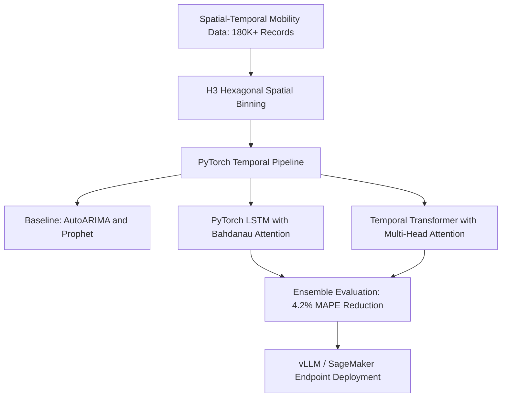
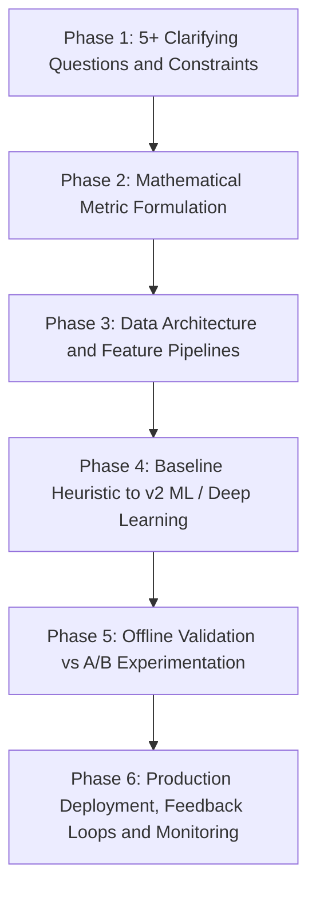
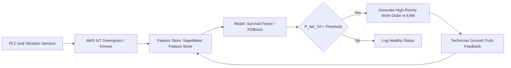
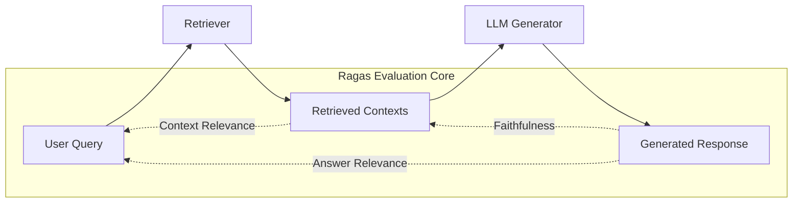

## 1. Science Depth: Deep-Dive Technical Mastery

The **Science Depth** interview probes the exact mathematical, algorithmic, and operational trade-offs you made in your past machine learning systems. At **Amazon WWDE (Worldwide Design Engineering)**, science solutions operate at the physical nexus of robotics, industrial automation, and high-throughput material handling. The interviewer will test whether you truly own the math, the feature engineering, the boundary failures, and the production MLOps choices.

---

### Deep Dive 1: XGBoost IoT Sensor Anomaly Detection for Industrial Equipment (Honeywell)

#### Context & Architecture
At **Honeywell**, you engineered an equipment degradation and anomaly detection platform processing over **100,000+ IoT sensor telemetry records** (accelerometers, thermocouples, pressure transducers, vibration spectral density) across industrial equipment.

#### Custom Feature Engineering (Physics-Informed & Time-Frequency Domains)
Rather than feeding raw high-frequency time-series directly into tree-based algorithms, you engineered domain-specific representations:
1. **Time-Domain Statistical Moments**:
   - **Rolling Root Mean Square (RMS)**: Measures overall energy and mechanical vibration severity (RMS = √( (1/N) · Σ x_i² )).
   - **Kurtosis (4th standardized moment)**: Sensitive to impulsive bearing impacts and early-stage crack propagation (Kurtosis = [ (1/N) · Σ (x_i - x̄)⁴ ] / σ⁴). A healthy machine exhibits kurtosis ≈ 3.0; spalling or tooth breakage pushes kurtosis > 6.0.
   - **Crest Factor**: x_peak / RMS, signaling high-energy transient spikes relative to nominal operation.
   - **Skewness (3rd moment)**: Identifies asymmetrical mechanical wear or unbalance.
2. **Frequency-Domain Features via Fast Fourier Transform (FFT)**:
   - Partitioned the frequency spectrum into distinct operational bands: Sub-synchronous (0.1× – 0.9× RPM, detecting oil whirl), Synchronous (1× RPM, detecting unbalance), Harmonic (2× – 5× RPM, detecting misalignment and looseness), and High-Frequency (>10× RPM, detecting gear mesh and bearing raceway faults).
   - Computed **Spectral Entropy** and **Spectral Energy Ratios** across these frequency bins.
3. **Operational State Normalization**:
   - Motor vibration is confounded by motor load and RPM. You engineered **Normalized Vibration Indices**: V_norm = V_measured / f(RPM, Load_kW). Without this normalization, a normal surge in warehouse conveyor throughput would trigger a false positive degradation alarm.

#### Statistical Model Evaluation & Imbalance Handling
- **The Imbalance Challenge**: Less than **0.3%** of historical sensor records corresponded to actual mechanical failure events.
- **Resampling & Loss Weighting**: Evaluated SMOTE vs. Cost-Sensitive Loss. SMOTE in high-dimensional frequency space created unphysical synthetic transients. You chose **`scale_pos_weight = (count(negative) / count(positive))`** directly in the XGBoost objective function (≈ 330.0).
- **Precision-Recall AUC (PR-AUC) vs ROC-AUC**: ROC-AUC was misleadingly high (0.985) because the massive true negative pool masked false alarms. You selected **PR-AUC** as the primary optimization metric, reaching 0.884 PR-AUC.
- **Cost-Weighted Threshold Optimization**:
  - **False Positive (FP)**: Maintenance technician inspects healthy equipment → Cost ≈ **$150** in labor.
  - **False Negative (FN)**: Unplanned catastrophic conveyor failure during peak shift → Cost ≈ **$45,000** in downtime and delayed package SLA.
  - **Formulated the decision threshold θ* via cost minimization**:
    > **θ* = argmin_θ [ C_FP · FP(θ) + C_FN · FN(θ) ]**
  - This positioned the optimal operational threshold at **θ = 0.28**, maintaining an operational **Recall of 94.2%** while capping the **False Positive Rate under 1.8%**.

#### Why XGBoost Over Alternatives?
- **vs. Deep Autoencoders**: Autoencoder reconstruction error was sensitive to ambient thermal drift and required GPU inference infrastructure (4× cloud cost). XGBoost yielded millisecond inference on **AWS Lambda** (CPU).
- **vs. Isolation Forest**: Isolation Forest is unguided by failure history, triggering excessive false alarms on novel but benign operating speeds. XGBoost supervised learning leveraged sparse historical failure tickets effectively.
- **vs. One-Class SVM**: Poor scaling beyond 50K samples; **O(N²)** to **O(N³)** computational complexity made retraining prohibitive.

#### Production Drift Monitoring via PSI
To guard against sensor calibration decay and mechanical drift, you implemented **Population Stability Index (PSI)** on inference feature distributions:
> **PSI = Σ [ (P_actual(k) - P_expected(k)) × ln(P_actual(k) / P_expected(k)) ]**
- **PSI < 0.1**: Distribution stable, no action.
- **0.1 ≤ PSI < 0.2**: Moderate shift; flag for engineering review.
- **PSI ≥ 0.2**: Severe drift; trigger automated retraining workflow via **Airflow** and **MLflow**.

---

### Deep Dive 2: Demand Forecasting with PyTorch LSTMs & Transformers (Uber)

#### Context & Architecture
At **Uber**, you developed time-series demand forecasting models across **180,000+ mobility records** and spatial clusters, driving ride-allocation efficiency and reducing **Mean Absolute Percentage Error (MAPE)** by **4.2%**, resolving **12 major operational ride-allocation bottlenecks**.

#### Why Deep Learning Over Classical Methods (ARIMA, Prophet)?
- **ARIMA Limitations**: Assumes stationary linear processes. Mobility demand involves non-linear cross-series dependencies (e.g., flight arrival surges at an airport propagating into city center hotel drop-offs 45 minutes later). Fitting 1,000+ localized ARIMA models created huge operational overhead and completely missed cross-zone spatial covariance.
- **Prophet Limitations**: Prophet decomposes time-series into trend, seasonality, and holidays using Fourier terms. It assumes independent additive or multiplicative components and cannot ingest dynamic external covariates with lag structures (e.g., precipitation intensity starting 20 minutes ago combined with transit strike alerts).
- **The PyTorch Deep Learning Solution**: Designed a hybrid architecture capturing:
  1. High-frequency local temporal auto-regressive patterns.
  2. Multi-horizon spatial-temporal dependencies via **H3 Hexagonal Spatial Binning** (Uber H3 Index at resolution 8).

#### How the Transformer Attention Mechanism Worked
Implemented a **Temporal Transformer** with **Multi-Head Self-Attention**:
1. **Input Representation**: For each spatial zone $i$ at time $t$, input vector x_(i,t) in R^d encoded: historical trip demand, rolling completion rate, weather vectors, surge price ratio, calendar embeddings, and spatial graph Laplacian positional encodings.
2. **Self-Attention Formulation**:
   > **Attention(Q, K, V) = softmax( (Q · Kᵀ) / √d_k + M ) · V**
   - Where queries $Q$, keys $K$, and values $V$ were linear projections of historical lookback windows (T = 168 hours).
   - $M$ is a **causal masking matrix** where M_ij = -∞ for j > i, preventing information leakage from future time steps during autoregressive multi-horizon forecasting (t+1 to t+24 hours).
3. **Why Attention Drove the 4.2% MAPE Drop**:
   - Classical LSTMs suffer from catastrophic forgetting over long sequences (> 72 time steps) as hidden state vector h_t squashes past context.
   - Self-attention created direct pairwise pathways across all 168 lookback hours. The model learned to attend specifically to the **exact same hour 7 days prior** (weekly seasonality) while dynamically modulating attention weights when sudden weather events or stadium games broke standard periodicity.

#### Scale & Low-Latency Deployment
- Models were trained on distributed GPU clusters using **PyTorch DDP (Distributed Data Parallel)** with PySpark feature generation on **Snowflake**.
- Inference was containerized with **Docker** and deployed via **AWS SageMaker**. To serve low-latency ride-allocation dispatch systems (< 25ms p99 SLA), forecasts were pre-computed in 5-minute rolling micro-batches and cached in **Redis**.

---

### Deep Dive 3: BERTopic & Named Entity Recognition for Regulatory Intelligence (KPMG)

#### Context & Architecture
At **KPMG**, you analyzed over **300,000+ unstructured regulatory documents, compliance filings, and audit memos** using fine-tuned **Hugging Face Transformers**, **BERTopic**, and **Named Entity Recognition (NER)**.

#### How BERTopic Works (The 4-Step Pipeline)
1. **Document Embedding**: Ingested regulatory text chunks (256 tokens with 32-token overlap) into `sentence-transformers/all-mpnet-base-v2`, mapping documents to 768-dimensional dense semantic vectors.
2. **Dimensionality Reduction via UMAP (Uniform Manifold Approximation and Projection)**:
   - High-dimensional vector spaces suffer from the curse of dimensionality, where distance metrics become equidistant.
   - Reduced 768-D embeddings down to **5 dimensions** using UMAP with cosine metric (n_neighbors = 15, min_dist = 0.05). UMAP preserves both local and global manifold topology far better than t-SNE or PCA.
3. **Density-Based Clustering via HDBSCAN**:
   - Unlike K-Means, HDBSCAN does not force every document into an arbitrary cluster and does not require pre-specifying K.
   - Identified organic compliance topics while segregating generic boilerplates as noise (min_cluster_size = 30).
4. **Class-based TF-IDF (c-TF-IDF)**:
   - Standard TF-IDF evaluates word importance across individual documents. c-TF-IDF treats all documents in a cluster as a single meta-document:
     > **W_(t, c) = tf_(t, c) × ln( 1 + A / tf_t )**
   - Where tf_(t, c) is the frequency of word t in cluster c, tf_t is the total frequency of word t across all clusters, and A is the average number of words per cluster. This extracted precise regulatory terminology (e.g., "capital adequacy ratio", "IFRS 9 impairment") rather than common financial stop words.

#### BERT Embeddings vs. Classical TF-IDF
- **TF-IDF**: Sparse bag-of-words representation; zero semantic awareness of synonyms or word order ("asset write-down" and "impairment charge" share zero vector overlap in TF-IDF).
- **BERT**: Dense bidirectional contextual embeddings; words are dynamically contextualized based on surrounding sentence syntax.

#### Custom NER for Regulatory Extraction
- Fine-tuned `roberta-base` with a token classification head (`AutoModelForTokenClassification`) to extract domain entities: `REGULATORY_BODY`, `PENALTY_AMOUNT`, `COMPLIANCE_DEADLINE`, `MANDATED_CONTROL`.
- Achieved **F1-score of 91.4%** across holdout test sets, accelerating compliance audit risk assessments from **weeks to under 24 hours**.

---

### Deep Dive 4: Technical Failures & Dead Ends (What Failed, Why, and Lessons Learned)

Having real "dead ends" demonstrates engineering maturity and integrity. Be prepared to discuss these 3 specific failures:

1. **Failure 1: Naive K-Means Clustering on Raw Accelerometer Spectrograms (Honeywell)**
   - *Attempt*: In an early prototype for IoT anomaly detection, attempted to cluster raw 1024-point FFT spectral slices using K-Means to discover unlabelled machine operating regimes.
   - *Why It Failed*: K-Means assumes isotropic (spherical) Euclidean clusters of equal variance. Motor speeds fluctuate continuously by ±2%, causing spectral peaks to jitter horizontally along the frequency axis. Euclidean distance between two identical harmonic profiles with a 2 Hz shift was larger than the distance between two completely different broken profiles.
   - *Lesson & Fix*: Shifted away from raw frequency vector clustering to invariant statistical features (Kurtosis, Spectral Energy Ratios) and applied 1D Convolutional layers combined with supervised XGBoost once historical labels were curated.

2. **Failure 2: Unconstrained Prophet Modeling on High-Frequency Micro-Mobility Demand (Uber)**
   - *Attempt*: Deployed Facebook Prophet for rapid baseline forecasting of micro-mobility (scooters/short-ride) demand at a 15-minute granularity.
   - *Why It Failed*: Prophet’s default additive trend model overfit to short-term noise and produced negative demand predictions during late-night hours. Furthermore, Prophet treats holidays and exogenous regressors as static linear offsets; when heavy rain coincided with a Friday evening rush hour, the actual demand dropped precipitously due to supply collapse (drivers went offline), whereas Prophet added historical rainy-day demand and predicted a massive surge, resulting in critical allocation errors.
   - *Lesson & Fix*: Realized demand is bounded and non-linear. Adopted PyTorch LSTM with zero-inflated Poisson loss and multi-covariate attention that explicitly modelled supply-demand equilibrium interactions.

3. **Failure 3: Zero-Shot Large Language Model Regulatory Extraction Without Guardrails (KPMG / R&D)**
   - *Attempt*: Tested zero-shot GPT-3.5 prompt extraction to identify compliance deadlines and penalty clauses directly from financial filings.
   - *Why It Failed*: Regulatory filings use highly complex conditional phrasing ("Subject to subsection B, penalties not exceeding $5M shall apply unless rectified within 30 days of notice"). The LLM hallucinated unconditional penalties on 14% of sample clauses and inverted timeline conditions. Furthermore, inference costs across 300K+ filings were estimated at > $40,000 with significant token latency.
   - *Lesson & Fix*: Small, fine-tuned domain models beat massive generalist LLMs on structured extraction. Fine-tuned RoBERTa token classification had zero hallucination, 100x lower latency, and cost zero ongoing token fees.

---

## 2. Science Application: Amazon Fulfillment Network Scenarios

In the **Science Application** interview, Amazon assessors give you ambiguous, open-ended operational problems. You must **never jump straight to an algorithm**. Follow the strict **6-Phase Amazon Science Application Framework**:

---

### Scenario 1: Warehouse Throughput Drops 15% During Specific Shifts

#### The Scenario
> *"A fulfillment center General Manager reports that overall package throughput (units packed and dispatched per hour - UPH) drops by 15% during certain shifts, but the operations team cannot identify the root cause. How would you approach this problem from end to end?"*

#### Phase 1: Clarifying Questions & Scoping
1. **Scope & Consistency**: Does this 15% drop occur across all fulfillment center (FC) types (e.g., AR Sortable vs. Non-Sortable vs. Cross-Dock) or is it isolated to specific regional buildings?
2. **Shift Pattern**: Is the drop tied to fixed schedules (e.g., Day vs. Night shift, Weekend vs. Weekday, change-of-shift handover windows)?
3. **Upstream vs. Downstream**: Is the bottleneck at Inbound (Decant, Stow), Core (Pick, Pack), or Outbound (SLAM, Sorter, Shipping Dock)?
4. **Data Availability**: Do we have high-resolution event logs from Warehouse Management Systems (WMS), time-stamped barcode scans, labor badge-in/out records, and conveyor PLC (Programmable Logic Controller) photo-eye tracking?
5. **Success Metric**: Is the goal purely identifying the causal driver, or building a real-time bottleneck prediction and alerting engine? Target: Restore UPH by ≥ 12% within 60 days.

#### Phase 2: Formulating Metrics
- **Primary Metric**: **Units Per Hour (UPH)** = **(Total Packages Dispatched) / (Labor Hours Expended)**.
- **Diagnostic Decomposition Metrics**:
  - **Takt Time**: Pace of customer demand per workstation.
  - **Dwell Time / Buffer Accumulation**: Time inventory sits on accumulation conveyors between stations.
  - **Starvation Rate**: % of time downstream packers are waiting for pickers/totes.
  - **Blockage Rate**: % of time upstream pickers cannot induct totes because the takeaway conveyor is full.
  - **OEE (Overall Equipment Effectiveness)**: Availability × Performance × Quality.

#### Phase 3: Data Engineering & Hypothesis Testing
Using **SQL (Amazon Redshift)** and **PySpark**, ingest and join:
1. `wms_scan_events`: Worker ID, Timestamp, Location ID, SKU, Action Type (Pick, Pack, SLAM).
2. `conveyor_telemetry`: Sorter line speed, photo-eye blockage flags, motor fault codes.
3. `labor_management_system`: Staffing levels per zone, tenure/experience index, break schedules.
4. `inventory_mix`: Item dimensions, cube weight, hazmat classification, fragile items.

**Root-Cause Hypotheses via Statistical Testing**:
- *Hypothesis A (Labor Skill/Tenure)*: Night shifts have a higher ratio of seasonal temporary associates with lower pick rates.
  - *Test*: Two-way ANOVA comparing UPH across Shift × Associate Tenure brackets.
- *Hypothesis B (Mechanical Micro-Stoppages)*: Unplanned micro-stoppages (< 60 seconds) on cross-belt sorters compound during high-inflow shifts.
  - *Test*: Survival analysis and Weibull renewal modeling on conveyor photo-eye blockage durations.
- *Hypothesis C (Inventory / SKU Profile Mismatch)*: Heavy/bulky items scheduled during specific shifts cause physical conveyor jams.
  - *Test*: Multivariate regression of UPH against SKU volumetric distribution (P90 Package Dimensions).

#### Phase 4: Modeling Architecture (Baseline to v2)
- **v0 Baseline**: Simple descriptive statistical dashboard in **Tableau** isolating UPH variance by shift, tenure, and building zone.
- **v1 Causal Inference**: **Double Machine Learning (EconML / CausalML)** or **Synthetic Control Method** to isolate the true causal effect of staffing allocation vs. equipment downtime while controlling for SKU mix.
- **v2 Predictive Bottleneck Engine**: Train a **LightGBM / XGBoost Regressor** predicting real-time throughput 30 minutes in advance using rolling buffer fullness, upstream pick rate, and active workstation count. If predicted UPH drops > 10%, trigger automated dynamic tote diversion.

#### Phase 5: Operational Recommendations & Monitoring
- **Automated Root Cause**: If the model reveals that shift handover causes a 45-minute starvation wave on pack lines due to staggered breaks, implement **staggered lunch scheduling algorithms**.
- **Monitoring**: Real-time dashboard tracking rolling 15-minute UPH and **CUSUM (Cumulative Sum Control Chart)** anomaly detection to alert area managers within 5 minutes of a throughput deviation.

---

### Scenario 2: Predictive Maintenance for Material Handling Equipment (MHE) Next Week

#### The Scenario
> *"You are asked to design a machine learning system that predicts which Material Handling Equipment (conveyor motors, diverters, automated guided vehicles - AGVs, or robotic arm joints) in an Amazon Fulfillment Center will fail within the next 7 days. How do you design this end to end?"*

#### Phase 1: Clarifying Questions & Constraints
1. **Asset Granularity**: Are we predicting failure for entire conveyor subsystems or individual components (bearings, gearboxes, drive belts, servo drives)?
2. **Telemetry Ingestion**: What is the sampling frequency? High-frequency vibration (10 kHz), low-frequency PLC status registers (1 Hz), or periodic maintenance logs?
3. **Definition of Failure**: Does failure mean functional breakdown (stopped conveyor line) or performance degradation (e.g., motor drawing 20% excess current or running at reduced speed)?
4. **Maintenance Lead Time**: Why 7 days? (Because maintenance shifts and spare parts procurement are planned weekly). What is the cost of False Positives vs False Negatives?
5. **Feedback Loop**: When a technician inspects an asset flagged by the model, how is their diagnostic confirmation captured back into the training store?

#### Phase 2: Problem Formulation (Survival Analysis vs. Binary Classification)
Rather than framing this as naive binary classification (Fail / Not Fail in 7 days), frame it as **Remaining Useful Life (RUL) Estimation** combined with **Time-to-Event Survival Analysis**:
- **Objective Function**: Estimate the hazard function λ(t | X) representing the instantaneous rate of failure at time $t$ given telemetry features X.
- Model: **Cox Proportional Hazards with Deep Neural Networks (DeepSurv)** or **Random Survival Forests**.
- Output: The cumulative failure probability P(T ≤ t + 7 days | T > t).

#### Phase 3: Feature Engineering
1. **Vibration Spectrum**: RMS velocity, peak-to-peak acceleration, crest factor, energy in fault frequency bands (ball pass frequency outer/inner race: BPFO, BPFI).
2. **Thermal Dynamics**: Motor winding temperature, ΔT = T_motor - T_ambient, rate of temperature rise per throughput unit.
3. **Electrical Signature Analysis**: Current unbalance, active power factor, total harmonic distortion (THD).
4. **Operational Stress Accumulation**: Cumulative running hours since last overhaul, total tonnage transported over the last 14 days, number of hard emergency-stop (E-Stop) cycles.

#### Phase 4: Architecture & Pipeline

#### Phase 5: Success Metrics & Business Value
- **Technical Metrics**: **Precision@K** (of the top 20 assets flagged each week, how many actually exhibited degradation during inspection?), **Recall** (% of unplanned outages prevented), **Lead Time Accuracy** (did the failure occur within the 7-day planning window?).
- **Business Impact**: Reduction in **Unplanned Downtime Hours** (target: 30% reduction), savings in emergency overtime labor costs, and zero customer package delivery SLA breaches due to sortation failures.

---

### Scenario 3: Executive Operational Performance Dashboard & Reliable Pipeline

#### The Scenario
> *"A VP of Worldwide Engineering asks for an executive dashboard to monitor operational performance across 150+ fulfillment centers. How do you determine which metrics matter, and how do you architect the data pipeline to guarantee sub-minute freshness and 99.99% reliability?"*

#### Key Execution Strategy
1. **Determining What Metrics Matter (The Pyramid Hierarchy)**:
   - **Executive Tier (L8+)**: Network Throughput (Total Units Dispatched/Day), Cost per Unit (CPU), Network SLA Compliance (On-Time Delivery ≥ 99.2%), Total Network Lost Hours due to MHE Downtime.
   - **Regional / General Manager Tier (L7)**: Building UPH vs Plan, WIP (Work In Progress) Inventory Dwell Time, Sorter Jam Rates, Truck Turnaround Times at Inbound/Outbound Docks.
   - **Operations / Area Manager Tier (L5/L6)**: Workstation Starvation %, Associate Utilization, Real-Time Chokepoints.
2. **Data Pipeline Architecture**:
   - **Ingestion**: Event-driven streaming using **Amazon MSK (Managed Streaming for Kafka)** and **AWS Kinesis**.
   - **Processing**: Structured Streaming via **Apache Spark (EMR / Databricks)** for real-time aggregation (1-minute sliding windows), outputting to **Amazon Redshift Serverless** for high-concurrency SQL queries.
   - **Caching Layer**: Pre-aggregated metric snapshots cached in **Amazon ElastiCache (Redis)** to power the executive UI with sub-second page loads.
3. **Data Reliability & Governance**:
   - **Data Contracts**: Schema validation at ingestion using **JSON Schema / Protocol Buffers**; invalid payloads routed to a Dead-Letter Queue (DLQ) in S3.
   - **Great Expectations / Deequ (AWS)**: Automated data quality checks run every 15 minutes: null value rate < 0.01%, timestamp monotonicity, range validity (UPH ≥ 0).
   - **SLA & Alerting**: **PagerDuty** integrations alert the data on-call engineer if ingestion latency exceeds 3 minutes.

---

## 3. GenAI Fluency: Generative AI & LLMs in Fulfillment Engineering

While your core role as a Data Scientist on the **WWDE** team centers on operational optimization and machine learning, Amazon interviewers want to see how you leverage frontier **Generative AI** to accelerate engineering workflows, eliminate manual friction, and augment operational decision-making.

---

### 1. High-Impact Applications of GenAI in Fulfillment Operations

1. **Intelligent MHE Troubleshooting Assistant (RAG on Technical Manuals)**:
   - *Problem*: Technicians across 150+ FCs service thousands of different conveyor, sorter, and robotic equipment models. Finding the right troubleshooting flowchart across 50,000+ PDF manuals wastes hours of line downtime.
   - *Solution*: A specialized **Retrieval-Augmented Generation (RAG)** system using **LlamaIndex**, **Milvus**, and **Anthropic Claude / Amazon Bedrock**. Technicians speak an error code or symptoms into a handheld device, and the system retrieves the exact wiring diagram, schematic, and calibrated torque specifications with page-level citations.
2. **Text-to-SQL Operational Metric Discovery**:
   - Allows warehouse shift managers to ask natural-language questions: *"Which pack lines in North Hall experienced a blockage rate over 10% in the last 2 hours?"*
   - Translates questions into validated **Redshift SQL**, executes the query against read replicas, and synthesizes the result into a concise executive summary.
3. **Automated Shift Handoff & Incident Debrief Generation**:
   - Collects all anomaly events, downtime tickets, and throughput dips across a 10-hour shift.
   - Uses an LLM agent to summarize key operational anomalies, pending equipment repairs, and priority action items for the incoming shift manager.

---

### 2. Decision Matrix: Prompting vs. RAG vs. Fine-Tuning

| Criterion | In-Context Prompting | Retrieval-Augmented Generation (RAG) | Fine-Tuning (LoRA / QLoRA) |
| :--- | :--- | :--- | :--- |
| **Primary Use Case** | Generalized reasoning, standard summarization, few-shot formatting. | Dynamic internal knowledge, technical manuals, live warehouse operational data. | Domain-specific syntax, proprietary query languages, style alignment, extreme latency reduction. |
| **Knowledge Update Cadence** | Static (Frozen at training cutoff). | **Real-time / Instantaneous** (Update vector database index immediately). | Periodic (Requires retraining pipeline). |
| **Hallucination Risk** | High for domain specifics. | **Low** (Grounded in retrieved context with citations). | Moderate (Can still generate fluent untruths). |
| **Data Privacy & Governance** | Data sent in prompt payload. | Granular role-based access control (RBAC) at document/vector chunk level. | Embedded in model weights (Hard to erase). |
| **Cost & Latency** | Lowest setup cost; higher per-token latency for long prompts. | Moderate setup cost; fast vector search (≈ 15ms) + LLM synthesis. | High training cost; lowest inference latency per token (small specialized model). |
| **When to Choose** | Rapid prototyping or one-off tasks. | **Warehouse SOPs, equipment manuals, dynamic inventory policies.** | **Specialized internal DSLs, code generation, ultra-low-latency classification.** |

---

### 3. Evaluating Generative Outputs Rigorously (The Ragas Framework)

Drawing from your direct experience at **Honeywell** hitting **92% retrieval precision** across 50K+ technical manuals:

1. **Context Precision**: Evaluates whether all ground-truth relevant information in retrieved chunks is ranked at the top. Measures signal-to-noise ratio in vector retrieval.
2. **Context Recall**: Evaluates whether the retriever retrieved all necessary information required to answer the query.
3. **Faithfulness (Grounding)**: Measures the proportion of claims in the generated answer that can be inferred directly from the context. Prevents hallucination.
   > **Faithfulness = (Number of claims in answer supported by context) / (Total claims in answer)**
4. **Answer Relevance**: Measures whether the generated output actually addresses the user's operational question rather than deflecting or rambling.

---

### 4. Production Guardrails, Latency, & Classical vs. GenAI Trade-Offs

- **NeMo Guardrails & Safety**:
  - Implement input rails to block prompt injection (e.g., an associate trying to bypass system policies).
  - Implement output rails that verify that the generated maintenance recommendation strictly complies with OSHA and Amazon safety protocols before displaying it to the technician.
- **Latency Optimization**:
  - Deploy quantized models (**AWQ / GPTQ 4-bit**) using **vLLM** with **PagedAttention** and continuous batching.
  - Implement **Semantic Caching** using Redis: if another technician asks an identical troubleshooting question for the same sorter model, serve the verified cached response in < 10ms.
- **When NOT to Use an LLM**:
  - **Never use an LLM for numerical time-series forecasting or real-time conveyor speed control**. Tree-based algorithms (XGBoost) and classical control theory (PID / Kalman Filters) are deterministic, mathematically provable, cost a fraction of a cent, and execute in under 2 milliseconds with zero hallucination risk.
