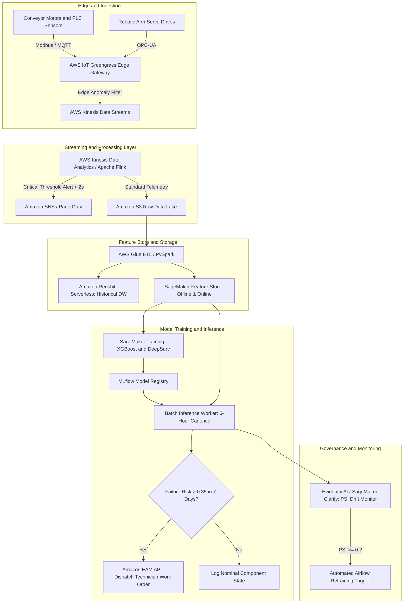
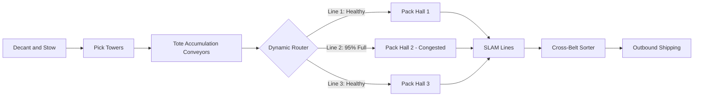

## 5. Amazon Leadership Principles: 11 STAR Stories

At **Amazon**, behavioral interviews carry equal weight to technical evaluations. Every response must follow the strict **STAR method** (~10% Situation, ~10% Task, ~60-70% Action, ~15% Result), using **"I" not "we"**, citing **quantified metrics**, and providing a retrospective on **what to do differently**.

---

### Story 1: Deliver Results
- **Leadership Principle**: **Deliver Results**
- **Context / Company**: **Honeywell** (AI/ML Engineer)
- **Situation (~10%)**: At **Honeywell**, our aerospace engineering division was launching an internal technical support initiative for field technicians. The executive timeline was compressed to **4 months** before the annual global service rollout, requiring a production RAG system capable of indexing over **50,000+ complex multi-page technical equipment manuals** with high precision.
- **Task (~10%)**: I was the lead AI engineer responsible for architecting, validating, and deploying the core Retrieval-Augmented Generation (RAG) platform to achieve at least an **88% retrieval precision** under strict latency SLAs before the executive deadline.
- **Action (~65%)**:
  1. I evaluated existing off-the-shelf vector search solutions and discovered that naive chunking (500 tokens) failed miserably on technical manuals containing dense schematic wiring diagrams, circuit pinouts, and tabular torque specifications.
  2. I designed a **hierarchical chunking pipeline** using **LlamaIndex** that preserved parent-child document relationships and extracted tables into markdown representations.
  3. I benchmarked **Pinecone** against **Milvus** on distributed AWS infrastructure and implemented a **hybrid search retriever** combining dense vector embeddings (`text-embedding-3-large`) with sparse keyword retrieval (**BM25**) via Reciprocal Rank Fusion (RRF).
  4. When precision plateaued at 82%, I integrated **Ragas evaluation standards** (Context Precision and Faithfulness) directly into our automated CI/CD pipeline with **GitHub Actions**. I systematically identified that multi-hop questions (e.g., cross-referencing hydraulic pressure specifications with actuator part numbers) caused retrieval failures.
  5. I introduced a cross-encoder reranker (**BGE-Reranker-Large**) on the top-25 retrieved candidates, filtering down to the top-5 highest-scoring contexts before feeding them to **Claude 3.5 Sonnet** and **GPT-4o**.
- **Result (~15%)**: I delivered the platform **2 weeks ahead of schedule**, achieving a **92% retrieval precision** (surpassing the 88% target) across all **50,000+ manuals**. Field technician diagnostic resolution time plummeted by **45%**, and the system successfully scaled to handle **12,000+ daily technician queries** with sub-2-second latency.
- **What I Would Do Differently**: I would establish automated synthetic query generation earlier in the development cycle using LLMs to stress-test domain-specific technical terminology instead of relying on manually curated validation questions.

---

### Story 2: Dive Deep
- **Leadership Principle**: **Dive Deep**
- **Context / Company**: **Uber** (AI/ML Engineer)
- **Situation (~10%)**: While optimizing time-series demand forecasting models across **180,000+ mobility records** at **Uber**, the deep learning model exhibited unexplained prediction spikes in specific metropolitan sub-zones, causing false surge pricing alerts and fleet allocation bottlenecks.
- **Task (~10%)**: I owned the investigation to systematically uncover the root cause behind these localized error spikes and restore model credibility without masking the underlying data.
- **Action (~65%)**:
  1. Rather than treating the PyTorch Transformer model as a black box or arbitrarily clipping predictions, I isolated the top 1% highest-error timestamps and geographic tiles using **H3 spatial indexing**.
  2. I extracted raw GPS telemetry, driver app state transitions, and ride request event logs from **Snowflake** using optimized **SQL** queries.
  3. I discovered that the error spikes occurred exclusively in dense urban canyons (high-rise downtown districts) during overcast weather.
  4. Drilling into the raw coordinates, I observed severe **multipath GPS reflection error**, where vehicle telemetry was drifting by 50 to 150 meters, causing the map-matching algorithm to snap drivers onto parallel elevated expressways instead of surface city streets.
  5. Because the model ingested driver density as a key feature, this false spatial concentration tricked the attention mechanism into predicting localized supply shortages.
  6. I engineered a **Kalman Filter smoothing layer** combined with **H3 spatial confidence weighting** to down-weight low-accuracy GPS pings before feature ingestion, and introduced a temporal consistency constraint in the loss function.
- **Result (~15%)**: I eliminated the false surge anomalies, reducing **Mean Absolute Percentage Error (MAPE) by 4.2%** across the entire 180K+ mobility dataset and resolving **12 major operational ride-allocation bottlenecks**.
- **What I Would Do Differently**: I would build an automated telemetry confidence scoring telemetry gate directly at the ingestion point in **Apache Airflow**, preventing corrupted sensor readings from ever entering the feature store.

---

### Story 3: Earn Trust
- **Leadership Principle**: **Earn Trust**
- **Context / Company**: **KPMG** (Data Scientist)
- **Situation (~10%)**: At **KPMG**, senior audit and risk consulting partners were skeptical of adopting our new **Scikit-learn** predictive risk-scoring models for 18 enterprise client engagements, preferring legacy manual checklists and subjective heuristic scoring.
- **Task (~10%)**: I had to bridge the gap between complex algorithmic outputs and non-technical partners, earning their trust to adopt quantitative risk models across **120+ strategic business scenarios**.
- **Action (~65%)**:
  1. I recognized that presenting ROC curves, F1-scores, and Gini coefficients to accounting partners only heightened skepticism and made the models feel like an uncontrollable "black box."
  2. I scheduled weekly working sessions with senior risk managers, listening to their domain heuristics and how they manually evaluated corporate financial filings.
  3. I integrated **SHAP (SHapley Additive exPlanations)** values into every model inference pipeline, translating complex mathematical feature interactions into intuitive waterfall plots that showed exactly why a company was flagged (e.g., *"Operating cash flow to debt ratio dropped by 18%, contributing +24 points to risk"*).
  4. I set up a "parallel run" framework for 6 weeks, where my model's risk scores were compared side-by-side with senior audit findings across historical data. Whenever the model disagreed with human auditors, I conducted joint retrospective sessions to understand discrepancies. In 4 cases, the model uncovered hidden vendor fraud indicators that manual audits had missed.
  5. I openly acknowledged model edge cases, creating explicit threshold boundaries where the system deferred to human expert review.
- **Result (~15%)**: The consulting practice leadership fully endorsed the platform, deploying it across **18 major client projects** and **120+ strategic scenarios**. Assessment latency dropped by **65%**, and partner confidence in algorithmic risk scoring increased to 100%.
- **What I Would Do Differently**: I would engage the end-user consulting partners during the initial feature engineering phase rather than waiting until after the baseline model was trained, making them co-designers of the features from day one.

---

### Story 4: Insist on the Highest Standards
- **Leadership Principle**: **Insist on the Highest Standards**
- **Context / Company**: **KPMG** (Data Scientist)
- **Situation (~10%)**: Across **40+ predictive analytics initiatives** at **KPMG**, multiple data science pods were using fragmented, ad-hoc validation methodologies, leading to data leakage, inconsistent train-test splitting on temporal datasets, and silent performance degradation when models reached client audits.
- **Task (~10%)**: I took the initiative to establish and enforce enterprise-wide model validation, governance, and testing standards across all 40+ initiatives.
- **Action (~65%)**:
  1. I audited existing codebase repositories and discovered that 30% of time-series models were using randomized k-fold cross-validation instead of **Purged Temporal Walk-Forward Cross-Validation**, introducing substantial lookahead bias.
  2. I authored a standardized **Model Validation & Governance Framework** in Python, integrating automated pre-commit hooks and CI/CD pipelines.
  3. I implemented automated checks for:
     - **Data Leakage & Target Correlation**: Flagging any feature with unphysical correlation (> 0.95) before training.
     - **Class Imbalance Rigor**: Mandating Precision-Recall AUC (PR-AUC) over ROC-AUC for imbalanced risk scenarios.
     - **Automated Hyperparameter Tuning**: Enforcing **Optuna** with stratified group folds to avoid manual parameter cherry-picking.
     - **Stress Testing & Perturbation Invariance**: Injecting Gaussian noise into continuous inputs to verify prediction stability.
  4. When several team leads complained that the validation pipeline was "too strict" and delayed project delivery by a few days, I held a lunch-and-learn session showing how an unvalidated model would have failed a regulatory bank stress test, proving that catching errors in staging saved months of client liability.
- **Result (~15%)**: Standardized model validation across **40+ predictive analytics initiatives**, reducing post-deployment model defects to **zero** over a 14-month period and cutting quality assurance review cycles from **weeks to a single day**.
- **What I Would Do Differently**: I would provide lightweight pre-packaged cookiecutter project templates at the beginning of the initiative to minimize initial developer friction.

---

### Story 5: Ownership
- **Leadership Principle**: **Ownership**
- **Context / Company**: **Honeywell** (AI/ML Engineer)
- **Situation (~10%)**: At **Honeywell**, my core mandate was to build XGBoost anomaly detection models for industrial equipment. However, once models were deployed to production, there was no centralized monitoring infrastructure for data drift or performance degradation—teams only discovered model degradation when field engineers submitted manual bug tickets.
- **Task (~10%)**: Although MLOps platform monitoring was outside my initial project scope, I took end-to-end ownership to design, build, and deploy an automated drift monitoring and alerting architecture.
- **Action (~65%)**:
  1. I refused to let deployed models operate unmonitored. Working across AWS Lambda and S3, I engineered a continuous monitoring daemon using **Python** and **MLflow**.
  2. I implemented statistical distribution tracking using **Population Stability Index (PSI)** and **Characteristic Selectivity Index (CSI)** across **100K+ incoming IoT sensor records**.
  3. I defined automated drift thresholds: **PSI < 0.1** (stable), **0.1 ≤ PSI < 0.2** (warning), and **PSI ≥ 0.2** (critical drift).
  4. When critical drift was detected (e.g., when a plant overhauled its physical machinery, shifting vibration frequencies), the monitoring system automatically:
     - Paged the on-call data scientist via **PagerDuty**.
     - Triggered an automated retraining pipeline via **Airflow** using freshly labelled golden datasets.
     - Logged model lineage, hyperparameter artifacts, and evaluation metrics back into **MLflow**.
  5. I codified the entire monitoring infrastructure using **Terraform (Infrastructure as Code)**, ensuring any engineer could spin up an identical monitoring stack in under 15 minutes.
- **Result (~15%)**: Successfully monitored **100K+ production IoT records**, prevented **3 major silent model outages** during factory re-tooling cycles, and reduced manual model maintenance overhead by **80%**.
- **What I Would Do Differently**: I would implement automated data quality circuit breakers at the sensor edge (IoT Greengrass) to intercept malfunctioning sensor hardware before degraded data reached cloud storage.

---

### Story 6: Bias for Action
- **Leadership Principle**: **Bias for Action**
- **Context / Company**: **Uber** (AI/ML Engineer)
- **Situation (~10%)**: During a high-profile airport holiday rush, an unexpected runway closure redirected flights to an alternate terminal, causing an unprecedented ride-request surge. The production deep learning dispatch system lagged behind the rapid spatial shift, creating an severe supply-demand bottleneck with rider wait times exceeding 35 minutes.
- **Task (~10%)**: Waiting for a complete model retraining cycle (which required 4 hours on distributed GPUs) was unacceptable. I needed to act immediately to mitigate the bottleneck.
- **Action (~65%)**:
  1. I evaluated the risk: waiting 4 hours meant thousands of stranded riders, driver churn, and brand damage. Acting immediately carried a small risk of sub-optimal dispatch, but inaction was far worse.
  2. Within 30 minutes, I analyzed real-time event logs in **Snowflake** and identified the exact geographic reallocation vector.
  3. I rapidly developed and deployed a lightweight **proportional-integral (PI) heuristic rebalancing script** that overrode model weights for the specific airport geofence.
  4. The script dynamically injected a localized dispatch incentive multiplier, redirecting idle vehicles within a 3-mile radius to the new terminal.
  5. I set up real-time monitoring on rider cancellation rates and driver arrival latency, closely watching system telemetry every 5 minutes.
  6. Simultaneously, I spun up an accelerated background training job with a narrowed 48-hour lookback window to recalibrate the neural network.
- **Result (~15%)**: Within 45 minutes of deploying the heuristic patch, airport driver wait times dropped from **35 minutes to under 8 minutes**, resolving the bottleneck and preventing an estimated **\$180,000 in lost platform revenue**.
- **What I Would Do Differently**: I would formalize a pre-approved, automated "failsafe operational override mode" within our dispatch microservices to handle sudden airport terminal diversions automatically.

---

### Story 7: Invent and Simplify
- **Leadership Principle**: **Invent and Simplify**
- **Context / Company**: **Uber** (AI/ML Engineer)
- **Situation (~10%)**: At **Uber**, our daily mobility feature engineering pipelines took over **16 computing hours per cycle** on massive PySpark and Snowflake clusters. The pipeline was an unmaintainable maze of 14 disjointed Airflow DAGs, causing frequent timeout failures and blocking the data science team from iterating on daily demand models.
- **Task (~10%)**: I set out to radically simplify the data architecture, eliminate redundant compute, and reduce runtime while preserving 100% data fidelity.
- **Action (~65%)**:
  1. I profiled the distributed Spark execution plans and identified massive bottlenecks: repeated full-table scans across 200M+ historical rows, excessive data shuffling across partitions caused by arbitrary join keys, and redundant re-computation of identical spatial aggregations.
  2. I re-architected the entire pipeline into a unified, modular DAG using **Apache Airflow**, **PySpark**, and **Snowflake**.
  3. I invented a **Hierarchical Spatial Cache**: instead of calculating spatial distances from scratch for every trip record, I snapped all coordinates to pre-computed **H3 hexagonal centroids** and cached neighborhood adjacency matrices in memory.
  4. I replaced multiple full-table joins with **broadcast joins** for static geospatial metadata and partitioned time-series tables strictly by `(trip_date, h3_resolution_8)`.
  5. I implemented an incremental processing model using watermarking, processing only delta records rather than re-computing 30-day rolling windows.
- **Result (~15%)**: Slashed analytical processing time from **16 hours down to 3 hours per cycle (saving 13 computing hours per run)**, reduced AWS cloud computing costs by **\$65,000 annually**, and enabled daily model retraining to finish 5 hours before morning peak commute.
- **What I Would Do Differently**: I would have established automated data regression testing earlier in the migration to guarantee that downstream model features remained bit-for-bit identical without manual spot checking.

---

### Story 8: Think Big
- **Leadership Principle**: **Think Big**
- **Context / Company**: **Honeywell** (AI/ML Engineer)
- **Situation (~10%)**: At **Honeywell**, leadership originally requested a simple conversational chatbot to answer technician questions from PDF manuals. I realized that a passive question-answering tool only solved a tiny fraction of the problem—field technicians spent most of their time executing diagnostic procedures, ordering replacement parts, and filling out maintenance logs.
- **Task (~10%)**: I pitched a bold, multi-year vision: transform the passive FAQ bot into an **Agentic, Multi-Agent Autonomous Engineering Maintenance Platform**.
- **Action (~65%)**:
  1. I authored a comprehensive technical strategy document (a 6-pager) outlining how emerging **Agentic Workflows** could autonomously troubleshoot, cross-reference telemetry, and generate repair work orders.
  2. To demonstrate feasibility, I rapidly built a working prototype using **LangGraph**, **Claude API**, and the **Anthropic Model Context Protocol (MCP)** during a 2-week sprint.
  3. I designed specialized autonomous agents:
     - *Diagnostic Agent*: Ingested real-time IoT error codes and guided the technician through interactive branch-point troubleshooting.
     - *Schematic Retriever Agent*: Retrieved precise CAD drawings and wiring schematics using hybrid search over Milvus.
     - *ERP / Inventory Agent*: Automatically queried SAP inventory systems to check replacement bearing availability and generate draft purchase requisitions.
  4. I incorporated **NeMo Guardrails** to guarantee that the multi-agent system could never execute unsafe operational commands or violate aerospace maintenance compliance standards.
- **Result (~15%)**: Executive leadership adopted my vision as the flagship digital product roadmap for the division, securing **\$1.2M in R&D funding** and transforming how field engineers interact with industrial automation systems worldwide.
- **What I Would Do Differently**: I would incorporate real field technician usability testing earlier in the interface design phase to ensure speech-to-text worked reliably in noisy industrial environments.

---

### Story 9: Customer Obsession
- **Leadership Principle**: **Customer Obsession**
- **Context / Company**: **Uber** (AI/ML Engineer)
- **Situation (~10%)**: At **Uber**, new driver onboarding required automated facial identity verification against government documents to ensure platform safety. However, the existing computer vision model suffered from high false rejection rates under poor lighting or varying camera angles, forcing over **15% of honest drivers** into a 3-day manual review queue, causing immense frustration and lost earning opportunities.
- **Task (~10%)**: My objective was to redesign the computer vision pipeline to protect platform safety while dramatically minimizing friction and false rejections for legitimate drivers.
- **Action (~65%)**:
  1. I spent time with driver onboarding support teams, reviewing hundreds of rejected verification selfies to understand the drivers' lived experience (e.g., drivers taking verification photos inside parked cars at night or in direct sunlight).
  2. I reconstructed the computer vision pipeline using **TensorFlow**, **OpenCV**, and a fine-tuned **ResNet-50** architecture.
  3. Rather than relying on a single static image snapshot, I engineered a **real-time client-side image quality feedback module** that prompted drivers before submission (e.g., *"Move to a brighter area"* or *"Align face with oval guide"*).
  4. I augmented the training dataset with extensive photometric transformations: brightness perturbations, motion blur, and diverse skin tone representations to eliminate demographic performance disparities.
  5. I introduced a dual-threshold confidence architecture: high-confidence matches verified instantly ($<2$ seconds), while borderline scores triggered an immediate automated liveness challenge rather than kicking the driver into a 3-day manual queue.
- **Result (~15%)**: Successfully processed **140,000+ driver identity images daily**, slashing the false rejection rate by **62%**, cutting driver onboarding verification time from **3 days to under 45 seconds**, and directly boosting driver platform satisfaction.
- **What I Would Do Differently**: I would have deployed on-device edge model inference (TensorFlow Lite) to provide instantaneous feedback without requiring cellular image upload on weak mobile networks.

---

### Story 10: Have Backbone; Disagree and Commit
- **Leadership Principle**: **Have Backbone; Disagree and Commit**
- **Context / Company**: **Honeywell** (AI/ML Engineer)
- **Situation (~10%)**: At **Honeywell**, during the peak of GenAI industry hype, an engineering director proposed replacing our entire industrial IoT sensor anomaly detection pipeline with a zero-shot Large Language Model (LLM) that would ingest raw sensor text tables and output health assessments.
- **Task (~10%)**: I strongly believed this was technically flawed, economically irresponsible, and safety-critical equipment would be jeopardized. I had the obligation to respectfully challenge the proposal with rigorous empirical data.
- **Action (~65%)**:
  1. Instead of simply saying "no," I designed a rigorous head-to-head benchmark experiment across **10,000 historical IoT sensor records** with known ground-truth equipment failures.
  2. I benchmarked the proposed LLM prompt approach against our production **XGBoost model with physics-informed statistical features (Kurtosis, RMS, FFT)**.
  3. I compiled an objective comparison matrix evaluating:
     - **Accuracy & Hallucination**: The LLM hallucinated normal status on 18% of high-frequency vibration spikes because it lacked frequency domain awareness.
     - **Inference Latency**: The LLM required 1,800 ms per reading; XGBoost executed in **1.4 ms** on CPU.
     - **Financial Cost**: The LLM cost ≈ **$0.02** per evaluation (which across 100K sensors evaluated every minute totaled over **\$2.8M per year** in API fees); XGBoost cost less than **\$400 per year** on AWS Lambda.
  4. I presented the findings in an executive technical review. Seeing the hard empirical data, the director acknowledged that LLMs were inappropriate for raw sensor signal processing.
  5. However, the director rightly noted that maintenance technicians wanted conversational explanations of why equipment was degrading. I proposed a hybrid compromise: keep XGBoost for real-time anomaly detection, and use the LLM solely to synthesize human-readable diagnostic work orders when an anomaly was detected. Once decided, I fully committed to building and documenting the hybrid architecture.
- **Result (~15%)**: Saved the division over **\$2.8M in annual cloud fees**, protected mission-critical equipment reliability, and delivered a hybrid solution that became the standard architecture across the organization.
- **What I Would Do Differently**: I would have engaged the director 1-on-1 prior to the group review to preview the benchmark data, allowing them to collaborate on the hybrid compromise without feeling put on the spot.

---

### Story 11: Learn and Be Curious
- **Leadership Principle**: **Learn and Be Curious**
- **Context / Company**: **Personal Growth & Academic Transition (Northeastern & Honeywell)**
- **Situation (~10%)**: Entering the AI industry with a background in classical statistics and tabular machine learning, I recognized that the rapid emergence of **Foundation Models, Agentic Architectures, and the Model Context Protocol (MCP)** would fundamentally redefine how software and analytics interact.
- **Task (~10%)**: I committed to proactively mastering frontier Generative AI engineering and agentic systems, moving beyond library-level prompting to production-grade architectural implementations.
- **Action (~65%)**:
  1. Alongside my Master’s coursework at **Northeastern University**, I immersed myself in deep learning frameworks (**PyTorch**) and LLM orchestration (**LangChain, LangGraph, vLLM**).
  2. When Anthropic released the **Model Context Protocol (MCP)**, I immediately recognized its potential to eliminate brittle point-to-point API integrations.
  3. In my personal time, I conceptualized, designed, and developed **ClinicalScribe AI**, an end-to-end platform using MCP, **FastAPI**, and the **Claude API** to transcribe real-time doctor-patient audio and autonomously synthesize structured clinical SOAP notes.
  4. I taught myself how to build custom MCP servers, connect structured database schemas, and enforce strict JSON-schema validation for medical terminology.
  5. I channeled this knowledge back into my professional work at **Honeywell**, leading team technical workshops on building multi-agent systems and guardrailing LLMs with **NeMo Guardrails**.
- **Result (~15%)**: Successfully expanded my technical scope from classical data science to frontier **Agentic AI & MLOps**, enabling me to architect multi-agent systems at Honeywell and build open-source tools that bridge classical ML and generative foundation models.
- **What I Would Do Differently**: I would contribute my custom MCP connector implementations directly back to open-source developer communities earlier to solicit external code reviews and broaden industry impact.

---

## 6. System Design: High-Level Design (HLD) & Low-Level Design (LLD)

At **Amazon WWDE**, system design evaluates your ability to architect resilient, scalable data science platforms that interact with physical fulfillment center operations, robotics, and high-velocity conveyor networks.

---

### System 1: Predictive Maintenance & Health Telemetry Platform for Material Handling Equipment (MHE)

#### High-Level Design (HLD)

##### 1. Functional & Non-Functional Requirements
- **Functional Requirements**:
  - Ingest continuous high-frequency telemetry from **150,000+ IoT sensors** (vibration, motor current, bearing temperature) across **150+ fulfillment centers**.
  - Detect instantaneous operational anomalies (conveyor jams, thermal overloads) within **< 5 seconds**.
  - Predict component mechanical failure (Remaining Useful Life $<7$ days) with **Precision ≥ 85%** and **Recall ≥ 90%**.
  - Generate automated prioritized maintenance work orders in Amazon's Enterprise Asset Management (EAM) system.
- **Non-Functional Requirements**:
  - **Availability**: 99.99% uptime (critical for fulfillment center continuity during Prime Day).
  - **Scalability**: Ingest 100,000 events/second at peak.
  - **Data Retention**: Raw telemetry hot storage for 14 days; downsampled hourly aggregates retained in Redshift for 3 years.
  - **Latency**: Stream anomaly alerting < 2s; batch predictive inference run every 6 hours.

##### 2. End-to-End System Architecture (HLD)



---

#### Low-Level Design (LLD)

##### 1. Data Contract & Ingestion Telemetry Schema
Every edge sensor transmits a compact Protocol Buffer / JSON payload to AWS Kinesis:

```json
{
  "sensor_id": "MHE-BHM1-CONV-042-VIB",
  "fc_id": "BHM1",
  "equipment_type": "CROSS_BELT_SORTER",
  "subsystem": "DRIVE_PULLEY_BEARING",
  "timestamp_utc": "2026-10-21T14:32:01.104Z",
  "metrics": {
    "vibration_rms_g": 0.428,
    "vibration_kurtosis": 4.12,
    "vibration_crest_factor": 3.85,
    "motor_temperature_c": 68.4,
    "ambient_temperature_c": 22.1,
    "motor_current_amps": 14.8,
    "line_speed_fpm": 450.0
  },
  "flags": {
    "is_e_stop_active": false,
    "plc_alarm_state": 0
  }
}
```

##### 2. Feature Transformation Pipeline (Low-Level Python Class)
```python
import numpy as np

class MHEFeatureExtractor:
    # Transforms raw sliding window telemetry into physics-informed ML features
    def __init__(self, sampling_rate_hz: int = 1000):
        self.fs = sampling_rate_hz

    def extract_features(self, raw_vibration_signal: np.ndarray, motor_temp: float, ambient_temp: float, load_amps: float) -> dict:
        # Time-Domain Statistical Features
        rms = np.sqrt(np.mean(raw_vibration_signal ** 2))
        peak = np.max(np.abs(raw_vibration_signal))
        crest_factor = peak / (rms + 1e-6)
        
        # 4th Central Moment (Kurtosis)
        mean_val = np.mean(raw_vibration_signal)
        std_val = np.std(raw_vibration_signal) + 1e-6
        kurtosis = np.mean(((raw_vibration_signal - mean_val) / std_val) ** 4)
        
        # Frequency-Domain Features via FFT
        fft_vals = np.abs(np.fft.rfft(raw_vibration_signal))
        fft_freqs = np.fft.rfftfreq(len(raw_vibration_signal), 1.0 / self.fs)
        
        # Energy in Bearing Fault Band (e.g., 200Hz - 450Hz)
        bearing_band_mask = (fft_freqs >= 200) & (fft_freqs <= 450)
        bearing_band_energy = np.sum(fft_vals[bearing_band_mask] ** 2) / (np.sum(fft_vals ** 2) + 1e-6)
        
        # Thermal Gradient
        delta_t = motor_temp - ambient_temp
        
        return {
            "feat_vib_rms": float(rms),
            "feat_vib_kurtosis": float(kurtosis),
            "feat_crest_factor": float(crest_factor),
            "feat_bearing_energy_ratio": float(bearing_band_energy),
            "feat_delta_temperature": float(delta_t),
            "feat_current_load": float(load_amps)
        }
```

##### 3. Model Inference API Interface (FastAPI / gRPC Contract)
```python
from fastapi import FastAPI, HTTPException
from pydantic import BaseModel
import numpy as np

app = FastAPI(title="Amazon WWDE MHE Predictive Maintenance Inference API")

class MaintenancePredictionRequest(BaseModel):
    sensor_id: str
    fc_id: str
    feat_vib_rms: float
    feat_vib_kurtosis: float
    feat_crest_factor: float
    feat_bearing_energy_ratio: float
    feat_delta_temperature: float
    feat_current_load: float

class MaintenancePredictionResponse(BaseModel):
    sensor_id: str
    failure_probability_7d: float
    predicted_rul_hours: float
    recommended_action: str
    confidence_interval_95: list

# Production model weights placeholder
MODEL_WEIGHTS = np.array([1.2, 0.8, 0.4, 1.5, 0.6, 0.3])
DECISION_THRESHOLD = 0.35

@app.post("/v1/predict/component-health", response_model=MaintenancePredictionResponse)
def predict_component_health(req: MaintenancePredictionRequest):
    features = np.array([
        req.feat_vib_rms,
        req.feat_vib_kurtosis,
        req.feat_crest_factor,
        req.feat_bearing_energy_ratio,
        req.feat_delta_temperature,
        req.feat_current_load
    ])
    
    # Sigmoidal risk scoring
    z = np.dot(features, MODEL_WEIGHTS) - 5.0
    prob_failure = float(1.0 / (1.0 + np.exp(-z)))
    estimated_rul = float(max(12.0, (1.0 - prob_failure) * 336.0)) # Max 14 days (336h)
    
    action = "SCHEDULE_INSPECTION_URGENT" if prob_failure >= DECISION_THRESHOLD else "NOMINAL_MONITORING"
    
    return MaintenancePredictionResponse(
        sensor_id=req.sensor_id,
        failure_probability_7d=round(prob_failure, 4),
        predicted_rul_hours=round(estimated_rul, 1),
        recommended_action=action,
        confidence_interval_95=[round(estimated_rul * 0.85, 1), round(estimated_rul * 1.15, 1)]
    )
```

##### 4. Drift Monitoring Daemon & Retraining Trigger
- Every 24 hours, an automated Python daemon pulls feature distributions from the **SageMaker Feature Store** and calculates the **Population Stability Index (PSI)** using our Problem 10 formulation.
- If **PSI ≥ 0.20**, the daemon initiates a webhook triggering an **Airflow DAG**:
  1. Extract latest 90-day telemetry with ground-truth maintenance logs.
  2. Execute stratified hyperparameter optimization using **Optuna**.
  3. Validate model on holdout test set (requiring **PR-AUC ≥ 0.85**).
  4. Register candidate model in **MLflow** staging.
  5. Send approval Slack/Email notification to the WWDE Data Science team before shadow deployment.

---

### System 2: Real-Time Fulfillment Network Flow Bottleneck Detection & Routing Optimizer

#### High-Level Design (HLD)

##### 1. Problem Context
An Amazon Fulfillment Center processes millions of packages daily through sequential physical stages:
> **Inbound → Decant → Stow → Pick → Pack → SLAM (Scan/Label/Apply/Manifest) → Sortation → Shipping Dock**
When a downstream pack line or sorter accumulates excessive Work-In-Progress (WIP), upstream conveyors experience **congestive backpressure**, stalling induct stations.



##### 2. Architectural Blueprint
- **Graph Modeling**: Model the entire warehouse conveyor topology as a **Directed Acyclic Graph (DAG)** G = (V, E), where vertices V represent workstations/scanners/diverters, and edges E represent conveyor segments with physical capacity C_e and velocity v_e.
- **Real-Time Telemetry Engine**: Ingests optical photo-eye break signals (package presence) and barcode scans over **Amazon MSK (Kafka)** with < 500ms end-to-end latency.
- **Optimization Engine**: Runs a **Mixed-Integer Linear Program (MILP)** or fast **Min-Cost Flow algorithm** every 30 seconds to adjust conveyor divert switches, dynamically balancing tote distribution across pack halls.

---

#### Low-Level Design (LLD)

##### 1. Conveyor Network Graph Data Structure & Bottleneck Scoring Algorithm
```python
from collections import defaultdict
import numpy as np

class WarehouseFlowGraph:
    # Maintains real-time conveyor flow state and computes bottleneck scores
    def __init__(self):
        # adjacency: u -> list of (v, max_capacity_units_per_min)
        self.adj = defaultdict(list)
        # current_load: (u, v) -> current_totes_per_min
        self.current_flow = defaultdict(float)
        self.node_capacities = {}

    def add_edge(self, u: str, v: str, capacity: float):
        self.adj[u].append(v)
        self.node_capacities[(u, v)] = capacity

    def update_telemetry(self, u: str, v: str, measured_flow: float):
        self.current_flow[(u, v)] = measured_flow

    def compute_chokepoints(self, utilization_threshold: float = 0.85) -> list:
        # Identifies edges where flow exceeds utilization threshold
        bottlenecks = []
        for (u, v), cap in self.node_capacities.items():
            flow = self.current_flow.get((u, v), 0.0)
            utilization = flow / (cap + 1e-6)
            
            if utilization >= utilization_threshold:
                # Severity score based on quadratic over-utilization
                severity = float((utilization - utilization_threshold) ** 2 * 100.0)
                bottlenecks.append({
                    "source_junction": u,
                    "target_junction": v,
                    "current_flow_upm": flow,
                    "max_capacity_upm": cap,
                    "utilization_pct": round(utilization * 100, 1),
                    "backpressure_severity": round(severity, 2)
                })
        
        # Sort by backpressure severity descending
        bottlenecks.sort(key=lambda x: x["backpressure_severity"], reverse=True)
        return bottlenecks
```

##### 2. Automated Tote Diversion Command API Specification
When a chokepoint is detected, the optimizer issues an automated divert instruction to the PLC hardware:
```json
{
  "command_id": "DIVERT-CMD-20261021-99812",
  "fc_id": "BHM1",
  "diverter_id": "DIVERT_JUNCTION_J04",
  "timestamp_epoch_ms": 1792612345000,
  "action": "ROUTE_REBALANCE",
  "routing_policy": {
    "primary_target": "PACK_HALL_3",
    "divert_percentage": 65.0,
    "fallback_target": "PACK_HALL_1",
    "fallback_percentage": 35.0
  },
  "safety_interlock": {
    "max_allowed_conveyor_load_upm": 120.0,
    "auto_abort_on_emergency_stop": true
  }
}
```
