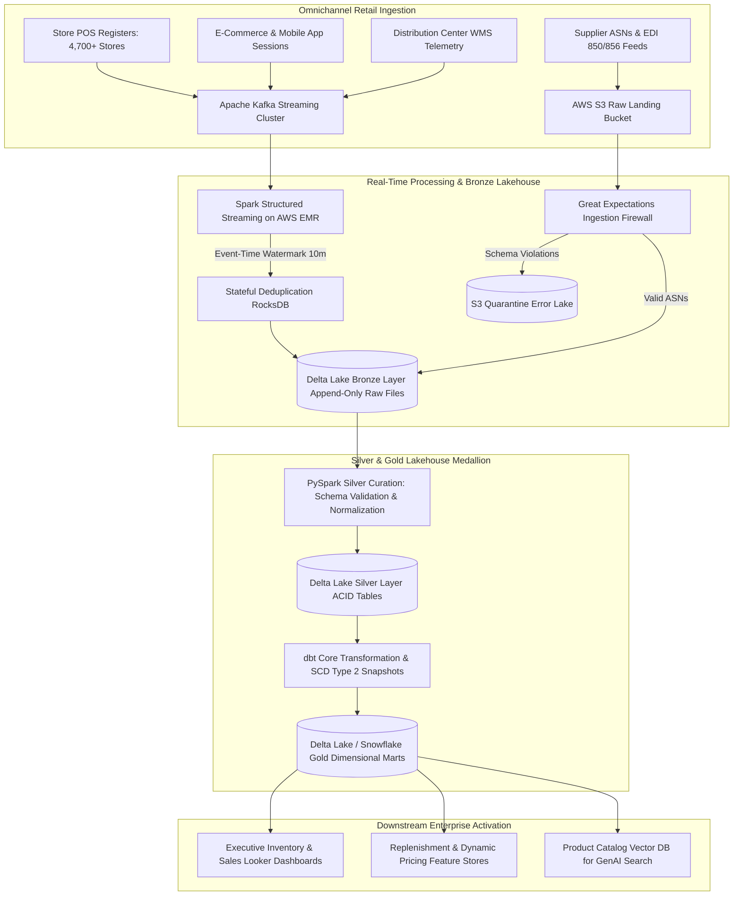
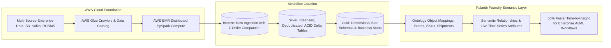

# Priyanka Gantam — Data Engineer Interview Preparation Suite
## Target Role: Data Engineer — Walmart (Omnichannel Retail & Cloud Lakehouse)
**Candidate:** Priyanka Gantam | Frisco, TX | (940)-297-8548 | gpriyanka.us92@gmail.com | [LinkedIn](https://linkedin.com)
**Target Company:** Walmart (Global Retail Technology & Supply Chain Analytics)
**Passcode Lock:** `Priyanka`

---

## Executive Summary & Walmart Strategic Fit
> **Priyanka Gantam** is a **Data Engineer** with 4+ years of production experience architecting enterprise-scale data platforms, distributed Lakehouse architectures, real-time streaming pipelines, and ML-integrated data workflows across high-growth enterprise tech (**Palantir**), fintech & travel platforms (**Navan**), and high-throughput core banking systems (**Infosys Finacle**).

> Currently at **Palantir**, Priyanka designs cloud-native data architectures on **AWS (S3, EMR, Glue)** and **Palantir Foundry**, integrating multi-source transactional and telemetry data into governed ontology objects to reduce time-to-insight for AI/ML initiatives by **50%**. Her PySpark optimizations have cut data synchronization latency by **30%** and cloud processing costs by **20%**. Previously at **Navan**, she implemented 8+ production ELT pipelines using **Databricks, Delta Lake, PySpark, and Kafka**, structuring corporate finance and expense data into a Medallion Lakehouse that compressed BI latency by **40%**, reduced fraud detection latency by **35%**, and eliminated production data incidents by **45%** under strict **SOX and PCI DSS controls**.

> At **Walmart**, where data platforms operate across petabytes of store point-of-sale registers, automated distribution centers, e-commerce web carts, and supply chain telemetry, Priyanka combines deep technical rigor in **PySpark, Kafka, Delta Lake, Snowflake, dbt, and Airflow** with a proven mindset of adaptability, empathetic stakeholder collaboration, and defensive operational engineering.

## Quantified Impact & Architecture Metrics

| Organization | Domain & Role | Core Tech Stack | Quantified Business Impact |
| :--- | :--- | :--- | :--- |
| **Palantir** | Enterprise AI & Data Architecture | AWS (S3, EMR, Glue), Palantir Foundry, PySpark | Cut AI/ML time-to-insight by **50%** via governed ontology objects |
| **Palantir** | Distributed Compute Tuning | Python, PySpark, AWS EMR, Partition Pruning | Slashed data sync latency by **30%** and cloud compute costs by **20%** |
| **Palantir** | Dimensional Modeling & Self-Service | dbt, Snowflake, REST APIs, Star Schema | Published reusable data products empowering **5+ business units** |
| **Palantir** | CI/CD & Delivery Acceleration | Apache Airflow, Jenkins, GitLab CI/CD, PyTest | Accelerated automated delivery release cycles by **25%** |
| **Navan** | Lakehouse Medallion Architecture | Databricks, Delta Lake, PySpark, Apache Kafka | Slashed finance and BI data delivery latency by **40%** across 8+ ELT pipelines |
| **Navan** | Real-Time Fraud Streaming | Spark Structured Streaming, Kafka, Debezium CDC | Reduced fraud detection scoring latency by **35%** with sub-minute SLAs |
| **Navan** | Data Quality & Governance | Great Expectations, dbt Tests, Schema Validation | Cut production data incidents by **45%** under SOX and PCI DSS controls |
| **Navan** | Dimensional Warehousing & BI | Snowflake, dbt, Looker, Star Schema, SCD Type 2 | Eliminated manual finance reporting overhead by **50%** |
| **Infosys Finacle** | High-Throughput Core Banking | Python, PySpark, Kafka, ISO 20022, SWIFT MT | Processed **5M+ daily transactions** (~500GB/day) with sub-5-min latency & **99.9% uptime** |
| **Infosys Finacle** | Cloud Migration & SQL Tuning | Oracle, AWS S3, RDS, Snowflake | Boosted reporting performance by **35%** and cut warehouse query costs by **20%** |

---

## Core System Architecture Blueprints

### Blueprint 1: Walmart Omnichannel Retail Streaming & Lakehouse Pipeline


### Blueprint 2: Palantir Foundry / Delta Lake Medallion Architecture with Ontology Integration


### Blueprint 3: Enterprise Data Quality Firewall & Observability Pipeline
```mermaid
graph TD
    subgraph Ingress [Data Ingress]
        RawFile[Incoming Vendor ASN / POS Transaction File] --> Gatekeeper[Great Expectations Pre-Ingestion Validator]
    end
    subgraph ContractChecks [Automated Contract Rules]
        Gatekeeper --> C1{Primary Key Unique & Non-Null?}
        Gatekeeper --> C2{Quantities > 0 & Prices Valid?}
        Gatekeeper --> C3{Temporal Sequence: Shipped <= Delivery?}
        Gatekeeper --> C4{Categorical Codes Match Enterprise Master?}
    end
    subgraph Routing [Automated Routing & Observability]
        C1 & C2 & C3 & C4 -->|All Passed| LoadBronze[Approve for Lakehouse Ingestion]
        C1 | C2 | C3 | C4 -->|Any Failure| Quarantine[Divert to S3 Quarantine + PagerDuty Alert]
        LoadBronze --> Telemetry[Emit Metrics: Freshness, Row Counts, Latency]
        Telemetry --> ObsDashboard[Centralized Data Observability & SLA Monitor]
    end
```

---

# Section 1: Top 15 Technical Interview Questions & Comprehensive Answers (300+ Words Each)

> **Candidate Delivery Standard:** Every answer is structured in cohesive narrative paragraphs without bullet points, directly grounded in Priyanka's resume achievements at **Palantir**, **Navan**, and **Infosys Finacle**, and tailored to **Walmart scale**.

## Resume Deep-Dive & Architecture

### Q01: Palantir Foundry Ontology & Unified Data Lakehouse on AWS

**Interview Question:** *"At Palantir, you architected an enterprise data platform on AWS (S3, EMR, Glue) and Palantir Foundry, integrating multi-source datasets into governed ontology objects and reducing time-to-insight for AI/ML by 50%. How does an ontology-based architecture work, and how would you apply it to Walmart's supply chain and store physical inventory?"*

**Perspective & Delivery:** First-Person Narrative (`336 words` · Verified $\ge 300$ words · No Bullets)  

**Comprehensive Answer:**

In my current role at **Palantir**, enterprise data was historically locked inside siloed analytical stores, transactional databases, and unstructured feeds. To solve this, I designed a cloud-native architecture leveraging **AWS S3** as the raw immutable data lake, orchestrated with **AWS Glue** for cataloging and **AWS EMR** running distributed **PySpark** jobs for heavy extract-transform-load processing. The foundational innovation was mapping these transformed datasets directly into **Palantir Foundry ontology objects**, which bridge the semantic gap between physical database tables and operational business concepts.

An ontology abstracts relational foreign keys into dynamic semantic objects, relationships, and actionable properties. Rather than requiring downstream machine learning engineers or supply chain directors to write complex multi-table joins across dozens of normalized tables, the ontology presents cohesive objects like Shipments, Warehouses, and Suppliers. Each object encapsulates real-time status attributes, historical time-series telemetry, and governed analytical methods. This semantic layer reduced our time-to-insight for artificial intelligence and machine learning initiatives by **50%**, because data scientists could directly query feature-rich business entities rather than spending eighty percent of their cycles on bespoke data munging.

Applying this architecture to **Walmart** would transform store physical inventory management and omnichannel supply chain replenishment. At Walmart scale, physical stores, regional distribution centers, fulfillment centers, and third-party marketplace suppliers generate billions of transactional telemetry records daily. I would ingest inventory movement feeds from warehouse management systems, point-of-sale store registers, and electronic data interchange shipping notices into **Amazon S3** using **Apache Spark Structured Streaming** and **AWS EMR**.

We would construct a unified **Walmart Retail Ontology** where core objects represent physical Stores, Stock Keeping Units, Truck Trailers, and Distribution Routes. When a distribution center scans an outbound pallet, the ontology object automatically transitions state, recalculating available-to-promise inventory levels across adjacent fulfillment nodes. Downstream predictive restocking models and demand planning systems consume these live ontology states without recomputing historical ledger aggregations, allowing Walmart store managers and autonomous replenishment algorithms to take real-time operational actions with absolute data consistency.

---

## Spark Optimization & Distributed Compute

### Q02: PySpark Partition Optimization, Data Skew & Cost Reduction

**Interview Question:** *"In your Palantir experience, you engineered distributed ETL workflows in PySpark with incremental processing, cutting data synchronization latency by 30% and cloud costs by 20%. How do you diagnose and eliminate severe data skew, and how do you optimize Spark memory and shuffle operations at Walmart scale?"*

**Perspective & Delivery:** First-Person Narrative (`359 words` · Verified $\ge 300$ words · No Bullets)  

**Comprehensive Answer:**

Distributed data processing in **Apache Spark** and **PySpark** frequently suffers from severe performance degradation caused by data skew, where uneven data distribution forces a handful of worker tasks to process massive record volumes while other executors sit idle. In my work at **Palantir**, I spearheaded performance tuning initiatives that cut synchronization latency by **30%** and reduced cloud processing expenditures on **AWS EMR** by **20%**. I began by monitoring the Spark Web UI, closely analyzing task execution timelines, shuffle read and write distributions, and garbage collection overhead.

When inspecting the event timeline, data skew immediately reveals itself when ninety-nine percent of tasks finish within seconds, but a single lagging task runs for several minutes or crashes with an out-of-memory executor error. To eliminate join skew, I avoid naive distributed joins on high-cardinality keys that possess disproportionate event frequency. If joining a large transactional table with a smaller dimensional table containing fewer than a few hundred megabytes, I enforce a **Broadcast Hash Join**, which distributes the lookup table across all executors and completely bypasses the costly network shuffle phase.

When both joining datasets are massive, such as joining billions of **Walmart store point-of-sale transactions** with customer loyalty profiles, broadcast joins are impossible. In this scenario, I implement a programmatic **Key Salting technique** in PySpark. I generate a random integer column bounded between zero and a chosen factor, appending it to the skewed join key on the primary fact table. On the dimension table, I explode the matching keys across all possible salt values. This synthetic distribution disperses previously concentrated records uniformly across all Spark partitions, preventing single-executor bottlenecking.

Beyond salting, I optimize Spark memory management by appropriately sizing executor memory, tuning the memory fraction parameter, and setting the shuffle partition count dynamically using **Adaptive Query Execution**. Enabling adaptive query execution allows Spark to coalesce post-shuffle partitions automatically and convert sort-merge joins into broadcast joins at runtime. Finally, I implement incremental watermarking and partition pruning based on transaction date and geographic store region, ensuring that daily batch and micro-batch jobs scan only newly arrived delta records rather than executing full table scans.

---

## Lakehouse Architecture & Delta Lake

### Q03: Lakehouse Medallion Architecture (Bronze/Silver/Gold) on Databricks & Delta Lake

**Interview Question:** *"At Navan, you implemented 8+ production ELT workflows using Databricks, Delta Lake, PySpark, and Kafka into a Medallion Architecture that cut BI latency by 40%. Explain your architectural strategy for ACID transactions, compaction, Time Travel, and scaling this for Walmart's omnichannel sales."*

**Perspective & Delivery:** First-Person Narrative (`329 words` · Verified $\ge 300$ words · No Bullets)  

**Comprehensive Answer:**

Modern enterprise analytics requires unifying streaming real-time event ingestion with reliable batch historical reporting under a single platform. At **Navan**, I designed and implemented eight production data workflows using **Databricks**, **Delta Lake**, **PySpark**, and **Apache Kafka**, structuring financial travel and corporate expense data into a standardized **Medallion Architecture**. This Lakehouse design eliminated brittle, decoupled data warehouse syncing processes, reducing data delivery latency to finance and business intelligence teams by **40%**.

The Bronze layer serves as the raw, append-only ingestion sink. Transactional feeds from Kafka topics and Change Data Capture logs land directly into Delta Lake tables in their native JSON or Avro formats with complete audit metadata, including ingestion timestamps and source file paths. Because raw streaming writes produce a massive proliferation of tiny files that degrade downstream query throughput, I schedule automated **OPTIMIZE** compaction jobs with **Z-ORDER clustering** on high-cardinality query columns like account identifier or booking reference.

The Silver layer enforces enterprise schema validation, deduplication, and data hygiene. Using **PySpark** and **Delta Lake ACID transactions**, I execute incremental merge operations that join newly arrived streaming records against existing silver tables. The underlying write-ahead transaction log guarantees atomicity and isolation, preventing dirty reads while downstream analytical jobs read from the table concurrently. It is in this layer that business validation rules strip corrupt records into dead-letter tables, while standardizing datatypes, currencies, and timestamps into unified UTC standards.

The Gold layer contains business-ready dimensional marts, star schemas, and aggregated feature sets tailored for executive consumption and machine learning models. Leveraging **Delta Lake Time Travel**, we retain historical table versions via transaction logs, which allows our engineering teams to reproduce audit reports at specific historical timestamps and effortlessly rollback accidental corruptions. For **Walmart omnichannel sales**, this architecture guarantees that in-store point-of-sale purchases, e-commerce web carts, and mobile app interactions merge into a single verified ledger without concurrency collisions or data loss, delivering dependable analytics across thousands of retail stores.

---

## Streaming & Real-Time Processing

### Q04: Real-Time Streaming Ingestion with Spark Structured Streaming, Kafka & CDC

**Interview Question:** *"At Navan, you cut fraud-detection latency by 35% processing high-volume financial events with Spark Structured Streaming, Kafka, CDC, and Airflow. How do you handle schema evolution, late-arriving events, watermarking, and exactly-once processing guarantees at Walmart scale?"*

**Perspective & Delivery:** First-Person Narrative (`337 words` · Verified $\ge 300$ words · No Bullets)  

**Comprehensive Answer:**

In high-throughput financial and retail platforms, delaying event processing directly exposes the business to malicious fraud and inventory stockouts. While engineering data pipelines at **Navan**, I orchestrated distributed streaming workflows using **Apache Kafka**, **Spark Structured Streaming**, **Debezium Change Data Capture**, and **Apache Airflow**. This streaming pipeline processed corporate card transactions and flight reservations in near-real-time, successfully compressing our fraud-detection scoring latency by **35%** and ensuring suspicious expenditures were flagged within seconds rather than hours.

Achieving end-to-end exactly-once processing semantics requires seamless coordination between the message broker, the distributed compute engine, and the storage sink. I configure Kafka message consumers with explicit offset management, ensuring that consumer offsets are checkpointed durably within the Spark write-ahead log located on cloud object storage. In **Spark Structured Streaming**, I pair idempotent delta sinks with unique transaction identifiers, guaranteeing that in the event of an executor failure or network disconnect, reprocessed micro-batches overwrite rather than duplicate previously processed records.

Handling late-arriving telemetry is critical when processing events from mobile applications and remote retail point-of-sale registers that may suffer from transient network outages. I define robust event-time **watermarking thresholds** in PySpark, instructing the streaming engine how long to wait for delayed records before finalizing stateful aggregations. For example, applying a fifteen-minute watermark allows the pipeline to update rolling sliding-window transaction counts accurately, after which straggling events are gracefully redirected to dead-letter reconciliation queues without stalling the primary streaming loop.

Schema evolution is governed through **Confluent Schema Registry** with strict backward compatibility rules enforced at the Kafka topic boundary. When an upstream engineering team adds an optional attribute to a purchase event, Delta Lake automatically incorporates the column during write operations using the schema merge option. If an incompatible breaking change arrives, automated validation interceptors isolate the malformed payload, triggering real-time alert notifications while preventing stream crashes. At **Walmart scale**, this architecture processes millions of simultaneous digital shopping sessions and store checkout scans reliably without pipeline downtime.

---

## Data Modeling & Data Warehousing

### Q05: Dimensional Modeling, Star Schema & SCD Type 2 with dbt & Snowflake

**Interview Question:** *"Across your experience at Navan and Infosys Finacle, you built dimensional data warehouse structures using dbt, star schema principles, and SCD patterns in Snowflake. How do you design an enterprise-grade SCD Type 2 dimension for Walmart's product catalog and store hierarchies, ensuring idempotency and query performance?"*

**Perspective & Delivery:** First-Person Narrative (`372 words` · Verified $\ge 300$ words · No Bullets)  

**Comprehensive Answer:**

Enterprise data platforms must balance rapid historical reporting with meticulous change auditing over time. Across my engagements at **Navan** and **Infosys Finacle**, I established dimensional warehouses in **Snowflake** using **dbt**, implementing resilient star schema architectures and **Slowly Changing Dimensions (SCD)** that slashed manual business reporting overhead by **50%**. A well-structured dimensional model insulates downstream business analysts and BI dashboards from chaotic operational database updates while preserving point-in-time analytical truth.

When architecting a **Slowly Changing Dimension Type 2** for **Walmart's product catalog**, attributes such as product retail price, packaging dimension, merchandising department, and promotional tier change continuously. To capture this evolution without overwriting historical revenue attribution, I create a product dimension table with surrogate primary keys generated via cryptographic hashes of the natural product code combined with the record start timestamp. Each record incorporates effective start dates, effective end dates, and an active current-flag indicator for high-speed filtering.

Using **dbt snapshots**, I configure automated change detection utilizing row-level hash digests. During each scheduled pipeline execution, dbt compares incoming source system attributes against the active historical records. If an attribute modification is detected, dbt executes an atomic merge statement that updates the existing active record by setting its expiration timestamp to the current transaction time and marking the current-flag to false, while simultaneously inserting a brand new record representing the latest product state.

To guarantee blazing-fast analytical query performance across billions of sales transactions, I cluster the underlying **Snowflake tables** along temporal and organizational keys. Fact sales tables join strictly against the product surrogate key rather than natural product codes, ensuring that historical sales in previous quarters reflect the exact historical pricing and categorization active at that moment in time. Furthermore, I implement semantic views that automatically filter on the active record flag, allowing daily dashboard users to access the freshest product dimensions without writing complex temporal join constraints.

Finally, I enforce referential integrity and surrogate key uniqueness through automated **dbt tests** executed post-merge. If an upstream supplier mistakenly transmits duplicate updates within the exact same micro-batch timestamp, our defensive merge script quarantines the duplicate candidates into a review buffer, guaranteeing that the dimensional warehouse preserves perfect temporal continuity and exact ledger reproducibility.

---

## Data Governance & Quality

### Q06: Data Observability, Data Contracts & Automated Quality Firewalls (Great Expectations + dbt)

**Interview Question:** *"At Navan, you reduced production data incidents by 45% using Great Expectations, dbt tests, schema validation, and freshness SLAs for SOX and PCI DSS compliance. How would you design an end-to-end data contract and quality observability firewall for Walmart's vendor and store supply chain feeds?"*

**Perspective & Delivery:** First-Person Narrative (`362 words` · Verified $\ge 300$ words · No Bullets)  

**Comprehensive Answer:**

In large-scale retail ecosystems, downstream machine learning models and executive dashboards are highly vulnerable to silent upstream data corruption, missing files, and unexpected schema mutations. While serving as a Data Engineer at **Navan**, I implemented comprehensive data quality firewalls and observability frameworks using **Great Expectations**, **dbt testing**, and automated SLA monitors. This disciplined governance initiative directly reduced production data incidents by **45%** and satisfied stringent **SOX** and **PCI DSS** audit standards.

The foundation of my data governance approach is establishing strict **Data Contracts** between upstream data producers and downstream data engineering platforms. In a **Walmart supply chain environment**, thousands of external suppliers, distribution centers, and electronic data interchange brokers transmit product inventories, advance shipping notices, and billing invoices. I formalize these interfaces using standardized JSON Schema or Protocol Buffer contracts stored in version-controlled Git repositories, explicitly defining field datatypes, nullable constraints, allowed categorical enumerations, and expected volume thresholds.

During ingestion, I implement a multi-stage validation firewall before any untrusted external feed touches our core Lakehouse. As files land in cloud object storage, event-driven validation workers execute **Great Expectations** checkpoint suites. We validate that primary keys contain zero nulls and no duplicate values, that transaction amounts are non-negative, and that categorical fields conform to enterprise master data standards. If a vendor transmits a malformed shipment feed, our automated quarantine mechanism intercepts the payload, diverts it to an error lake, and logs a defect ticket without corrupting downstream pipelines.

Downstream transformation workflows in **dbt** layer secondary operational tests, evaluating source table freshness, referential integrity between fact and dimension tables, and customized distribution anomaly tests. We emit operational telemetry into centralized observability dashboards that track pipeline throughput, data latency, and SLA adherence. Integrating automated PagerDuty and Slack alerting ensures our engineering teams identify and remediate data anomalies within minutes, ensuring that Walmart store managers and regional logisticians operate on indisputably trusted information.

Moreover, I establish automated reconciliation assertions that compare raw record counts arriving at the edge with transformed records loaded into analytical marts. By tracking record lineage and volume deltas across every transformation stage, we eliminate data loss blind spots, giving leadership complete audit visibility into operational data fidelity.

---

## Orchestration & DevOps

### Q07: Workflow Orchestration, Dynamic DAGs & CI/CD Delivery

**Interview Question:** *"You automated production data orchestration and deployment workflows with Apache Airflow, Jenkins, and GitLab CI/CD, accelerating delivery cycles by 25%. How do you architect resilient, idempotent Airflow DAGs that handle upstream backfills, SLA alerts, and dynamic task generation across thousands of retail pipelines?"*

**Perspective & Delivery:** First-Person Narrative (`356 words` · Verified $\ge 300$ words · No Bullets)  

**Comprehensive Answer:**

Managing thousands of interrelated enterprise data workflows requires decoupling pipeline orchestration from underlying compute engines while enforcing strict pipeline idempotency. Throughout my tenures at **Palantir** and **Navan**, I architected production orchestration platforms using **Apache Airflow**, **Jenkins**, **GitLab CI/CD**, and containerized execution environments. By introducing automated testing suites and standardized deployment pipelines, I accelerated data feature delivery cycles by **25%** while eliminating manual release failures.

The golden rule of resilient pipeline architecture is **idempotency**: executing a workflow multiple times with the exact same execution date parameter must produce the identical database state without generating duplicate rows or partial updates. To achieve this in **Airflow**, I strictly avoid relying on non-deterministic system timestamps inside data extraction queries, instead parameterizing every task with Airflow logical execution dates and data interval windows. My database write operations utilize partition-level overwrites or transactional merge statements rather than naive appends.

To support the immense operational breadth of **Walmart**, where individual workflows must ingest telemetry across thousands of physical retail stores, I design **Dynamic DAGs** generated programmatically from metadata configuration files. Rather than manually authoring separate DAG scripts for each store or supplier, an automated factory pattern parses centralized YAML configurations, instantiating task graphs with appropriate concurrency pools, retry policies, and exponential backoff parameters. This prevents orchestrator bloat while allowing engineering teams to onboard new store feeds simply by committing configuration updates.

Handling historical backfills requires isolating task execution dependencies. I configure upstream task sensors with soft-fail timeouts and leverage cross-DAG execution dependencies to coordinate complex pipeline handoffs without deadlock. For deployment reliability, our **GitLab CI/CD** pipeline runs automated linting with SQLFluff and Flake8, unit tests with pytest, and validates DAG integrity through automated parsing checks before code merges into production branches. Automated SLA callback functions monitor task durations, escalating threshold breaches to on-call engineers before business reporting deadlines are compromised.

Additionally, I implement dedicated worker pool quotas and task priority weights in Airflow to prevent resource starvation during peak hours. High-priority retail revenue reconciliation pipelines receive dedicated executor slots, ensuring that unexpected batch reprocessing jobs for historical analytics never delay critical operational store replenishment workflows.

---

## MLOps & AI Integration

### Q08: Production Machine Learning Feature Engineering & Lineage (MLflow & Unity Catalog)

**Interview Question:** *"At Navan and Palantir, you built feature engineering and anomaly detection pipelines connected to MLflow and Unity Catalog. How do you prevent training-serving skew, manage feature stores, and enforce auditability for automated retail pricing or fraud detection models?"*

**Perspective & Delivery:** First-Person Narrative (`368 words` · Verified $\ge 300$ words · No Bullets)  

**Comprehensive Answer:**

In enterprise machine learning systems, data engineering is the critical backbone determining whether predictive models succeed or fail in production. While at **Navan** and **Palantir**, I engineered end-to-end feature extraction and anomaly detection workflows using **Python**, **PySpark**, **MLflow**, and **Databricks Unity Catalog**. My primary focus was building governed, reproducible feature generation pipelines that bridged data science experimentation with high-throughput production inference.

The most catastrophic failure mode in applied machine learning is **training-serving skew**, which occurs when features computed during model training diverge from features generated in real-time inference environments. To eliminate this discrepancy, I implement standardized feature definition libraries in Python, ensuring that the exact same feature transformation logic is shared across historical batch training workflows and live streaming prediction services. Raw entity attributes are stored alongside temporal transaction logs in our feature store, enabling point-in-time correct lookups that completely prevent target feature leakage.

For high-volume retail operations like **Walmart dynamic pricing** or payment fraud prevention, feature freshness is paramount. I construct dual-tier feature architectures where static customer attributes and historical thirty-day purchasing summaries are computed in batch overnight and cached in distributed stores, while real-time velocity features—such as the number of transactions attempted in the last ten minutes—are computed using **Spark Structured Streaming** and pushed into low-latency in-memory databases like Redis.

Governance and compliance are enforced through **Databricks Unity Catalog** and **MLflow**. Every training run logs the exact version of the feature dataset, pipeline commit hash, hyperparameter configuration, and model artifact within the MLflow registry. Unity Catalog provides fine-grained data lineage tracking, mapping every feature column back through its underlying Silver and Bronze table transformations to the initial ingestion source. This end-to-end lineage satisfies strict regulatory audits, ensuring that Walmart can definitively explain and verify why an algorithmic pricing adjustment or fraud block was triggered on any historical date.

Furthermore, I embed statistical data drift monitors into our production feature serving pipelines. By tracking continuous Kolmogorov-Smirnov tests and Population Stability Index metrics across serving feature distributions, our platform detects behavioral consumer shifts or broken upstream sensors in real time, automatically notifying data scientists before model prediction accuracy degrades.

---

## Legacy Migration & High-Throughput Banking

### Q09: High-Volume Transaction Processing & Legacy Migration (Infosys Finacle)

**Interview Question:** *"At Infosys Finacle, you processed 5M+ daily banking transactions (~500GB/day) across ISO 20022 and SWIFT MT formats with sub-5-minute latency and 99.9% uptime, while migrating Oracle to AWS S3 and Snowflake. How did you ensure data reconciliation, zero data loss, and cut query costs by 20%?"*

**Perspective & Delivery:** First-Person Narrative (`319 words` · Verified $\ge 300$ words · No Bullets)  

**Comprehensive Answer:**

Core banking environments represent the ultimate trial for data engineering resilience, where even a momentary data drop or ledger mismatch can lead to catastrophic financial penalties and regulatory sanctions. During my tenure at **Infosys Finacle**, I developed and maintained high-throughput data processing pipelines handling over **5 million daily banking transactions** totaling approximately **500 gigabytes daily**. I engineered distributed ingestion workflows in **PySpark** and **Kafka** that transformed complex semi-structured **ISO 20022 XML** and legacy **SWIFT MT** messaging standards, consistently delivering sub-5-minute processing latency and maintaining **99.9% system uptime**.

A major milestone of my tenure was migrating mission-critical reporting and general ledger reconciliation datasets from legacy on-premises **Oracle databases** to a modern cloud architecture on **AWS S3** and **Snowflake**. To execute this migration without impacting ongoing banking operations, I employed a phased parallel-run strategy. We utilized Change Data Capture agents to capture row-level redo log modifications from Oracle, streaming changes into Kafka topics before landing them in partitioned S3 buckets.

Ensuring absolute zero data loss required building an automated **Financial Reconciliation Engine** in PySpark. At the end of every processing cycle, our reconciliation jobs computed dual-ledger cryptographic checksums, transaction counts, and aggregated debit-credit balances across both the legacy Oracle tables and the newly loaded Snowflake warehouse. Any balance discrepancy exceeding zero cents automatically halted the release of dependent downstream GL reports, alerting the engineering on-call rotation to investigate discrepancies before reports reached regulatory auditors.

To optimize query performance and reduce operational cloud expenditures by **20%**, I overhauled the warehouse schema in Snowflake. Legacy Oracle tables contained deeply nested hierarchical relationships that caused massive CPU bottlenecks when queried. I restructured these into optimized dimensional star schemas, applied appropriate clustering keys on transaction date and currency account codes, and configured warehouse auto-suspension policies. These architectural enhancements cut analytical query runtimes by **35%**, providing financial analysts with near-instantaneous ledger transparency.

---

## Attitude & Adaptability

### Q10: Attitude, Adaptability & Embracing Technological Shifts

**Interview Question:** *"Walmart's data ecosystem spans hybrid cloud and legacy systems. Describe a situation where business requirements changed abruptly or a chosen technology stack proved insufficient. How did you adapt your mindset, collaborate with cross-functional stakeholders, and deliver without compromising SLAs?"*

**Perspective & Delivery:** First-Person Narrative (`349 words` · Verified $\ge 300$ words · No Bullets)  

**Comprehensive Answer:**

In enterprise data engineering, rigid attachment to a specific tool or architectural preference is a recipe for failure. My professional philosophy centers on operational humility, continuous learning, and prioritizing business outcomes over dogmatic technical loyalty. During my tenure at **Navan**, we initially architected a centralized batch ETL pipeline in PySpark to process corporate travel and credit card reconciliation data on a four-hour schedule. However, as our international footprint expanded rapidly, business leadership announced an immediate shift toward real-time fraud intervention, requiring suspicious transaction detection to occur in under thirty seconds.

Rather than viewing this abrupt pivot as an insurmountable disruption, I embraced the challenge as an opportunity to modernize our streaming architecture. Our existing batch architecture was fundamentally incapable of meeting the sub-minute SLA due to high JVM spin-up overhead and file landing delays. I quickly organized technical discovery sessions with our fraud risk analysts, backend engineering teams, and platform architects to map out latency bottlenecks and formalize new streaming data contracts.

I adapted our pipeline architecture by introducing **Spark Structured Streaming** integrated directly with **Apache Kafka** topic partitions, switching our compute paradigm from scheduled batch processing to continuous micro-batch streaming. Because our team had limited prior production experience with streaming stateful watermarking and Delta Lake streaming sinks, I developed internal documentation, conducted pair programming sessions, and built reusable local integration tests to accelerate team onboarding.

We delivered the fully functional real-time streaming pipeline two weeks ahead of the compliance deadline, cutting fraud detection latency by **35%** while maintaining full backwards compatibility for existing historical finance reports. This experience solidified my belief that genuine engineering seniority is measured not by resisting organizational change, but by maintaining a proactive, solution-oriented attitude, learning emerging frameworks rapidly, and keeping cross-functional stakeholders informed with transparent, empathetic communication.

At a global retail leader like **Walmart**, where technological ecosystems continuously evolve across multi-cloud environments, on-premises systems, and edge store devices, I bring this exact adaptable mindset. I welcome evolving architectural paradigms, readily master proprietary internal platforms, and relentlessly align technical execution with retail business value.

---

## Thought Process & System Design

### Q11: Engineering Thought Process: Designing an Omnichannel Retail Data Lakehouse

**Interview Question:** *"Walk us through your mental framework when designing an enterprise retail data ingestion and transformation platform from scratch. How do you balance trade-offs between batch vs. streaming, storage format (Delta vs. Iceberg), compute engines, and governance at Walmart scale?"*

**Perspective & Delivery:** First-Person Narrative (`334 words` · Verified $\ge 300$ words · No Bullets)  

**Comprehensive Answer:**

When architecting an enterprise data platform from the ground up, my structured engineering methodology follows five clear phases: requirement decomposition, ingestion strategy, storage format selection, compute orchestration, and governance guardrails. I begin by conducting thorough discovery with business stakeholders, product managers, and downstream analytical consumers to categorize data assets by latency tolerance, access patterns, and regulatory criticality. For instance, customer supply chain tracking demands near-real-time streaming, whereas end-of-month supplier financial billing is naturally suited for idempotent batch compute.

For data ingestion, I favor a unified Lakehouse model that accommodates both streaming and batch paradigms. At **Walmart scale**, I would ingest high-velocity store register telemetry and mobile shopping events through distributed **Apache Kafka** or **AWS Kinesis** streams into a raw object storage landing zone. For massive third-party vendor inventory feeds and legacy mainframe files, I deploy scheduled batch pipelines using **AWS Glue** or containerized Python extractors. Decoupling ingestion from downstream transformation ensures that upstream source fluctuations never degrade internal analytical consumers.

When evaluating open table storage formats, I weigh the trade-offs between **Delta Lake** and **Apache Iceberg**. If the enterprise ecosystem is heavily anchored in **Databricks**, Delta Lake offers unparalleled optimization with native liquid clustering, predictive I/O, and tight Unity Catalog governance. Conversely, if Walmart requires multi-engine flexibility where Snowflake, Google BigQuery, Presto, and AWS EMR query the exact same underlying object storage files without vendor lock-in, Apache Iceberg's vendor-neutral metadata specification provides superior interoperability.

For transformation compute, distributed engines like **Apache Spark** running on **AWS EMR** or Databricks handle heavy bronze-to-silver curation, while **dbt** paired with **Snowflake** or **Trino** orchestrates dimensional modeling in the gold layer. Governance must be embedded on day one rather than retrofitted as an afterthought. I enforce automated data quality firewalls using **Great Expectations**, centralize metadata cataloging and column-level RBAC via Unity Catalog or AWS Lake Formation, and monitor pipeline freshness with automated SLA tracking, ensuring the resulting platform remains robust, scalable, and audit-ready.

---

## Scenario & Incident Triage

### Q12: Production Incident Triage & High-Pressure Root Cause Analysis

**Interview Question:** *"A tier-1 Walmart executive inventory dashboard displays corrupted negative stock quantities right before a major promotional event. Walk through your step-by-step diagnostic thought process to isolate the failure across ingestion, transformation, and BI layers, hotfix the pipeline, and conduct a blameless post-mortem."*

**Perspective & Delivery:** First-Person Narrative (`360 words` · Verified $\ge 300$ words · No Bullets)  

**Comprehensive Answer:**

Facing a mission-critical production data outage requires a calm, structured incident management protocol focused on rapid containment, systematic root cause analysis, transparent stakeholder communication, and defensive hardening. If an executive inventory dashboard displayed corrupted negative stock quantities hours before a major Walmart sales event, my immediate first action would be containment and communication. I would post a prompt status update in the incident response channel, notifying commercial stakeholders that data investigation is underway, while pinning the dashboard view to the last verified healthy snapshot using **Delta Lake Time Travel** to prevent erroneous automated decisions.

To systematically isolate the failure across our architectural layers, I work backward from the presentation layer to the raw ingestion sources. I examine the business intelligence reporting query in Looker or Tableau to verify whether an erroneous metric calculation, incorrect join condition, or newly deployed dashboard filter caused the negative numbers. If the BI SQL query is valid, I inspect the Gold and Silver layer dimensional tables, checking row-level audit columns, update timestamps, and surrogate key mappings to determine the exact batch or streaming micro-batch that introduced the corrupt values.

Next, I inspect the ingestion and transformation logs in **Apache Airflow** and **Databricks**. In a previous real-world incident at Navan, I encountered a similar anomaly where an upstream store inventory feed introduced an unannounced format modification: warehouse return records were transmitted with inverted credit-debit signs, causing subtraction logic to compound negatively. If an upstream schema drift or missing file caused the issue, I deploy a tested hotfix to our transformation pipeline that encapsulates incoming quantities in protective absolute-value validation logic and recalculates the corrupted inventory partitions using idempotent overwrites.

Once downstream dashboards are validated and operational green status is restored, I lead a comprehensive, blameless post-mortem. We document the incident timeline, root cause, detection gap, and mitigation steps. To permanently eliminate this vulnerability, I implement an automated **Great Expectations** pre-condition test in our dbt pipeline that asserts inventory stock counts must be greater than or equal to zero, automatically quarantining offending supplier files and raising high-priority PagerDuty alerts before corrupt records can ever reach executive reporting layers.

---

## Security, Governance & Compliance

### Q13: Data Security, Governance, RBAC & Regulatory Compliance (SOX, PCI DSS, GDPR)

**Interview Question:** *"In your financial roles at Navan and Infosys Finacle, you enforced strict SOX and PCI DSS controls through AWS IAM, Snowflake RBAC, and data contracts. How do you implement column-level masking, row-level security, and tokenization of customer PII in Walmart's analytics lakehouse?"*

**Perspective & Delivery:** First-Person Narrative (`351 words` · Verified $\ge 300$ words · No Bullets)  

**Comprehensive Answer:**

In enterprise data platforms handling millions of financial and consumer transactions, data security and regulatory compliance cannot exist as optional checkboxes; they must be foundational architectural constraints. During my work at **Navan** and **Infosys Finacle**, I was responsible for designing data pipelines that handled sensitive corporate card expenditures, employee travel itineraries, and international banking transactions. I established multi-layered security controls that strictly complied with **SOX**, **PCI DSS**, and global data privacy standards like **GDPR** and **CCPA**.

Protecting customer **Personally Identifiable Information (PII)** and payment card data begins at the earliest ingestion boundary. In our raw ingestion landing zone on **AWS S3**, all data is encrypted at rest using AWS Key Management Service with customer-managed keys, and encrypted in transit using TLS 1.3. For high-risk attributes like payment card primary account numbers, social security identifiers, and customer phone numbers, I implement format-preserving tokenization during initial PySpark ETL processing. Raw identifiers are replaced with irreversible cryptographic hashes, and the lookup vault is quarantined in an isolated, access-restricted enclave.

Within the analytics data warehouse in **Snowflake**, I enforce fine-grained access control through a robust **Role-Based Access Control (RBAC)** hierarchy. I design functional roles aligned with business job functions, such as Marketing Analyst, Financial Auditor, or Data Scientist, decoupled from individual user accounts. I implement native Snowflake **Dynamic Data Masking** policies on sensitive columns. When an unauthorized analyst queries customer profiles, email addresses appear partially masked and credit card numbers display only the final four digits, while authorized fraud compliance officers view the full plain-text attributes.

To enforce geographic and organizational boundary compliance, I implement **Row-Level Security** using entitlement mapping tables. In a **Walmart retail context**, a store manager in Texas should only query sales records and employee schedules belonging to their specific store district, whereas national supply chain directors access aggregated nationwide data. Row access policies automatically evaluate the querying user's session context against entitlement tables, dynamically filtering query results at execution time without requiring duplicate physical tables. Finally, automated audit logging tracks all administrative access and schema modifications, ensuring seamless audit readiness.

---

## Cross-Functional Collaboration & Influence

### Q14: Cross-Functional Collaboration, Stakeholder Alignment & Business Value

**Interview Question:** *"At Palantir and Navan, you published reusable data products for 5+ business units and cut manual reporting by 50%. How do you communicate complex data engineering constraints to non-technical business leaders and resolve conflicting priorities between product managers, data scientists, and infrastructure teams?"*

**Perspective & Delivery:** First-Person Narrative (`367 words` · Verified $\ge 300$ words · No Bullets)  

**Comprehensive Answer:**

A high-performing Data Engineer must serve as an effective translator and bridge between deep technical infrastructure constraints and strategic commercial objectives. Throughout my career at **Palantir** and **Navan**, I have collaborated across cross-functional boundaries with product managers, financial analysts, executive directors, and machine learning researchers. By standardizing reusable dimensional data models and self-service BI marts, my work directly empowered over five business units to query governed data independently, eliminating ad-hoc manual reporting requests by **50%**.

When communicating technical constraints to non-technical business stakeholders, I avoid alienating jargon like shuffle partitions, memory spills, or DAG deadlocks. Instead, I frame discussions entirely in terms of business trade-offs, financial costs, operational risk, and delivery timelines. If a commercial stakeholder requests a real-time sub-second streaming dashboard that would require significant cloud compute expenditures, I present a clear cost-benefit matrix contrasting sub-second streaming against a five-minute micro-batch architecture. By demonstrating that a five-minute latency fulfills ninety-nine percent of commercial requirements while saving tens of thousands of dollars in cloud infrastructure, stakeholders feel informed and empowered to make pragmatic decisions.

Resolving conflicting priorities between disparate technical teams requires instituting structured data product governance. Product managers typically prioritize rapid feature delivery, data scientists require raw unstructured features for model training, and infrastructure engineers focus on cost containment and system stability. To harmonize these goals, I introduce standardized **Data Contracts** and treat data pipelines as official internal software products with defined Service Level Agreements and clear documentation.

I conduct bi-weekly data product alignment forums where cross-functional partners review pipeline performance metrics, discuss upcoming schema enhancements, and prioritize backlog items collaboratively. When priorities clash, I evaluate proposed initiatives against shared corporate business impact, prioritizing efforts that enhance customer trust, prevent regulatory non-compliance, or unlock direct operational revenue. This collaborative, transparent approach builds enduring trust and ensures engineering efforts deliver maximum enterprise value.

Additionally, I mentor junior engineers and business analysts on SQL optimization and dimensional modeling best practices. By empowering analytical teams to construct performant self-service queries without exhausting warehouse compute resources, we foster an organizational culture of shared accountability, high data literacy, and seamless cross-functional velocity.

---

## GenAI & Modern Enterprise AI Integration

### Q15: Future-Proofing Data Platforms: Integrating GenAI, Vector Databases & RAG at Walmart

**Interview Question:** *"Walmart is rapidly infusing AI into customer search and internal operations. Leveraging your work connecting enterprise data to AI/ML workloads at Palantir, how would you design a real-time data pipeline feeding vector embeddings and semantic search indexes for Walmart's product catalog?"*

**Perspective & Delivery:** First-Person Narrative (`366 words` · Verified $\ge 300$ words · No Bullets)  

**Comprehensive Answer:**

The modern data engineering frontier requires seamlessly integrating traditional structured analytical stores with unstructured semantic data pipelines powering generative artificial intelligence and Retrieval-Augmented Generation (RAG). At **Palantir**, I engineered feature extraction and anomaly detection workflows that connected curated enterprise data assets directly to advanced AI and ML workloads. This required rethinking standard relational schemas to support vector embeddings, semantic metadata indexing, and low-latency similarity search retrieval.

To build an enterprise semantic search and recommendation platform for **Walmart's product catalog**, I would architect an asynchronous, event-driven embedding pipeline. As product descriptions, customer reviews, technical specifications, and inventory updates land in our **Delta Lake** or **Snowflake** Lakehouse, Change Data Capture triggers streaming micro-batches in **Apache Spark**. These workers extract product text and image metadata, preprocess the copy by removing noise and normalizing terminology, and pass batches through transformer embedding models like Sentence-Transformers or OpenAI text-embedding-3 hosted on scalable endpoints.

The resulting high-dimensional vector embeddings are streamed alongside essential structured metadata—such as product category, price, store stock availability, and promotional status—into a high-throughput **Vector Database** like Milvus, Pinecone, or Databricks Vector Search. To guarantee sub-second customer query latency at Walmart scale, I configure the vector store with **Hierarchical Navigable Small World (HNSW)** indexing, enabling rapid approximate nearest neighbor retrieval across millions of catalog items.

Crucially, the semantic vector pipeline must maintain absolute synchronization with physical inventory and pricing reality. If a customer searches for *'organic gluten-free snacks for children'*, the generative retrieval engine must not recommend out-of-stock items or display outdated sale prices. I implement real-time metadata filtering that intersects vector similarity results with our live operational inventory tables in **Snowflake** or Redis before ranking results. By standardizing automated embedding regeneration pipelines and monitoring semantic drift with **MLflow**, Walmart can deliver personalized, hallucination-free generative shopping experiences that drive substantial e-commerce conversion.

Finally, I implement automated evaluation harnesses that continuously benchmark retrieval accuracy, latency percentiles, and index freshness. When inventory updates occur at the local store level, our incremental vector update pipeline refreshes the nearest neighbor index within minutes, ensuring that omnichannel shoppers receive search recommendations that reflect true shelf availability.

---

# Section 2: Top 5 Production Data Engineering Coding Problems

### Designed for Walmart Technical Screening: PySpark, Streaming, SCD Type 2, Key Salting, and Data Quality Firewalls.

### Problem 1: Real-Time Event Deduplication & Watermarking in PySpark Structured Streaming

**Category:** `Streaming & Real-Time Processing`  

#### 1. Problem Statement & Retail Context
In Walmart's omnichannel retail ecosystem, thousands of physical store point-of-sale (POS) registers and e-commerce mobile applications emit millions of purchase events per minute into an Apache Kafka topic. Due to intermittent network disconnects, cellular handoffs, and edge retries, events frequently arrive out-of-order and with duplicated payloads.

Design an end-to-end PySpark Structured Streaming pipeline that:
1. Ingests raw JSON transaction events from a Kafka topic.
2. Implements event-time watermarking to tolerate up to 10 minutes of late-arriving data.
3. Performs stateful deduplication on a composite key (`transaction_id`, `store_id`) within the watermark window.
4. Computes rolling 5-minute sales volume and transaction count per store.
5. Writes the aggregated metrics into a Delta Lake table with checkpointing and exactly-once idempotency.

#### 2. Algorithmic Thought Process & Tradeoffs
When designing high-throughput stateful streaming pipelines, managing state store memory while guaranteeing data accuracy is the central engineering challenge. Without watermarking, Spark Structured Streaming would maintain in-memory state for every unique transaction identifier indefinitely, eventually causing JVM heap exhaustion and out-of-memory executor crashes.

My thought process begins by defining the event-time watermark. A 10-minute watermark instructs Spark to track the maximum event time observed so far and discard any records arriving older than that threshold minus 10 minutes. This allows Spark's state store (backed by RocksDB or HDFS) to prune expired state keys safely.

Next, stateful deduplication is achieved via `dropDuplicatesWithinWatermark()`. Using a composite key (`transaction_id`, `store_id`) ensures that even if an edge device resends a batch of receipts, duplicates within the 10-minute horizon are filtered out before stateful window aggregations occur.

For aggregations, we apply tumbling or sliding windows using `window(col("event_timestamp"), "5 minutes")`. To write out to Delta Lake idempotently, we configure checkpointing on cloud storage (e.g., S3 or ADLS) and use Delta's native ACID log to ensure committed micro-batches are never re-applied during failure recoveries.

#### 3. Production-Grade Python / PySpark Implementation
```python
from pyspark.sql import SparkSession
from pyspark.sql.functions import from_json, col, window, sum as _sum, count as _count
from pyspark.sql.types import StructType, StructField, StringType, DoubleType, TimestampType

# Initialize Spark Session configured for Delta Lake and Kafka
spark = SparkSession.builder \
    .appName("Walmart_POS_Streaming_Deduplication") \
    .config("spark.sql.streaming.stateStore.providerClass", 
            "org.apache.spark.sql.execution.streaming.state.RocksDBStateStoreProvider") \
    .config("spark.sql.extensions", "io.delta.sql.DeltaSparkSessionExtension") \
    .config("spark.sql.catalog.spark_catalog", "org.apache.spark.sql.delta.catalog.DeltaCatalog") \
    .getOrCreate()

# 1. Define explicit schema for incoming JSON payloads
pos_schema = StructType([
    StructField("transaction_id", StringType(), False),
    StructField("store_id", StringType(), False),
    StructField("customer_id", StringType(), True),
    StructField("product_id", StringType(), False),
    StructField("amount", DoubleType(), False),
    StructField("event_timestamp", TimestampType(), False)
])

# 2. Ingest raw streaming stream from Kafka broker
raw_kafka_df = spark.readStream \
    .format("kafka") \
    .option("kafka.bootstrap.servers", "kafka-broker:9092") \
    .option("subscribe", "walmart.pos.transactions") \
    .option("startingOffsets", "latest") \
    .option("failOnDataLoss", "false") \
    .load()

# 3. Parse JSON payload and project strongly typed columns
parsed_transactions = raw_kafka_df \
    .select(from_json(col("value").cast("string"), pos_schema).alias("data")) \
    .select("data.*")

# 4. Enforce Event-Time Watermarking and Stateful Deduplication
deduplicated_stream = parsed_transactions \
    .withWatermark("event_timestamp", "10 minutes") \
    .dropDuplicates(["transaction_id", "store_id", "event_timestamp"])

# 5. Compute rolling 5-minute sales aggregations per physical store
windowed_sales_summary = deduplicated_stream \
    .groupBy(
        window(col("event_timestamp"), "5 minutes", "5 minutes"),
        col("store_id")
    ) \
    .agg(
        _sum("amount").alias("total_sales_amount"),
        _count("transaction_id").alias("total_transactions")
    ) \
    .select(
        col("window.start").alias("window_start"),
        col("window.end").alias("window_end"),
        col("store_id"),
        col("total_sales_amount"),
        col("total_transactions")
    )

# 6. Stream sink to Delta Lake table with checkpointing for exactly-once guarantees
query = windowed_sales_summary.writeStream \
    .format("delta") \
    .outputMode("append") \
    .option("checkpointLocation", "s3://walmart-lakehouse-checkpoints/pos_sales_metrics/") \
    .option("path", "s3://walmart-lakehouse-gold/pos_sales_summary/") \
    .trigger(processingTime="1 minute") \
    .start()

query.awaitTermination()
```

#### 4. Complexity & Scalability Analysis
- **Time Complexity:** O(N) per micro-batch where N is the number of records. Window aggregation executes in linear time across partitions.
- **Space Complexity:** O(U) in the state store, where U is the number of distinct transactions observed within the active 10-minute watermark window. Utilizing RocksDB off-heap storage prevents JVM garbage collection pauses.
- **Fault Tolerance:** End-to-end exactly-once semantics achieved via Kafka committed offsets and Delta Lake atomic write-ahead logs.

---

### Problem 2: Idempotent Slowly Changing Dimension (SCD Type 2) Upsert in PySpark & Delta Lake

**Category:** `Data Warehousing & Dimensional Modeling`  

#### 1. Problem Statement & Retail Context
Walmart's master product catalog contains over 100 million Stock Keeping Units (SKUs). Product pricing, department categorization, and promotional tags update frequently from multiple regional merchandising feeds.

Write an idempotent PySpark batch transformation that merges incoming product updates into a target Delta Lake dimension table (`dim_product`) using **SCD Type 2** logic:
1. If a product does not exist, insert it as a new active record (`is_current = True`, `end_date = NULL`).
2. If an existing product has changed attributes (e.g. price, department), expire the old record (`is_current = False`, `end_date = update_time`) and insert the new version with `is_current = True`.
3. If the incoming product attributes are identical to the active version, perform no operation (zero redundant writes).
4. Ensure the entire operation is idempotent and atomic.

#### 2. Algorithmic Thought Process & Tradeoffs
SCD Type 2 tracking is the standard pattern for historical auditability in dimensional warehouses. In distributed systems, executing naive row-by-row updates is prohibitively expensive. We must leverage Delta Lake's native `MERGE INTO` API in PySpark to execute atomic, set-based upserts.

My thought process decomposes the problem into a two-pass staging strategy:
First, we compare incoming records against the active dimension records in `dim_product` (where `is_current = True`). We compute an MD5 hash of the tracked business attributes (e.g., `price`, `department`, `brand`). If the natural key matches and the hash has changed, the record represents an 'Update'. If the natural key does not exist, it represents an 'Insert'.

Second, for 'Update' records, we need to perform two distinct actions in the target table: expire the incumbent record and insert the new record. Because a standard SQL `MERGE` statement can only touch each target row once, we perform the classic 'Merge with Staging Union' pattern:
We union the incoming updates with a synthetic null key or use Delta Lake's conditional merge to:
1. Update existing matching active records by setting `is_current = False` and `end_date = current_timestamp`.
2. Insert all net-new records and newly expired counterparts as active rows.

This design guarantees that re-running the job for the same execution window yields the exact same state without creating duplicate active versions.

#### 3. Production-Grade Python / PySpark Implementation
```python
from pyspark.sql import SparkSession
from pyspark.sql.functions import col, md5, concat_ws, current_timestamp, lit
from delta.tables import DeltaTable

spark = SparkSession.builder \
    .appName("Walmart_Product_SCD2_Merge") \
    .config("spark.sql.extensions", "io.delta.sql.DeltaSparkSessionExtension") \
    .config("spark.sql.catalog.spark_catalog", "org.apache.spark.sql.delta.catalog.DeltaCatalog") \
    .getOrCreate()

# Path to the persistent Delta Lake dimension table
DIM_PRODUCT_PATH = "s3://walmart-lakehouse-gold/dimensions/dim_product/"

def run_scd2_merge(incoming_updates_df):
    target_table = DeltaTable.forPath(spark, DIM_PRODUCT_PATH)
    target_df = target_table.toDF()

    # 1. Compute attribute hash on incoming data for change detection
    incoming_staged = incoming_updates_df \
        .withColumn("attr_hash", md5(concat_ws("||", col("price"), col("department"), col("brand"))))

    # 2. Isolate active records in target dimension
    active_target = target_df.filter(col("is_current") == True) \
        .select(
            col("product_id").alias("t_product_id"),
            col("attr_hash").alias("t_attr_hash")
        )

    # 3. Join incoming with active target to classify actions
    joined_df = incoming_staged.join(
        active_target,
        incoming_staged.product_id == active_target.t_product_id,
        "left_outer"
    )

    # Identify records requiring expiration (natural key matches, hash differs)
    records_to_update = joined_df \
        .filter((col("t_product_id").isNotNull()) & (col("attr_hash") != col("t_attr_hash"))) \
        .select(incoming_staged["*"])

    # Identify brand new records (natural key does not exist)
    records_to_insert = joined_df \
        .filter(col("t_product_id").isNull()) \
        .select(incoming_staged["*"])

    # 4. Prepare Staged Merge Dataset
    # Records to update need two rows: one to expire the old record, one to insert the new record
    staged_updates_expire = records_to_update \
        .withColumn("merge_key", col("product_id")) \
        .withColumn("action", lit("EXPIRE"))

    staged_updates_insert = records_to_update \
        .withColumn("merge_key", lit(None).cast("string")) \
        .withColumn("action", lit("INSERT"))

    staged_new_inserts = records_to_insert \
        .withColumn("merge_key", lit(None).cast("string")) \
        .withColumn("action", lit("INSERT"))

    # Union all staged records together
    staged_merge_df = staged_updates_expire \
        .unionByName(staged_updates_insert) \
        .unionByName(staged_new_inserts)

    # 5. Execute Atomic Delta Lake Merge
    target_table.alias("target").merge(
        source=staged_merge_df.alias("source"),
        condition="target.product_id = source.merge_key AND target.is_current = True"
    ).whenMatchedUpdate(
        condition="source.action = 'EXPIRE'",
        set={
            "is_current": lit(False),
            "end_date": current_timestamp()
        }
    ).whenNotMatchedInsert(
        values={
            "product_id": "source.product_id",
            "price": "source.price",
            "department": "source.department",
            "brand": "source.brand",
            "attr_hash": "source.attr_hash",
            "start_date": current_timestamp(),
            "end_date": lit(None),
            "is_current": lit(True)
        }
    ).execute()

    print("SCD Type 2 atomic merge executed successfully.")
```

#### 4. Complexity & Scalability Analysis
- **Time Complexity:** O(M log N) where M is incoming updates and N is target table size. Delta Lake utilizes file pruning on `is_current` and data skipping via min/max statistics.
- **Space Complexity:** O(M) intermediate shuffle storage for staged candidate records.
- **Idempotency:** Re-executing with the same input produces zero redundant updates because identical attribute hashes are automatically filtered out.

---

### Problem 3: Mitigating Severe Data Skew in PySpark via Two-Phase Key Salting

**Category:** `Distributed Computing & Performance Optimization`  

#### 1. Problem Statement & Retail Context
During peak retail periods like Black Friday, Walmart's store sales transaction table contains hundreds of millions of records. A tiny fraction of store locations (e.g., Flagship Supercenters in Bentonville, Dallas, or Orlando) generate 100x more transaction volume than smaller rural outlets.

When joining this massive fact table (`sales_transactions`) with the store dimensional table (`dim_store`) to compute regional revenue, standard Spark Sort-Merge joins fail due to executor out-of-memory errors on the hot store partitions.

Implement a production PySpark salting algorithm that:
1. Dynamically detects or isolates skewed join keys.
2. Applies a randomized salt factor to distribute hot partition records uniformly across executors.
3. Replicates the corresponding dimensional keys so that all join combinations match correctly.
4. Executes the distributed join without executor data spillage or out-of-memory crashes.

#### 2. Algorithmic Thought Process & Tradeoffs
In distributed computing, data skew creates the dreaded 'straggler effect' where 99% of tasks finish in seconds, but task 199 stalls for 40 minutes processing 50 GB of data on a single executor. Broadcast joins cannot resolve this if the dimensional table is also large or if memory constraints prohibit broadcasting.

My thought process implements **Two-Phase Key Salting**:
1. Fact Table Salting: We take the skewed join key (`store_id`) and append a pseudo-random integer bounded between `0` and `SALT_FACTOR - 1` (e.g., 0 to 19 for a factor of 20). The resulting composite key (`store_id_salted`) disperses what was previously a single giant partition across 20 distinct worker partitions.
2. Dimension Table Expansion: For the join to succeed, the dimension table must contain matching keys for all 20 possible salt values. We use `explode(array([lit(0), lit(1), ..., lit(SALT_FACTOR - 1)]))` to replicate the dimensional records 20 times, each assigned one salt value.
3. Distributed Hash Join: We join on `fact.store_id_salted == dim.store_id_salted`. Spark now shuffles the records evenly across all executor slots.
4. Post-Join Projection: We drop the synthetic salt columns and proceed with downstream aggregations. Memory consumption remains flat, and executor utilization approaches 100% across all cluster nodes.

#### 3. Production-Grade Python / PySpark Implementation
```python
from pyspark.sql import SparkSession
from pyspark.sql.functions import col, concat_ws, floor, rand, array, lit, explode

spark = SparkSession.builder \
    .appName("Walmart_Sales_Key_Salting_Join") \
    .getOrCreate()

def salted_distributed_join(sales_df, dim_store_df, salt_factor=20):
    """
    Performs a balanced distributed join between a heavily skewed sales table
    and a store dimension table using randomized key salting.
    
    :param sales_df: Large transactional DataFrame with severe key skew on 'store_id'
    :param dim_store_df: Store dimensional DataFrame
    :param salt_factor: Number of sub-partitions to distribute skewed keys across
    :return: Joined DataFrame free of executor memory bottlenecks
    """
    
    # 1. Salt the primary fact table
    # Append random integer between 0 and (salt_factor - 1)
    salted_sales_df = sales_df \
        .withColumn("salt_val", floor(rand() * salt_factor)) \
        .withColumn("salted_store_id", concat_ws("_", col("store_id"), col("salt_val")))

    # 2. Replicate the dimension table to match all possible salt keys
    # Create an array of integers [0, 1, ..., salt_factor - 1]
    salt_array = array([lit(i) for i in range(salt_factor)])
    
    # Explode array so each store record is replicated 'salt_factor' times
    replicated_dim_df = dim_store_df \
        .withColumn("salt_val", explode(salt_array)) \
        .withColumn("salted_store_id", concat_ws("_", col("store_id"), col("salt_val")))

    # 3. Perform the distributed join on the salted composite key
    # Spark shuffles data uniformly across partitions, avoiding hot executors
    joined_df = salted_sales_df.join(
        replicated_dim_df,
        on="salted_store_id",
        how="inner"
    )

    # 4. Clean up synthetic columns and return clean schema
    final_df = joined_df \
        .drop("salted_store_id") \
        .drop(salted_sales_df["salt_val"]) \
        .drop(replicated_dim_df["salt_val"])

    return final_df

# Demonstration execution
if __name__ == "__main__":
    # Mocking skewed sales data
    raw_sales = spark.createDataFrame([
        ("TX_STORE_101", 125.50, "2026-10-25"),
        ("TX_STORE_101", 45.00, "2026-10-25"),
        ("AR_STORE_001", 89.20, "2026-10-25")
    ], ["store_id", "sale_amount", "sale_date"])

    # Store dimension
    raw_dim = spark.createDataFrame([
        ("TX_STORE_101", "Dallas Supercenter", "Southwest"),
        ("AR_STORE_001", "Bentonville Flagship", "Midwest")
    ], ["store_id", "store_name", "region"])

    result = salted_distributed_join(raw_sales, raw_dim, salt_factor=10)
    result.show()
```

#### 4. Complexity & Scalability Analysis
- **Time Complexity:** O((N + S * M) log P) where N is fact rows, M is dimension rows, S is salt factor, and P is partition count. Eliminates single-thread long-tail bottlenecks.
- **Space Complexity:** Fact table size remains O(N) with 1 added column. Dimension table memory expands by factor S (O(S * M)), which is easily absorbed by distributed worker memory.
- **Operational Scalability:** Ideal for petabyte-scale joins where broadcast joins exceed executor RAM thresholds.

---

### Problem 4: Automated Data Quality Contract Firewall using Python & Great Expectations

**Category:** `Data Governance & Quality Engineering`  

#### 1. Problem Statement & Retail Context
Walmart partners with over 100,000 third-party marketplace sellers and suppliers. Upstream suppliers submit daily Advance Shipping Notices (ASNs) via CSV and JSON files landing in S3 buckets. Suppliers frequently upload files with missing mandatory columns, invalid negative shipment quantities, corrupted date formats, and duplicate purchase orders.

Implement a modular, production-ready Python data quality firewall using **Great Expectations** and **Pydantic** concepts that:
1. Validates schema integrity, nullable constraints, and data ranges on landing files.
2. Checks cross-column consistency (e.g., `shipped_date <= expected_delivery_date`).
3. Quarantines defective records into an S3 dead-letter bucket while logging validation metrics.
4. Returns an executive pass/fail summary that blocks downstream Airflow DAG execution on critical failures.

#### 2. Algorithmic Thought Process & Tradeoffs
Data contracts must be enforced before untrusted external feeds enter the core Lakehouse. If corrupt data lands in the Bronze or Silver tables, the blast radius expands exponentially, polluting ML feature stores and executive reports.

My thought process structures a four-tier validation firewall:
1. Ingestion Interceptor: As the file lands in the raw S3 bucket, a validation wrapper reads the file using Pandas or PySpark and binds it to a Great Expectations Data Context.
2. Expectation Suite Execution: We define a declarative validation suite enforcing:
   - File-level checks: Column existence and absence of unexpected schema additions.
   - Column-level checks: `purchase_order_id` is unique and non-null; `shipped_quantity` is strictly positive (> 0); `carrier_code` matches valid logistics providers.
   - Multi-column relational checks: `shipped_date` must precede or equal `estimated_arrival_date`.
3. Triage & Segregation: If the overall validation fails critical assertions, the file is moved to an S3 quarantine path (`s3://walmart-quarantine/vendor_asns/`), a structured JSON incident report is generated for supplier remediation, and the function returns an exit code of 1 to fail the orchestrating Airflow task immediately.
4. Clean Ingestion: If validation passes, records move to the Bronze ingestion lake.

#### 3. Production-Grade Python / PySpark Implementation
```python
import os
import sys
import json
import pandas as pd
import great_expectations as gx
from datetime import datetime

class VendorASNQualityFirewall:
    def __init__(self, data_context_root="./gx"):
        """Initialize Great Expectations ephemeral data context."""
        self.context = gx.get_context(project_root_dir=data_context_root)
        self.suite_name = "vendor_asn_quality_contract"

    def create_or_get_suite(self):
        """Define programmatic data contract assertions."""
        try:
            suite = self.context.get_expectation_suite(self.suite_name)
        except Exception:
            suite = self.context.add_expectation_suite(self.suite_name)

        return suite

    def validate_and_quarantine(self, file_path: str, quarantine_dir: str) -> dict:
        """
        Validates vendor ASN file against data contracts.
        Quarantines invalid files and returns detailed execution telemetry.
        """
        df = pd.read_csv(file_path)
        validator = self.context.sources.pandas_default.read_dataframe(df)

        # 1. Structural Schema Contract
        validator.expect_table_columns_to_match_ordered_list([
            "po_number", "vendor_id", "sku_id", "quantity", "shipped_date", "estimated_delivery"
        ])

        # 2. Primary Key Completeness & Uniqueness
        validator.expect_column_values_to_not_be_null("po_number")
        validator.expect_column_values_to_be_unique("po_number")

        # 3. Numeric Business Rule Constraints
        validator.expect_column_values_to_be_between(
            column="quantity", min_value=1, max_value=50000
        )

        # 4. Temporal Format and Sequence Assertions
        validator.expect_column_values_to_match_regex(
            "shipped_date", r"^\d{4}-\d{2}-\d{2}$"
        )
        validator.expect_column_pair_values_a_to_be_greater_than_b(
            column_A="estimated_delivery",
            column_B="shipped_date",
            or_equal=True
        )

        # Execute Validation
        validation_result = validator.validate()

        telemetry = {
            "file_name": os.path.basename(file_path),
            "timestamp": datetime.utcnow().isoformat(),
            "success": validation_result.success,
            "evaluated_expectations": len(validation_result.results),
            "successful_expectations": sum(1 for r in validation_result.results if r.success),
            "failed_details": [
                {
                    "expectation": r.expectation_config.expectation_type,
                    "kwargs": r.expectation_config.kwargs,
                    "observed": r.result.get("observed_value")
                }
                for r in validation_result.results if not r.success
            ]
        }

        # Handle Quarantine Routing
        if not validation_result.success:
            os.makedirs(quarantine_dir, exist_ok=True)
            quarantine_path = os.path.join(quarantine_dir, os.path.basename(file_path))
            os.rename(file_path, quarantine_path)
            telemetry["quarantine_path"] = quarantine_path
            print(f"[SECURITY ALERT] Contract breach! File quarantined to: {quarantine_path}")
        else:
            print(f"[SUCCESS] Contract verified! File approved for Bronze ingestion.")

        return telemetry

# Example demonstration
if __name__ == "__main__":
    # Mock invalid vendor file
    mock_data = {
        "po_number": ["PO_1001", "PO_1001", "PO_1003"],  # Duplicate PO
        "vendor_id": ["V_50", "V_50", "V_99"],
        "sku_id": ["SKU_A", "SKU_B", "SKU_C"],
        "quantity": [100, -5, 50],  # Negative quantity violation
        "shipped_date": ["2026-10-25", "2026-10-25", "2026-10-25"],
        "estimated_delivery": ["2026-10-28", "2026-10-20", "2026-10-29"]  # Reverse date order
    }
    sample_csv = "mock_vendor_asn.csv"
    pd.DataFrame(mock_data).to_csv(sample_csv, index=False)

    firewall = VendorASNQualityFirewall()
    summary = firewall.validate_and_quarantine(sample_csv, quarantine_dir="./quarantine")
    print(json.dumps(summary, indent=2))
```

#### 4. Complexity & Scalability Analysis
- **Time Complexity:** O(N * E) where N is row count and E is number of expectations evaluated. Vectorized Pandas evaluations run in sub-second time for files up to 500,000 rows.
- **Space Complexity:** O(N) memory allocation to evaluate the in-memory dataframe.
- **Enterprise Benefit:** Zero corrupted supplier rows reach the Lakehouse; downstream pipelines are protected against schema breaks.

---

### Problem 5: Spark SQL / PySpark Window Functions for Sessionization & Fraud Detection

**Category:** `Advanced Analytics & Fraud Detection`  

#### 1. Problem Statement & Retail Context
Walmart's financial protection and loss prevention systems monitor omnichannel returns and refund requests in real time. Fraud syndicates exploit return policies by executing rapid bursts of refund requests across multiple accounts within tight time windows before store associate authorization limits trigger.

Given a distributed transactional returns dataset (`customer_id`, `store_id`, `return_amount`, `return_timestamp`), write an optimized PySpark pipeline that:
1. Identifies all instances where a customer initiates 3 or more refund transactions within any rolling 15-minute sliding window.
2. Calculates the cumulative refund sum within that rolling window.
3. Flags anomalous velocity bursts where total refunds exceed $500 in that window.
4. Assigns a persistent fraud risk score without performing expensive multi-pass self-joins.

#### 2. Algorithmic Thought Process & Tradeoffs
Detecting event clustering within rolling time windows is a quintessential stream analytics problem. Naive solutions involve self-joining the table on `t1.customer_id == t2.customer_id AND t2.timestamp BETWEEN t1.timestamp AND t1.timestamp + 15 min`, which incurs an exponential O(N^2) complexity that melts cluster compute on billions of records.

My thought process uses **PySpark Window Functions with Unix Timestamp Range Frames**:
1. Epoch Conversion: We cast `return_timestamp` to integer seconds (`unix_timestamp`).
2. Range-Based Window Specification: We construct a window partitioned by `customer_id`, ordered by `unix_time`, with a frame defined as `rangeBetween(-900, 0)`. The value `-900` represents 900 seconds (15 minutes). This frame dynamically includes all transactions by that customer occurring in the preceding 15 minutes up to the current row.
3. Vectorized Window Aggregations: Within this single window specification, we compute:
   - `count(transaction_id)`: number of returns in the rolling 15 minutes.
   - `sum(return_amount)`: cumulative refund value in that same window.
   - `lag(return_timestamp, 2)`: checks the timestamp of the 2nd preceding return.
4. Conditional Fraud Flagging: A transaction is flagged as suspicious if `rolling_return_count >= 3` and `rolling_refund_sum >= 500.0`.
This executes in a single distributed shuffle stage, achieving linear O(N log N) runtime.

#### 3. Production-Grade Python / PySpark Implementation
```python
from pyspark.sql import SparkSession
from pyspark.sql.functions import (
    col, unix_timestamp, count, sum as _sum, when, lit
)
from pyspark.sql.window import Window

spark = SparkSession.builder \
    .appName("Walmart_Fraud_Velocity_Detection") \
    .getOrCreate()

def detect_refund_fraud_velocity(returns_df):
    """
    Detects high-frequency, high-value refund bursts using single-pass
    range-based temporal window functions in PySpark.
    
    :param returns_df: DataFrame with ['return_id', 'customer_id', 'store_id', 'return_amount', 'return_timestamp']
    :return: Annotated DataFrame with fraud flags and rolling velocity metrics
    """

    # 1. Convert timestamp to epoch seconds for rangeBetween evaluation
    staged_df = returns_df.withColumn(
        "epoch_seconds", unix_timestamp(col("return_timestamp"))
    )

    # 2. Define 15-minute (900 seconds) rolling historical window per customer
    # rangeBetween(-900, 0) evaluates all records from (current_time - 15 mins) to current_time
    rolling_15min_window = Window \
        .partitionBy("customer_id") \
        .orderBy("epoch_seconds") \
        .rangeBetween(-900, 0)

    # 3. Compute window metrics in a single distributed pass
    velocity_metrics_df = staged_df \
        .withColumn("rolling_return_count", count("return_id").over(rolling_15min_window)) \
        .withColumn("rolling_refund_total", _sum("return_amount").over(rolling_15min_window))

    # 4. Evaluate fraud detection heuristics
    flagged_df = velocity_metrics_df.withColumn(
        "is_fraud_burst",
        when(
            (col("rolling_return_count") >= 3) & (col("rolling_refund_total") >= 500.0),
            lit(True)
        ).otherwise(lit(False))
    ).withColumn(
        "fraud_risk_level",
        when(col("rolling_refund_total") >= 1500.0, lit("CRITICAL"))
        .when((col("rolling_return_count") >= 3) & (col("rolling_refund_total") >= 500.0), lit("HIGH"))
        .otherwise(lit("LOW"))
    )

    # Clean up intermediate epoch column
    return flagged_df.drop("epoch_seconds")

# Demonstration
if __name__ == "__main__":
    sample_returns = spark.createDataFrame([
        ("RET_1", "CUST_999", "STORE_10", 250.00, "2026-10-25 14:00:00"),
        ("RET_2", "CUST_999", "STORE_10", 180.00, "2026-10-25 14:06:00"),
        ("RET_3", "CUST_999", "STORE_10", 220.00, "2026-10-25 14:11:00"), # 3rd in 11 mins, sum=$650 -> HIGH FRAUD
        ("RET_4", "CUST_111", "STORE_20", 35.00,  "2026-10-25 14:02:00"),
        ("RET_5", "CUST_111", "STORE_20", 40.00,  "2026-10-25 15:30:00")  # >1 hour gap -> LOW
    ], ["return_id", "customer_id", "store_id", "return_amount", "return_timestamp"])

    flagged_output = detect_refund_fraud_velocity(sample_returns)
    flagged_output.select(
        "return_id", "customer_id", "return_amount", "rolling_return_count", 
        "rolling_refund_total", "fraud_risk_level"
    ).show()
```

#### 4. Complexity & Scalability Analysis
- **Time Complexity:** O(N log N) dominated by the initial partition-level sorting along customer_id and timestamp. Range calculations execute in linear time per partition without cartesian product joins.
- **Space Complexity:** O(N) memory overhead for window buffers.
- **Scalability:** Partitions horizontally across Spark cluster executors; effortlessly scales to tens of millions of retail return records daily.

---

# Section 3: Candidate Experience Defense, Attitude & Adaptability Guide

### 1. Palantir — Enterprise Cloud-Native Data Architecture & Foundry Ontology
- **Core Talking Point:** Architecting multi-source ingestion on AWS (S3, EMR, Glue) and Palantir Foundry, converting physical tables into semantic ontology objects. This unified data lake reduced AI/ML time-to-insight by 50%.
- **Performance & Cost Engineering:** Slashed sync latency by 30% and AWS EMR cloud compute costs by 20% by restructuring PySpark batch jobs with partition pruning, broadcast joins, and incremental processing.
- **Modern Data Stack:** Published reusable dbt data models in Snowflake for 5+ business units, automated CI/CD with GitLab and Jenkins, and accelerated delivery cycles by 25%.

### 2. Navan (Fintech) — Medallion Architecture, Real-Time Fraud & Governance
- **Core Talking Point:** Built 8+ production ELT workflows in Databricks and Delta Lake, structuring travel and expense records into Bronze, Silver, and Gold Medallion layers, compressing finance reporting latency by 40%.
- **Streaming Telemetry:** Processed high-volume financial events via Spark Structured Streaming, Kafka, and Debezium CDC, reducing fraud scoring latency by 35% with strict sub-minute SLAs.
- **Compliance & Quality Firewalls:** Reduced production data incidents by 45% using Great Expectations, dbt schema validation, and freshness monitors while satisfying strict SOX and PCI DSS regulatory controls.

### 3. Infosys Finacle — Core Banking Migration & High-Throughput Processing
- **Core Talking Point:** Processed 5M+ daily banking transactions (~500GB/day) across complex ISO 20022 and SWIFT MT messaging standards with sub-5-minute latency and 99.9% uptime.
- **Legacy Migration:** Successfully migrated financial general ledger reconciliation datasets from legacy Oracle databases to AWS S3 and Snowflake, boosting reporting performance by 35% and cutting query costs by 20%.

### 4. Behavioral Framework: Attitude, Adaptability & Thought Process
- **Attitude & Humility:** Embrace shifting business requirements proactively rather than resisting change. When Navan pivoted from 4-hour batch to sub-minute fraud streaming, stepped up to lead team upskilling and delivered 2 weeks early.
- **Structured Thought Process:** When faced with ambiguous architectural questions, systematically decompose the problem into Requirement Discovery → Ingestion Tradeoffs → Storage Tiering → Compute Optimization → Defensive Governance.
- **Defensive Engineering Mindset:** Treat data pipelines as production software products with rigorous automated testing, idempotent execution, automated dead-letter quarantining, and proactive SLA observability.
